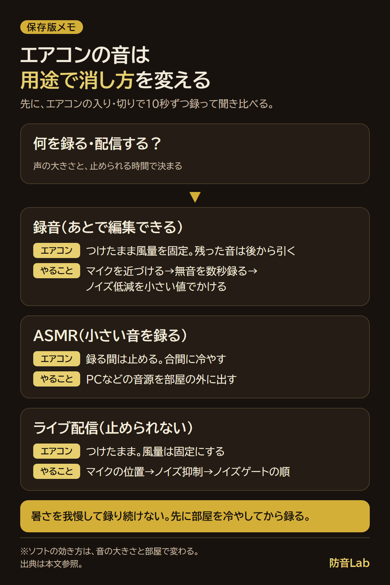

<RegionBanner />

エアコンの音がマイクに入るときの対策は、録音・ASMR・ライブ配信の用途で変わります。

録音は、マイクの位置を直して、残りを後からノイズ除去で引きます。

ASMRは、録る間だけエアコンを止めて、PCなどの音源を部屋の外に出します。

ライブ配信は、エアコンのような一定の音なら、配信ソフトのノイズ抑制で減らしやすいです。

私はふだん収録をせず、イヤホンでASMRや動画を聴きながら眠ることがある、聞く側です。

試した感想ではなく、調べた公式の説明と計算で整理します。

## エアコンの音がマイクに入るときの対策は用途で決まる

エアコンの音への対策は、録音は「位置を直して後から引く」、ASMRは「録る間は止める」、ライブ配信は「止めずに減らす」です。

3つの用途では、エアコンを止められる時間と、声の大きさが違います。

| 用途 | エアコン | PC・ファン | ソフト | 許せる残り方 |
| :--- | :--- | :--- | :--- | :--- |
| 録音 | つけたまま、風量を固定する | マイクから離す | マイクを近づけて、後からノイズ低減 | 小さい値で減らして、声が変わらない範囲 |
| ASMR | 録る間だけ止める | 部屋の外に出す | ノイズ除去に頼りすぎない | 残さない（声との差が小さいと除去が効きにくい） |
| ライブ配信 | 止めずに、風量を固定する | マイクから離す | ノイズ抑制とゲート | 声がこもらない範囲で小さくなればよい |

用途ごとのやることを、保存して見返せる1枚にまとめました。

どの用途でも、最初にやるのは、エアコンの入り・切りで10秒ずつ録って聞き比べることです。

## エアコンの音は「一定の音」だから配信では減らしやすい

エアコンの音は、風量が変わらないあいだは一定の背景音なので、ノイズ除去が見分けて減らしやすい音です。

Audacityの[ノイズ低減の説明](https://manual.audacityteam.org/man/noise_reduction.html)は、ハム・ヒス・ファン音のような一定の背景音を減らせるとしています。交通や観客のような不規則な音には向かないとも書いています。

OBSの[ノイズ抑制フィルターの説明](https://obsproject.com/kb/noise-suppression-filter)は、軽い背景ノイズやホワイトノイズを減らすのに使えるとしています。PCのファン音のような環境音には、よく効くことがあると書いています。

どちらも、エアコンの音を名指しした説明ではありません。

ただ、風量が変わらないあいだのエアコンの音も「一定の音」なので、同じ考え方で試せます。

| | 消しやすい音 | 消しにくい音 |
| :--- | :--- | :--- |
| 性質 | 一定の背景音 | 不規則な音、変わる音 |
| 例 | エアコンの「サー」、PCのファン音、ハム、ヒス | 風量が切り替わる瞬間、車の音、人の声 |
| 条件 | ノイズだけの区間がある | ノイズが大きい、声とあまり差がない |

Audacityの説明では、ノイズが大きい、変わる、声とあまり差がない場合は、うまく消せないことがあります。かけると、多少のひずみも出ます。

OBSも、大量の背景ノイズ（騒がしい部屋）には、一般に効きにくいとしています。

エアコンの「サー」は、広い帯域に散らばる音です。特定の周波数を切るだけでは消えません。低い「ブーン」は、低音を切る設定で減らせることがあります。

### 仕様表の dB は、マイクで聞こえる大きさではない

エアコンの仕様表の dB は、決まった条件で測った値で、あなたのマイクの位置で測った値ではありません。

6畳用の室内機を2つ例にします。

- <strong>パナソニック CS-J223DS（冷房2.2kW）</strong> : 冷房59dB、暖房60dB。[仕様表](https://panasonic.jp/aircon/p-db/CS-J223DS_spec.html)の表記は「運転音（音響レベル）」で、メーカーの仕様表の値です
- <strong>三菱電機 MSZ-AXV2525（室内機）</strong> : 強ノッチ運転で冷房63dB、暖房64dB。[メーカーの資料](https://dl.mitsubishielectric.co.jp/dl/ldg/wink/ssl/wink_doc/m_contents/wink/S_TEC/mszaxv2525-in-nc.pdf)にある、A特性音響パワーレベル（JIS C 9612:2013）の参考値です

音響パワーレベルは、機械が出す音そのものの大きさです。

マイクの位置で測る dB とは、物差しが違います。

マイクに届く大きさは、距離と部屋で変わるので、「60dBだから会話と同じ大きさ」とは読み替えられません。

風量を「自動」から固定にすると、運転中の音の変化が減ることが多いです。機種で違うので、取扱説明書で確かめます。

## 録音｜マイクを近づけて、残りを後から引く

録音は、マイクを近づけて声を大きく入れ、残ったエアコンの音を、後からノイズ低減で引きます。

手順は5つです。

1. <strong>入り・切りで10秒ずつ録る</strong> : エアコンの音が、どのくらい入っているかを聞き比べます
2. <strong>マイクを半分の距離にする</strong> : 口とマイクを20cmから10cmにすると、声は計算上、約6dB大きく入ります（20×log10(2)＝約6dB）。その分だけ感度を下げると、離れたエアコンの音は、声に対して約6dB小さくなります。反射のない場所の計算なので、部屋では差が小さくなります
3. <strong>マイクの向きを確かめる</strong> : マイクの説明書で、音を拾いにくい向きを確かめて、そこをエアコンに向けます
4. <strong>録音の頭に無音を数秒残す</strong> : ノイズだけの区間がないと、Audacityのノイズ低減が使えません
5. <strong>ノイズ低減を小さい値でかける</strong> : 初期設定の低減量は6dBです。許せる範囲まで減る、いちばん小さい値を使います

強くかけるほど、ひずみが出ます。

マイクを近づけても、部屋の響きごと入る場面は残ります。

「吸音リフレクションフィルター」は、エアコンの音を消す道具ではなく、部屋からの跳ね返りを減らす道具です。

<AffiliateCard slug="reflection-filter" />

エアコンの音は、1から5の順で減らします。リフレクションフィルターは、そのあとに残る響きの対策です。

## ASMR｜録る間は止め、音源を部屋の外に出す

ASMRは、ささやき声が小さいので、録る間はエアコンを止めて、PCなどの音源を部屋の外に出します。

ささやき声は約30dB、ふつうの会話は約60dBです。声が小さいと、声とエアコンの音の差が小さくなります。

Audacityの説明では、ノイズが声とあまり差がないと、ノイズ低減はうまくいかないことがあります。止められるなら、止めて録るほうが、後から直す作業が減ります。

夏や冬は、次の順で進めます。

1. 先に部屋を冷やす（暖める）
2. エアコンを止めて録る
3. 合間に、エアコンをつけて部屋を戻す

静けさの目標値は、ASMRならNC-20以下、ゲーム実況ならNC-30前後が、自サイトの目安です。表と測り方は、[暗騒音の目安はNC値で決める](/ja/knowledge/report-japan-asmr-vtuber-streaming-studio-standard/)にまとめています。

外の音をどう減らすかは、[ASMR収録の部屋づくり](/ja/creator/asmr-external-noise-elimination/)で扱っています。

## ライブ配信｜止めずに、ノイズ抑制とゲートで減らす

ライブ配信は、エアコンを止めずに、OBSのノイズ抑制とノイズゲートで減らします。

順番は、マイクの位置、ノイズ抑制、ノイズゲートです。

- <strong>マイクの位置</strong> : 録音の節と同じく、近づけて、声を大きく入れます
- <strong>ノイズ抑制</strong> : 「RNNoise」は音質が高く、CPUを多く使います。「Speex」は、強さを調整できます。「NVIDIA Noise Removal」は、NVIDIAの追加ソフトのインストールが必要です
- <strong>ノイズゲート</strong> : 話していない間の背景ノイズを切ります。閉じる値はノイズより上、開く値は声より少し下に合わせます。初期値は、閉じる−32dB、開く−26dBです

NVIDIA Broadcastの要件は、[公式の案内](https://www.nvidia.com/ja-jp/geforce/guides/broadcast-app-setup-guide/)で、GeForce RTX 2060以上、RAM 8GB以上です。

ノイズゲートは、話していない間だけ切ります。話している間のエアコンの音は、ゲートでは減りません。

ノイズ抑制は、強くかけるほど声の質も変わりやすいので、小さい設定から試します。

OBSの手順は、[ノイズ抑制フィルター](https://obsproject.com/kb/noise-suppression-filter)と[ノイズゲート](https://obsproject.com/kb/noise-gate-filter)の公式の説明に沿っています。

PCのファン音が原因のときは、[配信のマイクノイズはPC本体が原因？](/ja/creator/streaming-pc-fan-noise-mic/)で切り分けます。

配信の音の直し方を、優先順位で見たいときは、[配信初心者がカメラより先に直すべき音質](/ja/creator/streaming-audio-first-low-budget/)が参考になります。

## 防音室でエアコンを止められない夏はどうする？

防音室に入れても、室内の機械の音は減りません。夏は、PCを外に出して、先に部屋を冷やし、合間に冷やします。

防音室は熱がこもりやすく、人の発熱は安静時で約100W、PCも熱源です。

0.5〜1畳の小型ブースは、エアコンを置く場所がないことが多いです。PCを外に出して、親部屋を冷やしておきます。

暑さを我慢して録り続けず、体調に不安があるときは、録音を止めて休みます。

防音室の空調は、[防音室のエアコン選びと静音化](/ja/soundproof-room/proofroom-aircondition-select/)で扱っています。

小型ブースの排熱は、[防音室の格安モデルは夏に暑い？](/ja/soundproof-room/budget-soundproof-booth-comparison/)で比べています。

## よくある質問

### ホワイトノイズとエアコンの音は同じ？

同じではありませんが、どちらも広い帯域に散らばる音です。

このため、特定の周波数を切るだけでは、エアコンの「サー」は消えません。

### エアコンの設定で音を小さくできる？

風量を下げる、風量を固定する、の2つを先に試します。

音の大きさは機種で違うので、値は機種の公表値を確かめます。

### 「ジー」という音も同じ直し方？

「ジー」という音は、エアコンではなく、電源や配線が原因のことがあります。

その場合は、ノイズ除去ではなく、配線を見直します。原因の探し方は、[アース線でノイズは減る？](/ja/knowledge/ground-loop-noise-basics/)にまとめています。

## まとめ｜まず入り・切りで10秒ずつ録る

- 録音は、マイクを半分の距離に近づけて、残りを後からノイズ低減で小さい値で引きます
- ASMRは、先に部屋を冷やして、録る間だけ止めます
- ライブ配信は、止めずに、ノイズ抑制とノイズゲートで減らします

次にやることは1つです。

エアコンを入れて10秒、切って10秒ずつ録り、聞き比べます。

私なら、聞き比べてから、マイクの位置とノイズ除去の強さを決めます。
