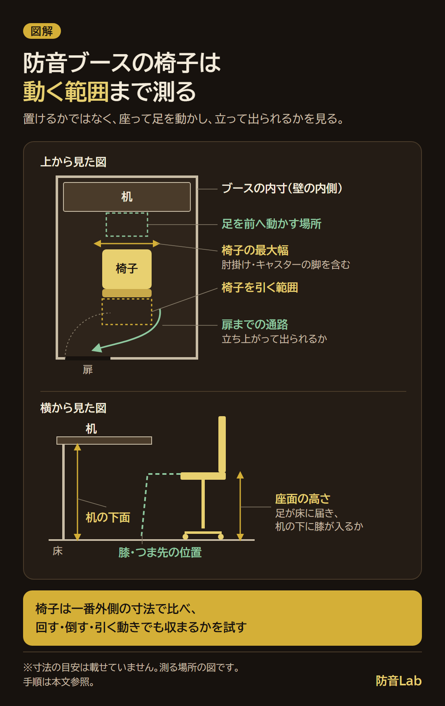

<RegionBanner />

防音ブースの椅子は、内寸に収まり、足を動かして立ち上がれるものを選びます。

寸法を比べるときは、仕様表の全幅・奥行きに加え、座って椅子を引く場所まで確かめます。

採寸する項目と動作の試し方を整理し、長く座るときの注意は厚労省の資料に沿ってまとめました。

ブース本体も選んでいる人は、[組み立て式防音室の用途別比較](/ja/soundproof-room/assembly-type-comparison/)から候補を絞れます。

## 防音ブースの椅子は内寸と動くときの寸法で選ぶ

<strong>床に椅子を置けることと、座って使えることは別に確かめます。</strong>

畳数やブースの外寸だけで判断せず、内側の幅・奥行きと、机を置いた後の空きを測ります。

椅子は座面だけでなく、肘掛けやキャスターを含めた一番外側までが比較の対象です。

| 確かめる場所 | ブース・机側で測るところ | 椅子側で照合するところ |
| :--- | :--- | :--- |
| 横幅 | 壁や机の脚に挟まれた空き幅 | 肘掛け・脚部を含む最大幅 |
| 奥行き | 机の前端から背後の壁まで | 背もたれ・脚部を含む奥行きと、椅子を引く範囲 |
| 足元 | 机の下から前の壁までの空間 | 座ったときの膝・つま先の位置 |
| 高さ | 机の下面と床の間 | 座面の高さ調整範囲と肘掛けの高さ |
| 搬入・出入り | 扉を開けたときの通路と開口部 | 搬入時の幅と、立ち上がるときに必要な場所 |

全幅が同じ椅子でも、座面よりキャスターの脚が外へ張り出すものがあります。

回転させるときや背もたれを倒すときは、正面向きで収まっていても壁に当たる場合があります。

<strong>使う機能を動かした状態で収まるか</strong>を、寸法図や実物で確認します。

## 防音ブースが狭いときは足元と出入りを先に試す

机に向かって座れたら、次はつま先を前へ出し、かかとを上げ下げできるかを試します。

机の下にPCや収納箱がある人は、それらを含めて足の置き場を確かめます。

脚を伸ばせる奥行きは体格や座り方で変わるので、一律の寸法を足すより自分の動作で確認します。

購入前なら、ブースの内寸に合わせた範囲を自室の床に紙などで示すと配置を試せます。

1. 机と椅子を置き、普段キーボードやマウスを使う位置で座ります。
2. 足を前後に動かし、机の脚・収納・前の壁に当たるかを確かめます。
3. 椅子を引いて立ち、扉の前まで移動する動作を試します。
4. 背もたれや肘掛けを動かし、壁や机との接触を確かめます。

床に示すのは壁の位置なので、背もたれがその線を越えていないかも見ます。

これは当サイトが提案する配置確認の手順で、座り心地や長時間の使いやすさを保証するものではありません。

机やケーブルの配置も見直す場合は、[防音室のケーブル配線と電源の整理](/ja/creator/soundproof-booth-cable-management/)も確認できます。

## 防音室の椅子でおすすめの形は？使い方に合わせて比べる

狭い防音室で椅子を選ぶなら、使いたい機能と、その機能に必要な場所を並べて比べます。

今の椅子で採寸と動作の確認ができれば、買い替えずに使えるかも判断できます。

| 使い方・困っていること | 候補になる形や機能 | 選ぶ前に確かめること |
| :--- | :--- | :--- |
| 大きな背もたれが壁に当たる | 背もたれの張り出しが小さい椅子 | 座面の大きさが自分の体に合うか |
| 肘掛けが机や出入口に当たる | 肘掛けの高さ調整・跳ね上げができる椅子 | 動かした後も机の下へ入るか |
| 床の上で椅子を引くのが難しい | 脚部が小さい椅子や固定脚の椅子 | 立ち上がるときに動かせるか |
| 背もたれを倒して休みたい | リクライニングできる椅子 | 倒した背もたれと前へ出した足が収まるか |

「ゲーミングチェア」「オフィスチェア」という分類だけで、収まるかは決められません。

オットマンを使う人は、展開した状態の全長と、扉への通路が残るかも確認します。

### 座面の高さとキャスターも床に合わせる

座面の高さは、足を床に置けるかと、机に腕を置いて作業できるかを合わせて試します。

座面の奥行きも、背もたれを使って座ったときに膝裏へ当たらないかを確かめます。

椅子の試座ができるなら、使う机の高さを控えて持っていくと比較できます。

キャスターは、ブースの床材に使える種類かを椅子とブース双方の取扱説明で確認します。

床を保護するマットを敷く場合も、扉の開閉やキャスターの動きを妨げないかを見ます。

## 長く座るときの注意は厚労省の資料を参考にする

厚労省は、同じ姿勢で長く座るときの注意として、足の運動や水分補給を挙げています。

出典は[「エコノミークラス症候群 予防のために」](https://www.mhlw.go.jp/file/06-Seisakujouhou-10600000-Daijinkanboukouseikagakuka/0000121877_1.pdf)と[「深部静脈血栓症／肺塞栓症の予防Q&A」](https://www.mhlw.go.jp/bunya/kenkou/hoken-sidou/dl/disaster-02.pdf)です。

両資料は災害時や車中などの窮屈な姿勢を念頭にした案内で、配信者の危険度を示した資料ではありません。

予防の例として示されているのは、次のような動作です。

- 足や足の指をこまめに動かす
- かかとを上げ下げする
- 歩く
- こまめに水分をとる

配信の待機画面やゲームの区切りを、席を立つきっかけにしておく方法もあります。

<strong>片方の膝から下の赤み・腫れ・痛みが出たら、急いで医療機関を受診してください。</strong>

厚労省のQ&Aは、胸の痛み・呼吸困難・失神も危険な症状として挙げています。

椅子の買い替えで解決すると考えず、持病や症状がある人は医師に相談してください。

## 購入前に確認すること

- <strong>寸法</strong> : 内寸と、机・肘掛け・脚部を含めた配置を照合できたか
- <strong>動作</strong> : 足を動かし、椅子を引いて立ち、扉まで移動できたか
- <strong>適合</strong> : 座面の高さと奥行き、キャスターが体格・机・床に合うか

椅子や荷物で換気口をふさがないことも、配置時に確認します。

空気の入れ替えは、[防音室の換気・空調設備を選ぶ際の確認点](/ja/soundproof-room/proofroom-aircondition-select/)へ整理を分けています。

まずは今の椅子に座り、机の前から立ち上がるまでの動きを、想定する内寸の中で試してみてください。
