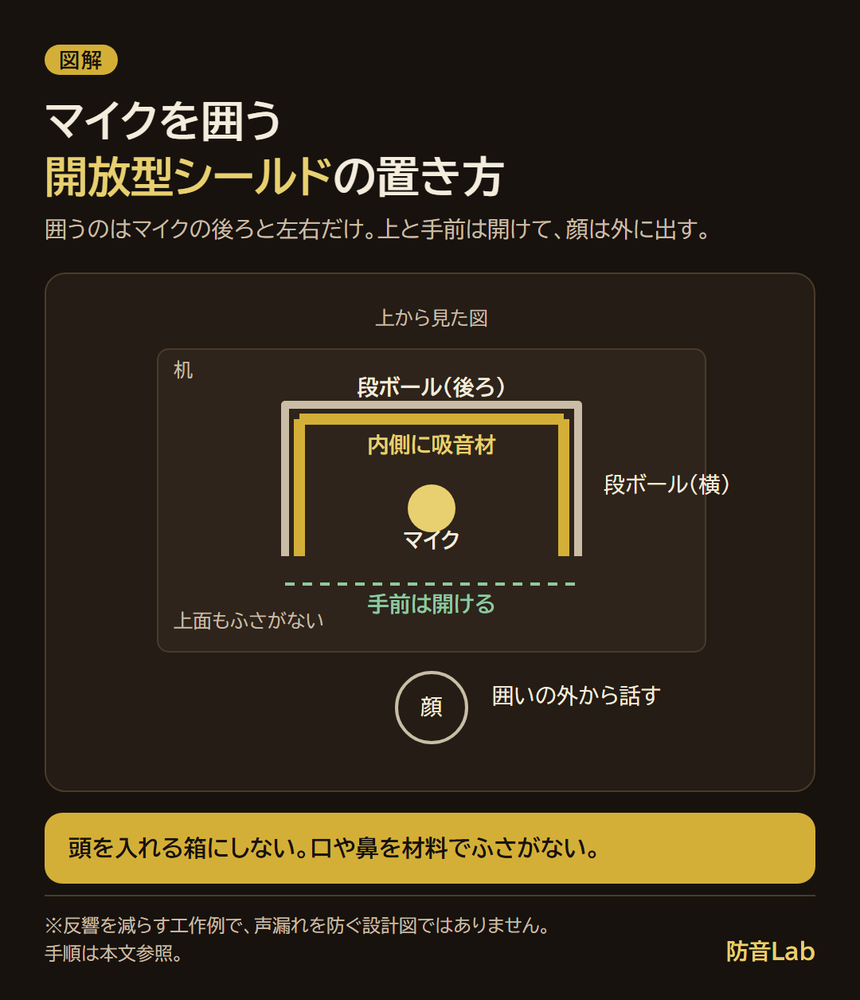

<RegionBanner />

防音マスク自作で声漏れがどれだけ減るか、安全に何分使えるかは、作り方だけでは決まりません。

私は厚生労働省の換気資料と録音機器メーカーの説明を確認し、顔を囲う方法と反響を減らす方法を分けて考えました。

ここでは密閉を避けたシールドの作り方と、録音音質・室外への声漏れを別々に確かめる手順をまとめます。

吸音と遮音の違いは、[DIY防音のコツと材料の役割](/ja/diy/diy-soundproofing-tips/)でも整理しています。

## 防音マスク自作でできることと、確かめられない効果

<strong>口元を覆う防音マスクと、マイク周りの反響を減らすシールドは、目的が異なります。</strong>

録音がクリアになっても、隣室に届く声が同じように小さくなるとは限りません。

| 方法 | 狙うこと | 判断できないこと・注意点 |
| :--- | :--- | :--- |
| 口元を囲う自作マスク | 声が周囲へ広がるのを抑えること | 自作品の低減量・呼吸のしやすさ・安全な使用時間は未確認 |
| 顔を覆わないマイクシールド | マイクに戻る反響を減らすこと | 部屋の外への音漏れを防ぐ性能は保証できない |
| 頭を箱や布団で囲う方法 | 声や反響を囲いの中に収めること | 呼吸する空間を囲うため、換気と安全性の確認が要る |

市販のリフレクションフィルターも、メーカーは<strong>壁などで反射してマイクに戻る音の収音を抑える</strong>仕組みとして説明しています。

出典：[sE Electronics「RF-X」の仕組み説明](https://seelectronics.com/products/rf-x/)（確認日：2026-11-08）。下の自作例に、市販品と同じ性能があるという意味ではありません。

「何dB下がるか」「夜でも叫べるか」を裏付ける、この自作例の測定データはありません。

声漏れへの対策を優先する場合は、[予算別の防音室の選び方](/ja/soundproof-room/soundproof-room-budget-selection-guide/)と比較して、部屋側で対処する範囲も考えてください。

## 防音マスクの作り方を選ぶ前に、酸欠・二酸化炭素に注意する

<strong>頭や口・鼻を密閉する自作品について、安全に使える条件は確認できませんでした。</strong>

小穴を開けたり、一定時間ごとに外したりすれば安全になる、とも言い切れません。

酸欠と二酸化炭素の蓄積は、分けて考えます。

| 確認した資料 | 公表されている内容 | 自作マスクへの当てはめ方 |
| :--- | :--- | :--- |
| 厚生労働省「酸素欠乏症等防止規則」第2条 | 酸素濃度18％未満を酸素欠乏と定義 | 労働現場の定義であり、自作マスクの安全性を認める値ではない |
| 厚生労働省「建築物環境衛生管理基準」 | 対象となる建築物の居室で、二酸化炭素は1,000ppm以下 | 室内環境の管理基準であり、マスク内の安全判定や使用時間の根拠にはできない |

出典：[酸素欠乏症等防止規則](https://www.mhlw.go.jp/web/t_doc?dataId=74105000&dataType=0&pageNo=1)、[建築物環境衛生管理基準について](https://www.mhlw.go.jp/bunya/kenkou/seikatsu-eisei10/index.html)（確認日：2026-11-08）。

二酸化炭素濃度だけを見ても、酸素濃度は確認できません。

何分以内なら安全に使える、と示せる根拠は確認できませんでした。

口や鼻を材料で塞ぐこと、頭を箱や布団で囲って使うことは避けてください。

息苦しさや頭痛を感じたら使用を中止し、外気を吸える場所へ移ります。症状が続く場合は医療機関に相談してください。

## 顔を覆わないマイクシールドの材料と作り方

反響の軽減を試すなら、顔に装着せず、<strong>机上でマイクの後ろ・左右に置く開放型</strong>にします。

マスクの代わりに、反響の軽減だけを試す工作例です。声漏れを防ぐマスクの設計図ではありません。

### 用意する材料

| 材料・道具 | 選び方・用途 |
| :--- | :--- |
| 段ボール板 | マイクの後ろと左右を囲えるもの。頭を入れる箱にはしない |
| 室内用の吸音材 | メーカーが用途・取扱方法を案内しているもの。粉や繊維が落ちる材料は口元で使わない |
| テープ・接着材 | 吸音材の説明に合うもの。接着後は指定どおり乾燥させる |
| カッター・定規・下敷き | 板の切り出し用。切断は機材や体から離れた作業台で行う |

材料費は、手元の材料と購入する吸音材で変わります。購入前に必要量と送料を含む合計を確かめてください。

### 組み立てる順番

1. 段ボールをマイクの後方と左右に立つU字形に折ります。上面と、話す人の側は開けておきます。
2. 内側に吸音材を固定します。マイクの収音部やケーブルに触れず、材料が落ちないようにします。
3. 平らな机に置き、倒れないことを確かめます。マイクスタンドへ無理に重さを掛けない配置にします。
4. 顔を囲いの外に保ち、マイクの取扱説明書に沿って距離と向きを調整します。
5. 同じ声量・マイク設定で、シールドあり・なしの録音を比べます。こもる場合は囲いの幅や位置を変えます。

段ボールや吸音材は、暖房器具・照明などの熱源から離して使います。

## 防音マスクをゲーム用に自作するときの音漏れチェック

ゲーム中の叫び声が家族や隣室に届くかは、<strong>配信に乗る音と、部屋の外で聞こえる音を分けて</strong>確かめます。

| 確かめる場所 | 比較する方法 | 分かること |
| :--- | :--- | :--- |
| マイクの録音 | 距離・入力設定・声量をそろえ、シールドの有無を比較 | 反響や声のこもりの変化 |
| 家族のいる部屋など | 協力者に同じ場所で聞いてもらい、普段の会話音量で比較 | その場所・声量での聞こえ方 |
| 配信中の声量 | ヘッドホン音量やマイク位置を見直す | 小さな声でも会話が成立する設定を探せる |

夜間に大声を出して試したり、共有廊下で長時間確認したりすると、周囲の迷惑になります。

普段の会話で漏れるなら、叫び声まで自作品で抑えられるとは考えず、時間帯や部屋側の対策を見直します。

ノイズゲートや入力音量の調整は、マイクへ入る音に作用します。口から部屋へ出る声そのものを小さくする機能ではありません。

機材に入る音の切り分けは、[配信マイクのノイズ・反響を直す手順](/ja/creator/streaming-pc-fan-noise-mic/)も参考になります。

## まとめ：自作は反響と声漏れを分けて判断する

私なら、顔を覆わないシールドで録音を比べ、室外への声漏れが残るなら別の対策に切り替えます。

録音音質の変化だけでは、家族や隣人に届く声の小ささを判断できないからです。

防音マスクの自作に、保証できる低減量や使用時間はありません。呼吸する空間を囲わず、目的に合う方法から選んでください。
