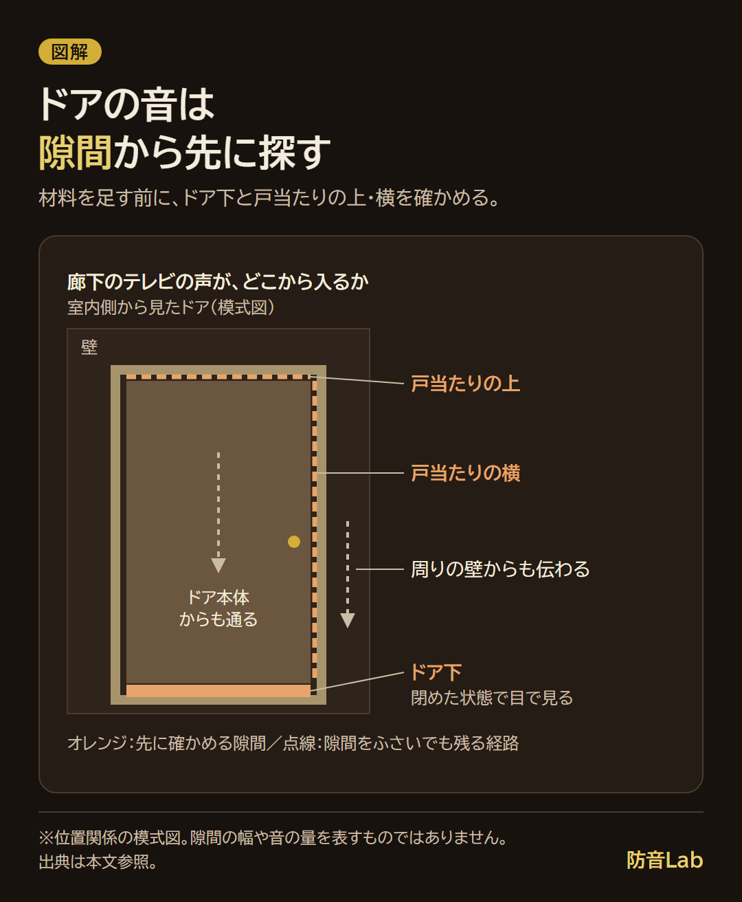
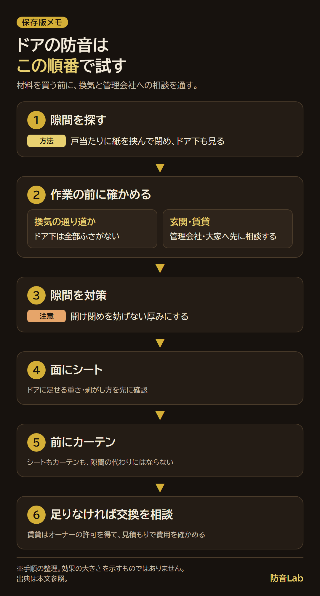

<RegionBanner />

ドアの防音は、まずドア下と戸当たりの隙間を確かめ、ふさいでよい場所から対策します。

販売元の説明でも、隙間テープは厚ければよいわけではなく、ドアの開け閉めを妨げない厚さを選ぶよう案内されています。

隙間の見つけ方とテープの選び方から、シート・カーテン・交換まで、賃貸で試す順番を整理します。

## ドアの防音は、まず隙間をふさぐ

夜、廊下側のドアの下から、家族が見ているテレビの声が入ってくる。

閉めたドアの下を見ると、指が入るほどの隙間がある、という場面を考えてみてください。

音はドア下だけでなく、ドアが閉まったときに枠と触れる「戸当たり」の上・横からも通ります。

ドア本体や周囲の壁を通る音もあるため、隙間をふさいでも音がなくなるわけではありません。

<strong>このうち、材料を足す前に確かめやすいのが隙間です。</strong>

私は音漏れが気になったことはありませんが、冷暖房の効きを考えて、部屋のドアの隙間はふさいでいます。

ごく普通の軽い木製ドアなので、隙間の対策とドア本体の防音は分けて考えています。

ドア以外も含めた対策は、[DIY防音のコツと材料の役割](/ja/diy/diy-soundproofing-tips/)で整理しています。

## ドアの隙間テープの選び方と貼り方

### 1. 隙間の場所と幅を測る

戸当たりに紙や名刺を挟み、ゆっくりドアを閉めて、紙が抵抗なく抜ける場所を探します。

上と横を少しずつ場所を変えて調べ、ドア下は閉めた状態で隙間を見ます。

紙が抜けるかどうかは隙間を探す手がかりで、正確な寸法や遮音性能の測定ではありません。

買う前に、次をメモして売り場へ持っていくと選びやすくなります。

- 紙や名刺が何枚入るか、測れる場所は隙間の幅
- ドアと枠が当たる面の幅
- 貼りたい場所の長さと、開け閉めでこすれる場所

### 2. 場所に合うテープを選ぶ

戸当たりには、ドアを閉めたときに押しつぶされるスポンジ・ゴム系を候補にします。

ドア下はドア下用の隙間ふさぎやブラシを候補にし、床に引っかからないかを見ます。

商品例は、東京防音の遮音テープTP-25です。

[販売ページ](https://item.rakuten.co.jp/tokyobouon/tp-25/)では、厚み2.5mm・幅15mm・長さ2mで、ハサミで切れると案内されています（2026年11月14日確認）。

これは商品の寸法で、どのドアにも合う推奨寸法ではありません。

### 3. 厚みの選び方と貼り方

私がホームセンターで選んだときは、種類や厚みが多く、自宅のドアに貼れるかを売り場で考えることになりました。

厚みのあるテープで、ドアの留め具が浮くほどになったこともあります。

TP-25の販売元は、厚みの目安を「開け閉めに少し力が要るくらい」と説明しています。

厚すぎると閉まりにくくなり、避難の妨げになるおそれがあるという注意もあります。

貼るときは、次の順で進めます。

1. 貼る面の汚れや油分を、ドアの仕上げを傷めない方法で落とす
2. 商品の説明に従い、閉めたときにドアが当たる面へ短い範囲から貼る
3. ドアをゆっくり閉め、留め具がかかるか、無理なく開けられるか確かめる
4. 問題がなければ残りを貼り、開け閉めをもう一度確かめる

<strong>強く押さないと閉まらないなら、厚みや貼る位置を見直します。</strong>

隙間をふさいで何dB下がるかは、このドアの条件に使える公表値がなく、数字では示せません。

壁やドア本体を通る音が残ることも、次の材料を買う前に確かめます。

## 100均・ホームセンターでそろうもの

店名より、使う場所から品目を絞ると迷いにくくなります。

| 使う場所 | 探す品目 | 売り場で確かめること |
| :-- | :-- | :-- |
| ドア下 | ドア下用の隙間ふさぎ・ブラシ | 床をこすらず、必要な換気を妨げないか |
| 戸当たり | スポンジ・ゴム系の隙間テープ | 厚み、幅、押したときのつぶれ方 |
| ドア面 | 防音シートと固定用品 | ドアに足せる重さ、剥がし方、固定方法 |

隙間テープは100均とホームセンターで見たことがあります。

そのときはホームセンターのほうが種類と厚みを選べましたが、店ごとの品ぞろえは購入前に確かめてください。

価格を確認できた材料がないため、この表に金額は載せていません。

## ドアに防音シートを貼る効果と、賃貸で剥がせる貼り方

防音シートは、隙間ではなくドアの面に重さを足す対策です。

中が空洞の軽い室内ドアでは、この違いを意識して選びます。

ただし、重さを足すと蝶番や固定部分にも負担がかかるため、ドアに貼ってよいかを先に確認します。

賃貸では、養生テープを下地にする方法でも、塗装や表面材が剥がれない保証はありません。

管理会社に固定方法と原状回復の扱いを聞き、目立たない場所で剥がせるかを確かめてから進めます。

下地を保護する考え方は、[遮音シートを壁に貼る方法](/ja/diy/sound-insulation-sheet-wall-install/)を参照してください。

壁用の施工手順を、そのまま動くドアへ流用しないようにします。

## ドア用の防音カーテンが効く場面

隙間を対策したうえで、ドアの前にもう一枚足すのがカーテンです。

突っ張り棒を使う場合も、生地の重さに耐えられるか、ドアの開閉や避難の邪魔にならないかを見ます。

ドアと生地の周囲が開いたままなら、そこから音が回るため、カーテンだけで隙間の代わりにはなりません。

ニトリを含む商品の表示の見方やドア用商品の比較は、[防音カーテンのおすすめと選ぶ基準](/ja/diy/soundproof-curtain-recommend/)にまとめています。

## 引き戸の防音

引き戸は、戸先、戸が重なる「召し合わせ」、下のレールまわりを順に見ます。

動くために必要な隙間もあるので、開き戸と同じ厚みのテープを一律に貼らないようにします。

短い範囲で試し、最後まで閉まるか、引っかからず動くかを確認してください。

建て付け自体が悪いときは、賃貸なら管理会社へ相談します。

## 玄関ドア・トイレのドアの場合

<strong>玄関ドアは、材料を買う前に管理会社・大家へ相談します。</strong>

[日本賃貸住宅管理協会の解説](https://kurashitokanri.jpm.jp/posts/entrance-door-gap-measures)では、賃貸の玄関ドアを入居者が自分で修理・交換できないとされています。

分譲では、[マンション標準管理規約の第7条](https://www.mlit.go.jp/kisha/kisha04/07/070123_3/03-1.pdf)が、玄関扉の専有部分を錠と内部塗装部分に限っています。

それ以外は共用部分の扱いですが、実際は各マンションの管理規約で確認します（両資料は2026年11月14日確認）。

トイレのドア下などは、空気の通り道になっている場合があります。

換気の説明は[三井住友トラスト不動産の資料](https://smtrc.jp/useful/knowledge/iedukuri/2022_07.html)を参照しています（2026年11月14日確認）。

24時間換気のある住宅では、居室の給気口からトイレ・浴室などへ空気が流れます。

隙間を全部ふさぐ前に、その経路を確認してください。

対策は「隙間 → 面にシート → 前にカーテン → 交換」の順に考え、賃貸の許可と換気を途中で確かめます。

## それでも足りないとき：防音ドアへの交換

ドア本体を通る音が残るなら、材料を重ね続ける前に交換の見積もりを取ります。

費用はドアの種類、枠ごと替えるか、必要な工事で変わるので、確かめた金額がない状態では幅を示せません。

持ち家でも交換できる範囲を確認し、賃貸ではオーナーの許可を得て相談します。

交換時にドア以外も確認する理由は、[防音室のドア・窓が弱点になる仕組み](/ja/soundproof-room/door-window-weak-points/)も参考になります。

規約や工事の判断は、管理会社・管理組合や専門家に確認してください。

## よくある質問（FAQ）

### 隙間テープだけで防音効果はありますか？

隙間を通る音への対策になりますが、ドア本体や壁を通る音は残ります。

まず隙間の有無を確かめ、貼ったあとも残る音から次の対策を選びます。

### ドアの隙間テープは賃貸でも使えますか？

貼ってよいか、剥がし跡をどう扱うかを管理会社に確認してから使います。

「剥がせる」と書かれたテープでも、ドアの仕上げとの相性を確かめます。

### ドアの下の隙間はふさいでいいですか？

換気の空気が通る隙間なら、そのまま全部をふさぐことは避けます。

換気経路が分からないときは、管理会社や施工業者へ先に確認してください。

## まとめと次にやること

ドアの防音は、隙間を探し、閉まり方と換気を確認してから材料を選ぶ順番です。

シートやカーテンは隙間の代わりにならず、交換の費用も条件を伝えた見積もりで確かめます。

今日やることは、<strong>ドアを閉めて、戸当たりに紙を挟み、ドア下と合わせて隙間を探すこと</strong>です。
