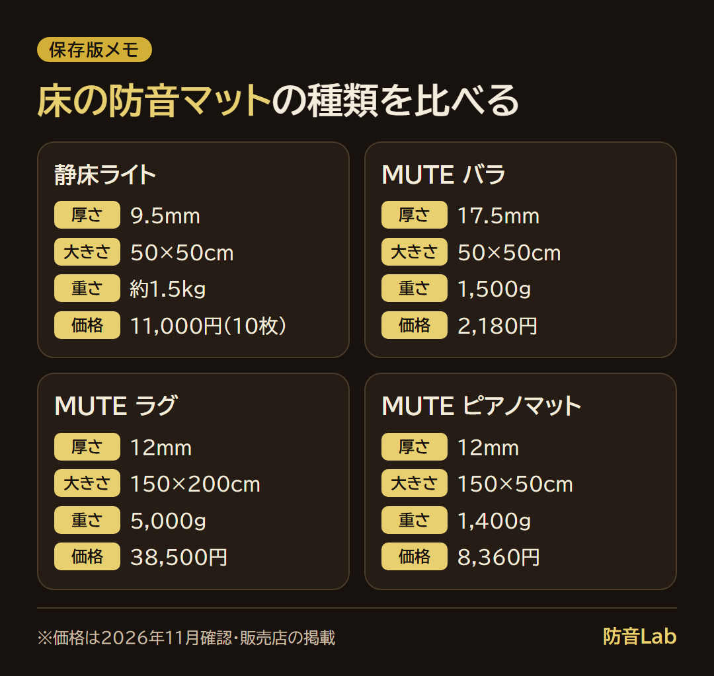
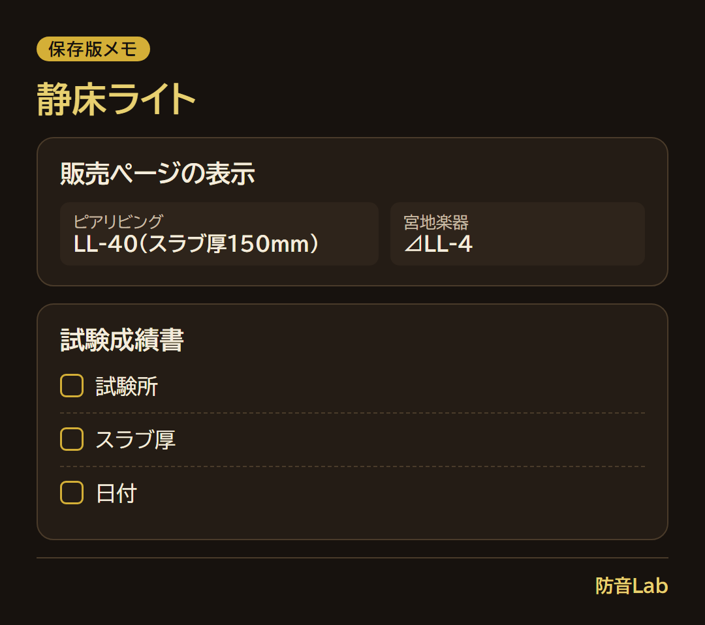

<RegionBanner />

床の防音マットは、スリッパのパタパタや物を落とすコツンという軽い音を減らすために選びます。

子どもが跳ぶ、かかとで歩くドンという重い音は、マットでは減りにくい音です。

私が調べて分かったのは、マットの遮音表示が軽い音の試験で決まることです。

日本建築総合試験所と東京都立産業技術研究センターの資料で確かめました。

## 床の防音マットの選び方は、音の種類・表示・置き方の3点で決める

選ぶ前に決めることは3つです。

- <strong>音の種類</strong> : 軽い音か重い音かを分けます。マットが効くのは軽い音です
- <strong>表示の見方</strong> : ΔLL・LL は、試験の条件つきで見ます
- <strong>置き方</strong> : 賃貸は、接着しない置くだけの物から選び、管理会社に聞きます

軽い音と重い音で、マットの効き方は次のように違います。

| 音の種類 | 試験で再現する音 | 床の防音マットの効き方 |
| :-- | :-- | :-- |
| 軽い音 | ハイヒールの歩行・食器の落下のような軽く硬い音 | 減らせる。マットの遮音表示はこの音の試験 |
| 重い音 | 子どもの飛び跳ねのような重く柔らかい音 | 減りにくい。床のコンクリートの厚みなど、構造の影響が大きい |

出典: 日本建築総合試験所（JIS A 1440-1 の軽量衝撃源・JIS A 1440-2 の重量衝撃源）、東京都立産業技術研究センター、All About の解説（2026年11月に確認）。

軽い音は JIS A 1440-1 のタッピングマシン、重い音は JIS A 1440-2 のバングマシンで測ります。

階下から足音の苦情が来ているなら、[階下から足音の苦情が来たときの対策](/ja/knowledge/vibration-reduction-science/)から読みます。

## 床の防音マットの種類を比べる：タイルカーペット・ラグ・ピアノ用マット

置き敷きの床の防音マットは、タイルカーペット型、ラグ型、ピアノ用マットに分けて比べられます。

| 種類・商品 | 大きさ | 厚さ | 重さ | 1m²あたりの価格 | 遮音の表示 |
| :-- | :-- | :-- | :-- | :-- | :-- |
| 静床ライト（10枚入り） | 50×50cm | 9.5mm | 1枚約1.5kg（1m²で約6kg） | 4,400円（宮地楽器）〜5,590円（ピアリビング） | LL-40（スラブ厚150mm）／⊿LL-4（販売店で別表示） |
| 静床プレミア（8枚入り） | 50×50cm | 12.5mm | 確かめられず | 7,700円（宮地楽器） | ⊿LL-4（販売店の掲載） |
| MUTE 防音専科 バラ | 50×50cm | 17.5mm | 1枚1,500g（1m²で約6kg） | 8,720円（バラ4枚）。8枚入りは1m²分で8,250円 | LL35（ΔLL-6） |
| MUTE ラグタイプ（150×200cm。200×200cm は49,500円） | 3m² | 12mm | 5,000g | 約12,800円（38,500円÷3m²） | LL37 |
| MUTE ピアノマット | 150×50cm（0.75m²） | 12mm | 1,400g | 約11,100円（8,360円÷0.75m²） | LL35（ΔLL-6） |

出典: 宮地楽器、ピアリビング Yahoo!ショッピング店（静床）、LIXIL ストア（MUTE）の掲載。

静床の仕様と価格は販売店の掲載で、メーカーの公表値ではありません。

価格は2026年11月27日の確認で、税込かは確かめられずです。

1m²あたりは4枚分で出しました（静床ライト 11,000円÷10枚×4枚＝4,400円）。

ジョイントマットは、仕様を確かめられた商品がないので、表に入れていません。

### タイルカーペット型（静床ライト・MUTE 防音専科）

タイルカーペット型は、50cm角を1枚ずつ並べる置くだけの型です。

置くだけで、切って敷く範囲を選べるので、まず1m²分（4枚）から試せます。静床ライトなら4枚で4,400円からです。

Amazonの口コミ（51件・星4.4。2026年11月28日に商品ページで確認）では、椅子のキャスターの音が階下に響かなくなった、ウォーキングマシンの音がほとんど伝わらなくなったという声がありました。一方で、色が商品画像と違ったという声もあります（購入者の個人の感想）。

<AffiliateCard slug="floor-mat-shizuyuka-light" />

価格は店で変わるので、遮音の表示と試験の条件を、買う前に商品ページで見比べます。

MUTE のバラは厚さ17.5mmで、静床ライトの9.5mmより厚い製品です。厚さと効き方の関係を示す資料は確かめられず、厚さは表の数字で比べるところまでにします。

### ラグ型・ピアノ用マット（MUTE）

ラグタイプは広い面を1枚で覆う型で、ピアノマットは150×50cmの細長い型です。どちらも LIXIL の MUTE の製品です。

## 防音マットの表示（ΔLL・LL）と厚さの読み方

ΔLL は、実験室で測った周波数帯域ごとの低減量から、床材の軽い音の低減性能を等級にした表記です。

ΔLL は1〜5の5段階で、数字が大きいほど低減性能が高い表示です。

ΔLL-4 は、125Hz帯で10dB、250Hz帯で19dB、500Hz帯で25dB、1kHz帯で29dB、2kHz帯で31dB以上の低減が条件です。

全帯域で満たしたときに、その等級になります。

同じ静床ライトが、販売店により「LL-40（スラブ厚150mm）」「⊿LL-4」と別の表示で載っています。どちらも、試験所や試験日は確かめられませんでした。

販売ページの表示は、次のように読み分けます。

| 販売ページの表示 | 分かること | 分からないこと |
| :-- | :-- | :-- |
| 静床ライト「LL-40（スラブ厚150mm）」（ピアリビング） | 軽い音の試験で、スラブ厚150mmの条件 | 試験所名・試験日 |
| 静床「⊿LL-4」（宮地楽器） | ΔLL の等級が4という表示 | スラブ厚・試験所名 |
| MUTE「LL35（ΔLL-6）」 | LL の値と ΔLL の表示が併記されている | ΔLL は5段階で、6の段階はない。何の試験の表示かは確かめられず |

出典: 日本建築総合試験所の ΔL 等級の解説、販売店と LIXIL ストアの掲載（2026年11月に確認）。

アトピッコハウスの「フロアタイル応援マット」は、「LL-40（ΔLL(Ⅰ)-5）」と併記しながら、「試験結果の遮音性能が担保されているという訳ではありません」と書いています。

数字だけで商品を比べず、<strong>試験所・スラブ厚・日付</strong>のある試験成績書があるかを見ます。確かめた販売店（宮地楽器・ピアリビング）のページには、試験成績書は載っていませんでした。

旧表示（L値）との読み替えや、等級の全表は、[床の防音等級の読み方](/ja/knowledge/floor-soundproof-rating/)にまとめています。

## 床の防音対策を賃貸でするときの注意：置くだけ・原状回復・管理会社への聞き方

賃貸では、接着しない置くだけの物から選びます。

原状回復は、入居時への完全な復元ではありません。借主の故意や不注意による損耗などを元に戻すことです。

経年劣化や通常使用による変化まで、借主が負担する必要はないと、北海道庁の解説にあります。

家具の設置によるカーペットなどのへこみは、貸主負担の例として挙がっています。

すでに契約を結んでいる場合は、原則として契約内容に沿った扱いです。

MUTE のページには、置くだけか接着かの記載がありません。製品の施工説明を見てから選びます。

敷く前に、管理会社に次の3点を聞きます。

- 置くだけの敷物を、床に敷いてよいか
- 退去時に、敷物の跡や床の傷みをどう扱うか
- 管理規約や契約書に、床の仕上げ材の定めがあるか

管理規約が関わる分譲の場合は、[床の防音下地は何を敷く？](/ja/diy/floor-soundproof-underlay/)の分譲マンションの項に、確認先をまとめています。

賃貸契約や原状回復の判断は、個別の事情で変わります。迷うときは、管理会社や自治体の相談窓口、専門家に確認してください。

## 運動やデスク下に敷く範囲・枚数・費用の当てはめ

50cm角のタイルは、1枚が0.25m²なので、1m²は4枚です。

| 範囲 | 枚数 | 静床ライト（1枚1,100円） | MUTE バラ（1枚2,180円） | 重さ（1枚1.5kg） |
| :-- | :-- | :-- | :-- | :-- |
| 1m² | 1 ÷ 0.25 ＝ 4枚 | 1,100 × 4 ＝ 4,400円 | 2,180 × 4 ＝ 8,720円 | 1.5 × 4 ＝ 6kg |

出典: 宮地楽器・LIXIL ストアの掲載価格（2026年11月27日確認、税込かは確かめられず）。壁際を切る分の余りは数えていません。

6畳全面の当てはめは、先の下地の記事に計算があります。

私の場合、自宅のトレーニングで、バーピーの前にヨガマットを敷いています。マットなしだと床に響いていると感じたためです。

跳ぶ動きは重い音の側にあたります。ヨガマットで重い音がどれだけ減るかは、数字では確かめていません。

だから私なら、軽い音の対策と重い音の対策を分けて考えます。

跳ぶ動きや足踏みの対策は、[トレッドミルの防音を重ねて考える方法](/ja/diy/treadmill-apartment-soundproofing-layering/)で比べています。

## 防音マットで足りないとき：重い音は床の構造の話

重い音の対策では、床のコンクリートの厚みが重要と、All About の解説にあります。

マットで足りないときは、出す音を変える、管理会社に床の構造を聞く、防振の対策へ進む、の順に考えます。

上の階の足音で悩む側の場合は、[上の階の足音がうるさいときの対処](/ja/soundproof-rental/upstairs-footsteps-noise/)から読みます。

## よくある質問

### 床の防音マットは階下への足音に効きますか？

スリッパや食器の落下のような軽い音には効きます。

子どもの飛び跳ねのような重い音は、床の構造で決まり、マットでは減りにくい音です。

### 防音マットの ΔLL-4 とは何ですか？

床材の軽い音の低減量を5段階（ΔLL-1〜5）で表す等級の4番目です。

125Hz帯の10dBから2kHz帯の31dB以上まで、全帯域で下限を満たした床材です。

### 賃貸で床に防音マットを敷いてよいですか？

契約と管理会社の判断で決まります。置くだけの物でも、敷く前に管理会社に聞きます。家具のへこみは貸主負担の例ですが、契約が優先されます。

### LL-40 と ΔLL-4 は同じですか？

同じと言える資料は確かめられませんでした。同じ静床ライトが、販売店により「LL-40（スラブ厚150mm）」「⊿LL-4」と別の表示で載っています。

試験所・スラブ厚・日付のある試験成績書を見ます。

## まとめと次にやること

- 床の防音マットが減らすのは、主に軽い音です。重い音は床の構造で決まります
- 表示は、LL・ΔLL の数字だけで比べず、試験所・スラブ厚・日付を見ます
- 賃貸は置くだけの物から選び、敷く前に管理会社に聞きます

次にやることは1つです。

<strong>気になる音を軽い音と重い音に分け、軽い音なら1m²（4枚）分から試します。</strong>

私なら、コツンやパタパタが中心なら4枚から、ドンが中心なら、先に床の構造を管理会社に聞きます。

## 出典と確認日（2026年11月に確認）

- [日本建築総合試験所「床材の床衝撃音低減性能（ΔL等級）」](https://www.gbrc.or.jp/test_research/acoustic/sound02/)
- [東京都立産業技術研究センター「床衝撃音低減性能の依頼試験」](https://www.iri-tokyo.jp/tiri-news/jigyo-2025-09-02/)
- [All About「床衝撃音の対策」（2014年8月20日更新）](https://allabout.co.jp/gm/gc/26942/2/)
- [日東紡績「過去に販売していた製品」](https://www.nittobo.co.jp/business/pastproducts.htm)
- [宮地楽器「静床」](https://www.miyajimusic.com/soundsolution/task/bouon/elements/shizuyuka.php)
- [ピアリビング Yahoo!ショッピング店「静床ライト」](https://store.shopping.yahoo.co.jp/pialiving/02001.html)
- [LIXIL ストア「MUTE 防音専科」](https://store.lixil.co.jp/living/living-parts/mute.html)
- [アトピッコハウス「フロアタイル応援マット」](https://www.atopico.com/product/floortile2.php)
- [北海道庁「賃貸アパートガイドラインポイント」](https://www.pref.hokkaido.lg.jp/kn/ksd/fudousan/tintai-point.html)
