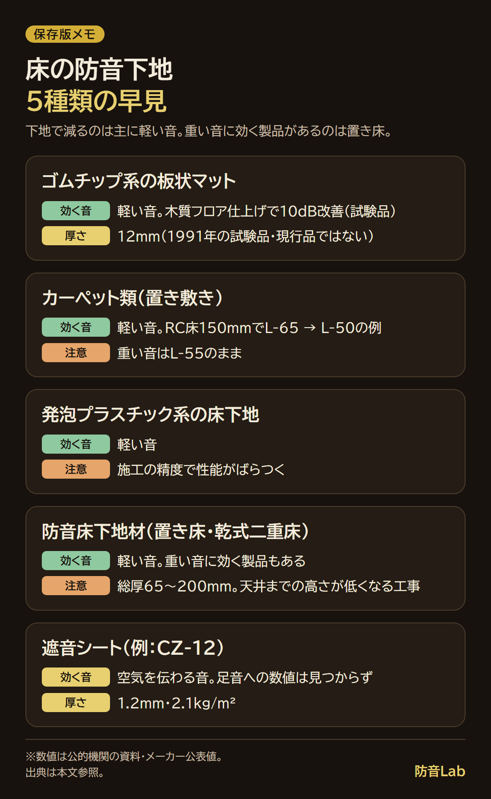
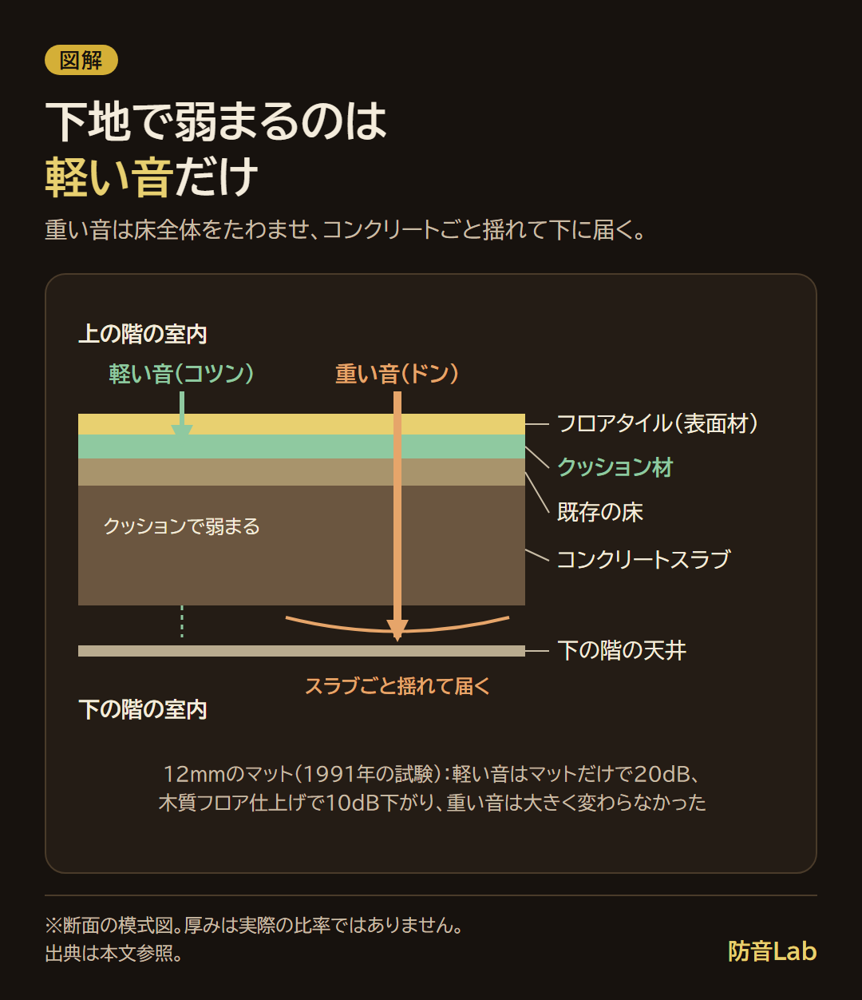

<RegionBanner />

床の防音下地は、スリッパや物を落とす音のような軽い音には効きますが、子どもが跳ぶような重い音は、床の構造で決まります。

道総研の林産試験場が公開している1991年の試験では、厚さ12mmのマットを合板の床に敷くと、軽い音は20dB下がりました。

ただし、上に木質フロアを張ると、改善は10dBにとどまっています。

この記事では、下地材の比べ方と重ね方、置くだけで敷く手順、下地では足りない音の見分け方を解説します。

## 床の防音下地で減るのは「軽い音」。重い音は床の構造で決まる

床の音は2種類あります。スリッパのパタパタや物を落とすコツンという軽い音と、かかとで歩くドンという重い音です。

下地材が減らせるのは、主に前者です。

軽い音は床の表面で生まれ、下地のクッションで弱まります。

重い音は床全体をたわませるので、表面に何を敷いてもコンクリートごと揺れて下の階に届きます。

道総研の林産試験場が1991年に報告した試験で、違いを確かめます。

ゴムチップと木質チップを固めた板状のマット（厚さ12mm・比重0.75）を、木造の実験住宅の2階床（構造用合板12mm）に敷いた試験です。

| 床の構成 | 軽い音の改善量 | 備考 |
| :-- | :-- | :-- |
| 合板にマットだけ | 20dB | L-95からL-75 |
| マット＋カーペット | 30dB | 合板だけと比べた改善量 |
| マット＋木質フロア（厚さ12mm） | 10dB | L-95からL-85 |

出典: 林産試験場報 第5巻第2号（1991年）。JIS A 1418による測定。1階天井が未造作の実験住宅で、報告は改善量で比べています（2026年11月に確認）。

重い音は、どの構成でも大きな改善が見られませんでした。

試験は1991年に開発したマットで、今売られている製品の性能ではありません。

見てほしいのは、上がカーペットなら30dB、硬い木質フロアなら10dBと、表面で改善量が変わることです。

等級の読み方は、[床の防音等級の読み方](/ja/knowledge/floor-soundproof-rating/)にまとめています。

## 下地材の種類を比べる

数値を公的機関の資料で確かめられたものだけを、表にしました。

| 種類 | 厚さ・重さ | 効く音 | 注意 |
| :-- | :-- | :-- | :-- |
| ゴムチップ系の板状マット（上の試験品） | 12mm・比重0.75。面密度 0.012m × 750kg/m³ ＝ 9kg/m² | 軽い音。木質フロア仕上げで10dB改善 | 重い音は改善小。現行製品ではない |
| カーペット類（置き敷き） | 製品で違う | 軽い音。RC床150mmで、発泡塩ビシート仕上げのL-65が、ラバー裏打ちのニードルパンチカーペットでL-50 | 重い音はL-55のまま |
| 発泡プラスチック系の床下地 | 製品で違う | 軽い音 | 施工の精度で性能がばらつく |
| 防音床下地材（置き床・乾式二重床） | 総厚65〜200mm | 軽い音。重い音に効く製品もある | 天井までの高さが低くなる |
| 遮音シート（例: CZ-12） | 1.2mm・2.1kg/m² | 空気を伝わる音。足音への数値は見つからず | 床暖房の上は12mm以上の合板 |

出典: 林産試だより1997年10月号、GBRC Vol.46 No.4（2021年）、ゼオン化成の製品ページ（2026年11月に確認）。

国土交通省のハンドブックは、マットの選び方を次のように示しています。

- <strong>等級表示</strong> : 「ΔLL-○」のように試験所名つきの表示がある商品を選びます。数字が大きいほど、軽い音を減らす効果が高い表示です
- <strong>厚さと硬さ</strong> : 厚ければよいわけではなく、柔らかすぎると歩きにくくなります。硬さの指標「G値」は、100以下が目安です
- <strong>試験の種類</strong> : 住宅用マットは、軽い音の試験（LL試験）で確かめるのが一般的です

## フロアタイル・クッションフロアの下に敷く重ね方

床の断面を、上から順にたどります。

フロアタイル（表面材）、クッション材、既存の床、コンクリートスラブ、下の階の天井の順です。

軽い音は、上の2層で弱まります。重い音は、既存の床とスラブごと揺れるので、この2層では止まりません。

層の順番でも、効き方は変わります。軽い音への性能は、衝撃を受ける上の層の性質が、ほぼ決めるためです。

| 日本建築総合試験所の実験（防音フローリングの上に重ねた場合） | 250Hz帯の変化 |
| :-- | :-- |
| 防音ではないフローリングを重ねる | 18dB低下 |
| 厚めで硬いクッションフロアを重ねる | 6dB低下 |
| 遮音性能の高いタイルカーペットを置き敷き | 20dB向上 |

出典: GBRC Vol.46 No.4（2021年10月）。実験室で約900mm角の小さな試料を1点だけ加振した簡易測定（2026年11月に確認）。

フロアタイルのような硬い表面材を上にすると、下にクッション材を敷いても、カーペットの場合より改善は小さくなる見込みです。

遮音シートは、空気を伝わる音を重さで減らす材料です。足音は質量則で改善量を出せないので、足すかは音の種類で決めます。

考え方は、[遮音シートの効果と試算](/ja/diy/sound-insulation-sheet-effect/)で解説しています。

重ねた分だけ、床は材料の厚さの合計で高くなります。12mmのマットなら、それだけで12mmです。

ドアの下端、敷居、クローゼットの扉は、敷く前に高さを測ります。

### フロアタイルとクッションフロアで違うところ

どちらも既存の床に重ねる表面材で、軽い音の効きは、上の層の硬さが大きく決めます。

2つの低減量を同じ条件で比べた公的な資料は、見つけられませんでした。

製品ページに、ΔLL等級と試験所名の表示があるかを見比べます。

## 防音下地材を床に敷く手順（置くだけ・DIY）

置くだけで敷く手順は、次の4つです。

1. <strong>音を確認して採寸する</strong> : 軽い音か重い音かを書き出し、敷く範囲の面積を出します
2. <strong>床を掃除する</strong> : 凹凸やゴミがあると緩衝材がつぶれて遮音性能が下がると、林産試験場が直張りの防音床で注意しています
3. <strong>下地を突き付けで並べる</strong> : すき間なく並べます。施工の精度で性能がばらつくと、林産試験場が発泡プラスチック系の床下地で注意しています
4. <strong>壁際を切り、フロアタイルを敷く</strong> : すき間の取り方や敷き方は、製品の施工説明に従います

私が手を出しにくいと感じるのは、手間です。

部屋の物をいったん全部出す必要があり、時間がかかります。戸建てでも、業者に頼みたくなるくらいです。

だから、家具を動かさずにできる範囲から始める当てはめ方を、次に出します。

## 自分の部屋に当てはめる：まず一部、次に6畳全面

面積は、畳の数から出します。不動産の表示に関する公正競争規約は、畳1枚の広さを1.62m²以上（壁心面積を畳数で割った値）としています。

1畳は1.62m²、2畳は 1.62 × 2 ＝ 3.24m²、6畳は 1.62 × 6 ＝ 9.72m² です。

1枚50cm角（0.25m²）のタイル状のマットを仮定すると、次のとおりです。

| | ①簡易（家具を出さずにできる範囲） | ②本格（賃貸の6畳の洋室全面） |
| :-- | :-- | :-- |
| 範囲の例 | デスクの下・トレーニングする場所の1〜2畳 | 部屋の物を出して、置くだけのフロアタイルと下地を全面に |
| 面積 | 1.62〜3.24m² | 9.72m² |
| 枚数 | 1.62 ÷ 0.25 ＝ 6.48→7枚、3.24 ÷ 0.25 ＝ 12.96→13枚 | 9.72 ÷ 0.25 ＝ 38.88→39枚 |
| 重さ（9kg/m²の場合） | 1.62 × 9 ＝ 約15kg、3.24 × 9 ＝ 約29kg | 9.72 × 9 ＝ 約87kg |
| 費用 | 面積 × 1m²あたりの単価（製品ページで確認） | 同じ |

枚数は切り上げで、壁際を切る分の余りは数えていません。重さは、道総研の試験品と同じ厚さ・比重だと仮定した計算です。

まず①の1〜2畳から始めます。軽い音が出る場所に絞れば、物を出す手間が小さく、効果も確かめやすいからです。

②は、部屋の物を出せるときに進めます。

## 賃貸・マンションで敷くときの注意

賃貸では、接着剤を使わず置くだけで敷く方法が前提です。はがせる方法でも、原状回復の扱いは、契約と管理会社の判断で決まります。

敷く前に、管理会社かオーナーに、置くだけの物を敷いてよいかを確認します。

賃貸なら、オーナーの許可が要ります。ただ、答えが「やる」か「やらない」の二択になるので、かえって決めやすいかもしれません。

壁を傷つけない固定方法は、[賃貸で壁を傷つけずにできる防音対策](/ja/diy/renter-parent-house-soundproofing/)にまとめています。

分譲マンションは、管理規約が関わります。

日本建築総合試験所は、床の遮音性能に法的な規制はなく、リフォームでは管理規約で床仕上げ材の遮音性能を決めていることが多いと書いています。

標準管理規約は、床のフローリングを、理事長の承認が必要な修繕の例にしています。

置くだけの下地が規約の対象かは、自分のマンションの規約と細則で決まります。管理会社に確認します。

「マンション用の防音床下地材」を探すと、置き床や乾式二重床のように、総厚65〜200mmの工事になる種類も出てきます。そちらは、管理組合の承認と業者の見積もりが要る工事と考えます。

法律や管理規約の解釈は、個別の事情で変わります。迷うときは、管理会社や自治体の相談窓口、専門家に確認してください。

## 下地では足りないとき

重い音は、床の構造で決まります。

林産試験場は、重い音を床仕上げ材だけで改善するのは難しく、2階の床と1階の天井を分離するなどの工夫が必要としています。

私は、自宅のトレーニングでバーピーをするときは、ヨガマットを敷いています。敷かずにやると、さすがに響いていると感じたので、何かしらのマットは欲しいと思いました。

跳ぶ動きは、重い音の側です。ヨガマットで重い音がどれだけ減るかは、私は測っていません。

気になる音ごとの考え方です。

| 気になる音 | 考え方 | 読む記事 |
| :-- | :-- | :-- |
| コツン・パタパタ（軽い音） | 下地・マットで減らす。まず一部から | この記事 |
| ドン・子どもが跳ぶ（重い音） | 床の構造の話。出す側の工夫と防振の対策 | [階下から足音の苦情が来たときの対策](/ja/knowledge/vibration-reduction-science/) |
| 床そのものを変えたい | 置き床・二重床は業者の工事 | [防音工事の種類と価格比較](/ja/soundproof-room/construction-types-cost-comparison/) |

## よくある質問

### 床下地の防音シートと防音マットはどちらがいいですか？

足音のような軽い音は、衝撃を吸収する柔らかい緩衝材（防音マット側）で減らします。

遮音シートは、空気を伝わる音を重さで減らす材料で、足音への効果を示す資料は見つけられませんでした。マットは、ΔLL等級とG値の表示で比べます。

### フロアタイルだけでも防音になりますか？

フロアタイルだけの低減量を示した公的な資料は、見つけられませんでした。

国土交通省のハンドブックは、フローリングなどの硬い床材は衝撃を吸収しにくく、下の階まで振動が伝わりやすいとしています。

フロアタイルを硬い仕上げ材の仲間として考えるなら、下に柔らかい層を入れるほうが、軽い音には有利と考えます。

### 下地を敷くとどのくらい段差ができますか？

敷いた材料の厚さの合計が、そのまま床の高さになります。12mmのマットなら12mm、そこにフロアタイルの厚さが加わります。

フロアタイルの厚さは製品ページで確かめ、ドアの下端と足し算します。

## まとめと次にやること

- 床の防音下地が減らすのは、主に軽い音です。12mmのマットで20dB下がり、木質フロアを重ねると10dBでした
- 重い音は床の構造で決まるので、下地では足りません
- 当てはめは、まず1〜2畳。部屋の物を出せるなら、6畳全面（9.72m²）です

次にやることは1つです。

<strong>気になる音が軽い音か重い音かを、下の階の人の立場で書き出します。</strong>

私なら、コツンやパタパタが多ければ1畳分のマットから、ドンが多ければ管理会社に床の構造を聞くところから始めます。

## 出典と確認日（2026年11月に確認）

- [林産試験場報 第5巻第2号「ゴムチップと木質チップとの成形マットの床衝撃遮音性能（第1報）」（1991年）](https://www.hro.or.jp/upload/10517/25254028001.pdf)
- [林産試験場「技術のおたずねにこたえて（床衝撃音の対策について）」（1990年1月号）](https://www.hro.or.jp/upload/9894/9001-8.pdf)
- [林産試験場「静かな床をつくるために（2）」（林産試だより1997年10月号）](https://www.hro.or.jp/upload/10141/26107005001.pdf)
- [日本建築総合試験所 GBRC Vol.46 No.4「重ね貼り施工が床衝撃音遮断性能に及ぼす影響」（2021年）](https://www.gbrc.or.jp/assets/documents/gbrc/GBRC186_899.pdf)
- [国土交通省住宅局「音と向き合うための ハンドブック」p.20](https://www.mlit.go.jp/jutakukentiku/house/content/001991123.pdf)
- [国土交通省「マンション標準管理規約（単棟型）コメント」令和7年改正](https://www.mlit.go.jp/jutakukentiku/house/content/001999022.pdf)
- [ゼオン化成「サンダム 遮音シート」](http://www.zeonkasei.co.jp/kenzai/sandam/001.htm)
- [三井住友トラスト不動産 用語集「畳」（畳1枚1.62m²）](https://smtrc.jp/useful/glossary/detail/n/3751)
