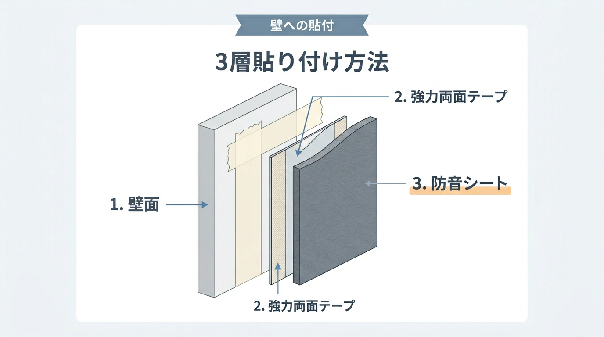
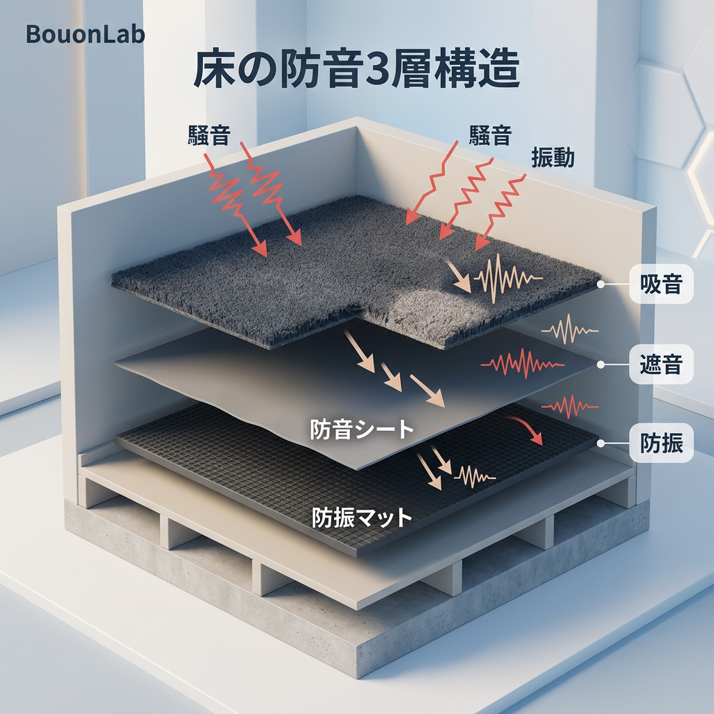

<RegionBanner />

「配信を始めたいけど、賃貸だから壁に穴は開けられない……」
「夜中にボイチャで盛り上がると、翌朝親に怒られるのが憂鬱だ」

そんな悩みを抱えていませんか？
賃貸や実家では、退去時の費用や家族の目があるぶん、防音DIYのやり方が限られます。

結論から言うと、<strong>壁に穴を開けず、剥がせる層を挟んで施工すれば、賃貸でも話し声や配信音をかなり和らげられます</strong>。
ただし、楽器の演奏や大音量を隣室に聞こえない水準まで抑える方法ではありません。

この記事では、原状回復の考え方を押さえたうえで、5つの方法とそれぞれの限界を紹介します。

## 原状回復の考え方：何が退去費用になるのか

防音DIYで最も避けたいのは、<strong>壁に防音材を直接貼ること</strong>です。
強力な両面テープは、剥がすときにクロスの表面を一緒に持っていくことがあります。

国土交通省の「原状回復をめぐるトラブルとガイドライン」では、次のように整理されています。

- <strong>通常の使用による損耗</strong> : 貸主の負担（賃料に含まれる）
- <strong>借主の故意・過失による損耗</strong> : 借主の負担
- <strong>壁クロスの耐用年数</strong> : 6年で残存価値が1円になる考え方で、借主の負担割合は居住年数に応じて下がる

つまり、防音のために貼ったテープでクロスを破いた場合は、借主の負担になる可能性があります。
居住年数が長いほど負担割合は下がりますが、<strong>0円になるとは限りません</strong>。

実家の場合も、壁紙を傷めれば張り替えが必要になり、DIYが家族に知られてしまいます。
施工前に壁の状態を写真で残しておくと、後のトラブル防止に役立ちます。

賢い防音の基本は、<strong>「既存の壁に触れない」か「剥がせる層を間に挟む」</strong>ことです。

## 方法1：マスキングテープを下地にして遮音シートを貼る

遮音シートを壁面に設置するとき、扱いやすいのが幅広のマスキングテープを下地にする方法です。

手順は次のとおりです。

1. 壁のクロスに、幅広のマスキングテープを縦に貼る
2. そのマステの上に、強力な両面テープを貼る
3. 遮音シートを上から貼り付ける

_Fig: マステ＋両面テープ＋遮音シートの3層構造。壁に直接テープを貼らずに重い防音材を支える積層テクニック。_

遮音シートは重いため、マステの面積が小さいと重さに耐えきれず剥がれ落ちます。
壁一面をマステで覆うくらいの面積で下地を作ると、剥落しにくくなります。

<strong>注意点</strong>は次の3つです。

- マステ自体も、長期間貼ったままだとクロスから剥がれにくくなることがある
- クロスの種類や経年劣化によっては、マステでも表面が傷む場合がある
- 施工前に、目立たない場所で貼って剥がす試験をしておく

遮音シートの重さと固定方法は、[防音室DIYの落とし穴。「遮音シート」の重さで自作ブースが崩壊しないためのフレーム補強術](/ja/diy/soundproof-sheet-heavy-diy-tips/)で詳しく解説しています。

## 方法2：突っ張り柱（ディアウォール・ラブリコ）で壁を立てる

「マステすら貼るのが不安」という場合は、ディアウォールやラブリコのような突っ張り柱を使う方法があります。

仕組みは、天井と床の間に2×4材（ツーバイフォー材）を突っ張って、独立した柱を作ることです。
立てた柱に、吸音ボードや石膏ボードをビスで固定します。

既存の壁と新しいボードの間に空気層を作ると、壁の振動が新しい面材へ直接伝わりにくくなります。
壁の傷はつきにくい工法ですが、<strong>柱の当たる天井や床にあとが残る場合がある</strong>ため、当て木やシートを挟んでおくと安心です。

ただし、この方法には限界もあります。

- 空気層は1〜2cmだと狭く、遮音の上積みは限定的になりやすい
- 隙間があると音が抜けるため、気密処理まで行わないと効果が下がる
- 面材が重くなるほど、突っ張りの強度と床の荷重に注意が必要になる

楽器演奏や大声での配信を隣室に聞こえない水準まで抑えたい場合は、この方法だけでは足りないことが多いです。
工法ごとの費用・効果・リスクの比較は、[自分の部屋を防音室にしたい？DIYの壁防音と専門工事の現実的な選択肢](/ja/diy/diy-wall-soundproofing-room-guide/)で整理しています。

## 方法3：ドアの隙間と閉扉音を対策する

リビングからの親の声、あるいは自分の声が廊下に漏れる原因として、ドア周りの隙間は大きな割合を占めます。
音は針の穴ほどの隙間からでも漏れ出すため、壁より先にドアを見直す価値があります。

### 隙間テープで密閉する

100均（ダイソー・セリアなど）で売っているEPDMゴム製の隙間テープを、ドア枠の4辺に貼ります。
ドアを閉めたときに、軽く手応えがあるくらいの厚みが目安です。厚すぎるとドアが閉まらなくなります。

### ドアを重くする

ドアは壁より薄いため、音が通りやすい部分です。
前述の「マステ＋遮音シート」の方法をドアにも施すと、話し声の透過を抑えやすくなります。

ただし、重くしすぎると蝶番に負担がかかり、ドアが下がる原因になります。
シートは薄めのものから試し、開閉に問題がないか確認してください。

### 「バタン」という閉扉音を抑える

隙間テープが防ぐのは空気を伝わる音で、ドアが枠にぶつかる衝撃音（固体音）は別の対策が必要です。

- 100均の「戸当たりクッション」を、ドア枠の閉まる位置（ラッチ受け金具の周辺）に貼る
- ドアノブに巻くカバーやクッションゴムで、金属音を抑える
- 両面テープ式で跡が心配な場合は、「跡が残りにくい」と明記された商品を選ぶか、マステを下地に挟む

## 方法4：床は「防振・遮音・吸音」の3層で考える

賃貸で多いトラブルは、壁よりも床への衝撃音です。
ジョイントマット1枚では、低い「ドン」という振動音はほとんど防げません。

組み合わせの考え方は次のとおりです。

| 層 | 素材の例 | 役割 |
| :-- | :-- | :-- |
| 下層 | 防振マット（ゴム製） | 椅子の移動や歩行の振動を吸収する |
| 中層 | 遮音シート | 階下へ抜ける音を和らげる |
| 上層 | 極厚のラグ、吸音タイルカーペット | 表面の反射音を抑え、感触を確保する |

_Fig: 階下への振動と音を和らげる3層レイヤー。防振（マット）＋遮音（シート）＋吸音（ラグ）の組み合わせ。_

この構成で、椅子を引く音や、物を落とした音のような軽い衝撃は抑えやすくなります。
一方、子どもが飛び跳ねるような<strong>重い衝撃音（ドスン）は、マットを重ねても完全には防げません</strong>。

重量衝撃音の仕組みと、やってはいけない対策は、[階下から足音の苦情が来たら？ジョイントマットで防げない理由と正しい対策](/ja/knowledge/vibration-reduction-science/)で解説しています。
木造アパートで悩んでいる場合は、[木造アパートの防音は無理？苦情ゼロまで音を減らす3つの現実的対策](/ja/diy/wooden-apartment-soundproof-guide/)も参考になります。

## 方法5：予算ゼロならクローゼットの中で録音・配信する

予算が完全にゼロなら、<strong>クローゼットの中</strong>に入る方法があります。
吊るされた服が音を乱反射させ、部屋の反響を抑えてくれるため、録音した声がクリアになりやすくなります。

やり方は簡単です。

1. クローゼットの中にマイクを持ち込む
2. 扉を閉める
3. 扉の隙間にタオルを詰める

この方法で減るのは主に<strong>部屋の反響</strong>で、外に漏れる音をなくす方法ではありません。
そのため、深夜の歌ってみたやナレーションの録音には向きますが、声量が大きい場合は音漏れの対策が別に必要です。

本格的に作りたい場合は、[クローゼットDIY防音室](/ja/diy/closet-diy-soundproof-room/)の手順も参考にしてください。

## まとめ：制約を前提に、剥がせる対策から積み上げる

賃貸や実家では、原状回復の制約があるからこそ、順番が大事です。

| 場所 | 先にやること | 限界 |
| :-- | :-- | :-- |
| 壁 | マステ下地の遮音シート、または突っ張り柱 | 楽器・大音量には不足しやすい |
| ドア | 隙間テープ＋戸当たりクッション | 重くしすぎると蝶番に負担 |
| 床 | 防振＋遮音＋吸音の3層 | 重量衝撃音は完全には防げない |
| 録音 | クローゼットの中 | 反響は減るが音漏れは防げない |

まずは100均やホームセンターで買える身近なアイテムから試し、音の漏れる場所を一つずつ減らしてみてください。
それでも足りないと感じたら、DIYの限界を認めて次の選択肢を検討するのも賢い判断です。

退去費用や契約に関わる判断は、契約書や管理会社の指示を優先し、不明な点は事前に確認してください。

## 関連記事

- <strong>もっと専門的な材料を知りたい方は</strong> : [吸音材か遮音材か迷う人へ｜あなたの環境で"必要なのはどっち？"徹底ガイド](/ja/knowledge/absorption-vs-soundproofing-materials/)
- <strong>賃貸の壁に貼れる既製の防音パネルの実力を知りたい方は</strong> : [ワンタッチ防音壁は効果ある？評判と自作代用の可否を検証](/ja/soundproof-room/onetouch-soundproof-wall-review/)
- <strong>DIY以外の選択肢（引っ越し・業者依頼・防音室購入）も比較したい方は</strong> : [自宅に防音室がなくても「一人になれる空間」を作る4つの方法｜40〜60代の予算別ガイド](/ja/money/quiet-space-budget-decision-guide/)
- <strong>子育て世代で、まず「一人になれる場所」を作りたい方は</strong> : [子育て世代のDIY「一人になれる場所」｜1万円台から始める段階的な作り方](/ja/diy/parenting-generation-quiet-corner-diy/)
