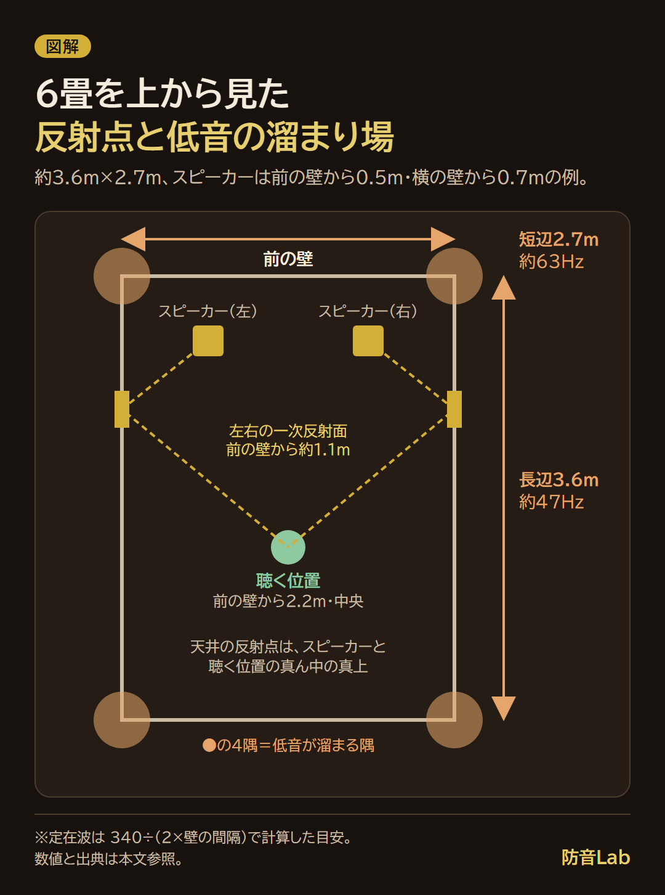
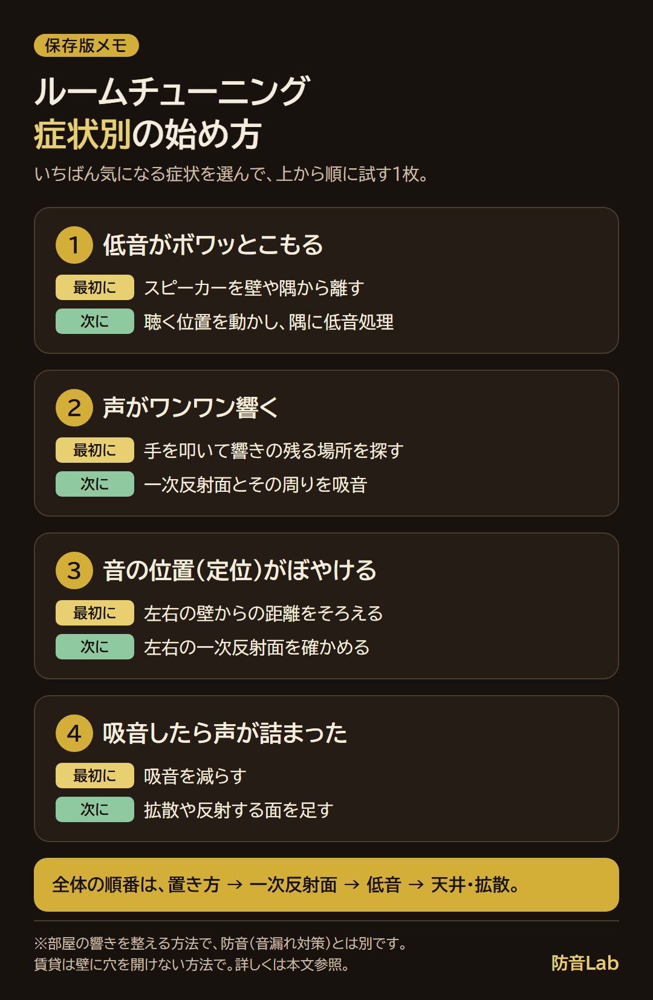
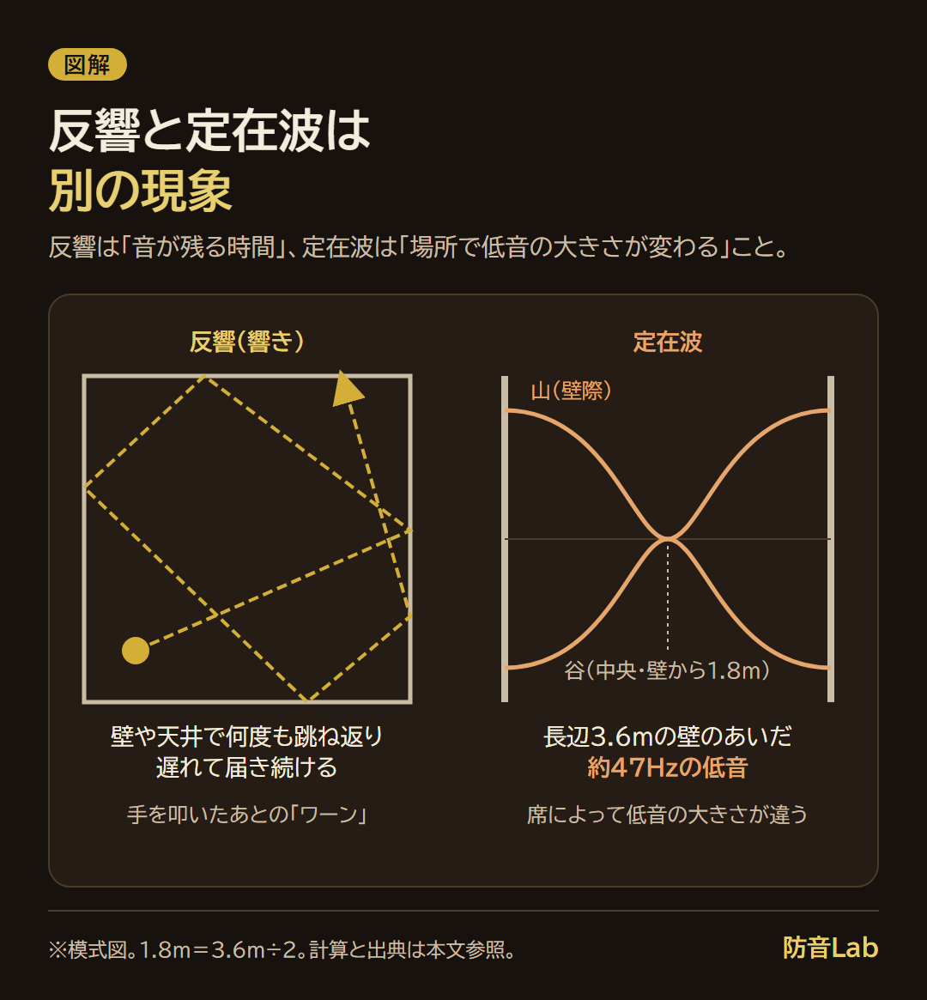

<RegionBanner />

ルームチューニングのやり方は、お金のかかる吸音パネルより先に、スピーカーの置き方と壁の反射を確かめるところから始めます。

オーディオ専門メディアの解説と部屋の寸法からの計算を合わせると、6畳では47〜71Hzの低音が溜まりやすいことが分かりました。

部屋の響きを整える方法なので外への音漏れは減りませんが、症状から次の一手を選べる判断フローと、1人でできる確かめ方をまとめます。

## ルームチューニングとは：部屋の響きを整えること（防音とは別）

<strong>ルームチューニングとは、スピーカーの音が壁・天井・床で跳ね返って耳に届くときの「響き」を整える作業です。</strong>

PHILE WEBのオーディオ解説（2024年5月）も、基本は「反射」と「吸音」の特性を整えることだと説明しています。

整えるのは部屋の中の音だけで、壁を通り抜けて外へ漏れる音は変わりません。

| | ルームチューニング | 防音（遮音） |
|---|---|---|
| 整えるもの | 部屋の中の響き、低音のこもり | 壁・床・窓を通り抜ける音 |
| 主な手段 | スピーカーの置き方、吸音材、拡散材 | 重い壁材、すき間の対策、窓 |
| 外への音漏れ | ほぼ変わらない | 減る |

吸音材が壁の外に漏れる音量をほぼ変えない理由は、[吸音材と遮音材の違い](/ja/knowledge/absorption-vs-soundproofing-materials/)で整理しています。

私自身は、ふだんヘッドホンかイヤホンで聴くことが多く、部屋の響きまで考えたことはありませんでした。

音が外に出て騒音になるのも嫌だからです。

平成初期、CDコンポがあったころは、スピーカーにこだわって大きくしたこともあります。

そのときも、音を大きくすると周囲への影響が気になりました。

「音を浴びる」ならシアタールームがあったほうがいい、と実感しています。

響きを整えることと、大きな音を出せることは別の話です。

私の夢は、自宅の地下にそういう部屋を作ることです。

大きな音を出したい人は、ルームチューニングではなく[ホームシアター向けの防音室](/ja/soundproof-room/home-theater-soundproof-room/)の話になります。

## ルームチューニングで整える4つ：置き方・吸音・拡散・低音

ルームチューニングで整えるのは、置き方・吸音・拡散・低音の4つです。

| 整えること | 何が変わるか | 費用の目安 | 賃貸で可か |
|---|---|---|---|
| 置き方 | 低音の量、左右の反射のそろい方 | 動かすだけなので0円 | 可 |
| 吸音（一次反射面） | 声や楽器の響きの濁り、定位 | 家にある物で試せる。パネルは製品の価格 | 立てかければ可 |
| 拡散 | 反射を残したまま散らし、響きの偏りを減らす | 家具で代用できる。専用品は製品の価格 | 置くだけなら可 |
| 低音（定在波） | 特定の低音の膨らみ・痩せ | 配置の変更は0円。ベーストラップは製品の価格 | 置くタイプなら可 |

6畳を上から見ると、反射点と低音が溜まる場所はこうなります。

### 置き方：スピーカーと壁の距離、左右対称

スピーカーを壁や隅に近づけると、低音の量は増えます。

QSCの解説では、400Hz以下の低音は、壁1面にぴったり付けると最大6dB、隅の3面に付けると最大18dB強まるとされています。

PHILE WEBのコラム（2023年11月）は、壁や床に近づけると低域の量感は増える一方、中高域の反射で音が濁り、音場感が損なわれると説明しています。

低音がボワッと膨らむ場合は、壁や隅から少し離すところから試します。

左右の壁からの距離をそろえると、左右の反射の届き方がそろいます。

片側の壁だけが強い反射を返す状態を避けられるため、置き方は最初に確かめます。

### 吸音：一次反射面

<strong>一次反射面とは、スピーカーの音が耳に届く前に、最初に1回だけ跳ね返る壁や天井の場所です。</strong>

反響との違いは、1回目の反射かどうかです。

反響は、音が壁や天井で何度も跳ね返り、遅れて届き続ける音の全体を指します。

一次反射面は、直接音のすぐ後に届く最初の反射が起きる場所なので、ここを吸音すると音の濁りに効きやすくなります。

GIK Acousticsは、リスニング位置を決めたあとの次の手順として、一次反射点の処理を挙げています。

探し方は、次の「やり方」の節で説明します。

### 拡散

拡散は、反射を消さずに、いろいろな方向へ散らす方法です。

GIK Acousticsの解説では、吸音が反射を減らすのに対し、拡散は反射を残して散らすため、部屋の活気を残したいときの選択肢とされています。

6畳では、拡散を後回しにします。

Violet Recordingは、拡散体には耳から距離が要り、小さな部屋では足りないことが多いと書いています。

### 低音（定在波）

低音は、部屋の寸法で決まる周波数が膨らんだり痩せたりします。

この現象が定在波で、6畳の計算は、後の「低音のこもりを減らす」の節で扱います。

低音は、吸音も難しい音域です。

PHILE WEBは、どの吸音パネルも可聴帯域をすべて吸収するわけではなく、特に低音は吸音が難しいと書いています。

## ルームチューニングのやり方：お金のかからない順に進める

ルームチューニングのやり方は、<strong>置き方 → 一次反射面 → 低音 → 天井・拡散</strong>の順に進めます。

| 順番 | やること | 費用 | 確かめ方 |
|---|---|---|---|
| 1 | スピーカーを壁や隅から離し、左右の壁からの距離をそろえる | 0円 | 同じ曲で低音の量を聴き比べる |
| 2 | 一次反射面を探し、そこに吸音を置く | 家にある物から | 手を叩いて響きの残り方を聞く |
| 3 | 低音のこもりを計算で見当をつけ、隅と聴く位置を動かす | 0円から | 座る位置を変えて低音の量を比べる |
| 4 | 天井の反射を確かめ、吸音しすぎなら拡散や反射を足す | 家具から | 声や手拍子が詰まっていないか聞く |

症状から、どこから手を付けるかも選べます。

| 気になる症状 | 最初にやること | 次にやること |
|---|---|---|
| 低音がボワッとこもる | スピーカーを壁や隅から離す | 聴く位置を動かし、隅に低音処理 |
| 声がワンワン響く | 手を叩いて響きの残る場所を探す | 一次反射面とその周りを吸音 |
| 定位（音の位置）がぼやける | 左右の壁からの距離をそろえる | 左右の一次反射面を確かめる |
| 吸音したら声が詰まった | 吸音を減らす | 拡散や反射する面を足す |

症状から始める順番を、保存して見返せる1枚にまとめました。

### 手を叩いて響きを聞く

PHILE WEBのコラムは、部屋で声を出したり柏手を打ったりして響きを確かめる方法を紹介しています。

柏手が1発で収まらず、声がビンビン嫌な響き方をする場所は、反射が大きいポイントです。

逆に、声が鼻が詰まったように艶を欠くなら、その部屋は吸音が多めです。

手を叩いたあとの余韻が「ワーン」と続く場合は、反響が長いと考えます。

### 1人でできる一次反射面の探し方

一次反射面は、鏡に映る位置で探せます。

スピーカーが鏡に映れば、その鏡の位置が、音の反射する場所になるからです。

GIK Acousticsは、友人・鏡・マーカーで探すミラートリックを紹介しています。

1人でやる場合は、鏡を板に付けて壁沿いに動かします。

- <strong>用意する物</strong> : 手鏡、マスキングテープ、壁に立てかけられる木の板（またはテーブル）
- <strong>手順1</strong> : 手鏡を板にマスキングテープで留め、鏡面を部屋側に向けて、板ごと壁に立てかけます
- <strong>手順2</strong> : 鏡の高さは、スピーカーと座った耳の高さのあいだにします
- <strong>手順3</strong> : 聴く位置に座り、鏡にスピーカーが映るか見ます
- <strong>手順4</strong> : 映らなければ、板を壁沿いに少しずらして、座り直して見ます
- <strong>手順5</strong> : 映った場所にマスキングテープで印を付け、反対側の壁でも繰り返します

何度も立ち座りするのが大変なら、先に計算で見当をつけます。

壁沿いの反射点は、次の式で出せます。

<strong>反射点の位置 ＝ スピーカーの位置 ＋（聴く位置 − スピーカーの位置）× スピーカーの壁からの距離 ÷（スピーカーの壁からの距離 ＋ 聴く位置の壁からの距離）</strong>

位置は、前の壁からの距離（m）で測ります。

私は次の条件で計算しました。

| 条件 | 値 |
|---|---|
| 部屋 | 6畳（約3.6m×2.7m） |
| 左のスピーカー | 前の壁から0.5m、左の壁から0.7m |
| 聴く位置 | 前の壁から2.2m、左の壁から1.35m（部屋の中央） |

左の壁の反射点は、0.5＋（2.2−0.5）×0.7÷（0.7＋1.35）＝0.5＋1.7×0.3415＝約1.08mです。

つまり、前の壁から約1.1mの位置に鏡を当てれば、スピーカーが映るはずです。

右の壁も、左右対称なら同じ約1.1mになります。

鏡で確かめた位置が計算と大きくずれたら、測った距離を見直します。

天井は、スピーカーと耳の高さが近ければ、スピーカーと聴く位置のおおむね真ん中の真上が反射点です。

鏡を当てにくい天井は、この見当を目印にして、その付近を吸音します。

印を付けた場所に、カーテンや立てかけた吸音材を置き、もう一度手を叩いて響きを聞き比べます。

吸音材の貼る位置の考え方は、[吸音材はどこに貼る？](/ja/diy/gamer-acoustic-placement/)で扱っています。

## ルームチューニングで低音のこもりを減らす：6畳で計算する定在波

スピーカーを買い替えたのに、低音だけがボワッとこもって、ボーカルが聞き取りにくい。

そんな場面では、部屋の寸法で決まる低音の山が、聴く位置に強く出ていることがあります。

ここでは6畳（約3.6m×2.7m、天井高2.4m）にブックシェルフ型スピーカー2台を置く前提で、計算します。

畳の大きさは地域や建物で違うので、自分の部屋の寸法を測って入れ替えてください。

### 定在波と反響（響き）の違い

<strong>反響と定在波は、別の現象です。</strong>

| | 反響（響き） | 定在波 |
|---|---|---|
| 何が起きるか | 音が壁や天井で何度も跳ね返り、遅れて届き続ける | 向かい合う壁のあいだで、特定の低音だけが大きくなったり小さくなったりする |
| 決まるもの | 音が残る時間の長さ | 場所と高さ |
| 聞こえ方 | 手を叩いたあとの「ワーン」 | 席によって低音の大きさが違う |
| 主な対策 | 一次反射面の吸音 | 置き方、聴く位置、ベーストラップ |

2つの違いを、図で並べます。

### 定在波の周波数を計算する

向かい合う壁のあいだで起きる最も低い定在波は、壁の間隔Lの2倍が、音の波長に等しくなる周波数で起きます。

式は次のとおりです。

<strong>f ＝ c ÷（2 × L）</strong>

fは周波数（Hz）、cは音速（m/s）、Lは向かい合う壁の間隔（m）です。

音速cは、農林水産省の資料に、空気中で約340m/sとあります。

近似式は331.5＋0.61×気温（℃）で、20℃なら約344m/s（331.5＋0.61×20＝343.7）です。

ここでは340m/sで計算します。

20℃だと周波数は約1%高くなります（3.6mで47Hzが48Hz）。

この式は、直方体の部屋の固有周波数の式（Wikipedia「Room acoustics」）を、向かい合う1組の壁だけで見たものです。

| 向かい合う壁の間隔 | 計算 | 最も低い定在波 | 2倍の周波数 |
|---|---|---|---|
| 長辺 3.6m | 340 ÷（2×3.6）＝340÷7.2 | 約47Hz | 約94Hz |
| 短辺 2.7m | 340 ÷（2×2.7）＝340÷5.4 | 約63Hz | 約126Hz |
| 天井高 2.4m | 340 ÷（2×2.4）＝340÷4.8 | 約71Hz | 約142Hz |

6畳では、47Hz・63Hz・71Hzあたりの低音が溜まりやすいことになります。

エレキベースの4弦（E1）は約41Hz、A線（A1）は約55Hzなので、ベースの低い音のあたりです。

最も低い定在波（47Hz）は、壁際で強く、壁から1.8m（3.6m÷2）の部屋の中央で弱くなります。

聴く位置を部屋の中央に置くと、47Hzが弱く聞こえる可能性があります。

自分の部屋の寸法が違う場合は、次の早見表で見当をつけます。

| 向かい合う壁の間隔 | 計算 | 最も低い定在波 |
|---|---|---|
| 3.0m | 340 ÷ 6.0 | 約57Hz |
| 3.3m | 340 ÷ 6.6 | 約52Hz |
| 3.9m | 340 ÷ 7.8 | 約44Hz |
| 4.2m | 340 ÷ 8.4 | 約40Hz |
| 4.5m | 340 ÷ 9.0 | 約38Hz |

この計算は、壁が硬くて閉じた直方体の部屋を前提にした目安です。

ドアや窓、家具のある実際の部屋では、山と谷の位置や周波数が少しずれます。

だから、計算で見当をつけたあとは、次の節の測定で確かめます。

### 低音のこもりを減らす手順

低音の対策は、費用のかからない順に3つです。

- <strong>聴く位置を動かす</strong> : 同じ曲を流しながら、座る位置を前後に動かして、低音の量が変わるか聞きます
- <strong>スピーカーを壁や隅から離す</strong> : 隅は低音が強まる場所なので、少し離します
- <strong>隅にベーストラップを置く</strong> : 厚い吸音材を隅に置き、低音の溜まりを減らします

GIK Acousticsは、低音の吸音には厚い吸音材が必要で、隅の対策では厚い広帯域のベーストラップが中心になると説明しています。

材料と寸法、配置の手順は、[ベーストラップ自作・設置ガイド](/ja/diy/bass-trap-installation-guide/)で扱っています。

## 天井と拡散：反射を消しすぎないために

ルームチューニングで天井を考えるときも、考え方は壁と同じで、一次反射面に当たる場所を探します。

天井の一次反射面は、スピーカーと聴く位置のあいだの真上あたりにあります。

天井高2.4mの6畳でも、天井は一次反射面のひとつです。

ただし、反射を全部吸音すると、別の問題が出ます。

PHILE WEBのコラムは、部屋全体を厚い吸音パネルで覆うと、鳴る音はボソボソと味気なくなり、艶やかさや伸びやかさに欠けると書いています。

反射一辺倒の部屋では、ビンビンと余分な音が響いて音楽を楽しむどころではない、とも書かれています。

Violet Recordingも、完全にデッドな部屋は疲れやすいと指摘しています。

息苦しいと感じたら、吸音の一部を拡散に替えるとよいと書いています。

吸音しすぎた部屋に反射を足す小さな方法として、PHILE WEBは床にビニールシートを敷く、壁に絵をかけるを挙げています。

ただし、響きを本質的に伸ばすには、本棚を別室へ移すような大がかりな対策が必要になることが多い、とされています。

拡散の役割は、反射を残しながら、一方向に偏らないように散らすことです。

拡散体の効果は主に高音域で、下限は大きさと深さで決まると、Violet Recordingは書いています。

6畳では、天井と左右の一次反射面を先に吸音し、声や手拍子が詰まってきたら拡散を足す順番にします。

## ルームチューニングを自作でやる範囲

家にある物でも、ルームチューニングの一部は代わりになります。

低音は代わりになりにくい、というのが調べた範囲の結論です。

| 家にある物 | 代わりになる所 | 代わりにならない所 |
|---|---|---|
| 厚手のカーテン | 窓や壁の反射を抑える。PHILE WEBは壁から空間を取って吊ると強い吸音が期待できるとしている | 低音の溜まり |
| ラグ・カーペット | 床で跳ね返る音を減らす | 低音の溜まり、壁や天井の反射 |
| 本棚 | 本の凹凸で反射が散らばる方向に働く。拡散の代わりに近いが、性能の公表値はない | 低音には効きにくい |
| 厚みのある布団・毛布 | 一次反射面に立てかけて、響きを抑える | 低音（厚さが足りない） |

低音のこもりに効かせたいなら、隅に置く厚い吸音材が必要です。

吸音パネルを貼る位置は、[吸音材はどこに貼る？](/ja/diy/gamer-acoustic-placement/)で、ベーストラップは[ベーストラップ自作・設置ガイド](/ja/diy/bass-trap-installation-guide/)で扱っています。

壁に貼る場合は、賃貸なら契約と原状回復を管理会社に確認してください。

## 変わったかを数字で確かめる：スマホの測定アプリ

1人では、耳だけで対策の前後を比べにくいものです。

そこで、スマホのマイクで周波数ごとの大きさを表示するアプリ（RTA・スペクトラム表示）を使い、対策の前後を同じ位置・同じ曲で比べます。

2026年11月10日に、公式ページとストアの掲載ページで確認した例です。

| 方法 | 用意する物 | 価格・対応 | 向き・限界 |
|---|---|---|---|
| Spectroid（Android） | Androidスマホ | 無料。開発者はCarl Reinke。Google Playの最終更新は2022年9月7日 | 音の大きさはdBFS（満点を0とした値）で表示。開発者のFAQは「校正された計測器にならない」と説明 |
| AudioTools（iPhone） | iPhone | App Storeの日本の表示は3,000円。iOS 15.0以降。1/3・1オクターブ帯域のRTAを含む | 業務用の測定には、校正済みのiTestMicなどの別売マイクが案内されている。内蔵マイクでの値は目安 |
| REW＋測定用マイク（パソコン） | パソコン、校正済みのUSBマイク | REWは無料（有料のProアップグレードもある）。公式ページにWindows・macOS・Linux向けがある | 公式は校正済みUSBマイクを推奨し、miniDSPのUMIK-1を例に挙げる。より正確に測るなら、こちら |

スマホのアプリは、絶対値ではなく、同じ条件での前後の比較に使います。

前後で見るのは、気になっていた周波数（例：47Hz、63Hz、71Hz付近）の山の高さが変わったかどうかです。

低音をどこまで正確に表示できるかは、アプリや機種で違います。

低音の山と谷の形が変わったかを見る使い方なら、スマホのマイクでも比較の目安になります。

- <strong>位置を決める</strong> : 聴く位置の耳の高さに、スマホを固定します（本や三脚）
- <strong>同じ曲を同じ音量で流す</strong> : 近隣に響く時間帯は避けます
- <strong>画面を保存する</strong> : 対策の前に、スクリーンショットを撮ります
- <strong>1つだけ変えて、もう一度測る</strong> : 置き方、吸音、ベーストラップのどれか1つだけを変えます

| 記録する項目 | 対策前 | 対策後 |
|---|---|---|
| 日付・時間 | | |
| 聴く位置 | | |
| 曲・音量 | | |
| 47Hz付近の山 | | |
| 63Hz付近の山 | | |
| 71Hz付近の山 | | |

## よくある質問

### ルームチューニングで防音にもなりますか？

なりません。

ルームチューニングは部屋の中の響きを整えるもので、壁の外へ漏れる音量はほぼ変わりません。

漏れる音を減らしたい場合は、遮音の対策が必要です。

違いは、[吸音材と遮音材の違い](/ja/knowledge/absorption-vs-soundproofing-materials/)で整理しています。

### 賃貸で壁に穴を開けずにできますか？

できます。

スピーカーの置き方、聴く位置、立てかけた板、カーテン、ラグ、置くタイプの低音処理は、壁に穴を開けません。

壁に貼る場合は、契約と原状回復を管理会社に確認してください。

### 配信や在宅会議の声にも効きますか？

声のワンワンした響きには、効く場合があります。

声が壁で跳ね返ってマイクに戻る反射を、吸音で減らせるためです。

マイクの周りの吸音は、[吸音材はどこに貼る？](/ja/diy/gamer-acoustic-placement/)で扱っています。

ただし、外に漏れる声は、ルームチューニングでは変わりません。

## まとめと次にやること

ルームチューニングは、部屋の中の響きと低音のこもりを整える作業で、外への音漏れ（防音）は変わりません。

お金のかからない順は、置き方、一次反射面、低音、天井・拡散です。

6畳（約3.6m×2.7m、天井高2.4m）では、47Hz・63Hz・71Hzあたりの低音が溜まりやすい計算でした。

天井と拡散は、吸音しすぎないように最後に足します。

私なら、今日は聴く位置に座って手を叩き、1発で収まらない響きがあるかを聞きます。

そのあと、鏡と板で一次反射面を1か所探します。

先にスマホのアプリで今の低音を1回記録しておくと、あとで前後を比べられます。

## 出典

2026年11月10日に確認した資料です。

- [農林水産省の騒音に関する資料](https://www.maff.go.jp/j/nousin/noukan/eikyou_hyouka/attach/pdf/souon-12.pdf)：空気中の音速は約340m/s、近似式331.5＋0.61t
- [Wikipedia「Room acoustics」](https://en.wikipedia.org/wiki/Room_acoustics)：直方体の部屋の固有周波数の式
- [PHILE WEB「オーディオ用ルームチューニング材の効果・選び方」（2024年5月6日）](https://www.phileweb.com/review/column/202405/06/2359.html)：反射と吸音のバランス、柏手と声の確かめ方
- [PHILE WEB「オーディオ専用ルームに最適な条件とは？」（2023年11月9日）](https://www.phileweb.com/review/column/202311/09/2256.html)：壁との距離と低域・中高域、デッドな部屋の直し方
- [GIK Acoustics「The Basics of Room Acoustics」](https://www.gikacoustics.net/blogs/knowledge-base/the-basics-of-room-acoustics)：隅と一次反射点の処理、低音の厚い吸音
- [GIK Acoustics「Understanding Diffusion」](https://www.gikacoustics.com/blogs/knowledge-base/understanding-diffusion)：吸音と拡散の違い
- [GIK Acoustics「First Reflection Points」](https://gikacoustics.com/video-room-acoustics-first-reflection-points/)：鏡で一次反射点を探す方法
- [Violet Recording「Absorption vs Diffusion」](https://violetrecording.com/absorption-vs-diffusion/)：小さな部屋での拡散、吸音しすぎの注意
- [QSC「Loudspeaker placement part 1: Low frequency build-up」](https://support.qscaudio.com/en_US/sound-advice/sound-advice-%7C-loudspeaker-placement-part-1-low-frequency-build-up)：壁・隅での低音の増加
- [REW（Room EQ Wizard）公式サイト](https://www.roomeqwizard.com/)
- [Spectroid（Google Play）](https://play.google.com/store/apps/details?id=org.intoorbit.spectrum)
- [AudioTools（App Store 日本）](https://apps.apple.com/jp/app/audiotools/id325307477)
