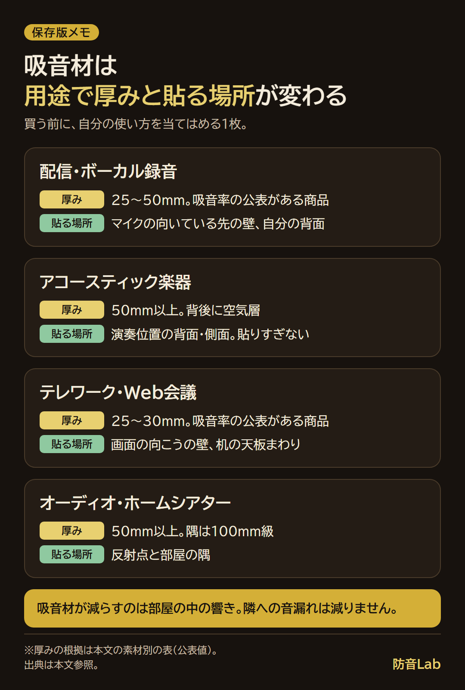
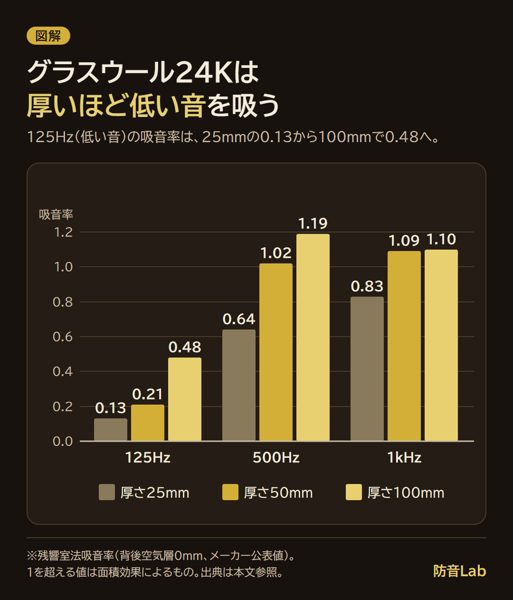
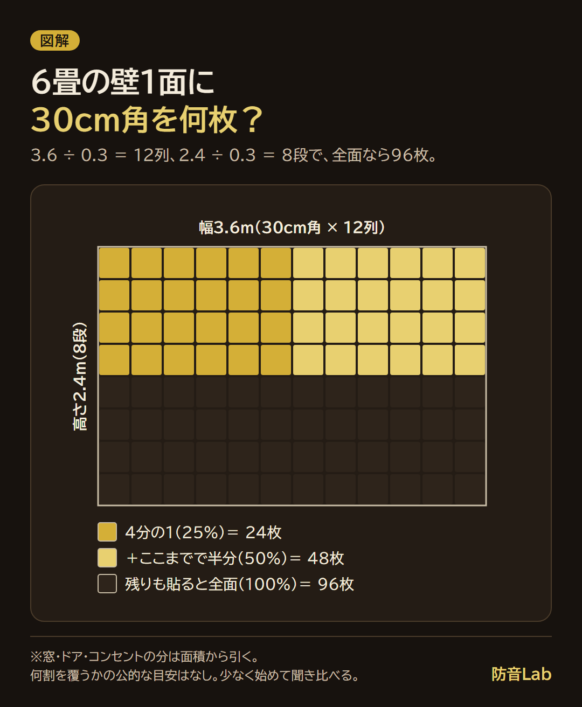

<RegionBanner />

吸音材のおすすめは、減らしたい響きが中音か低音か、部屋のどこに貼るかで変わります。

メーカーの公表値を並べると、同じグラスウール（密度24kg/m³）でも、125Hzの吸音率は厚さ25mmで0.13、50mmで0.21、100mmで0.48と、厚みで低い音への効き方が変わりました。

この記事では、素材別の吸音率の表、6畳の壁1面に30cm角で何枚要るかの当てはめ、商品を選ぶ基準をまとめます。

吸音率は、壁に当たった音のうち、跳ね返らずに吸い込まれる割合です。

0.8なら、当たった音の8割を吸い込みます。

## 吸音材のおすすめは「何の音を、どこで減らすか」で決まる

配信を始めて、コメントで「お風呂から配信してる？」と言われる。

「え、違うよ？」と思ったところから、自分の部屋の響きに気づく人がいます。

吸音材を買おうと調べると、素材も厚みも多すぎて選べません。

吸音材が減らすのは、部屋の中で跳ね返る音（響き）です。

日本建設業連合会の用語解説は、吸音率を「入射音から反射音を引いた割合」（α＝(I−R)÷I）と説明しています。

この割合には、材料が吸った音のほかに、壁を通り抜けた音も入ります。

だから、吸音率が高くても、隣の部屋への音漏れが減るとは限りません。

遮音材との違いは、[吸音材と遮音材の違いと選び方](/ja/knowledge/absorption-vs-soundproofing-materials/)で整理しています。

私はふだんヘッドホンで聴き、収録もしないので、自分の部屋の響きが気になったことはありません。

電話中に相手側の響きが気になることはありますが、自分の音を指摘されたことはなく、ある程度は気を遣っているからかな、と思っています。

用途ごとの出発点を表にしました。厚みの目安は、後ろの素材別の表の公表値から選びました。

| 用途 | 減らしたい響き | 素材・厚み | 置く場所 |
| :--- | :--- | :--- | :--- |
| 配信・ボーカル録音 | 声の反響 | 25〜50mm。吸音率の公表がある商品 | マイクの向いている先の壁、自分の背面 |
| アコースティック楽器 | 楽器の余韻 | 50mm以上。背後に空気層 | 演奏位置の背面・側面。貼りすぎない |
| テレワーク・Web会議 | 通話の反響 | 25〜30mm。吸音率の公表がある商品 | 画面の向こうの壁、机の天板まわり |
| オーディオ・ホームシアター | 反射と低音 | 50mm以上。隅は100mm級 | 反射点と隅 |

## 素材で選ぶ：グラスウール・ポリエステル・ウレタン・ロックウールの吸音率を比べる

次の表は、周波数別の公表値を確かめられた素材です。値は残響室法吸音率（JIS A 1409）で、125Hzは低い音、500Hzと1kHzは中音です。

| 素材・厚み | 125Hz | 500Hz | 1kHz | NRC | 面あたりの重さ |
| :--- | :--- | :--- | :--- | :--- | :--- |
| グラスウール24K 厚さ25mm | 0.13 | 0.64 | 0.83 | 0.67 | 0.6kg/m² |
| グラスウール24K 厚さ50mm | 0.21 | 1.02 | 1.09 | 0.97 | 1.2kg/m² |
| グラスウール24K 厚さ100mm | 0.48 | 1.19 | 1.10 | 1.12 | 2.4kg/m² |
| ポリエステル繊維 厚さ30mm（OTTO R 丸450） | 0.05 | 0.43 | 0.78 | 0.60 | 約1.7kg/m² |

グラスウールの3行は、マグ・イゾベールの技術資料にある小林理学研究所の測定値で、背後空気層は0mmです。

ポリエステルの行は、リブグラフィの技術資料の値で、厚みは同社カタログの30mm、背後空気層の記載はありません。試験体も試験機関も違うので、比較は目安です。

NRCは250・500・1k・2kHzの吸音率の平均で、ポリエステルの0.60は計算です（(0.17＋0.43＋0.78＋1.01)÷4＝0.5975）。

重さは、グラスウールが密度×厚さ（24kg/m³×0.05m＝1.2kg/m²）、OTTO Rは1枚600g÷0.36m²です。

表に1を超える値があるのは、残響室法では試料のまわりからも音が流れ込む「面積効果」が出るためと、東京都立産業技術研究センターが説明しています。1.09は「ほぼ全部吸う」と読みます。

ウレタンフォームとロックウールは、周波数別の数値表を確かめられず、表に入れていません。

### 厚手の吸音材は低い音に効く？厚みと空気層で変わる

125Hzの吸音率は、厚いほど上がります（25mmが0.13、50mmが0.21、100mmが0.48）。

厚みの代わりに、50mmの裏に空気層を作っても上がります。

50mmの125Hzは、空気層0mmで0.21、40mmで0.31、100mmで0.45で、100mm厚の0.48に近い値です。

6畳で低音が溜まりやすい47〜71Hz（計算は[ルームチューニングのやり方](/ja/diy/room-tuning-basics/)）は、この表の範囲より低く、公表値を確かめられませんでした。

低音のこもりは、配置とベーストラップで考えます（[ベーストラップの設置ガイド](/ja/diy/bass-trap-installation-guide/)）。

## 用途別のおすすめ：配信・楽器・テレワーク・オーディオ

### 配信・ボーカル録音

響きは、マイクの向いている先の壁と自分の背面から探します（[吸音材はどこに貼る？](/ja/diy/gamer-acoustic-placement/)）。

厚みは25〜50mmで、周波数別の吸音率が公表された商品から選びます。

### 楽器（アコースティック楽器・ピアノ）

低い音の響きが気になるなら、50mm以上か、背後に空気層を作ります。

貼りすぎると音が詰まるので、演奏位置の背面と側面から少しずつ足します。

### テレワーク・オンライン会議

通話の響きは、画面の向こうの壁と机の天板まわりから確かめます。厚みは25〜30mmが中心です。

### オーディオ・ホームシアター

吸音材より先に、スピーカーの置き方と反射点を確かめます。順番は[ルームチューニングのやり方](/ja/diy/room-tuning-basics/)にあります。

### 商品は公表の吸音率とレビューの評価で選ぶ

商品は、価格の安さではなく、次の順で選びます。

1. 周波数別の吸音率が公表されているか（残響室法か）
2. 素材と厚みが書かれているか
3. レビューの件数と、星1〜2の内容

2026年11月11日に確認した3商品です。

| 商品 | 素材・厚み | 公表の吸音率 | 価格 | 評価 |
| :--- | :--- | :--- | :--- | :--- |
| OTTO R（リブグラフィ） | 表皮フェルト＋ポリエステル繊維、30mm | あり（丸450で測定） | 公式通販「各種 単品3,630円（税込）〜」 | 確認できず |
| ニトリ 吸音ウォールパネル 6枚セット | MDF＋不織布、裏はフェルトボード、30×80×2.1cm | なし | 14,990円 | 確認できず |
| フェルメノン 防音フェルトボード（80×60cm） | ポリエステル100%フェルト、10mm | なし | 6,451円（Amazon、1枚） | 5.0（1件） |

公表値があるのは、OTTO Rだけです。

フェルメノンの評価は1件だけなので、判断には使えません。

ニトリとOTTO Rの評価は、数字として確認できなかったので載せていません。通販サイトで件数と星1〜2の内容を見てから選びます。

ニトリの検証は[ニトリ防音は壁に効果ある？](/ja/soundproof-room/nitori-soundproof-acoustic-guide/)です。

## 6畳に何枚要る？壁の面積で当てはめる

前提は、6畳の壁1面です。幅3.6m、高さ2.4m（一般的な天井高）で、面積は3.6×2.4＝8.64m²です。

30cm角は1枚0.09m²なので、壁1面全部なら 3.6÷0.3＝12列、2.4÷0.3＝8段で、12×8＝96枚です。

何割を覆うかで、枚数は次のようになります。

| 覆う割合 | 面積 | 30cm角（0.09m²） | 60cm角（0.36m²） |
| :--- | :--- | :--- | :--- |
| 全面（100%） | 8.64m² | 96枚 | 24枚 |
| 半分（50%） | 4.32m² | 48枚 | 12枚 |
| 4分の1（25%） | 2.16m² | 24枚 | 6枚 |

窓、ドア、コンセントの分は、面積から引きます。

何割を覆うのが適切か、公的な目安は、私が調べた範囲では確かめられませんでした。

リブグラフィは2021年のプレスリリースで自社のOTTO Rを「壁面の6%に貼るだけ」と案内しますが、部屋の広さと測定条件の記載がなく、目安にしません。

少なく始めて、貼る前後を聞き比べて足すほうが、費用を絞れます。聞き比べ方は記事の最後にあります。

費用は、枚数×単価です。上の商品で壁1面を全部覆うと、次の金額になります。

- <strong>ニトリ 6枚セット</strong> : 1セット1.44m²（0.3×0.8×6）なので、8.64÷1.44＝6セットで 6×14,990＝89,940円
- <strong>フェルメノン 80×60cm</strong> : 1枚0.48m²なので、8.64÷0.48＝18枚で 18×6,451＝116,118円

## 安く済ませるなら：ホームセンター・100均・自作

面積あたりに直すと、ニトリが約10,400円/m²（14,990÷1.44）、フェルメノンが約13,400円/m²（6,451÷0.48）ですが、どちらも吸音率の公表がなく、性能は比べられません。

ホームセンターの売り場では、パッケージに周波数別の吸音率があるかを先に見ます。

100均の素材の使い分けは、[防音室の自作はプラダンや100均で足りる？](/ja/diy/diy-substitute-materials-daiso-plastic-board/)で判定しています。

自作パネルの作り方は、[LED付き自作吸音パネル](/ja/diy/diy-led-acoustic-panels/)で扱っています。

## 賃貸の壁に貼れる吸音材の条件

吸音材を買うなら、私が気になるのは、効くか分からないことと、貼ったものが剥がれ落ちないかです。

効くかは記事の最後の聞き比べで、剥がれは重さと固定方法の組み合わせで確かめます。

| 固定方法 | 確認した例 | 注意 |
| :--- | :--- | :--- |
| 両面テープ | OTTO R（付属） | 塩ビ系の壁紙は、剥がすと表面を少し傷つける場合があるとメーカーが書いている |
| マグネット | OTTO R | 鉄が付く壁（スチールパーテーションなど）向け |
| 虫ピン | 島村楽器のhisoka（30cm角・9mm・160g・12枚3,980円） | 小さな穴が残る |
| 釘 | フェルメノンの出品ページ | 「壁面の施工は釘施工のみ」と書かれている |

重さは、OTTO Rが約1.7kg/m²、hisokaが160g÷0.09m²＝約1.8kg/m²です。

壁1面（8.64m²）を全部覆うと、どちらも約14〜15kgになります。

先に小さい面で貼って、落ちてこないか確かめてから広げます。

原状回復の扱いは、契約書と管理会社の判断で変わります。貼る前に管理会社へ確認してください。固定の考え方は、[賃貸の防音対策は壁を傷つけずにできる？](/ja/diy/renter-parent-house-soundproofing/)にまとめています。

## 買ってから後悔しやすい3つのパターン

- <strong>音漏れが止まると思った</strong> : 吸音率は通り抜けた音も数えるので、隣への音漏れは変わりません。音漏れは遮音材で考えます
- <strong>薄すぎて低い音に効かない</strong> : 125Hzの吸音率は、25mmで0.13、ポリエステル30mmで0.05です。低い音は厚み、空気層、配置で考えます
- <strong>貼りすぎて声がこもった</strong> : 吸音が多いと声が詰まって聞こえます。少なく始めて、同じ条件で聞き比べます

3つ目の直し方は[ルームチューニングのやり方](/ja/diy/room-tuning-basics/)にあります。

## よくある質問

### 吸音材は置くだけでも効果がありますか？

置くだけでも吸音はします。

ただ、効くのは吸音材のある面で跳ね返る音だけで、置く場所と面積で変わります。壁から離すと、低い音の吸音率も上がります（上の空気層の数値）。

### 吸音材とは何ですか？

吸音材は、当たった音の跳ね返りを減らす材料です。

グラスウール、ポリエステル繊維、ポリウレタンフォームのような多孔質材料が代表（静岡県工業技術研究所の資料）で、壁を通り抜ける音を減らす遮音材とは役割が違います。

### 天井にも貼ったほうがいいですか？

手を叩いて、天井から響きが返る場合に足します。

配信なら、マイクの向いている先と自分の背面を先にして、天井は後です。

位置の例は、[吸音材はどこに貼る？](/ja/diy/gamer-acoustic-placement/)にあります。

## まとめと次にやること

- 吸音材が減らすのは部屋の中の響きで、隣への音漏れは減りません
- 低い音への効き方は厚みで変わります（グラスウール24Kの125Hzは0.13、0.21、0.48）
- 商品は、吸音率の公表とレビューの件数・内容で選びます

あなたの環境は、どれに近いでしょうか。

- <strong>配信者</strong> : マイクの向いている先の壁と、自分の背面
- <strong>防音室・クローゼットのような狭い空間</strong> : ほぼ全面
- <strong>テレワーク</strong> : 画面の向こうの壁と、机の天板まわり
- <strong>オーディオ</strong> : 反射点（[ルームチューニングのやり方](/ja/diy/room-tuning-basics/)）

貼る位置は、[吸音材はどこに貼る？](/ja/diy/gamer-acoustic-placement/)で確かめられます。

次にやることは1つです。

スマホで、貼る前の声（または手を叩いた音）を、同じ位置で録音しておきます。

貼ったあとに、同じ位置・同じ向き・同じ音量で録り直して、聞き比べます。

これが、自分の耳だけに頼らず、効き方を確かめる方法です。

## 出典と確認日

すべて2026年11月11日に確認しました。

- 日本建設業連合会「吸音率」（用語解説）: https://www.nikkenren.com/kenchiku/sound/pdf/glossary/ka-0210.pdf
- マグ・イゾベール「吸音」技術資料（小林理学研究所の測定値。同社資料を載せているサイトで確認）: http://rockwool.server-shared.com/WEBPDF/Data_GW/SoundAbsorptiom.pdf
- 東京都立産業技術研究センター「同一材料における残響室法吸音率と垂直入射吸音率の比較」: https://www.iri-tokyo.jp/uploaded/attachment/957.pdf
- 静岡県工業技術研究所「音響透過損失と残響室法吸音率の測定」: https://www.iri.pref.shizuoka.jp/wp/wp-content/uploads/2022/06/Joho_2017_5.pdf
- リブグラフィ「OTTO R 丸450 残響室法吸音率測定結果」: https://cdn.shopify.com/s/files/1/0464/1983/7085/files/sound-absorption-technical-data-ottor-r450.pdf
- リブグラフィ「OTTO R カタログ」: https://cdn.shopify.com/s/files/1/0464/1983/7085/files/ottor_catalog_202403_new.pdf
- リブグラフィ公式通販: https://shop.libgraphy.co.jp/
- リブグラフィ プレスリリース（2021年6月15日）: https://newscast.jp/smart/news/5226951
- ニトリネット「吸音ウォールパネル 6枚セット (ナチュラル)」: https://www.nitori-net.jp/ec/product/4955872963990s/
- Amazon.co.jp「フェルメノン 防音フェルトボード FMS-8060C-WH」: https://www.amazon.co.jp/dp/B07XG5CX8X
- 島村楽器「hisoka 吸音パネル」: https://www.shimamura.co.jp/shop/fukuoka/article/product/20250224/44152
