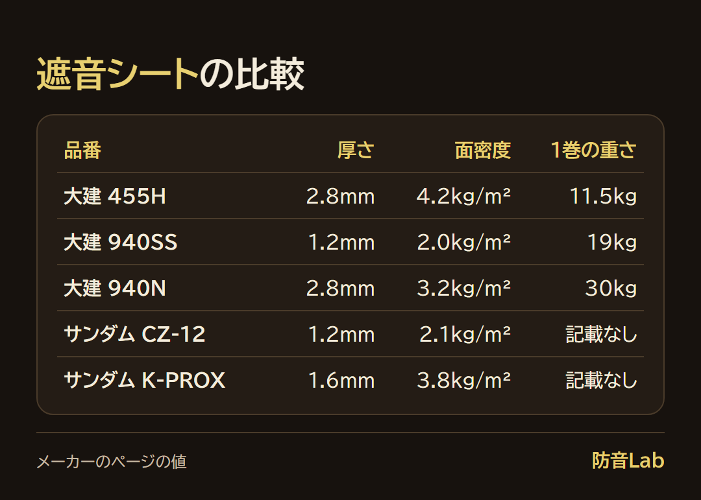
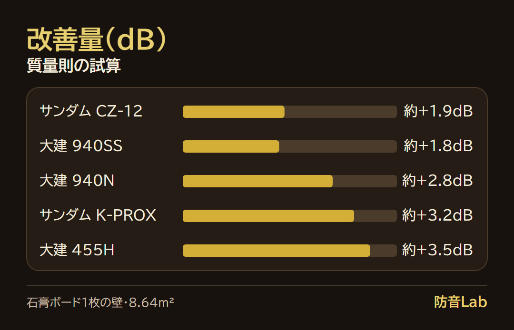
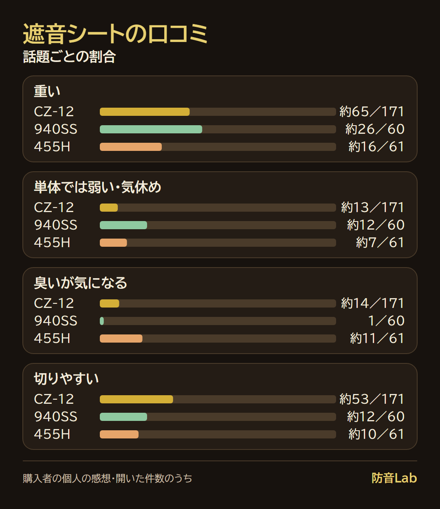

<RegionBanner />

遮音シートの選び方は、厚さでなく面密度（1m²あたりの重さ）で比べることです。

ダイケンの940SS（2.0kg/m²）とサンダム CZ-12（2.1kg/m²）は同じ1.2mm級で、石膏ボード1枚の壁に貼る改善は、質量則の試算でどちらも約2dBです。

大建工業のページは、遮音の数値（dB・透過損失・等級）を全品番で載せていません。ゼオン化成が載せるのも、K-PROX の「20dB/500Hz」だけです。

だから比べられる数字は、面密度・1巻の大きさと重さ・価格です。

その表と、6畳の壁1面の試算、購入者の口コミ（良い点と悪い点）で選び方をまとめます。

私は遮音シートを使ったことがなく、この記事は公表値と計算と、販売ページの口コミで書いています。

## 遮音シートの選び方は、面密度・1巻の重さ・貼る場所の3点で決める

- <strong>面密度</strong> : 性能は、1m²あたりの重さで比べます。同じ2.8mmでも、大建の455Hは4.2kg/m²、940Nは3.2kg/m²です
- <strong>1巻の重さ</strong> : 大建の1巻は11.5〜30kgです。壁1面に何巻、何kgを運ぶかを先に決めます
- <strong>貼る場所</strong> : 壁に貼る材料です。大建は、床下地に使っても床衝撃音の改善効果はないとしています

3点を、条件別の選び方にまとめると次の表になります。

| こうしたいなら | 選ぶ品 | 理由（数字） |
| :--- | :--- | :--- |
| 広い面を覆う | 大建 940SS・サンダム CZ-12 | 厚さ1.2mm、面密度2.0・2.1kg/m²。6畳の壁1面は10m巻1本で足りる |
| 狭い面で重さを足す | 大建 455H・サンダム K-PROX | 面密度4.2・3.8kg/m²。455Hは幅455mmなので、壁1面で4巻 |
| 粘着で貼りたい | 大建 940N | 粘着タイプ、面密度3.2kg/m²。賃貸ではがせるかは、大建のページに記載なし |
| 床の足音を減らしたい | 遮音シートでなく床の防音マット | 大建は、床下地に使っても床衝撃音の改善効果はないとしている |

面密度から改善量を出す式は、[遮音シートは効果ある？6畳の壁1面で試算した改善量と効かない原因](/ja/diy/sound-insulation-sheet-effect/)で説明しています。

## ダイケンとサンダムの遮音シートを、厚さ・面密度・1巻の重さ・価格で比べる

大建工業とゼオン化成サンダムの品を、メーカーのページの数字で並べました。2026年11月に確認した値で、「記載なし」はページに書かれていないという意味です。

| 品番 | 厚さ | 面密度 | 1巻の大きさ | 1巻の重さ | 材質 | 遮音の表示 |
| :--- | :--- | :--- | :--- | :--- | :--- | :--- |
| 大建 455H | 2.8mm | 4.2kg/m² | 455mm×6m | 11.5kg | 特殊非加硫ゴム | 記載なし |
| 大建 940B | 1.2mm | 2.1kg/m² | 940mm×10m | 20kg | 高比重物質配合のリサイクル塩ビ | 記載なし |
| 大建 940SS（西日本用）・940SSE（東日本用） | 1.2mm | 2.0kg/m² | 940mm×10m | 19kg | 940Bと同じ | 記載なし |
| 大建 940N（粘着） | 2.8mm | 3.2kg/m² | 940mm×10m | 30kg | アスファルト含浸ポリエステル不織布と特殊ゴム化アスファルト | 記載なし |
| サンダム CZ-12 | 1.2mm | 2.1kg/m² | 記載なし（販売店は940mm×10m） | 記載なし（販売店は約21kg） | リサイクル原料 | 記載なし |
| サンダム K-PROX | 1.6mm | 3.8kg/m² | 記載なし | 記載なし | 非鉛配合 | 20dB/500Hz（条件の記載なし） |
| サンダム YB-10 | 1mm | 記載なし | 記載なし | 記載なし | 記載なし | 記載なし |
| サンダム E-15・20・30 | 1.5・2.0・3.0mm | 2.6〜5.1kg/m²（型番ごとの値は記載なし） | 幅1m | 記載なし | 記載なし | 記載なし |

次は価格です。出どころが違うので、列を分けました。

| 品番 | 大建の参考価格（1巻） | 販売店の掲載（Yahoo!ショッピングの一覧） |
| :--- | :--- | :--- |
| 大建 455H | 6,700円 | 30件が4,779〜8,774円 |
| 大建 940B | 33,800円 | 確かめていない |
| 大建 940SS・940SSE | 22,000円 | 24件が3,380〜6,010円、6件が17,375〜20,240円 |
| 大建 940N | 42,200円 | 11件が27,970〜49,896円 |
| サンダム CZ-12 | メーカーのページに価格なし | 7,700円（2店）・6,490円（1店） |
| サンダム K-PROX | メーカーのページに価格なし | 該当商品なし |

- 大建の価格は、ページの価格欄の「参考価格」で、税込・税別の記載はありません
- 販売店の価格は、2026年11月に確かめた掲載で、店によって違います。税や送料の別は、掲載ごとには確かめていません
- 同じ940SSでも、店によって3,380円から20,240円まで開いています

大建のページには、2026年8月21日付で「一部生産中止品」の表示があります。生産中止と読めたのは排水管用の450Nだけなので、買う前に販売店で在庫を確かめます。

### 広い面を安く覆う（1.2mm級：サンダム CZ-12・大建 940SS）

6畳の壁1面（高さ2.4m×幅3.6m＝8.64m²）は、幅940mmを4本縦に並べて9.6mなので、10m巻1本で足ります。

切れるかが不安な人には、CZ-12 の口コミが手がかりになります。171件のうち約53件が、カッターやハサミで切れると書いています。

切りにくいと書いた人は0件でした（購入者の個人の感想）。

Amazonの口コミ（552件・星4.0。2026年11月28日に商品ページで確認）でも、ハサミやカッターで切りやすくタッカーで留めやすい、ゴムの臭いが少ないという声がありました。一方で、窓に貼ってもほとんど変わらず、吸音パネルのほうが効いたという声もあります（購入者の個人の感想）。

<AffiliateCard slug="sheet-sandam-cz-12" />

CZ-12 は、重いという口コミも約65件あり、10m巻は一人では大変という声が約15件あります。

同じ1.2mm級の大建 940SS は、石膏ボード1枚の壁に貼る改善が約1.8dBで、CZ-12 の約1.9dBとほぼ同じです。

940SS の口コミ60件では、約27件が音が減ったと書き、約12件が切りやすいと書いています。

一方で、端やタッカーの穴から裂けた、手で破れたという声も約5件あります。

Amazonの口コミ（東日本用の940SSE、536件・星4.0。2026年11月28日に商品ページで確認）では、音漏れがかなり減った、吸音ボードと組み合わせるとよく効いたという声がありました。一方で、とにかく重くて壁に貼るのが難しい、閉めきった部屋ではゴムの臭いがこもるという声もあります（購入者の個人の感想）。

<AffiliateCard slug="daiken-940ss" />

940SSの販売店の価格は、3,380円から20,240円まで開きます。買う店の掲載を先に確かめます。

### 狭い面で重さを稼ぐ（面密度の大きい品：大建 455H・サンダム K-PROX）

同じ壁1面の改善は、455Hが約+3.5dB、K-PROXが約+3.2dBです。

455Hは1巻が2.73m²なので、8.64m²には4巻（8.64÷2.73＝3.16の切り上げ）要ります。貼る重さは約36kg、買う重さは46kgです。

口コミ61件では、重いが約16件、臭いに触れたものが約15件です。

K-PROXは1.6mmでも、2.8mmの940N（3.2kg/m²）より面密度が大きい品です。

Yahoo!ショッピングの一覧では該当商品がなく、価格と1巻の大きさは確かめられませんでした。

## 同じ壁に貼ったとき、品ごとに改善量と費用はどう違う？6畳の壁1面で試算

試算の壁は、石膏ボード12.5mm1枚です。1枚14kgで、14÷(0.91×1.82)＝約8.45なので、8.5kg/m²として使います。

壁は高さ2.4m×幅3.6m＝8.64m²（6畳の壁1面）で、式は次のとおりです。

- <strong>改善量（dB）＝ 20 × log10（（8.5＋面密度）÷ 8.5）</strong>

質量則の試算で、すき間やコインシデンス効果は含みません。

| 品 | 面密度 | 合計 | 改善量（試算） | 必要な巻数 | 貼る重さ |
| :--- | :--- | :--- | :--- | :--- | :--- |
| サンダム CZ-12 | 2.1kg/m² | 10.6kg/m² | 約+1.9dB | 1巻 | 約18kg |
| 大建 940SS | 2.0kg/m² | 10.5kg/m² | 約+1.8dB | 1巻 | 約17kg |
| 大建 940B | 2.1kg/m² | 10.6kg/m² | 約+1.9dB | 1巻 | 約18kg |
| 大建 940N | 3.2kg/m² | 11.7kg/m² | 約+2.8dB | 1巻 | 約28kg |
| サンダム K-PROX | 3.8kg/m² | 12.3kg/m² | 約+3.2dB | 1巻の大きさを確かめられず | 約33kg |
| 大建 455H | 4.2kg/m² | 12.7kg/m² | 約+3.5dB | 4巻 | 約36kg |

巻数は、壁の面積を1巻の面積（940mm×10m＝9.4m²、455mm×6m＝2.73m²）で割って切り上げた数です。重ね代と端材は含めていません。

その巻数を買った費用は、次のとおりです。

| 品 | 巻数 | 大建の参考価格 | 販売店の掲載（Yahoo!ショッピングの一覧） |
| :--- | :--- | :--- | :--- |
| サンダム CZ-12 | 1巻 | メーカーのページに価格なし | 7,700円（2店）・6,490円（1店） |
| 大建 940SS | 1巻 | 22,000円 | 24件が3,380〜6,010円、6件が17,375〜20,240円 |
| 大建 940B | 1巻 | 33,800円 | 確かめていない |
| 大建 940N | 1巻 | 42,200円 | 11件が27,970〜49,896円 |
| 大建 455H | 4巻 | 26,800円（6,700円×4） | 19,116〜35,096円（4,779〜8,774円×4） |

出どころが違う価格なので、安い・高いの勝ち負けは言いません。

940SSとCZ-12は改善が約+1.8dBと約+1.9dBでほぼ同じです。同じ1.2mm級の価格差の理由は、大建のページに説明がありません。

面密度が大きい品ほど、改善も巻数も費用も増えます。455Hは4巻で約+3.5dBで、CZ-12との差は約1.6dBです。

費用の倍率は、価格の組み合わせで変わります。455H 4巻の最も低い掲載（19,116円）は、CZ-12の7,700円の約2.5倍です（19,116÷7,700＝2.48）。

大建のFAQでは、同じ材料を2倍にした改善は約5dBです。聞こえる音を半分にするには約10dBの改善が要り、同じ材料なら4倍の量になります。

私なら、まず1.2mm級で貼る範囲を決めます。改善は2dBに届かないので、足りない分を石膏ボードなど別の重さで足すか考えます。

重い品のフレームは、[遮音シートの重さで自作ブースが崩れないためのフレーム補強術](/ja/diy/soundproof-sheet-heavy-diy-tips/)にまとめています。

## 遮音シートの口コミ：サンダム CZ-12・大建 940SS・455H の良い点と悪い点

Yahoo!ショッピングと楽天市場で、2026年11月に開いた口コミは、CZ-12が171件（Yahoo!81・楽天90）、940SSが60件、455Hが61件です。

どれも購入者の個人の感想で、遮音性能の事実ではありません。

切りやすいという声が多い一方で、重い・臭い・単体では弱いという声も多く、吸音材や石膏ボードと重ねて使う人が多く見られました。

### 良い点：切りやすい・音が減ったと感じた

| 話題 | CZ-12（171件） | 940SS（60件） | 455H（61件） |
| :--- | :--- | :--- | :--- |
| 切りやすい・切れる | 約53件 | 約12件 | 約10件 |
| 音が減ったと感じた | 約66件 | 約27件 | 約23件 |
| 臭いが気にならない・消えた | 約15件 | 約5件 | 約4件 |

### 悪い点：重い・臭い・単体では弱い

| 話題 | CZ-12（171件） | 940SS（60件） | 455H（61件） |
| :--- | :--- | :--- | :--- |
| 重い | 約65件 | 約26件 | 約16件 |
| 単体では弱い・気休め | 約13件 | 約12件 | 約7件 |
| 臭いが気になる | 約14件 | 1件 | 約11件 |
| 低音には効きにくい | 約4件 | 3件 | 2件 |

併用した人は、CZ-12 が約60件、940SSが約22件で、単体の効果だけを見た口コミではありません。

重さで「一人では大変・二人で」と書いた人は、CZ-12 で約15件、940SSで約8件です。

口コミの評価の表示は、CZ-12 がYahoo!4.28（189件）と楽天4.37（213件）、940SSが3店で4.33〜4.61、455Hが5店で4.08〜4.80です。

星には配送や店の対応への評価も混ざるので、性能の根拠にはしません。

サンダム K-PROX と大建 940N は、口コミは確かめていません。

## 遮音シートの遮音性能（dB・透過損失）はどこで見る？メーカーの表示を読む

メーカーのページに書いてあることと、ないことです。

| メーカー・品 | 書いてあること | 書いていないこと |
| :--- | :--- | :--- |
| 大建工業（455H・940B・940SS・940N） | 厚さ・幅・長さ・1巻の重さ・面密度・参考価格・使用上の注意 | 透過損失・dB・遮音等級・試験条件 |
| ゼオン化成 サンダム CZ-12 | 厚さ1.2mm・面密度2.1kg/m² | 幅・長さ・1巻の重さ・遮音の数値 |
| ゼオン化成 サンダム K-PROX | 厚さ1.6mm・面密度3.8kg/m²・「20dB/500Hz」 | 何の試験の値かの区分・条件 |

dBで比べられないので、面密度で比べ、dBは質量則の試算として読みます。

設計施工資料やカタログのPDFは、今回の調べでは中身を読めていません。透過損失の表が要る人は、メーカーに問い合わせます。

一覧は[防音材スペック早見表](/ja/knowledge/soundproof-material-spec-chart/)にあります。

## 買う前に確かめること：下地・重さ・貼り方・床への使用

- <strong>下地</strong> : 大建は、軽量鉄骨下地にはステープルが留まらず、直接留められないとしています。両面テープ施工も勧めていません
- <strong>温度と仮留め</strong> : ゼオン化成は、5℃以下では割れることがあるので室温に戻して加工し、仮留めはアクリル系粘着テープとしています
- <strong>床</strong> : 大建は、床下地に使っても床衝撃音の改善効果はないとしています

貼り方と賃貸の貼り方は、[遮音シートを壁に貼る方法](/ja/diy/sound-insulation-sheet-wall-install/)で手順にしています。

床の足音には、[床の防音マットの選び方](/ja/diy/floor-soundproof-mat/)の、軽い音に効く種類から選びます。

シートだけの改善は、試算で約1.8〜3.5dBです。足りないときは重ねる材料を変えます。吸音材は、[吸音材おすすめの選び方](/ja/diy/sound-absorbing-material-recommend/)で比べています。

## よくある質問

### 遮音シートはダイケンとサンダムのどちらがよいですか？

同じ1.2mm級なら、面密度が940SSで2.0kg/m²、CZ-12で2.1kg/m²とほぼ同じです。違いは1巻の重さと価格です。

重さを稼ぐなら、K-PROX（3.8kg/m²）や455H（4.2kg/m²）を選びます。

### 遮音シートは厚いほど遮音できますか？

厚さでなく面密度で決まります。1.6mmのK-PROX（3.8kg/m²）は、2.8mmの940N（3.2kg/m²）より重い品です。

### 遮音シートを2倍にすれば音は半分になりますか？

なりません。大建のFAQでは、同じ材料を2倍にした改善は約5dBで、聞こえる音を半分にするには約10dBの改善が要ります。

### 遮音シートを床に敷いて足音は減りますか？

大建は、床下地に使っても、軽量・重量床衝撃音の改善効果はないとしています。

CZ-12の口コミでは、床に使った約25件のうち約15件が足音が減ったと書きますが、ほぼ全員がタイルカーペットなどと重ねています。

階下で確かめたと書いたのは2件で、購入者の個人の感想です。

### 遮音シートは切りにくいですか？

切りにくいという口コミは少なく、CZ-12は171件のうち約53件が切れると書き、切りにくいは0件でした。

940SSは60件のうち約12件が切りやすいと書く一方、端や穴から裂けたという声が約5件あります。

### 大建の遮音シートはどう貼りますか？

大建のFAQでは、940SSは柱・間柱にステープルで縦張りし、シート同士を10mm以上重ねます。

## まとめと次にやること

- 遮音シートは、厚さでなく面密度で比べます。940SS（2.0kg/m²）とCZ-12（2.1kg/m²）は、壁1面の試算で約1.8dBと約1.9dBです
- 455H（4.2kg/m²）は、4巻で約+3.5dBですが、貼る重さは約36kgです
- 口コミは、切りやすいという声が多い一方、重い・臭い・単体では弱いという声もあります

次にやることは1つです。

私なら、貼る面積を測り、1.2mm級で足りるか、重い品が要るかを、巻数と重さまで書き出します。

## 出典と確認日（2026年11月に確認）

- 大建工業「遮音シート」製品ページ（仕様・参考価格・使用上の注意）: https://www.daiken.jp/product/DispDetail.do?volumeName=00001&itemID=t000100002468
- 大建工業FAQ「940SSの壁への施工」: https://faq.daiken.jp/faq/show/601?site_domain=user
- 大建工業FAQ「遮音材を2倍にすれば、耳に聞こえる音は1/2になりますか？」: https://faq.daiken.jp/faq/show/342?site_domain=user
- ゼオン化成「サンダム 遮音シート」: http://www.zeonkasei.co.jp/kenzai/sandam/001.htm
- くらしのもり Yahoo!ショッピング店「サンダムCZ-12」: https://store.shopping.yahoo.co.jp/yamayuu/cz-12.html
- カインズ「ハイクリンボード 幅910mm 長さ1820mm 厚さ12.5mm」: https://www.cainz.com/g/2200024521323.html
- Yahoo!ショッピングの検索結果（940SS・455H・940N・CZ-12の販売店の掲載価格）: https://shopping.yahoo.co.jp/search?p=%E9%81%AE%E9%9F%B3%E3%82%B7%E3%83%BC%E3%83%88+940SS+GB03053
- 口コミ（購入者の個人の感想）: Yahoo!ショッピング くらしのもり（CZ-12）https://shopping.yahoo.co.jp/review/item/list?store_id=yamayuu&page_key=cz-12 ／ 楽天市場 ピアリビング（CZ-12）https://review.rakuten.co.jp/item/1/219561_10011655/1.1/ ／ Yahoo!ショッピング e-キッチンマテリアル（940SS）https://shopping.yahoo.co.jp/review/item/list?store_id=e-kitchenmaterial&page_key=gb03053 ／ Yahoo!ショッピング コンパネ屋（455H）https://shopping.yahoo.co.jp/review/item/list?store_id=conpaneya&page_key=gb0307
