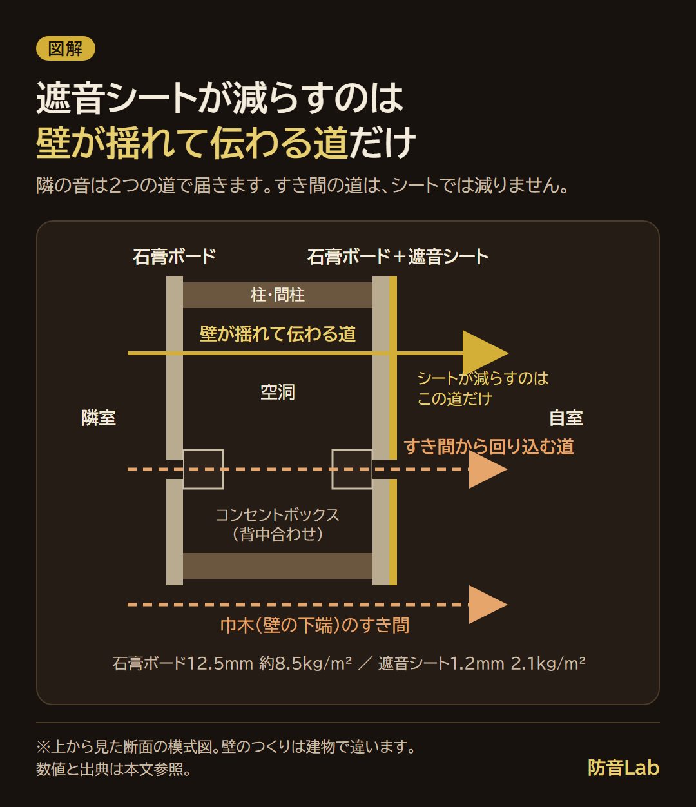
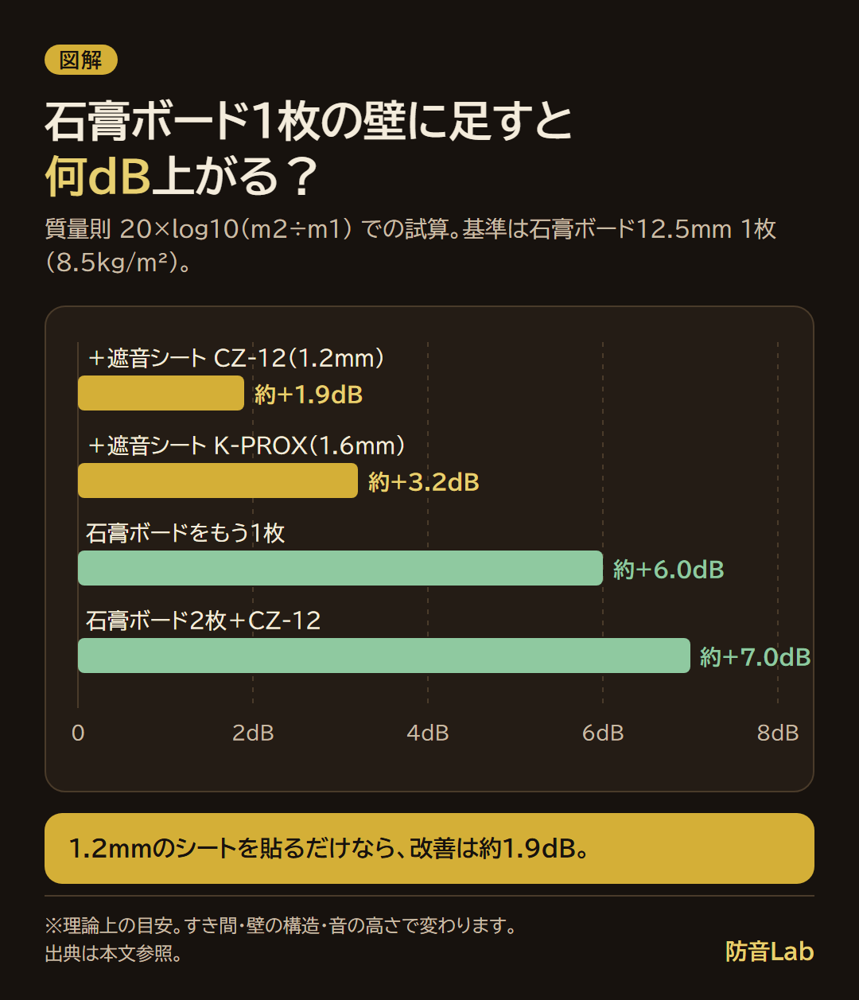
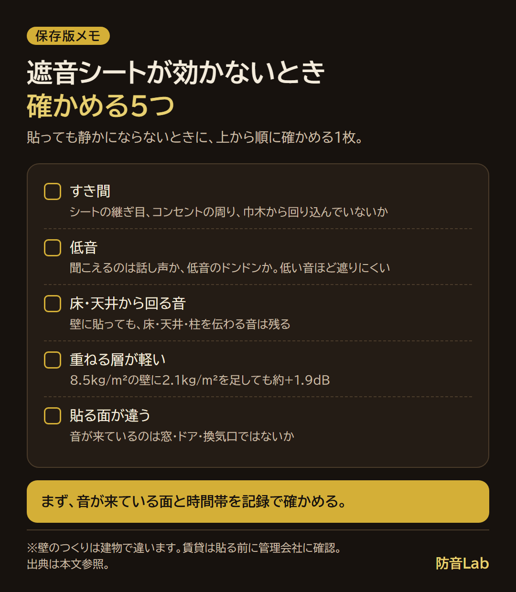

<RegionBanner />

遮音シートは効果がありますが、石膏ボード1枚の壁に厚さ1.2mmのシートを貼るだけなら、改善は約1.9dBです。

メーカー公表値の面密度（1.2mm品で2.1kg/m²）と質量則の式を使い、壁に足した重さから改善量を計算しました。

戸建ての子ども部屋の壁1面と、1LDKの両隣2面の試算に加えて、効かない5つの原因と、音が来ている面の確かめ方をまとめます。

私は、隣から話し声が聞こえると、こちらの電話の声も聞こえているのかなと思って小声になります。

自由に話せないのがつらく、遮音シートを貼れば解決するかもしれないと考えました。

ただ、壁の全面に貼るのか、一部でも効果があるのか、貼ったあとに剥がすことになったらと考えると、一歩踏み出せていません。

私は遮音シートを使ったことがないので、この記事は使った感想ではなく、公表値と計算で書いています。

## 遮音シートとは？効果が出る仕組みは「壁を重くする」こと

遮音シートは、壁や床に重さを足して、音を通しにくくする薄いシート状の建材です。

遮音シートの効果は、壁に足した重さで決まります。

壁は、音を受けると揺れて、反対側の部屋に音を伝えます。

重い壁ほど揺れにくく、隣の部屋に届く音が小さくなります。これが質量則です。

質量則の式は、壁の重さ（面密度）が m1 から m2 に増えたときの改善量を、次のように表します。

- <strong>改善量（dB）≒ 20 × log10（m2 ÷ m1）</strong>

面密度が2倍になると、この式では約6dB（20 × log10(2) ＝ 6.02）の改善です。

日本建設業連合会の用語解説は、いろいろな角度から音が当たる実際の条件では、2倍で約5dBとしています。

隣の音は、2つの道で届きます。

- <strong>壁そのものが揺れて伝わる道</strong> : 遮音シートが減らすのは、この道だけです
- <strong>すき間から回り込む道</strong> : コンセントの穴、巾木（壁の下端の板）のすき間、シートの継ぎ目から届きます

すき間があると、計算した改善量は出ません。

壁の中で音が通る道を、断面で見るとこうなります。

### 面密度（kg/m²）で性能を比べる

面密度は、シート1m²あたりの重さです。

2.1kg/m²なら、1m四方に切ったシートが2.1kgあります。

遮音シートの性能は、この面密度で比べます。

| 材料 | 厚さ | 面密度 | 出典・条件 |
| :--- | :--- | :--- | :--- |
| 遮音シート CZ-12 | 1.2mm | 2.1kg/m² | ゼオン化成の製品ページ |
| 遮音シート K-PROX | 1.6mm | 3.8kg/m² | ゼオン化成の製品ページ |
| 遮音シート E-15・20・30 | 1.5・2.0・3.0mm | 2.6〜5.1kg/m² | ゼオン化成の製品ページ（型番ごとの値は記載なし） |
| 石膏ボード（GB-R） | 12.5mm | 約8.5kg/m² | チヨダウーテの資料で910×1820mm1枚が約14kg。14 ÷ (0.91 × 1.82) ＝ 約8.45 |

1.2mmのシート（2.1kg/m²）の重さは、石膏ボード12.5mm1枚の約4分の1です（2.1 ÷ 8.5 ＝ 0.25）。

だから、シートを1枚貼るだけでは、壁の重さはあまり増えません。

### 吸音材とは役割が逆

遮音シートは、壁を通り抜ける音を減らす材料です。

吸音材は、部屋の中の反響を減らす材料で、壁を通り抜ける量は変えません。

2つの違いは、[吸音材と遮音材の違いと選び方](/ja/knowledge/absorption-vs-soundproofing-materials/)で整理しています。

## 遮音シートを壁に貼るだけで何dB下がる？6畳の壁1面で試算

2つの場面で計算しました。壁の高さは2.4m、壁の幅は3.6mと仮定します。

- <strong>場面A</strong> : 戸建ての6畳の部屋で、隣の子ども部屋の声やゲームの音が壁越しに聞こえる（壁1面）
- <strong>場面B</strong> : 分譲マンションの1LDKで、両隣の話し声が聞こえる（戸境壁2面）

壁は、場面A・Bとも、柱に石膏ボード12.5mmを1枚張った軽いつくり（面密度 8.5kg/m²）と仮定します。

マンションの戸境壁がコンクリートなど、これより重い壁なら、同じシートで増える重さの割合が小さいので、改善量はこの試算より小さくなります。

壁の面積は、場面Aが 2.4 × 3.6 ＝ 8.64m²、場面Bが 8.64 × 2 ＝ 17.28m² です。

次の表は、足す材料ごとの改善量です。

| 壁の構成 | 面密度の合計 | 式 | 改善量 |
| :--- | :--- | :--- | :--- |
| 石膏ボード1枚（基準） | 8.5kg/m² | — | — |
| ＋遮音シート CZ-12（2.1kg/m²） | 10.6kg/m² | 20 × log10(10.6 ÷ 8.5) | 約+1.9dB |
| ＋遮音シート K-PROX（3.8kg/m²） | 12.3kg/m² | 20 × log10(12.3 ÷ 8.5) | 約+3.2dB |
| 石膏ボードをもう1枚（計2枚） | 17.0kg/m² | 20 × log10(17.0 ÷ 8.5) | 約+6.0dB |
| 石膏ボード2枚＋CZ-12 | 19.1kg/m² | 20 × log10(19.1 ÷ 8.5) | 約+7.0dB |

1.2mm品を貼るだけの改善は、約1.9dBです。

上の「2倍で約5dB」の目安で同じ計算をすると、1.9 × 5 ÷ 6.02 ＝ 約1.6dBです。

どちらの計算でも、改善は2dBに届きません。

仮に10dB下げたいなら、面密度を約3.2倍にする計算です（10dBは 10^(10÷20) ＝ 3.16倍）。

8.5 × 3.16 ＝ 26.9kg/m² になるので、足す重さは 26.9 − 8.5 ＝ 約18.4kg/m² です。

CZ-12だけで足すと、18.4 ÷ 2.1 ＝ 約8.8枚分で、場面Aの壁1面だと 18.4 × 8.64 ＝ 約159kg になります。

足す材料ごとの改善量を、棒の長さで比べました。

この計算は、質量則だけで出した理論上の目安です。

実際は、壁の構造やすき間、特定の音域で遮音が落ちるコインシデンス効果で変わります。コインシデンス効果は、[コインシデンス効果と質量則の限界](/ja/knowledge/coincidence-effect-soundproofing/)で解説しています。

### 場面Aと場面Bの枚数・重さ・費用

CZ-12は幅940mmなので、壁の幅3.6mには 3.6 ÷ 0.94 ＝ 3.83 なので、4本を縦に並べます。

高さ2.4mの4本で 2.4 × 4 ＝ 9.6m、10m巻1本で足ります。

| 項目 | 場面A（壁1面・8.64m²） | 場面B（壁2面・17.28m²） |
| :--- | :--- | :--- |
| CZ-12（10m巻）の本数 | 1本（9.6m） | 2本（19.2m） |
| シートの重さ | 8.64 × 2.1 ＝ 約18kg | 17.28 × 2.1 ＝ 約36kg |
| シートの費用 | 7,700円 | 15,400円 |
| 改善量（シートのみ） | 約+1.9dB | 約+1.9dB（各面） |
| 石膏ボードを足す場合 | 8.64 ÷ 1.656 ＝ 約5.2枚分・8.64 × 8.5 ＝ 約73kg | 17.28 ÷ 1.656 ＝ 約10.4枚分・17.28 × 8.5 ＝ 約147kg |

石膏ボード1枚（0.91 × 1.82 ＝ 1.656m²）あたりの重さは約14kgです。

費用は、2026年11月10日にYahoo!ショッピングのくらしのもり店で確認した、CZ-12（厚さ1.2mm・幅940mm・長さ10m）の7,700円です。税込か税別かの表記は、ページで見つかりませんでした。

石膏ボードの価格は、公式ページで確認できなかったので載せていません。

遮音シートの重さを支えるフレームの補強は、[遮音シートの重さで自作ブースが崩れないためのフレーム補強術](/ja/diy/soundproof-sheet-heavy-diy-tips/)で解説しています。

### 壁の一部だけ貼っても効果はある？

効果はありますが、貼った面積の割合の分だけ小さくなります。

音は、シートのない部分から先に抜けるからです。

CZ-12で1.9dB下がる部分は、音の通りやすさが 10^(−1.9÷10) ＝ 約0.646 になります。貼っていない部分は 1.0 のままです。

壁の半分に貼ると、壁全体の平均は 0.5 × 1.0 ＋ 0.5 × 0.646 ＝ 約0.823 です。改善量は 10 × log10(1 ÷ 0.823) ＝ 約0.8dB になります。

| 貼る範囲 | 壁全体の音の通りやすさ | 改善量 |
| :--- | :--- | :--- |
| 壁の全面（100%） | 0.646 | 約1.9dB |
| 壁の半分（50%） | 0.823 | 約0.8dB |
| 壁の4分の1（25%） | 0.911 | 約0.4dB |

私が迷っていた「全面か一部か」は、この計算だと「貼った面積の割合で、効く量が決まる」が答えです。

一部だけ貼るなら、音がいちばん強く来ている場所を先に探します。探し方は、後ろの「音が来ている面を確かめる方法」にまとめました。

## 遮音シートの効果がない・感じない5つの原因

遮音シートを貼っても静かにならないとき、次の5つを順に確かめます。

| 原因 | 何が起きているか | 確かめ方・直し方 |
| :--- | :--- | :--- |
| すき間 | シートの継ぎ目、コンセントの周り、巾木のすき間から音が回り込む | 継ぎ目は遮音テープでふさぐ（ゼオン化成は、遮音テープを遮音シートや石膏ボードの目地に使うと遮音性能が高まるとしている） |
| 低音 | 質量則は、周波数が低いほど遮音量が小さい（日建連の式 R0 ＝ 20 × log10(m × f) − 42.5。周波数が2倍で約5dB増える） | 聞こえているのが話し声か、低音のドンドンかを分ける |
| 床・天井から回る | 壁にシートを貼っても、床や天井、柱を伝わる音は残る | 音が来る場所を壁・床・天井で記録して比べる |
| 重ねる層が軽い | 8.5kg/m² の壁に 2.1kg/m² を足しても、約+1.9dB | 上の試算表で、足す重さを計算する |
| 貼る面が違う | 音が来ているのは、窓、ドア、換気口 | 面ごとにレベルを記録する |

貼ったあとに確かめる5つを、保存して見返せる1枚にまとめました。

### コンセントから音が漏れるのはなぜ？

マンションや戸建ての間仕切り壁には、柱に石膏ボードを張っただけで、ボードの裏が空洞のつくりがあります。

コンセントは、その空洞の中に箱（コンセントボックス）を入れて、石膏ボードに穴を開けて付けます。

隣の部屋と背中合わせの位置にあると、2つの穴が空洞をはさんで向かい合います。

穴は石膏ボードの重さがない場所なので、壁の遮音を弱めます。

壁のつくりは、建物で違います。自分の壁に空洞があるかは、管理会社や建築図面で確かめます。

コンセントのカバーを外す作業は、感電の危険があります。電気に関わる作業は、管理会社や電気工事士に相談してください。

## 床に敷く遮音シートの効果は「足音」には別の物差し

床に敷く遮音シートの効果は、階下へ届く声やテレビの音（空気を伝わる音）には、質量則で働きます。

足音や物を落とした音は、床そのものがたたかれて伝わる音です。重さを足すだけでは、足音の改善量を質量則で出せません。

床の足音は、L値（床衝撃音レベル）で測ります。L値は、数字が小さいほど足音を遮る性能が高い物差しです。

等級の読み方は、[床の防音等級の読み方](/ja/knowledge/floor-soundproof-rating/)にまとめています。

ジョイントマットで足音が防げない理由は、[階下から足音の苦情が来たとき、ジョイントマットで防げない理由](/ja/knowledge/vibration-reduction-science/)で解説しています。

## 効果を足すなら：遮音シートの前後にやること

遮音シートの前後に、次の順で足します。

| 順 | やること | 狙い | 改善量・費用 |
| :--- | :--- | :--- | :--- |
| 1 | コンセント周り、巾木、ドアのすき間をふさぐ | 音の回り込みを減らす | すき間の大きさで変わり、質量則では計算できない |
| 2 | 遮音シートを貼る（CZ-12） | 壁を重くする | 約+1.9dB、10m巻7,700円 |
| 3 | 面密度が重いシートにする（K-PROX） | 壁をもっと重くする | 約+3.2dB、価格は公式ページに記載なし |
| 4 | 石膏ボードを足す | 壁を重くする | 約+6.0dB（2枚にした場合）、場面Aで約73kg |
| 5 | 吸音材を置く | 部屋の中の反響を減らす | 壁の遮音量は変わらない |

質量則の改善量は、1から4へ進むほど大きくなりますが、重さと工事の手間も増えます。

4は壁の工事になるので、賃貸では管理会社の許可が前提です。

### 剥がす前提で貼るときの考え方

貼ったあとに剥がす可能性があるなら、固定方法を先に決めます。

シートは壁1面で約18kgあるので、テープだけで支えるときは、小さい面で貼ってみて、落ちてこないかを確かめてからにします。

ゼオン化成は、遮音シートを仮留めするときはアクリル系粘着テープを使い、ゴム系粘着テープは避けるよう案内しています。

壁を傷つけない固定方法と、原状回復の考え方は、[賃貸で壁を傷つけずにできる防音対策と原状回復の考え方](/ja/diy/renter-parent-house-soundproofing/)にまとめています。

道具・材料の数量と、継ぎ目やコンセントまわりの処理は、[遮音シートを壁に貼る方法](/ja/diy/sound-insulation-sheet-wall-install/)で手順にしています。

## 音が来ている面を確かめる方法

音が出ている最中に、その場で測るのは難しいです。

代わりに、置きっぱなしにして、時間帯ごとの記録を残します。

1. <strong>騒音計アプリの記録機能</strong> : スマホを壁ぎわに置いて、夜のあいだ記録します。アプリの選び方と誤差は、[防音性能を測るスマホアプリ比較](/ja/knowledge/soundproof-app-review-2026/)で比べています。スマホの内蔵マイクは、低音の感度が機種で違います。
2. <strong>記録できる騒音計（データロガー付き）</strong> : 例として、カスタムのデータロガー騒音計 SL-1373SD は、取扱説明書によると、測定値と時刻をSDカードに1〜3600秒の間隔で記録できます。IEC 61672 class 2に準拠した設計で、A特性30〜130dB、精度は±1.4dB（1kHz、23±5℃）です。ロガー動作時の電池寿命は約60時間（アルカリ単3×6本）です。価格は、公式ページで確認できなかったので載せていません。
3. <strong>家族に音を出してもらう（戸建ての場面A）</strong> : 子ども部屋で、同じ曲を同じ音量で流してもらいます。壁、ドア、窓の前で順に測ります。

音が出ていない時間のレベルも、記録しておきます。音が出た時刻との差で、どの面から来ているかを比べられます。

1台では、壁・窓・ドアを同じ時刻には測れません。音が出る時刻が毎日決まっているなら、日を分けて、同じ時刻に置く場所を変えます。

## よくある質問

### 防音シートと遮音シートの違いは何ですか？

防音は、吸音・遮音・防振をまとめた言い方で、遮音シートはそのうち遮音を受け持つ材料です。

通販では、同じ商品が「防音シート」とも「遮音シート」とも書かれています。例えば、サンダム CZ-12 は「防音シート (軟質遮音シート)」の名前で売られています。

見分けるときは、面密度（kg/m²）が書かれているかを確かめます。吸音材は、面密度ではなく、反響を減らす材料です。

### 遮音シートの効果は何年もちますか？

ゼオン化成の製品ページには、耐用年数や、効果が何年続くかの記載は見つかりませんでした。

載っていたのは、5℃以下では硬くなって割れや折れが起こることがあるので、室温に戻してから加工すること、床暖房の上には12mm以上の合板を敷くこと、といった取り扱いの注意です。

質量則の計算は、シートの重さで決まります。貼ったままで剥がれ落ちたり、継ぎ目が開いたりしなければ、計算上の改善量は変わりません。

### 賃貸の壁に貼っても大丈夫ですか？

壁を傷つけない固定方法を選べば、貼ること自体はできます。ただし、貼ってよいかは、契約と管理会社の判断で決まります。

貼る前に、管理会社か不動産会社に、壁にテープを貼ってよいかを確認してください。

原状回復の扱いは、契約書の内容や個別の状況で変わります。不安があるときは、管理会社や自治体の相談窓口、専門家に確認してください。

## まとめと次にやること

- 遮音シートの効果は、壁に足した重さで決まります。1.2mm品（2.1kg/m²）を石膏ボード1枚の壁に貼るだけでは、約1.9dBです
- 壁の一部だけに貼ると、半分で約0.8dB、4分の1で約0.4dBに小さくなります
- 効かないときは、すき間、低音、床・天井から回る音、重ねる層の軽さ、貼る面の違いを順に確かめます

次にやることは1つです。

記録アプリか、データロガー付きの騒音計を壁ぎわに置いて、音が来ている面と時間帯を確かめます。

そのあとで、貼る場所と、貼る範囲を決めます。

## 出典と確認日

- ゼオン化成「サンダム 遮音シート」（CZ-12 1.2mm・2.1kg/m²、K-PROX 1.6mm・3.8kg/m²、E-15・20・30 2.6〜5.1kg/m²、取り扱いの注意）: http://www.zeonkasei.co.jp/kenzai/sandam/001.htm（2026年11月10日に確認）
- 日本建設業連合会の音響用語解説PDF（sa-0300。面密度が2倍で透過損失は約5dB、R0 ＝ 20log10(m・f) − 42.5）: https://www.nikkenren.com/kenchiku/sound/pdf/glossary/sa-0300.pdf（2026年11月10日に確認）
- チヨダウーテ「吸音ボード不燃品」チラシ（GB-R 12.5mm・910×1820mmが約14kg）: https://www.chiyoda-ute.co.jp/form_download/download_exe/pdf/nckyuonboard.pdf（2026年11月10日に確認）
- カインズ「ハイクリンボード 幅910mm 長さ1820mm 厚さ12.5mm」（14kg）: https://www.cainz.com/g/2200024521323.html（2026年11月10日に確認）
- くらしのもり Yahoo!ショッピング店「サンダムCZ-12」（10m巻7,700円、面密度2.1kg/m²）: https://store.shopping.yahoo.co.jp/yamayuu/cz-12.html（2026年11月10日に確認）
- カスタム「データロガー騒音計 SL-1373SD 取扱説明書」: https://www.kk-custom.co.jp/emp/pdf/M_SL-1373SD.pdf（2026年11月10日に確認）
