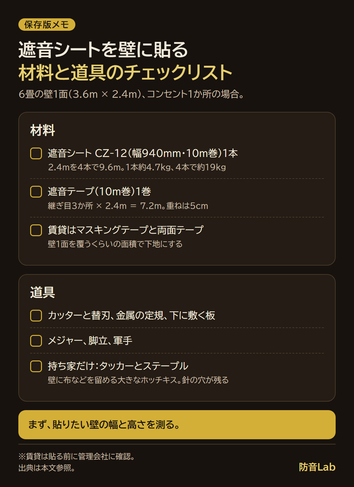
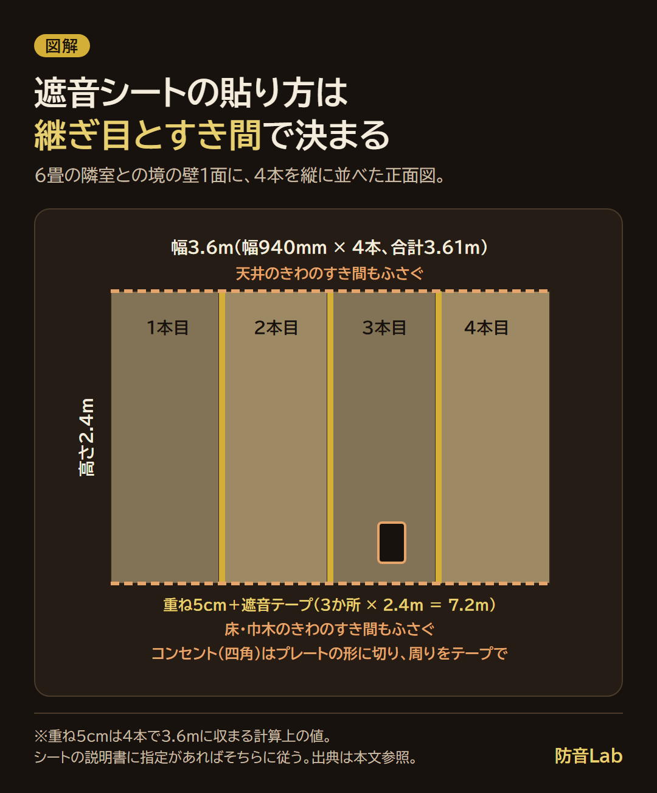
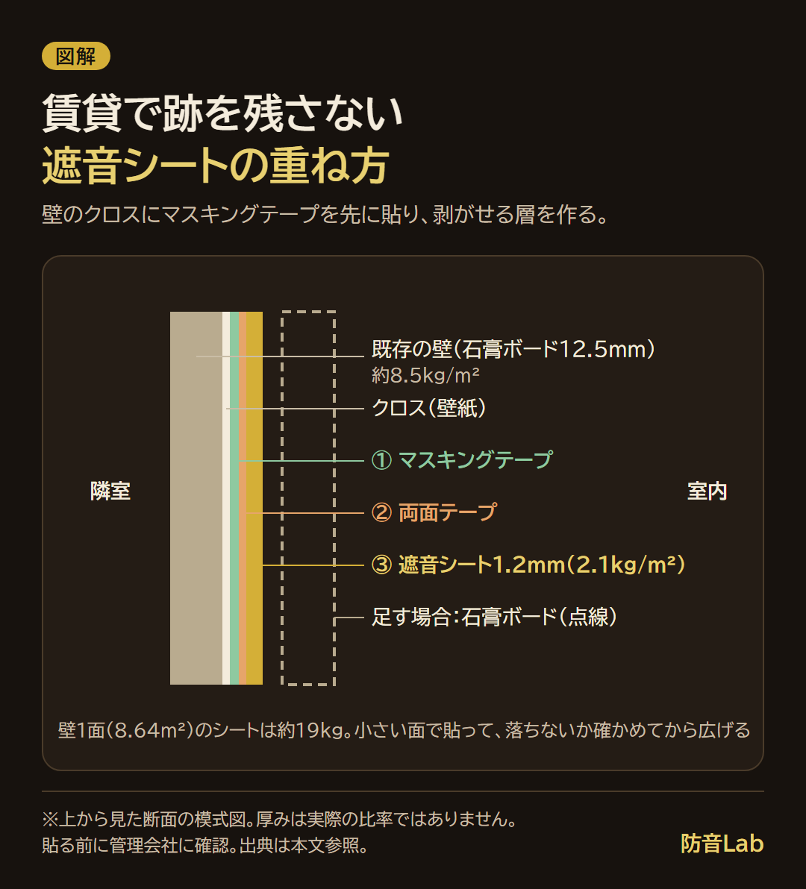

<RegionBanner />

遮音シートの壁の貼り方は、シートの継ぎ目を重ね、隣の部屋の音が入るすき間をふさぎ、上から重い面材で押さえる、の3つです。

メーカーの施工説明と日本建設業連合会の資料を読むと、効果を落とすのは、シートの性能より、継ぎ目とコンセントまわりのすき間でした。

6畳の壁1面（幅3.6m × 高さ2.4m）を例に、道具・数量・手順と賃貸で跡を残さない貼り方をまとめます。

私は遮音シートを使ったことがなく、この記事は感想ではなく、公表値と資料、計算で書いています。

## 遮音シートの壁の貼り方は「継ぎ目を重ねる・音の抜け道をふさぐ・上から押さえる」の3つ

| 動作 | 意味 | 根拠 |
| :--- | :--- | :--- |
| 継ぎ目を重ねる | シートを2枚重ねるのではなく、継ぎ目どうしを5cmほど重ねる | 大建工業は、遮音シート940SSを10mm以上重ねる施工としている |
| 音の抜け道をふさぐ | 隣の部屋の音が入る、コンセントまわり・巾木・天井と床のきわのすき間をふさぐ | 日本建設業連合会の資料は、コンセントボックスの四周にすき間を残さないとしている |
| 上から押さえる | シートの上に石膏ボードなどを重ねて、壁をさらに重くする | シートだけの改善は約1.9dB。石膏ボードも足すと約7.0dB |

約1.9dBは、石膏ボード12.5mm 1枚の壁（8.5kg/m²）に、厚さ1.2mmのCZ-12（2.1kg/m²）を貼った質量則の試算です。

試算の式と表は、[遮音シートは効果ある？6畳の壁1面で試算した改善量と効かない原因](/ja/diy/sound-insulation-sheet-effect/)にあります。

## 用意する遮音シートの道具と材料｜6畳の壁1面の数量と費用

前提は、賃貸の6畳で、隣室との境の壁1面（3.6 × 2.4 ＝ 8.64m²）、コンセント1か所です。

CZ-12の幅は940mmなので、3.6 ÷ 0.94 ＝ 3.83 より、4本を縦に並べます。

重ね幅は、シートの説明書の指定が先です。ゼオン化成のCZ-12の製品ページに、重ね幅の記載はありません。

4本で重ねられる上限は (4 × 0.94 − 3.6) ÷ 3 ＝ 約5.3cm なので、5cmで計算します（0.94 ＋ 3 × 0.89 ＝ 3.61m）。

高さ2.4mの4本は 2.4 × 4 ＝ 9.6m で、10m巻1本で足ります。

| 区分 | 品目 | 数量 | 費用・備考 |
| :--- | :--- | :--- | :--- |
| 材料 | CZ-12（厚さ1.2mm・幅940mm・10m巻） | 1本 | 7,700円。販売ページの重量は約21kg |
| 材料 | 遮音テープ（厚さ0.7mm・幅50mm・10m巻） | 1巻（3か所 × 2.4m ＝ 7.2m） | 4,290円（税込）。ゼオン化成は、在庫がなくなり次第販売終了としている |
| 材料 | マスキングテープ・両面テープ | 賃貸の下地。貼る面積で決まる | メーカーの指定なし |
| 道具 | カッターと替刃、金属の定規、下に敷く板、メジャー、脚立、軍手 | 各1 | 価格は書かない |
| 道具 | タッカー（壁に布などを留める、大きなホッチキスのような道具）とステープル | 持ち家だけ | 針の穴が壁に残る |

価格は、2026年11月11日に通販ページで確認しました。シートの7,700円は、税込か税別かの表記がありません。

シートと遮音テープの合計は 7,700 ＋ 4,290 ＝ 11,990円です。

1本（2.4m）は 2.4 × 0.94 × 2.1 ＝ 約4.7kg、4本で約19kgです。

10m巻1本の約21kgは、10kgのお米の袋2つより少し重い重さです。スーパーで持ち上げてみると、重さがつかめます。

## 遮音シートを壁に貼る手順

動作の単位で、次の順に進めます。

1. <strong>測る</strong> : 壁の幅と高さを測ります。
2. <strong>切る</strong> : 10m巻から2.4mを引き出し、床に広げて切ります。
3. <strong>上端を仮留めする</strong> : 壁の端から、1本目の上端を留めます。賃貸は、後ろの下地を先に作ります。
4. <strong>上から下へ貼る</strong> : 手のひらで空気を下へ押し出しながら、たるまないように貼ります。
5. <strong>2本目を5cm重ねる</strong> : 1本目の端に5cm重ねて、同じ順で貼ります。残り2本も同じです。
6. <strong>継ぎ目に遮音テープを貼る</strong> : 重ねた継ぎ目の端に沿って、上から下まで貼ります。
7. <strong>コンセントまわりを合わせる</strong> : プレートの形にシートを切り、周りのすき間をテープでふさぎます。
8. <strong>上に重ねる層を決める</strong> : 石膏ボードなどを足すかを決めます。

ゼオン化成は、仮留めにアクリル系粘着テープを使い、ゴム系は使わないとしています。

持ち家でタッカーを使うときは、不織布付きの製品では不織布側から留めると、同じページにあります。

大建工業は、柱・間柱にステープルを打つ施工を案内していて、石膏ボードだけに打ったときに支えられる重さは、確認できませんでした。

賃貸でいきなりタッカーで留めるのは避けます。理由は、後ろの賃貸の節です。

### 切る動作は、定規・刃・板で決まる

私がいちばん不安なのは、きれいに切れるかです。

ゼオン化成は、CZ-12を「軟らかく、裁断も容易」としていますが、切り方の手順はありません。次は、カッターの一般的な使い方です。

- 切る線に金属の定規を当てて押さえ、真下に要らない板を敷く
- 刃は新しくする（替刃の先を折る）
- 1回で切り落とさず、同じ線を2〜3回なぞる

ゼオン化成は、折り曲げると白くなったりひびが入ったりすること、5℃以下では固くなって割れることがあるので室温に戻してから加工することも案内しています。

### 2人で貼るか、1人で貼るか

1本の約4.7kgは、5kgのお米の袋とほぼ同じ重さで、1人でも持てます。

ただ、高さ2.4mの上端を留めながら下側を支えるには手が足りないので、2人が進めやすいです。

### コンセント・スイッチまわりの処理

日本建設業連合会の設備専門部会は、ボックスを背中合わせに取り付けないこと、コンセントボックスにはシートを貼って四周にすき間を残さないことを挙げています。

これは工事中の壁の話です。完成した部屋では、プレートを外さずに、プレートの外形でシートを切り、周りのすき間を遮音テープでふさぎます。

プレートを外す作業は、感電の危険があります。電気の作業は、管理会社か電気工事士に相談してください。

貼り終えたら、隣の部屋で音を出してもらい、コンセントの穴に耳を近づけて、音がはっきり聞こえないかを確かめます。穴には、指や物を入れないでください。

## 賃貸の壁に跡を残さず遮音シートを貼る方法

賃貸では、タッカーで壁に針を打たないでください。針の穴が残ると、原状回復の問題になることがあります。

国土交通省の「原状回復をめぐるトラブルとガイドライン」は、壁の画鋲・ピン等の穴（下地ボードの張替えは不要な程度）を通常の損耗としています。

重量物をかけるためのくぎ穴・ネジ穴で、下地ボードの張替えが必要な程度のものは、借主の負担の側です。

第1章を読んだ範囲では、タッカーの針を挙げた項目は見つかりませんでした。約19kgのシートを針で留めた穴がどちらに近いかは、判断できません。

貼る前に、管理会社に、壁にテープや針を使ってよいかを確認してください。契約や個別の状況で変わるため、不安があるときは、自治体の相談窓口や専門家にも確認してください。

私は壁に棚を固定したことがあり、突っ張り棒も使ったことがあります（DIYと言えるかは怪しいですが）。それでも、剥がすことになったらと考えると、全面に貼る一歩が踏み出せていません。

剥がせる層を間に挟む方法が、マスキングテープを下地にする方法です。

1. 壁のクロスに、幅広のマスキングテープを縦に貼る
2. その上に、両面テープを貼る
3. その上に、遮音シートを貼る

マスキングテープは、壁1面を覆うくらいの面積で下地にします。小さいと、約19kgの重さで剥がれ落ちるためです（下で紹介する賃貸の防音対策の記事と同じ考え方です）。

貼る前に、目立たない場所で貼って剥がす試験をします。両面テープはメーカーの指定がないので、小さい面で貼って、落ちてこないかを確かめてから全面に進みます。

下地の作り方と、突っ張り柱で別の壁を立てる方法は、[賃貸の防音対策は壁を傷つけずにできる？原状回復を守る5つの方法](/ja/diy/renter-parent-house-soundproofing/)にあります。

重さの支え方は、[遮音シートの重さで自作ブースが崩れないためのフレーム補強術](/ja/diy/soundproof-sheet-heavy-diy-tips/)にあります。

剥がすときは、2人でシートを支え、上端から少しずつ、マスキングテープごと剥がします。壁に糊や傷が残ったら、管理会社に先に伝えます。

## 遮音シートの効果を下げる貼り方の失敗5つ

遮音シートの効果的な貼り方は、次の失敗の逆をすることです。

| 失敗 | 何が起きるか | 直し方 |
| :--- | :--- | :--- |
| 継ぎ目を突き付けにした | 継ぎ目にすき間ができる | 5cm重ね、遮音テープで端をふさぐ |
| コンセントを残した | 壁の中のボックスから音が入る | プレートの周りをテープでふさぐ |
| シートだけで終えた | 改善は約1.9dBにとどまる | 石膏ボードなどを足す計画を立てる |
| たるませた | 壁から浮いて、継ぎ目が開きやすい | 上から下へ、空気を押し出して貼る |
| 床・天井との境をふさがない | きわのすき間から音が回り込む | 残ったすき間を遮音テープでふさぐ |

日本建設業連合会の音環境専門部会は、足場用の工事用防音シートで、継ぎ目の裏にテープを貼った「隙間処理あり」のほうが、「なし」より遮音性能が高い測定結果を示しています。

このシートの測定値ではありませんが、すき間が遮音を下げる考え方は同じです。

たるみの影響の数値は、見つかりませんでした。

## 遮音シートを床に敷くときの貼り方の違い

床に敷く遮音シートは、足音を減らすものではありません。

大建工業は、遮音シートを床下地に使っても、軽量・重量床衝撃音を改善する効果はないと案内しています。

足音は、L値（床衝撃音レベル）という別の物差しで測ります。

等級は、[床の防音等級の読み方](/ja/knowledge/floor-soundproof-rating/)にまとめています。

## よくある質問

### 遮音シートは自分で貼れますか？

持ち家なら貼れます。賃貸は、先に管理会社に確認してください。

### 遮音シートを2枚重ねて貼ると効果は上がりますか？

上がりますが、石膏ボードを足すほどではありません。

CZ-12を2層にすると、面密度は 8.5 ＋ 2.1 × 2 ＝ 12.7kg/m² で、改善量は 20 × log10(12.7 ÷ 8.5) ＝ 約3.5dB です。

効果の記事の試算では、石膏ボードをもう1枚足すと約6.0dBです。

2層は、シート2本で15,400円、重さは 8.64 × 4.2 ＝ 約36kg です。質量則だけの理論上の目安です。

### 遮音シートは壁の内側と外側、どちらに貼りますか？

新築や改装では、大建工業が、柱・間柱にステープルで縦張りし、その上を石膏ボードなどで仕上げる施工を案内しています。完成した壁には、部屋の側に貼ります。

### 貼るのにどれくらい時間がかかりますか？

メーカーと販売店のページに、作業時間の記載は見つかりませんでした。数字は書きません。作業の量は、切る4回、貼る4本、継ぎ目3か所（7.2m）、コンセント1か所です。

## まとめと次にやること

- 6畳の壁1面は、CZ-12を4本並べて5cm重ね、継ぎ目とコンセントまわりをふさぎます。11,990円、約19kgです
- 賃貸は、タッカーを使わず、マスキングテープを下地にします

次にやることは、貼りたい壁の幅と高さを測ることです。

## 出典と確認日（すべて2026年11月11日に確認）

- ゼオン化成「サンダム 遮音シート」: http://www.zeonkasei.co.jp/kenzai/sandam/001.htm
- 大建工業「遮音シート」製品ページ: https://www.daiken.jp/product/DispDetail.do?volumeName=00001&itemID=t000100002468
- 日本建設業連合会 設備専門部会「設備工事ポイントシート」6-3・6-5: https://www.nikkenren.com/sougou/10thaniv/pdf/07-03-90.pdf
- 日本建設業連合会 音環境専門部会「A040_0400 工事用防音シートの遮音性能」: https://www.nikkenren.com/kenchiku/sound/pdf/data/A040_0400.pdf
- 国土交通省「原状回復をめぐるトラブルとガイドライン（再改訂版）第1章」: https://www.mlit.go.jp/common/000991391.pdf
- 通販ページ「サンダムCZ-12」: https://store.shopping.yahoo.co.jp/yamayuu/cz-12.html
- 通販ページ「サンダム遮音テープ」: https://www.yamayuu.net/SHOP/3851090.html
