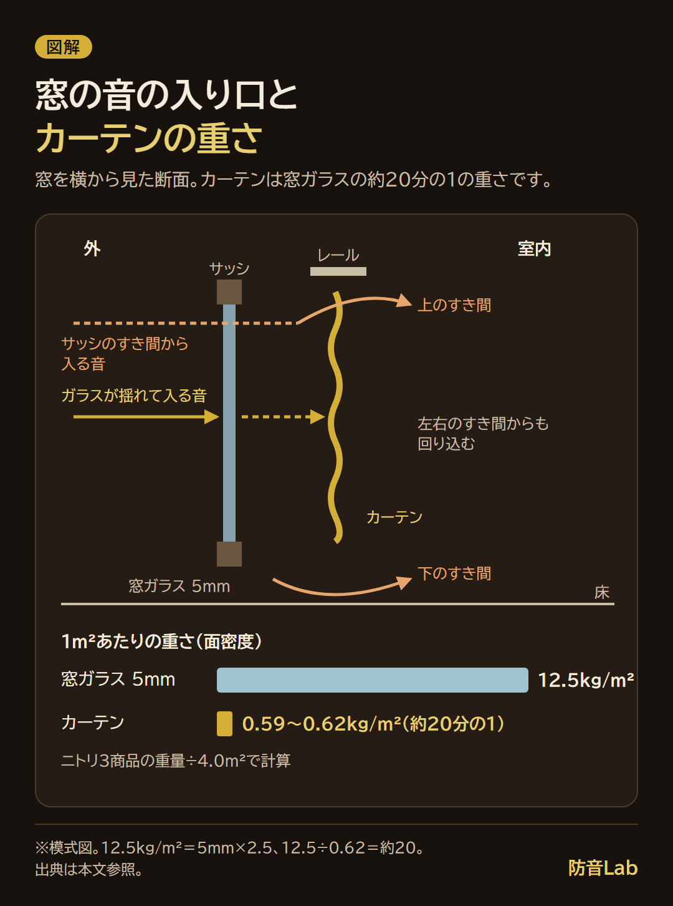
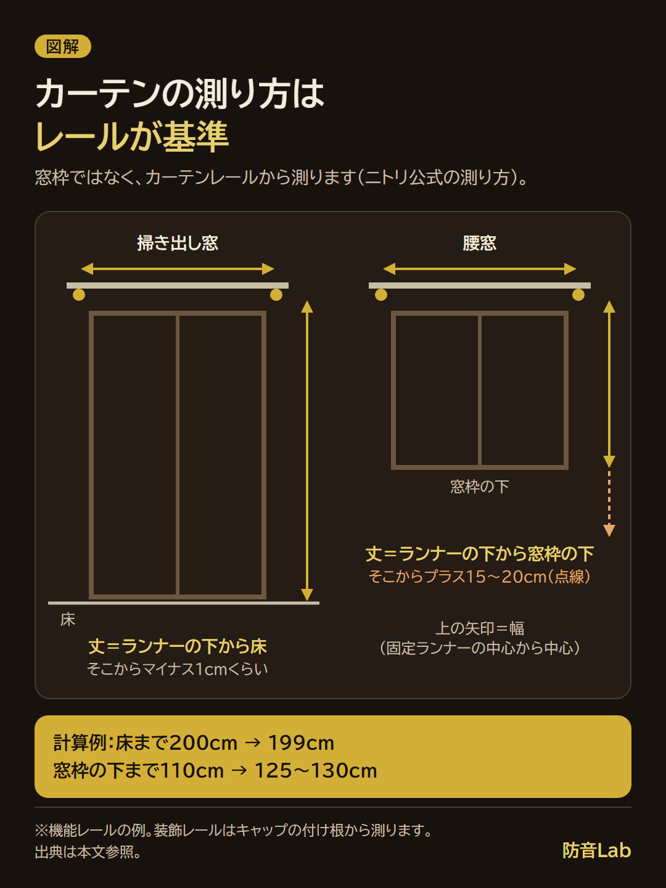

<RegionBanner />

防音カーテンの効果は、話し声やテレビのような高めの音と、窓のすき間から入る音に出ますが、車や電車の低い音は残ります。

窓ガラス（5mm）とカーテンの重さを比べると、カーテンはガラスの約20分の1しかなく、重さで音を跳ね返す力は小さいことが分かりました。

買う前に毛布で効果を確かめる方法と、すき間を作らない採寸のしかたもあわせてまとめます。

## 防音カーテンの効果は「高めの音」と「窓のすき間」に出る

大通りに面した部屋で、夜、窓の外を走るバイクの音で目が覚める。

カーテンを替えれば静かになるのか、知りたくなる場面です。

先に答えると、防音カーテンで音が減るのは次の2つです。

- <strong>高めの音</strong> : 話し声、テレビ、犬の鳴き声など
- <strong>窓まわりのすき間から入る音</strong> : サッシのすき間や、カーテンの上・左右・下から回り込む音

一方、車やバイクのエンジンの低い音、電車やトラックの低音と振動は残りやすい音です。

### 窓ガラスとカーテンの重さを比べる

音の入り口は、大きく2つあります。

- ガラスそのものが音で揺れて、室内に音を伝える道
- サッシのすき間から、空気を通って入る道

カーテンは、その手前に布を1枚足すものです。

ガラスの重さは、1m²あたりの重さ（面密度）で比べます。

面密度とは、板1m²あたりの重さのことで、重いほど音を通しにくくなります。

AGCの窓ガラス資料では、ガラスの面密度を「板厚[mm]×2.5」で求めます。

5mmの窓ガラスなら、5mm×2.5＝12.5kg/m²です。

JIS R 3202のフロート板ガラスの概算重量表でも、5mmは12kg/m²とされています。

カーテンは、ニトリネットの公式ページ（2026年11月10日確認）にある3商品の重さから計算しました。

3商品とも、幅100cm×丈200cmの2枚組です。

仕上がりの大きさは、幅100cm×2枚＝2.0m、丈2.0mなので、2.0m×2.0m＝4.0m²になります。

| 商品（ニトリ） | 重量（2枚組） | 面積 | 面密度（重量÷面積） |
| :-- | :-- | :-- | :-- |
| コーティング77（5642456） | 約2.48kg | 4.0m² | 2.48÷4.0＝0.62kg/m² |
| RD-002（7348276） | 約2.37kg | 4.0m² | 2.37÷4.0＝0.59kg/m² |
| 隙間ブロック RD120（2114100214095） | 約2.47kg | 4.0m² | 2.47÷4.0＝0.62kg/m² |

重量は商品ページの表記です。

幅200cm×丈200cmの1枚物も同じ約2.48kgなので、2枚組全体の重さと読みました。

ひだを寄せる前の生地の面積ではなく、窓を覆う仕上がり寸法で割っています。

ガラスとカーテンを比べると、12.5÷0.62＝約20.2です。

カーテンの面密度は、5mmガラスの約20分の1になります。

### 低い音が残りやすい理由

北海道立林産試験場の報告（1993年）は、窓の試験体で、周波数が高くなるほど透過損失（音を通さない量）が大きくなる傾向を示しています。

報告は、透過損失がガラスの面密度と周波数の積に依存する質量則で説明しています。

つまり、重いものほど、そして高い音ほど遮りやすい、ということです。

約20分の1の重さのカーテンは、ガラスの代わりに音を止めるのではなく、ガラスの手前で一部を弱める役目になります。

低い音は、重さが足りないぶん通りやすくなります。

カーテン単体で何dB下がるかの数値は、確認したニトリ3商品のページに載っていませんでした。

そのため、この記事ではカーテンの減音量をdBに直して書きません。

### 遮光目的で使っている私の感想

私は窓の音でそれほど困ったことはなく、防音のために対策をしようと思ったこともありません。

ただ、防音カーテンは光を通さないタイプが多いので、遮光目的で使っています。

完全に閉じていると、以前のふつうのカーテンよりは音が小さくなったかな？という程度です。

窓の音に困っていない人の感想なので、体感は控えめです。

音の入り口とカーテンの重さを、窓の断面で1枚にしました。

## 防音カーテンは効果ありますか？効く音・効かない音の早見

効果は「あります」。ただし、効く音は限られます。

カーテン単体の周波数別の減音量を載せた公開資料は、調べた範囲では見つかりませんでした。

販売店のピアリビングは、2025年2月末に残響室で自社の商品を測った結果を公開しています（規格名の記載はありません）。

Otonagiの室内から外へ向かう音では、窓だけとの差は500Hzで2.5dB、1,000Hzで3.3dBでした。

商品ごとの比較は、[防音カーテンのおすすめ](/ja/diy/soundproof-curtain-recommend/)にまとめています。

次の表は、前の節の質量則（重いほど、高い音ほど遮りやすい）と、音の入り口から、効きやすさを3段階で整理したものです。

数値ではなく傾向の整理です。

| 音の種類 | 例 | カーテンの効き | 理由 |
| :-- | :-- | :-- | :-- |
| 高めの音 | 話し声、テレビ、犬の鳴き声 | <strong>効きやすい</strong> | 高い音ほど遮りやすく、窓のすき間からの漏れも目立つため |
| 高さが混ざる音 | 車・バイクの走行音 | <strong>一部だけ</strong> | 高い成分は弱まり、エンジンの低い成分は残るため |
| 低い音 | 電車・トラックの低音、重低音の音楽 | <strong>ほとんど効かない</strong> | 低い音ほど、軽い布は通してしまうため |
| 振動で伝わる音 | 上下階の足音、工事の振動 | <strong>効かない</strong> | 窓を通らず、建物の床や壁を伝わるため |
| 窓以外から入る音 | 換気口、壁、玄関ドアからの音 | <strong>効かない</strong> | カーテンの背後に音の通り道がないため |

「効きやすい」でも、音が消えるわけではありません。

前の節の感想も、「小さくなったかな？」くらいでした。

カーテンで期待できるのは、窓の音が少し小さくなる、という変化です。

買う前に当てはめられるよう、保存して見返せる1枚にまとめました。

## 防音カーテンの効果がないと感じる原因

防音カーテンをつけても音が気になるなら、まず、すき間から入っています。

音の通り道を、図1の断面でたどります。

- 外の音がガラスを揺らし、室内に伝わる
- サッシのすき間から、空気を伝って入る
- カーテンの上・左右・下にすき間があると、そこから回り込む

カーテンは、3つ目の回り込みを減らすものです。

ここが空いていると、カーテンの手前で止めたはずの音が、横や下から入ります。

私の遮光カーテンでも、すき間を埋めたほうが防音の効果は高いと実感しました。

### 効果がない原因を確かめるチェックリスト

| 確認すること | 当てはまるとき | 直し方 |
| :-- | :-- | :-- |
| 丈 | 床とカーテンの間に、手のひらが入る。腰窓で窓枠より下に届かない | 採寸し直す（次の節） |
| 幅 | 閉めたとき、レールの端と壁の間が空く。ひだがなくフラットに近い | 幅にゆとりを足す |
| 上 | レールと天井の間が開いている | カーテンボックスやリターン仕様で上と横をふさぐ |
| サッシ | 窓を閉めても、サッシの合わせ目から外の音や風が入る | すき間テープを貼る |
| 入り口 | 窓を布で覆っても音が変わらない | 壁・換気口・ドア・床からの音を疑う |
| 音の種類 | 低音や振動が中心 | カーテンでは足りない |
| 期待 | 音が消えると思っていた | 少し小さくなる程度と考える |

サッシの合わせ目のすき間には、窓サッシ用の隙間テープが使えます。

貼り方や賃貸での注意は、[木造アパートの防音対策と隙間テープの使いどころ](/ja/diy/wooden-apartment-soundproof-guide/)で解説しています。

### メーカーの「○％」表示の読み方

遮光カーテンを買ったとき、「遮光90%」と数字があっても、実際にどう変わるのかは想像しづらく、私はそこが疑問でした。

数字だけで決められなかったので、実店舗で実際に触れてから買いました。

ニトリネットの商品名にある「遮音/遮光率99.99%」の数字は、遮光率のことです。

商品ページには、遮光1級（JIS基準）で遮光率99.99％以上と書かれています。

遮音の説明は、次のように言葉だけです。

- コーティング77・RD-002 : 「生地の裏面に樹脂コーティングすることで、室内の音を漏れにくく、部屋の中から又は外からの音を軽減します」
- 隙間ブロック RD120 : 「5層構造にすることで、室内の音を漏れにくく、部屋の中から又は外からの音を軽減します」

3商品とも、遮音のdBや％、試験機関、試験方法の記載は見つかりませんでした（2026年11月10日確認）。

壁や窓などの建材の遮音性能は、JIS A 1416に準じた残響室での測定で、周波数ごとの透過損失として出します。

カーテンの商品ページで「○％減音」のような表示を見かけたら、dBに直さず、販売元が出した数字としてそのまま読みます。

そのうえで、試験の方法や、どの周波数での数字かが書いてあるかを探します。

書いていなければ、数字は比べる材料になりません。

## 防音カーテンの効果的な使い方：採寸・丈・すき間

防音カーテンの効果を出すには、窓まわりにすき間を作らない採寸が先です。

測り方は、ニトリ公式の「サイズの測り方（カーテン）」と、カーテンメーカーTuiss（ツイス）の採寸ガイドを合わせて見ました。

### メジャーでのカーテンの測り方

準備するのは、メジャー（長さ5m以上がおすすめ）、踏み台、メモ帳です。

測るときの注意は、ニトリ公式に2つあります。

- 現在使っているカーテンのサイズを直接測らない
- カーテンレールが付いていない窓を直接測らない

つまり、基準は窓枠ではなくカーテンレールです。

手順は、幅、丈の順です。

- <strong>幅（機能レール）</strong> : 片方の固定ランナーの中心から、もう片方の固定ランナーの中心までを測る（ニトリ）
- <strong>幅（装飾レール）</strong> : 片方のキャップの付け根から、もう片方のキャップの付け根までを測る（ニトリ）
- <strong>丈（掃き出し窓）</strong> : ランナーの下から床までを測り、マイナス1cmくらいにする（ニトリ）。Tuissは床から1.5cm上を勧めています
- <strong>丈（腰窓）</strong> : ランナーの下から窓枠の下までを測り、プラス15〜20cmにする（ニトリ。Tuissも窓枠より15〜20cm下）

幅について、Tuissは、ひだが1.5倍または2倍のスタイルなら、測った幅に2〜5％を足すことを勧めています。

床から1〜1.5cm上げるのは、裾が床について、ホコリを集めたりほつれたりするのを防ぐためです。

音の面では、この1〜1.5cmのすき間が残ります。

床すれすれにするかどうかは、裾の傷みとのかねあいで選ぶことになります。

腰窓のプラス15〜20cmは、窓枠より下まで覆う長さです。

#### 自分の窓で当てはめる計算例

次の窓を例に、数字を当てはめます。

| 窓 | 測った値 | 計算 | 買うサイズの目安 |
| :-- | :-- | :-- | :-- |
| 掃き出し窓の丈 | ランナーの下から床まで200cm | 200−1＝199cm（Tuissなら200−1.5＝198.5cm） | 既製の丈200cm＋アジャスターフックで調整 |
| 腰窓の丈 | ランナーの下から窓枠の下まで110cm | 110＋15＝125cm、110＋20＝130cm | 125〜130cm。既製の丈135cmより5〜10cm短いので、1cm単位のオーダーを検討 |
| 幅（固定ランナーの中心どうし） | 180cm | ニトリの例（レール幅170〜190cmは幅100cm×2枚＝200cm）に合わせて、200−180＝20cm広い | 幅100cm×2枚 |
| 幅（Tuiss、レールの端から端。ひだ1.5倍・2倍） | 180cm | 180×1.02＝183.6cm、180×1.05＝189.0cm | 約184〜189cm |

丈200cmの既製品は、ニトリの商品ページで、アジャスターフック付きのものがあります。

RD120の商品ページには、5mm単位で丈を微調整できると書かれています。

Tuissの採寸ガイドも、「窓枠のサイズではありません」と注意しています。

幅も丈も、基準はカーテンレールです。

採寸に自信がないときは、ニトリのカーテンオンライン相談サービス（会員限定）が案内されています。

測る位置を、窓の種類ごとに図にしました。

### リターン仕様・カーテンボックス・二重づけで上と横をふさぐ

丈と幅をそろえても、上と横にはすき間が残ります。

減らす方法は3つあります。

- <strong>リターン仕様</strong> : カーテンの端を壁側に折り返す作りで、側面のすき間を減らす
- <strong>カーテンボックス</strong> : レールの上を箱で囲み、カーテンの上のすき間を減らす
- <strong>二重づけ</strong> : 厚地の手前にもう1枚かけ、すき間の位置をずらす

リターン仕様の例が、ニトリの隙間ブロック RD120です。

商品ページには「側面のリターン構造がスキマをブロック」「光と音、外からの視線を防ぎます」とあります。

裾には、中央のすき間を防ぐマグネットも付いています。

ただし、音の減る量の数値は、ページに載っていません。

3つとも、減音量の公表値は確認できていないため、効果は「すき間を減らす考え方」としてだけ書いています。

## ニトリの防音カーテンの効果は？表示の見方

ニトリネットの遮音カーテンの売り場には、商品名に「遮音」と入った遮光カーテンが並びます。

2026年11月10日に、ニトリネットの公式ページで3商品を確かめました。

| 商品 | 100×200cm×2枚の表示価格 | 遮音の説明 | 遮音の数値 |
| :-- | :-- | :-- | :-- |
| コーティング77 | 7,990円 | 生地の裏面に樹脂コーティング | なし |
| RD-002 | 6,990円 | 生地の裏面に樹脂コーティング（4層コーティング） | なし |
| 隙間ブロック RD120 | 7,490円（期間限定価格の表示あり、12月13日まで） | 5層構造。リターンとマグネットですき間を減らす | なし |

価格は変わるため、買う前に公式ページで確認してください。

3商品のページには、遮音の説明はあっても、dBや％の数字はありません。

商品名の「遮光率99.99%」は、光の数字です。

ニトリの説明を読むかぎり、遮音の効き目を数字で比べることはできません。

だから、買う前に自分の窓で確かめる必要があります。

この記事は、特定の商品をすすめるものではありません。

## 買う前に毛布で効果を確かめる

窓を布で覆うと音がどれだけ変わるかは、家にある毛布で予行できます。

毛布は防音カーテンの代わりではありません。

防音カーテンは樹脂コーティングなど別の構造なので、同じ結果になるとは限りません。

それでも、窓を布で覆う変化が大きいかどうかの目安になります。

用意するのは、厚手の毛布と、騒音計アプリです。

アプリの選び方は、[騒音計アプリの比較と、対策前後の測り方](/ja/knowledge/soundproof-app-review-2026/)にまとめています。

手順は次のとおりです。

- 窓の外の音がする時間に、窓から1m離れた位置に立つ
- アプリで30秒間測り、平均値と最大値をメモする
- 厚手の毛布を、窓枠ごと覆うように当てる
- 同じ位置、同じ高さ、同じ向きで、もう一度30秒測る
- 車やバイクの数で値がぶれるので、毛布なし → あり → なしの順に測り、前後の値をそろえて見る

スマホの内蔵マイクは機種差があるため、数値そのものではなく、同じ端末での変化量を見ます。

騒音計アプリの比較記事では、同じ端末・同じ条件で3dB以上の差が出れば対策の材料になり、1〜2dBなら誤差の範囲かもしれないとしています。

毛布を留める方法は、1人か2人かで変わります。

- <strong>1人でやる</strong> : 洗濯ばさみや画鋲で留められる程度の、軽めの毛布にする
- <strong>2人でやる</strong> : 重い布団をカーテンレールに掛けるなら、友人やパートナーに手伝ってもらう

賃貸で画鋲を使うときは、先に管理会社に確認します。

重い物をレールに掛けると、レールが外れる恐れもあります。

結果は、次のように読みます。

- 3dB以上の差が出た : 窓を布で覆う効果の余地がある。防音カーテンやすき間対策を検討する
- 1〜2dBの差 : 誤差かもしれない。測り方をそろえて、もう一度測る
- ほとんど変わらない : 窓以外の入り口や、低音・振動が中心の可能性がある

毛布で変化がほとんど出ないときは、カーテンに替えても大きくは変わらない、と読めます。

## カーテンで足りないとき：すき間テープ・内窓と比べる

カーテンで足りなければ、すき間をふさぐテープや、窓を1枚足す内窓があります。

| 対策 | 効きやすい音 | 手間 | 費用の目安 |
| :-- | :-- | :-- | :-- |
| 防音カーテン | 高めの音、窓まわりのすき間 | 採寸して取り付け | 100×200cm×2枚で6,990〜7,990円（ニトリ3商品、2026年11月10日確認） |
| 窓サッシ用のすき間テープ | サッシの合わせ目から入る音 | 貼る（賃貸は貼ってはがせるタイプ） | 商品ページで確認（金額は未確認のため載せません） |
| 内窓 | 窓全体を通る音 | 工事が必要 | LIXILのマンション用インプラス: 幅約1.6m×高さ約1mの引違い窓で参考価格107,800円（設置費用除く） |

内窓の価格は、2026年8月20日付のImpress Watchの記事（LIXILの発表）にある参考価格です。

窓の大きさやガラスの種類で変わるため、見積もりで確認してください。

私なら、費用の小さい順に「毛布で確かめる → すき間テープ → カーテン → 内窓」と進めます。上の表で、内窓だけが工事と10万円台の費用がかかるからです。

内窓の効果と選び方は、[内窓の防音効果を比べた記事](/ja/diy/diy-internal-window-road-noise-reduction/)で解説しています。

## よくある質問

### 遮光カーテンにも防音効果はありますか？

遮光は光の基準で、音の基準ではありません。

ニトリの遮光1級は、光を通さない度合いを表す基準で、遮光率99.99％以上とされています。

ただ、遮光カーテンの中には、生地の裏面に樹脂コーティングをして「遮音」と説明している商品があります。

その場合も、音の減る量は数字で示されていないため、毛布の予行や店頭で触って確かめます。

### 屋外用の防音カーテンとは何が違いますか？

屋外用は、工事現場で音を出す場所を囲うための防音シートです。

当サイトの記事では、1m²あたり約1.5kgの例を紹介しています。

家庭用の0.59〜0.62kg/m²と比べると、1.5÷0.62＝約2.4倍、1.5÷0.59＝約2.5倍の重さです。

窓の内側につるす室内用とは、使う場所も目的も違います。

詳しくは、[屋外用防音カーテンは家庭でも使える？工事用防音シートの効果](/ja/diy/outdoor-soundproof-curtain-market-guide/)で解説しています。

### 防音カーテンで楽器や歌の音漏れは防げますか？

防ぎきることは期待しにくいです。

音源の大きさは、ピアノの演奏が前方1mで80〜90dB、大声の独唱が90dB前後です。

カーテンは窓のすき間と高めの音に効く程度で、減音量の公表値もありません。

音は窓以外の壁、床、ドアからも出ます。

演奏する時間のルールは、[マンションで楽器は何時まで？管理規約と演奏時間の確かめ方](/ja/knowledge/mansion-instrument-practice-time-rules/)で確かめられます。

楽器や歌の音漏れは、管理会社や防音の専門家に相談してください。

## まとめと次にやること

防音カーテンの効果は、高めの音と窓のすき間から入る音に出ます。

カーテンの面密度は、5mmの窓ガラス（12.5kg/m²）の約20分の1で、低音や振動は残ります。

つけても気になるなら、丈・幅・上のすき間を見直します。

ニトリ3商品のページには、遮音のdBや％の数字がありませんでした。

次にやることは、1つです。

窓に厚手の毛布を当てて、騒音計アプリで前後を測ってみてください。

買うことにしたら、固定ランナーの中心から中心までを測り、床までの丈をマイナス1cmくらいにして選びます。

取り付けや住まいの規約は、管理会社や専門家に確認してください。

## 出典

- [ピアリビング「防音カーテン（遮音カーテン）の効果はある？」](https://www.pialiving.com/blog/soundproofing-item/soundproof-curtains/soundproof-curtain-effectiveness)（2026年11月12日確認。2025年2月末の残響室での測定値と条件）
- [ニトリネット「サイズの測り方（カーテン）」](https://www.nitori-net.jp/ec/feature/CurtainSize/)（2026年11月10日確認）
- [ニトリネット コーティング77 グリーン 100X200X2（5642456）](https://www.nitori-net.jp/ec/product/5642456/)（同日確認。重量約2.48kg、表示価格7,990円）
- [ニトリネット コーティング77 グリーン 200X200X1（5642586）](https://www.nitori-net.jp/ec/product/5642586/)（同日確認。重量約2.48kg）
- [ニトリネット RD-002 YGR 100X200X2（7348276）](https://www.nitori-net.jp/ec/product/7348276/)（同日確認。重量約2.37kg、表示価格6,990円）
- [ニトリネット 隙間ブロック RD120 ベージュ 100X200X2（2114100214095）](https://www.nitori-net.jp/ec/product/2114100214095/)（同日確認。重量約2.47kg、表示価格7,490円）
- Tuiss（ツイス）「カーテンの採寸方法」（PDF、2026年11月10日確認）
- AGC「GLASS WONDERLAND」の遮音の資料（ガラスの面密度＝板厚[mm]×2.5）と、JIS R 3202 フロート板ガラスの概算重量表（5mmは12kg/m²）
- [北海道立林産試験場「木製サッシの防音改修の検討」林産試場報 第7巻 第5号（1993）](https://www.hro.or.jp/upload/10548/26960036001.pdf)
- [Impress Watch「LIXIL、マンションでも設置しやすい二重窓『マンション用インプラス』」（2026年8月20日）](https://www.watch.impress.co.jp/docs/news/2134297.html)
- 音の大きさの目安: 環境省「騒音の目安」、日本環境協会「騒音の大きさの例」
