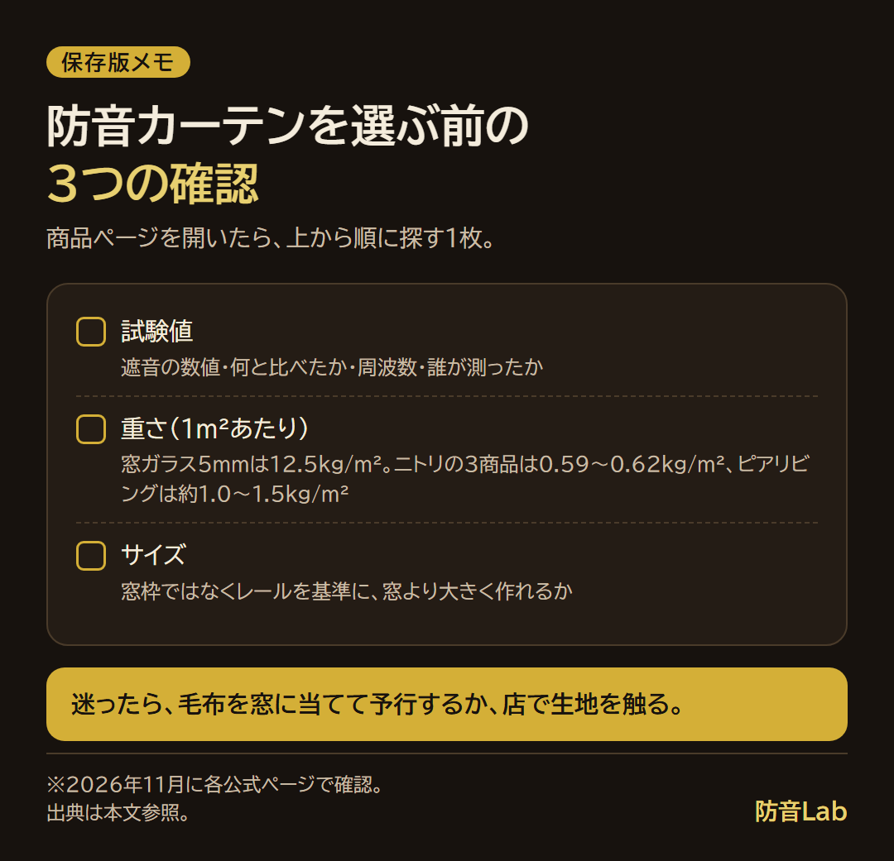
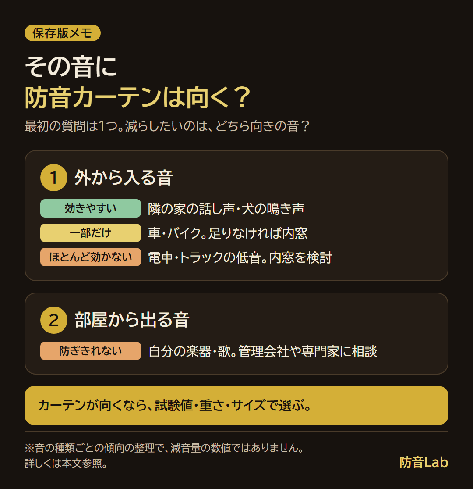

<RegionBanner />

防音カーテンのおすすめは、遮音の数値と測定条件を公表していて、窓より大きく作れる商品です。

公式ページを確かめた8商品のうち、遮音の数値を載せていたのは4商品でした。ただ、試験機関と規格まで書いてある数値は、ありませんでした。

この記事では、試験値の有無で分けた比較表と、車・電車・話し声の音別の選び方をまとめます。

## 防音カーテンのおすすめは「試験値・重さ・サイズ」で選ぶ

商品ページで確かめる基準は、次の3つです。

- <strong>試験値</strong> : 遮音の数値と、何をどう測った数字かが書いてあるか
- <strong>重さ</strong> : 1m²あたりの重さ（面密度）が書いてあるか。重いほど音を通しにくくなります
- <strong>サイズ</strong> : 窓枠ではなくカーテンレールを基準に、窓より大きく作れるか

効果の数字と採寸は、[防音カーテンの効果はどのくらい？効く音・効かない音と買う前の確かめ方](/ja/diy/soundproof-curtain-effect/)と同じ値を使います。

5mmの窓ガラスは12.5kg/m²、ニトリの3商品は0.59〜0.62kg/m²です。

ピアリビングは、公式ページに「1m×1mあたり約1.0〜1.5kg」と書いています。

12.5÷1.5＝約8.3、12.5÷1.0＝12.5なので、5mmの窓ガラスの約8〜13分の1です。

重さだけで窓ガラスの代わりにはなりません。

私が迷うのは、効くかどうかと、見た目・色です。

色は商品ごとに違い、公式ページでは、Otonagiが全3色、コーズが全5色でした。

## 「最強」の防音カーテンを選ぶ基準

「最強」の防音カーテンは、遮音の数値で決まります。

数値がなければ、強さを比べられません。何重構造かの数字も、物差しになりません。

- ニトリの隙間ブロック RD120のページには、「生地の構造表記を3層から5層に変更しましたが、実際の生地仕様・性能に違いはありません」とあります
- ピアリビングのコーズは、公式ページは「3枚の布」、楽天市場の販売ページは「五重構造」です
- Otonagiも、公式ページは「3枚の布」、楽天市場の販売ページは「7層構造」です

数値は、何と比べたか（窓だけ・ふつうのカーテン）、どの周波数か、誰が測ったか（試験機関と規格・販売店自身）の3点を見ます。

価格は表に載せますが、安い順には並べません。

買って後悔しにくいのは、数値と条件を読み、窓に合うサイズを選び、返品の条件を先に見た買い方です。

### メーカーの「○％」「平均○dB」表示の読み方

同じ商品でも、数値が3つ並ぶ例があります。ピアリビングのOtonagiは次のとおりです。

- 商品ページの説明 : 「平均で約4.9dBの軽減効果が確認されています」
- 商品ページのQ&A : 「7〜14dB程度軽減できます」
- 販売店が残響室で測った記事 : 窓だけとの差が2.5〜3.3dB（後の表）

条件が読み取れるのは、3つめだけです。

商品ページは、「あくまでも目安であり軽減の数値を保証するものではありません」とも書いています。

「○％減音」の読み方とdBに直さない理由は、上で紹介した効果記事にあります。

## 試験値のある防音カーテンを比べる

2026年11月に、ニトリネット、ピアリビング公式サイト、楽天市場の店舗ページで確かめた内容です。並びは順位ではありません。

販路は、ニトリが量販店のニトリネット、ピアリビングが公式サイトと楽天市場、くれないが楽天市場の直販店です。

Amazonの商品は、後の質問で触れます。

### 試験値の記載がある商品

| 商品名（販売元） | 構造 | 重さ | 試験値（条件） | 価格 |
| :-- | :-- | :-- | :-- | :-- |
| Otonagi 音凪（ピアリビング） | 3枚の布を重ねた多層構造。楽天は7層構造と表記 | 1m×1mあたり約1.3kg（片面仕様） | 平均約4.9dB軽減（条件の記載なし） | 幅110×丈200cmの2枚組 36,960円 |
| コーズ（ピアリビング） | 3枚の布（吸音布1枚、遮音布2枚）。楽天は五重構造と表記 | 1m×1mあたり約1kg | 平均約4.9dB軽減（条件の記載なし） | 幅110×丈200cmの2枚組 38,280円 |
| コーズ両面仕様 ドア・間仕切り用（ピアリビング） | 生地4枚（ページ内に6重構造の表記もあり） | 1m×1mあたり約1.2kg | 平均約7.3dB軽減（条件の記載なし） | オーダーのみ。幅71〜110×丈81〜120cmで27,500円から |
| 防音レースカーテン トルモア（ピアリビング） | レース2枚の間にTPUフィルムを挟んだ3層 | 記載なし | 平均約2.5dB軽減（条件の記載なし） | 幅100×丈198cmの2枚組 17,380円 |

価格は公式サイトの税込表示で、「条件の記載なし」は試験機関・規格・周波数が書かれていない意味です。

### 同じ条件で測った値（ピアリビングの測定記事）

ピアリビングは、2025年2月末に広島の試験施設の残響室を借りて、自社の商品を測った結果を公開しています。

2つの部屋の間に100cm×100cmの開口を設けて窓に見立て、商品を取り付けた条件で、規格名は書かれていません。

次の表は、室内から外へ向かう音が、何dB減ったかの値です。

差は、各値から「窓のみ」の値を引いた数字です（例: 22.6−20.1＝2.5）。

| 取り付けた物 | 500Hz | 窓のみとの差 | 1,000Hz | 窓のみとの差 |
| :-- | :-- | :-- | :-- | :-- |
| 窓のみ | 20.1dB | － | 18.3dB | － |
| 市販のカーテン | 20.7dB | 0.6dB | 19.6dB | 1.3dB |
| Otonagi | 22.6dB | 2.5dB | 21.6dB | 3.3dB |
| トルモア | 20.3dB | 0.2dB | 18.4dB | 0.1dB |
| 窓用ワンタッチ防音ボード | 29.1dB | 9.0dB | 36.4dB | 18.1dB |

カーテンの商品どうしの差は、0.1〜3.3dBでした。大きく差が出たのは、窓用の板です。

販売店が自社の商品を測った値なので、読めるのは、この条件の窓にこの商品を付けたときの値までです。

### 試験値の記載がない商品

| 商品名（販売元） | 構造 | 重さ | 試験値（条件） | 価格 |
| :-- | :-- | :-- | :-- | :-- |
| コーティング77（ニトリ） | 生地の裏面に樹脂コーティング | 約2.48kg（2枚組、4.0m²で0.62kg/m²） | 記載なし | 100×200cm×2枚で7,990円 |
| RD-002（ニトリ） | 生地の裏面に樹脂コーティング（4層コーティング） | 約2.37kg（0.59kg/m²） | 記載なし | 100×200cm×2枚で6,990円 |
| 隙間ブロック RD120（ニトリ） | 5層構造の表記。リターン加工とマグネット付き | 約2.47kg（0.62kg/m²） | 記載なし | 100×200cm×2枚で7,490円（期間限定価格の表示、12月13日まで） |
| 静 Shizuka（くれない） | 記載なし | 記載なし | 記載なし | 10,210円から（楽天市場の店舗ページの表示。幅・丈・枚数で変わる） |

これらの商品は、試験値を公表していないため、効果の大きさは比べられません。

くれないの静は、楽天市場の商品ページの文字情報で、構造・重さ・遮音の数値を確かめられませんでした。

### 返品の条件を先に見る

サイズを間違えたときに返品できるかは、商品で違います。

- <strong>ニトリのコーティング77とRD-002</strong> : ページに「ご注文後のサイズ変更、キャンセル、返品はできません」とあります
- <strong>ニトリのRD120</strong> : ページの配送欄に「14日間返品可能」の表示があります
- <strong>ピアリビング</strong> : 公式サイトの既製サイズは、配達完了から14日以内なら返品できます（返送送料は購入者負担）。オーダーサイズは返品・交換ができません。楽天市場の店舗は、店舗のページで確認します

## 音別のおすすめ：外から入る音か、部屋から出る音か

最初の質問は、1つです。

減らしたいのは、外から入る音ですか、部屋から出る音ですか？

| 音 | 向き | カーテンで足りるか | 優先する基準 |
| :-- | :-- | :-- | :-- |
| 隣の家の話し声、犬の鳴き声 | 窓から入る | <strong>効きやすい</strong> | 重さと、上下左右のすき間をふさぐサイズ |
| 車・バイクの走行音 | 窓から入る | <strong>一部だけ</strong>。エンジンの低い音は残る | 試験値の条件と、すき間をふさぐサイズ。足りなければ内窓 |
| 電車・トラックの低音 | 窓から入る | <strong>ほとんど効かない</strong> | カーテンより内窓を検討 |
| 自分の楽器・歌 | 部屋から出る | <strong>防ぎきれない</strong> | 管理会社や専門家への相談。演奏時間のルール |

## ニトリの防音カーテンはおすすめ？

ニトリの3商品は、遮音のdBも％も公式ページになく、効果の大きさを数字で比べられません。

比べられるのは、重さ（0.59〜0.62kg/m²）、価格（100×200cm×2枚で6,990〜7,990円）、返品の条件、すき間の作りです。

すき間の作りでは、RD120だけが、リターン加工と裾のマグネットを備えています。

表示の見方は、効果記事の[ニトリの防音カーテンの効果は？表示の見方](/ja/diy/soundproof-curtain-effect/)で書きました。

私は遮光カーテンを選んだとき、「遮光90%」の数字が想像しづらく、実店舗で触れてから買いました。

数字で決められないときは、店で生地の厚みと重さを触る方法もあります。

## レース・ドア用・遮光と兼ねる防音カーテンのおすすめ

- <strong>防音レースカーテン</strong> : トルモアは、商品ページで平均約2.5dB軽減です。測定記事では、窓のみとの差が0.2dB（500Hz）・0.1dB（1,000Hz）でした
- <strong>ドア用</strong> : コーズ両面仕様は、平均約7.3dB軽減で、重さは1m×1mあたり約1.2kgです。重いため、レールの固定が不十分だと落下のおそれがあると、ページに書かれています
- <strong>遮光と兼ねるもの</strong> : Otonagi・コーズ・ニトリ3商品は、遮光1級です。遮光等級は光の基準で、音の数値とは別に確かめます

数値を見るかぎり、レースだけで窓の音を大きく減らすことは期待しにくいです。

## カーテンでは足りないとき

数値で差が大きかったのは、窓用ワンタッチ防音ボードです。

窓のみとの差は、500Hzで29.1−20.1＝9.0dB、1,000Hzで36.4−18.3＝18.1dBでした。

ボードは窓をふさぐ板で、23,650円からです（ピアリビング公式サイト、2026年11月確認）。

比較表は、効果記事の[カーテンで足りないとき：すき間テープ・内窓と比べる](/ja/diy/soundproof-curtain-effect/)にあります。

内窓の効果と費用は、[内窓の防音効果の比較記事](/ja/diy/diy-internal-window-road-noise-reduction/)で解説しています。

## よくある質問

### 防音カーテンは重いほど効きますか？

重いほど音を通しにくくなるのは、物理の傾向です。

ただ、ピアリビングの数値は、コーズ（約1kg、平均約4.9dB）、Otonagi（約1.3kg、平均約4.9dB）、ドア用コーズ（約1.2kg、平均約7.3dB）で、重さの順と軽減量の順がそろいません。

数値の条件が書かれていないため、重さだけで効き目は決められません。

1m²あたり約1.5kgの工事用シートは、[屋外用防音カーテンは家庭でも使える？工事用防音シートの効果](/ja/diy/outdoor-soundproof-curtain-market-guide/)で解説しています。

### 防音カーテンとふつうの遮光カーテンは何が違いますか？

遮光は光の基準で、音の基準ではありません。

ピアリビングの測定では、ふつうのカーテンと窓のみの差は0.6dB（500Hz）・1.3dB（1,000Hz）でした。

Otonagiとふつうのカーテンの差は、22.6−20.7＝1.9dB、21.6−19.6＝2.0dBです。

### アマゾンの安い防音カーテンでも効果はありますか？

私は今回、Amazonの商品を、販売ページで条件まで確かめられず、表に入れていません。値段の安さと効き目の関係も、確かめられていません。

商品ページで、次の3点を探します。

- 遮音の数値と、何と比べた数値か
- 1m²あたりの重さ
- サイズの作りと、返品の条件

どれも書いていなければ、効果の大きさは比べられません。

その場合は、効果記事の[買う前に毛布で効果を確かめる](/ja/diy/soundproof-curtain-effect/)方法を試します。

## まとめと次にやること

防音カーテンのおすすめは、遮音の数値と測定条件を公表し、窓より大きく作れる商品です。

確かめた8商品のうち、数値があったのは4商品で、試験機関と規格まで書いたものはありませんでした。

ニトリの3商品とくれないの1商品は数値がなく、効果の大きさを比べられません。

私なら、数値と条件を書いている商品から、窓に合うサイズのものを選びます。

次にやることは、1つです。

窓の幅と、レールから床までの高さを測ってください。

測る位置の基準と手順は、効果記事の[防音カーテンの効果的な使い方：採寸・丈・すき間](/ja/diy/soundproof-curtain-effect/)にあります。

取り付けや住まいの規約は、管理会社や専門家に確認してください。

## 出典

- [ニトリネット 隙間ブロック RD120（2114100214095）](https://www.nitori-net.jp/ec/product/2114100214095/)（重量・返品。価格は効果記事の11月10日確認）
- [ニトリネット コーティング77（5642456）](https://www.nitori-net.jp/ec/product/5642456/)（重量・返品）
- [ニトリネット RD-002（7348276）](https://www.nitori-net.jp/ec/product/7348276/)（重量・返品）
- [ピアリビング Otonagi（音凪）](https://www.pialiving.com/c/soundproof_curtains/acoustic_curtain/cozepremiere)（11月11日確認）
- [ピアリビング コーズ](https://www.pialiving.com/c/soundproof_curtains/acoustic_curtain/coze)（同）
- [ピアリビング コーズ両面仕様（ドア・間仕切り用）](https://www.pialiving.com/c/soundproof_curtains/for_door/double_sided_coze)（同）
- [ピアリビング 防音レースカーテン トルモア](https://www.pialiving.com/c/soundproof_curtains/lace_curtain/torumore)（同）
- [ピアリビング 窓用ワンタッチ防音ボード](https://www.pialiving.com/c/soundproof_panels/for_window/onetouch_madoyou)（同）
- [ピアリビング「防音カーテン（遮音カーテン）の効果はある？」](https://www.pialiving.com/blog/soundproofing-item/soundproof-curtains/soundproof-curtain-effectiveness)（同。測定値と条件）
- [楽天市場 ピアリビングの防音カーテン特集](https://www.rakuten.co.jp/pialiving/contents/soundproof-hit/)（同。構造の表記）
- [楽天市場 カーテンメーカーくれない直販店 Shizuka](https://item.rakuten.co.jp/kurenai/828014/)（同。表示価格）
- 窓ガラス5mmの面密度（AGC・JIS R 3202）は、[効果記事](/ja/diy/soundproof-curtain-effect/)の出典に同じ
