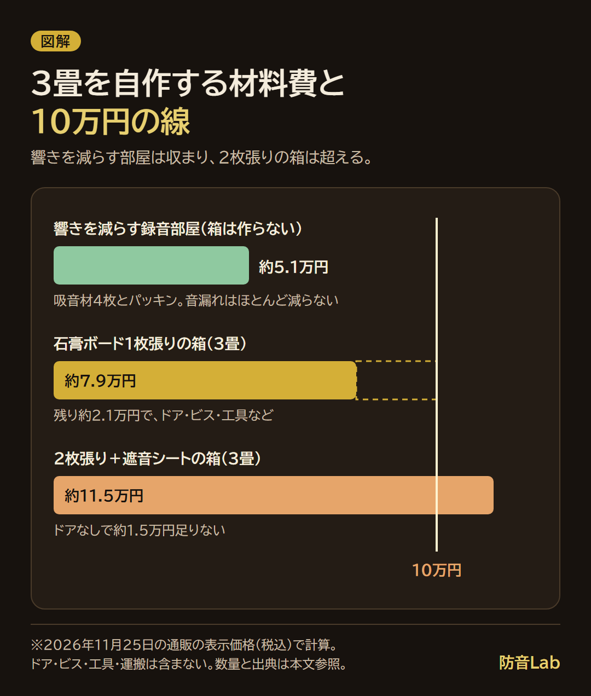

<RegionBanner />

3畳の防音室を10万円で自作できるかは、作りたい目標で変わります。

響きを減らす録音部屋なら、材料費は約5.1万円で足ります。

石膏ボード1枚張りの箱は約7.9万円で、ドアとビスなどに回せるのは約2.1万円です。

2枚張りと遮音シートの箱は、ドアなしで約11.5万円になり、10万円を超えます。

ホームセンターの表示価格（2026年11月25日、税込）と、質量則の式で、数量と合計を出しました。

作った感想ではなく、私が調べた価格表と計算で、どこまでできるかを線引きします。

## 3畳の防音室は10万円で自作できる？目標ごとの答え

10万円で足りるのは、響きを減らす録音部屋です。話し声を小さくする箱は、ドアを含めるとぎりぎりです。

歌や楽器の音を止める箱は、10万円では作れません。

「3畳で10万円は見通しが甘いのか」を確かめたい人のために、どこまでならできるかを、目標別に分けました。

| 目標 | 作るもの | 材料費（ドアなし） | 10万円で | 止まる音の目安 |
| :--- | :--- | :--- | :--- | :--- |
| 響きを減らす | 吸音材を立てかけた録音部屋（箱は作らない） | 約5.1万円 | 足りる | 外への音漏れはほとんど減らない |
| 話し声を小さくする | 石膏ボード1枚張りの箱 | 約7.9万円 | ドアとビスなどに21,032円残る | 500Hzで約22dB（ボードだけの計算） |
| 歌を小さくする（止めるには足りない） | 石膏ボード2枚張り＋遮音シートの箱 | 約11.5万円 | 14,836円足りない | 500Hzで約27dB（ボードだけの計算） |

表の dB は、ボードだけで計算した値です。実際の箱は、ドアと隙間の分だけ、止まる量が小さくなります。

2枚張りの約27dBでも、歌や楽器を止めるには足りません（理由は「何dB止まる？」の節）。

ドア、ビス、工具、運搬の費用は表に入れていません。ドアは価格を確かめていないので、金額を書いていません。

## 3畳の箱を作る材料費｜1枚張りは約7.9万円、2枚張りは約11.5万円

3畳の箱の材料費は、1枚張りで78,968円（約7.9万円）、2枚張り＋遮音シートで114,836円（約11.5万円）です。

2つの箱の差は35,868円（約3.6万円）で、石膏ボード16枚（12,768円）と遮音シート3本（23,100円）の分です。

数量は、江戸間の3畳（1.76m×2.64m）、高さ2.1mの箱として、次の式で出しました。

- <strong>壁</strong> : (1.76＋2.64)×2×2.1＝18.48㎡
- <strong>天井</strong> : 1.76×2.64＝約4.65㎡
- <strong>壁と天井の合計</strong> : 約23.1㎡
- <strong>石膏ボード（910×1820mm、1枚 約1.66㎡）</strong> : 23.1÷1.66＝約14枚。切りむだを1割見て、1枚張りは16枚、2枚張りは32枚
- <strong>遮音シート（1本 940mm×10m＝9.4㎡）</strong> : 23.1㎡に3本
- <strong>2×4材</strong> : 柱は8フィート（約2430mm）を24本（455mm間隔で20本と、角に4本）、上下の枠と天井の桟は6フィート（1820mm）を17本

石膏ボードの価格は[カインズの商品ページ](https://www.cainz.com/g/2200003531305.html)の12.5mm品（798円）です。

グラスウールも、[カインズの商品ページ](https://www.cainz.com/g/4582409040017.html)の50mm・密度10kg/㎥以上の1袋（約31㎡分、10,800円）です。

遮音シートは、[Yahoo!ショッピングの販売店](https://store.shopping.yahoo.co.jp/yamayuu/cz-12.html)のサンダム CZ-12（1.2mm×940mm×10m、7,700円）です。

ほかの木材・合板・パイプファンなどは、カインズの通販の表示価格です。

| 材料 | 1枚張りの箱 | 2枚張り＋遮音シートの箱 |
| :--- | :--- | :--- |
| 2×4 8フィート 24本 | 30,720円 | 30,720円 |
| 2×4 6フィート 17本 | 9,316円 | 9,316円 |
| 石膏ボード | 16枚 12,768円 | 32枚 25,536円 |
| 遮音シート 3本 | なし | 23,100円 |
| グラスウール 1袋 | 10,800円 | 10,800円 |
| 床の合板 3枚 | 4,740円 | 4,740円 |
| コーキング3本・パッキン2本 | 4,844円 | 4,844円 |
| パイプファン1台 | 5,780円 | 5,780円 |
| <strong>合計</strong> | <strong>78,968円（約7.9万円）</strong> | <strong>114,836円（約11.5万円）</strong> |
| 10万円との差 | 21,032円残る | 14,836円足りない |

材料費を10万円の線と並べると、次のようになります。

自サイトの[自作防音室の費用内訳](/ja/diy/soundproof-room-diy-cost/)は、1.5畳で約18万円です。

あちらは、床も2重に張り、ドアと換気を入れた試算で、値段もホームセンター等の相場の目安で調べています。

この記事の表は、ドアなし・床は合板3枚・表示価格で出した値なので、同じ物差しではありません。

## 10万円の箱で何dB止まる？

石膏ボード2枚張りの壁は、500Hzの音を約27dB、低い音の125Hzを約17dB止める計算です。

質量則は、壁が重いほど音を通しにくい、という考え方です。日本建設業連合会の[音響用語解説](https://www.nikkenren.com/kenchiku/sound/pdf/glossary/sa-0300.pdf)の式を使いました。

- <strong>R0＝20×log10(面密度×周波数)−42.5</strong>
- <strong>R＝R0−10×log10(0.23×R0)</strong>

面密度は、壁1㎡あたりの重さ（kg/㎡）です。石膏ボード12.5mmは、[吉野石膏の資料](https://yoshino-gypsum.com/support/qa)で1㎡あたり8.5kg（1枚14.1kg）です。

| 壁 | 面密度 | 500Hz | 125Hz |
| :--- | :--- | :--- | :--- |
| 石膏ボード1枚 | 8.5kg/㎡ | 約22dB | 約12dB |
| 石膏ボード2枚 | 17.0kg/㎡ | 約27dB | 約17dB |

低い音ほど下がりにくく、125Hzで止まる量は、500Hzより約10dB小さくなります。

面密度が2倍になっても、増えるのは約5dBです。

この計算は、ボードを1枚の板とみなした値です。隙間・ドア・床・柱を伝わる音は入れていません。

隙間は、遮音を大きく下げます。27dBの壁に、隙間があって音が素通りすると仮定して計算しました。

- <strong>面積の0.1%（23.1㎡なら約230㎠、はがき1枚半くらい）</strong> : 約25dB
- <strong>面積の1%（約0.23㎡）</strong> : 約19dB

はがきは10×14.8cm＝148㎠で数えています。

27dBの壁で、箱の外の音がどのくらいになるかを、身近な場所の大きさに当てはめます。

500Hzの値を音全体に当てはめ、ドアと隙間がないとした目安です。

- <strong>ふつうの会話（60dB）</strong> : 60−27＝33dB。ホテルの客室（30dB）と図書館の館内（40dB）の間です。1枚張り（22dB）なら38dBです
- <strong>大声の独唱（90dB）</strong> : 90−27＝63dB。銀行の窓口（60dB）くらいで、ふつうに話す声の大きさです

独唱は、2枚張りでも、箱の外にふつうの会話くらいの大きさで届く計算です。

歌や楽器を止める目的では、10万円で足りないと考える理由はここにあります。

ドアの隙間の直し方は、[ドアの防音対策は隙間から](/ja/diy/door-soundproof/)で試す順番にまとめています。

## 10万円で足りるのは、響きを減らす3畳の録音部屋

10万円に収まるのは、箱を作らずに吸音材を立てかけて、部屋の響きを減らす録音部屋です。

立てかける吸音材は、東京防音のホワイトキューオン（900×1800×50mm、約2.48kg）の12,078円/枚（モノタロウの表示価格、2026年11月25日確認）で試算しました。

- <strong>4枚の吸音材</strong> : 12,078×4＝48,312円
- <strong>部屋のドアの隙間に貼る気密パッキン2本</strong> : 2,960円
- <strong>合計</strong> : 51,272円（約5.1万円）

4枚は 0.9×1.8×4＝6.48㎡で、壁の面積18.48㎡の約35%です。

吸音材は、部屋の中の響きを減らす材料です。壁を通り抜ける音の量はほとんど変わらないので、外への音漏れ対策にはなりません。

2つの働きの違いは、[吸音材と防音材の違い](/ja/knowledge/absorption-vs-soundproofing-materials/)で整理しています。

マイクの正面や左右の壁に足すなら、壁に貼る「FELMENON 吸音パネル 60×60cm」が候補になります。

<AffiliateCard slug="acoustic-panel-felmenon" />

机の上で、マイクの後ろの反射を減らすなら、「吸音リフレクションフィルター」も選択肢です。

<AffiliateCard slug="reflection-filter" />

どちらも、部屋の響きを減らす道具で、外への音漏れを止める道具ではありません。

吸音材の素材や枚数の選び方は、[吸音材おすすめの選び方](/ja/diy/sound-absorbing-material-recommend/)で比べています。

## 作る前に測る3つ｜内側の広さ・床の重さ・換気

2枚張りの箱は、外が3畳でも、内側は約2.4畳になります。

壁と天井の重さは床1㎡あたり約95kg、換気は1人で1時間に約3回の入れ替えが目安です。

自分の部屋は、縦・横・高さ（m）を測って、次の式に入れます。

- <strong>壁と天井の面積</strong> : (縦＋横)×2×高さ＋縦×横
- <strong>石膏ボードの枚数</strong> : 面積÷1.66×1.1（切り上げ）
- <strong>ボードの重さ（1枚張り）</strong> : 面積×8.5kg
- <strong>内側の縦と横（2枚張り）</strong> : 外寸−0.228m
- <strong>換気の入れ替え回数（1時間）</strong> : 30÷(縦×横×高さ)

火災警報器や賃貸での許可は、[防音室の建築基準法・消防法](/ja/knowledge/building-fire-law-soundproof-room/)で確認します。

### 内側の広さは約2.4畳

壁の厚みは、片側で約114mmです（2×4材の幅89mm＋石膏ボード2枚の25mm）。

内側は、縦が1.76−0.228＝約1.53m、横が2.64−0.228＝約2.41mで、広さは約3.7㎡です。

江戸間の1畳は約1.55㎡なので、3.7÷1.55＝約2.4畳になります。

### 床の重さは約95kg/㎡

石膏ボードの重さは、1枚張りで 23.1×8.5＝約197kg（床面積4.65㎡で割ると約42kg/㎡）です。

2枚張りは約393kgで、遮音シート（23.1×2.1＝約49kg）を足すと、合わせて約442kgです。床面積で割ると、約95kg/㎡になります。

住宅の居室の床の積載荷重は、[建築基準法施行令85条](https://laws.e-gov.go.jp/law/325CO0000000338)で、床の構造計算をする場合に1,800N/㎡（約180kg/㎡）です。

この約95kg/㎡には、木材、床の合板、人、機材を入れていません。壁の重さは、箱の四辺に集まります。

私なら、この数字を管理会社か施工業者に見せて、床が耐えられるかを相談します。

遮音シートの重さとフレームの組み方は、[遮音シートの重さで自作ブースが崩れないためのフレーム補強術](/ja/diy/soundproof-sheet-heavy-diy-tips/)にまとめています。

### 換気は1時間に約3回

[厚生労働省の資料](https://www.mhlw.go.jp/content/000698866.pdf)では、室内の二酸化炭素を1000ppmに保つことは、1人あたり毎時約30㎥の換気に相当します。

箱の中の空気は、外寸で計算して 4.65×2.1＝約9.8㎥です。

30÷9.8＝約3.1なので、1時間に約3回、約20分に1回の入れ替えになります。

パイプファンの風量は確かめていないので、この計算には当てはめていません。

## 3畳をあきらめるなら｜10万円の使い道

3畳にこだわらないなら、同じ10万円で、次の3つが選べます。

- <strong>クローゼットを改造する</strong> : 3万円からの録音ブース。広さは、クローゼットの中だけです
- <strong>組み立て式を買う</strong> : 「だんぼっち」は、公式サイトが8万3,500円〜（送料別）、Amazonが9万6,100円〜です（2026年10月時点）。広さは3畳より小さくなります
- <strong>中古を探す</strong> : 組み立て式なら、予算10万円の中で探せます

私が調べた印象では、DIYに自信があれば自分でもできますが、自信がなければ業者に頼むほうがよいです。

3畳の箱は、ドアと隙間の作業が残ります。

話し声や配信が目的で、その作業に自信がないなら、「だんぼっち」のような組み立て式を先に見ます。

<CtaBox slug="danbocchi-standard" />

クローゼットの作り方は、[クローゼットDIYで3万円から作れる録音ブース](/ja/diy/closet-diy-soundproof-room/)にあります。

中古は、[中古防音室は予算10万円で何が買える？](/ja/money/used-soundproof-room-buying-guide/)で比べています。

## よくある質問

### 3畳の防音室を業者に頼むといくら？

防音室の価格は、広さと防音の等級、設置費で変わります。

サイズ別の価格は、[防音室の値段・価格相場](/ja/money/soundproof-room-price-market/)で比べています。

### 吸音材だけで音漏れは減る？

ほとんど減りません。吸音材は部屋の中の響きを減らす材料で、壁を通り抜ける音を止める材料ではないためです。

### 1枚張りで作って、後から2枚目を足せる？

足せますが、先に重さと内寸を見込みます。

2枚目を足すと、石膏ボードだけで約393kgになり、壁が厚くなって内側は約2.4畳になります。後から足すなら、最初から2枚張りの数字で、床と内寸を確かめます。

## まとめ｜最初に決めるのは広さより目標

- 響きを減らす録音部屋は、約5.1万円で10万円に収まります
- 石膏ボード1枚張りの箱は約7.9万円で、ドアとビスなどに回せるのは21,032円です
- 2枚張りと遮音シートの箱は約11.5万円で、10万円を超えます
- 2枚張りでも、止まるのは500Hzで約27dB、大声の独唱は箱の外で約63dBの計算です

次にやることは1つです。

部屋の縦・横・高さを測って、壁と天井の面積を出します。
