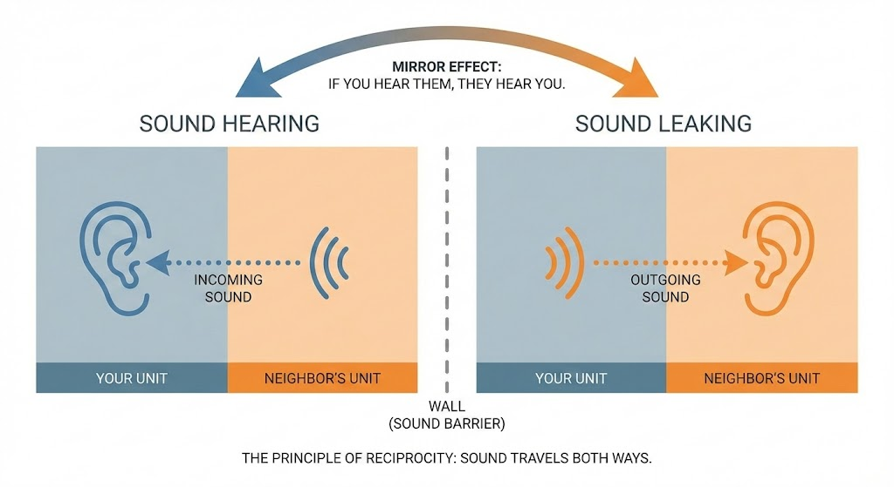
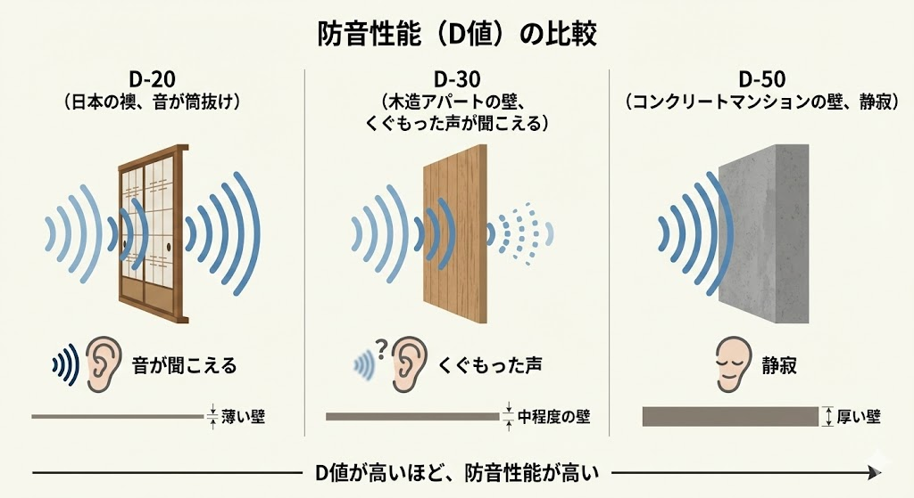
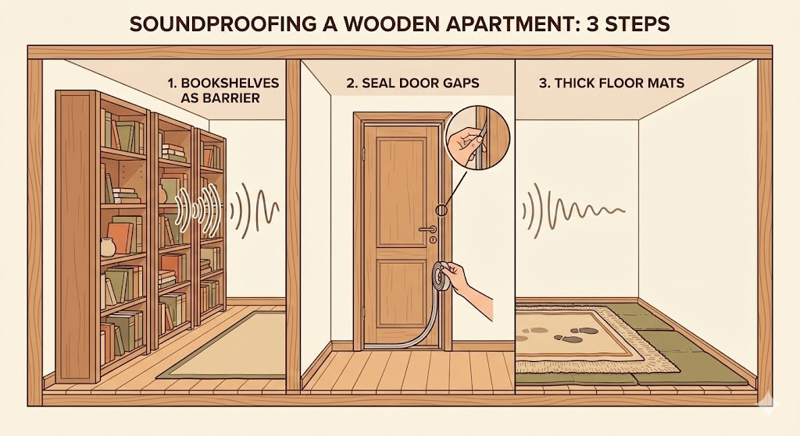

<RegionBanner />

「隣の部屋の目覚まし時計で目が覚めた」
「上の階の足音がうるさくて眠れない」

もしあなたが木造アパートに住んでいて、こんな経験があるなら要注意です。

<strong>「隣の音が聞こえる」ということは、「あなたの出している音も、筒抜けになっている」からです。</strong>

結論から言うと、<strong>木造アパートで「完全な防音」は無理</strong>です。

ただし、<strong>苦情が来ないレベルまで音を減らすことは可能</strong>です。

音の種類によって、効く対策がまったく違います。

- <strong>話し声・テレビ・通話（空気音）</strong> : 家具配置と隙間テープで減らせる
- <strong>足音・物を落とす音（固体音）</strong> : 防振マットと歩き方の見直しで減らせる
- <strong>楽器・深夜の熱唱</strong> : 木造では構造上むずかしい。別の手段を考える

この記事では、特別な工事なしでできる現実的な対策を、費用と効果の目安つきで紹介します。

怪しい防音シートを買う前に、まずはこの記事を読んでください。

## 木造アパートの防音性能（D値）の現実

木造アパートの壁（界壁）の遮音性能は、一般的に <strong>D-30〜D-40程度</strong> が目安とされています。

建物の築年数や構造、壁の中の吸音材の有無で、実際の性能は大きく変わります。

D値の読み方を、体感の目安で並べてみましょう。

| D値 | 聞こえ方の目安 |
| :-- | :-- |
| D-50 | 通常の話し声がほぼ聞こえない（分譲マンションレベル） |
| D-40 | 大声は聞こえるが、内容は聞き取りにくい |
| D-30 | 通常の話し声の内容まで聞き取れる |
| D-20 | 布団のこすれる音まで聞こえる（ふすまレベル） |

つまり、古い木造アパートの壁は「視界は遮るけれど、音はほとんど素通り」の状態です。

ここに数ミリの吸音シートを貼っても、残念ながら <strong>焼け石に水</strong> です。

D値の基礎から知りたい方は、[遮音性能の基準「D値」とは？楽器・用途別の目安](/ja/soundproof-room/bouon-dchiseinou-meyasu/)をご覧ください。

## やってはいけない「無駄な木造アパート防音」3選

ネット上には効果の怪しい防音テクニックが溢れています。

お金と時間を無駄にしないために、以下の3つは <strong>実行しないでください</strong> 。

### 薄い遮音シートを壁一面に貼る

<strong>結論：重さが足りないため効果が小さい</strong>

話し声のような「低音〜中音」を止めるには、壁に <strong>大きな質量（重さ）</strong> が必要です。

ペラペラのシートを貼っても、音はほとんど止まりません。

しかも退去時に剥がすと壁紙が破れ、修繕費を請求されるリスクのほうが高くなります。

### 壁に卵パックを貼る

<strong>結論：遮音効果はほぼゼロ</strong>

卵パックは音を「遮る」素材ではなく、遮音の役には立ちません。

凸凹にホコリがたまり、虫が寄る原因にもなります。

### 防音カーテンだけで安心する

<strong>結論：壁と床からは漏れ放題</strong>

窓からの音は減りますが、木造は壁や床・天井も薄い構造です。

「カーテンを閉めたから大声を出しても大丈夫」という過信が、トラブルの一番の原因になります。

## 木造アパートで音漏れを防ぐ3つの物理対策

木造アパートで戦うための武器は、高価なグッズではなく <strong>「重さ」</strong> と <strong>「密閉」</strong> です。

3つの対策を、費用と効果で比べると次のとおりです。

| 対策 | 費用の目安 | 効く音 | 効果 |
| :-- | :-- | :-- | :-- |
| 家具配置 | 0円（手持ち家具） | 話し声・テレビ | 中 |
| 隙間テープ | 数百円〜2,000円程度 | 話し声・外からの音 | 小〜中 |
| 防振マット＋カーペット | 数千円〜1万円台 | 足音・ドスン音 | 中 |

効果の大きさは建物の状態や音の種類で変わるため、あくまで目安です。

### 家具配置：タンスと本棚で「壁を厚くする」

一番手軽なのは、<strong>隣の部屋と接している壁に、背の高い本棚やタンスを並べること</strong>です。

本や衣類がぎっしり詰まった家具は、重さがあるぶん、音を弱める助けになります。

壁にぴったり付けると、壁と家具の間の空気層も効いてきます。

ただし、家具だけで壁の遮音等級が上がるわけではありません。

「話し声を少し和らげる」程度と考え、次の隙間対策と組み合わせるのが現実的です。

家具を置くときは、地震時の転倒防止も忘れないでください。

### 隙間対策：音の脱出口を塞ぐ

音は水と同じで、針の穴のような隙間からも漏れ出します。

古いアパートは隙間だらけなので、ここを塞ぐ効果は意外と大きくなります。

- <strong>ドアの隙間</strong> : 「EPDM（ゴムスポンジ）」製の隙間テープを貼ります。100均のスポンジより、ホームセンターのゴム製のほうが気密性が高めです。
- <strong>窓のサッシ</strong> : 「モヘア（起毛）」タイプのテープを貼ります。開閉をスムーズにしつつ、すきま風も減らせます。
- <strong>コンセント・換気口まわり</strong> : 外壁側は触らず、室内側の目に見える隙間だけを対象にします。

賃貸では、貼ってはがせるタイプを選び、退去時に跡が残らないか目立たない場所で試してください。

### 床防音：かかと歩きの「ドスン音」を消す

実は、トラブルの原因として多いのは声よりも <strong>「足音」</strong> です。

フローリングを歩くときの「ドスドス」という振動は、柱や梁を伝って建物全体に響きます。

- <strong>対策1</strong> : 防振ゴム系のマットの上に、厚手のカーペットを敷く
- <strong>対策2</strong> : 裏が柔らかい防音スリッパを履く
- <strong>対策3</strong> : かかとから着地せず、足裏全体で歩く

足音は「空気音」ではなく「固体音」なので、壁の対策では減りません。

足音の苦情が来たときの対処は、[階下から足音の苦情が来たら？ジョイントマットで防げない理由と正しい対策](/ja/knowledge/vibration-reduction-science/)で詳しく解説しています。

## 最後の砦は「マインドセット」

物理対策をした上で、生活習慣を少し変えるだけで、リスクはさらに下がります。

1.  <strong>22時以降は「静音モード」</strong>
    深夜は周囲も静まるため、同じ音でも大きく聞こえます。22時を過ぎたらヘッドホンをし、足音を忍ばせましょう。
2.  <strong>自分の周りだけ囲う</strong>
    どうしても通話をしたいなら、部屋全体ではなく「自分のデスク周り」だけをパーティションや布団で囲ってください。口元に近い場所で吸音するのが一番効率が良いです。
3.  <strong>入居前に壁と床の構造を確認する</strong>
    次に引っ越すなら、鉄筋コンクリート造や角部屋、1階を優先すると、対策の手間が大きく減ります。

## 対策しても苦情が来たときの動き方

対策をしても、苦情や注意が来ることはあります。

その場合は、自分で隣人に直接話しに行かず、まず管理会社や大家さんを通すのが安全です。

謝罪と改善の意思を伝えつつ、「何時ごろの、どんな音か」を具体的に聞いておきましょう。

具体的な手順は、[騒音クレームを直接言うのは危険？マンションの騒音トラブルを解決する『3フェーズ式』対策マニュアル](/ja/soundproof-rental/noise-complaint-landlord-negotiation-guide/)にまとめています。

なお、音の受け止め方には個人差があり、受忍限度の判断は個別の事情で変わります。

トラブルが深刻な場合は、管理会社や自治体の相談窓口、必要に応じて弁護士などの専門家に確認してください。

## まとめ：木造アパートの防音対策は限度がある

木造アパートで「防音室なしで楽器演奏」や「深夜の熱唱」は、残念ながら諦めたほうが安全です。

それは建物の構造上、対策だけでは届かない領域だからです。

しかし、<strong>普通の生活音を、隣の人に不快に思われないレベルにすることは可能</strong>です。

1.  <strong>家具を壁際に寄せる</strong> （話し声を少し和らげる）
2.  <strong>隙間テープで密閉する</strong> （音の抜け道を塞ぐ）
3.  <strong>床にマットを敷く</strong> （足音・振動音を減らす）

この3つを実践するだけでも、隣人トラブルのリスクは確実に下がります。

まずは今日、本棚を動かすところから始めてみませんか？

木造アパートの2階で簡易防音室を使う予定がある方は、[木造アパート2階に「だんぼっち」は危険？荷重を分散させるDIY補強術](/ja/diy/danbocchi-floor-protection/) も床荷重対策として確認しておきましょう。
