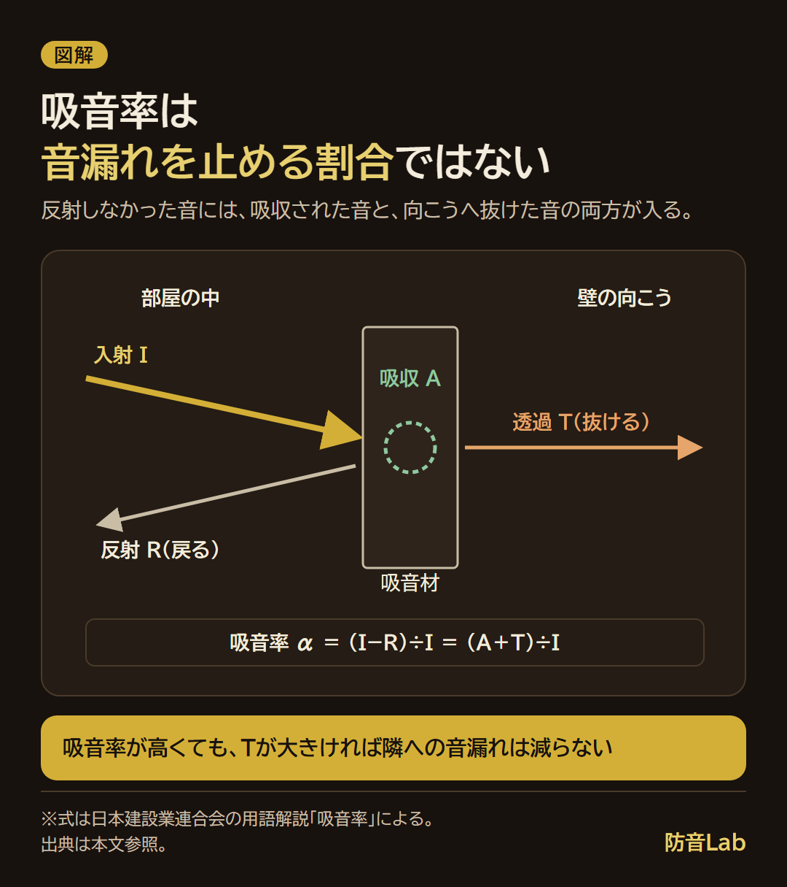

<RegionBanner />

吸音材と防音材の違いは、役割別の材料か総称かで、「防音材」は吸音材・遮音材などをまとめた呼び方です。

[日本音響材料協会の分類](https://www.onzai.or.jp/question/soundproof.html)で整理すると、音漏れを抑えるのは遮音材、室内の響きを減らすのが吸音材です。

比較表と3つの質問から、自分の悩みに合う材料と施工の順番を確かめられます。

材料の性能表示を横断して比べたい場合は、[防音材スペック早見表](/ja/knowledge/soundproof-material-spec-chart/)を参照してください。

## 吸音材と防音材の違いは、総称か役割別の材料か

<strong>吸音材は、防音材の一種です。</strong>「吸音材か防音材か」という二択にはなりません。

日本音響材料協会は、防音材料を遮音・吸音・制振・防振に分類しています。

商品に「防音」と書いてあっても、何を減らすための材料なのかを確かめて選びます。

| 項目 | 遮音材 | 吸音材 |
| :--- | :--- | :--- |
| 主な目的 | 壁・ドアなどを通る音を減らす | 室内で反射する音を減らす |
| 仕組み | 重さや壁の構造、隙間の処理で音を通しにくくする | 表面から戻ってくる音を減らす |
| 代表的な素材・部材 | 石膏ボード、遮音シート、防音ドア・窓 | グラスウール、ウレタンフォーム、吸音パネル |
| 向いている悩み | 自分の声が隣へ漏れる、外の音が入る | 声が反響する、録音に部屋の響きが乗る |
| 単独では解決しにくいこと | 室内の響きの調整 | 壁の向こうへの音漏れ |

分類・材料の出典は、上記の日本音響材料協会「防音材・遮音材・吸音材」です。

たとえば、机の前で話した声が壁に当たり、マイクへ戻ってくるなら吸音の問題です。

一方、その声が壁やドアを通って隣室に届くなら、遮音を検討する場面です。

同じ声でも、<strong>部屋の中の反射と、部屋を出ていく音は分けて考えます。</strong>

## 吸音材と遮音材の違いを3つの質問で確かめる

材料を買う前に、今困っている音について順に確認してください。

1. <strong>隣や外へ音が漏れる、外の音が入る悩みですか？</strong> : はい → 遮音と隙間の確認を先に進めます
2. <strong>部屋の中で声が反響したり、録音に響きが乗ったりしますか？</strong> : はい → 吸音を検討します
3. <strong>足音や物を落とす音が、床を通じて響きますか？</strong> : はい → 吸音パネルだけで解決しようとせず、防振も含めて音の経路を調べます

足音のような振動の問題は、話し声の音漏れと対策が異なります。

音漏れと響きの両方が気になる場合は、先に部屋の遮音を考え、その後で室内の響きを整えます。

## 吸音率が高くても、音漏れが減るとは限らない

吸音率は、材料に届いた音のうち、反射して戻らなかった音のエネルギーの割合です。

[日本建設業連合会の用語解説「吸音率」](https://www.nikkenren.com/kenchiku/sound/pdf/glossary/ka-0210.pdf)では、次の式で表しています。

<strong>α＝(I−R)÷I＝(A＋T)÷I</strong>

- <strong>I</strong> : 材料に入射した音のエネルギー
- <strong>R</strong> : 反射した音のエネルギー
- <strong>A</strong> : 材料の内部で吸収された音のエネルギー
- <strong>T</strong> : 材料の向こうへ透過した音のエネルギー

音が材料に当たると、一部は室内へ戻り、一部は材料内で吸収され、一部は向こう側へ進みます。

<strong>吸音率には、材料の向こうへ抜けた分も含まれます。</strong>吸音率を、そのまま「音漏れを止める割合」とは読めません。

同じ資料には、背後の空気層など、取り付ける構造でも吸音率が変わるとあります。

カタログの数字を見るときは、素材名だけでなく、どの構造・測定条件の値かも確認します。

素材や厚みごとの吸音率の比較は、[吸音材のおすすめの選び方と素材別の吸音率](/ja/diy/sound-absorbing-material-recommend/)にまとめています。

## 遮音材は重さだけでなく、壁や隙間とセットで考える

遮音は、壁の面密度（1m²あたりの重さ）や構造に関係します。

同じ構造・条件なら、面密度が大きいほど音を通しにくくなるという考え方が「質量則」です。

ただし、遮音シートを貼った面以外に音の通り道があれば、そこから音が伝わります。

日本音響材料協会の説明でも、軽量な間仕切りや周囲を密閉しにくい間仕切りは、遮音上の弱点を持つとされています。

<strong>シートの性能と、完成した部屋の性能は別に確かめます。</strong>

| 確認する場所 | 見ること |
| :--- | :--- |
| 壁・天井 | 材料の重さだけでなく、下地や層の構成を確認する |
| ドア・窓 | 閉めたときに隙間が残っていないかを見る |
| 配線を通した穴など | 壁を迂回する音の経路がないかを確認する |

部屋全体の遮音性能の表示は、[遮音性能の基準「D値」と用途別の目安](/ja/soundproof-room/bouon-dchiseinou-meyasu/)で整理しています。

## 施工の順番は、音漏れの経路を確認してから遮音・吸音

音漏れと室内の響きの両方を直したい場合は、次の順で考えます。

1. <strong>音の出入りを確認し、遮音を計画する</strong> : 壁・ドア・窓と、その周囲の隙間を先に確認します
2. <strong>吸音で室内の響きを調整する</strong> : 音が漏れる経路への対策とは分けて、反射が気になる場所に置きます
3. <strong>施工後に隙間と聞こえ方を再点検する</strong> : ドア下や配線まわりも含めて、残った音の経路を調べます

最初から録音の響きだけが悩みなら、遮音工事を経ずに吸音から試す選び方もあります。

先に「どちらの悩みか」を決めると、使わない材料を買う出費を避けられます。

賃貸では、貼り付けや固定をする前に、契約と管理会社への確認を進めます。

換気口を塞ぐ方法は避け、重い材料の固定や壁の変更は施工業者に相談してください。

配置を考えるときは、[吸音材を貼る場所とモニター裏・スピーカー裏の使い分け](/ja/diy/gamer-acoustic-placement/)を参照してください。

## 吸音材・遮音材のよくある質問

### 吸音材は効果ない？置くだけで効く？

<strong>室内の響きを減らす効果はありますが、音漏れへの効果は限られます。</strong>

置くだけでも音の反射を受ける位置なら役立ちますが、置く場所と吸音面の面積で結果は変わります。

面積も判断に入れる理由は、[日建連「等価吸音面積、平均吸音率」](https://www.nikkenren.com/kenchiku/sound/pdf/glossary/glossary-all.pdf#page=27)で確認できます。

「置いたのに変わらない」と感じたら、困っているのが響きか音漏れか、反射する面に向けて置けているかを確かめます。

吸音率は反射の減少を示す値で、音漏れの減少を保証しない、という前の節の区別が判断の出発点です。

### 遮音シートを貼るだけで防音できますか？

シートだけで、部屋全体の音漏れが止まるとは限りません。

壁の構造や窓・ドアの隙間によっても結果が変わるため、貼る面だけで判断しないようにします。

改善量の考え方は、[遮音シートの効果と面密度による試算](/ja/diy/sound-insulation-sheet-effect/)で確認できます。

### 音漏れと響きの両方が気になるときは、どちらを先に買いますか？

まず、音が出入りする場所を確かめます。

遮音の計画が決まったら、吸音で室内の反響を整える順に進めます。

吸音材を増やすだけで隣室への音漏れも解決すると見込んで、まとめ買いしないようにしてください。

## 買う前に、音漏れか響きかを一つ選ぶ

「防音材」はまとめた呼び方なので、その表示だけでは自分の悩みに合うか分かりません。

<strong>音漏れには遮音、部屋の響きには吸音</strong>を出発点にします。

今日できることは、3つの質問で「音漏れ・響き・振動」のどれが中心かを選ぶことです。

その答えをもとに、材料を選ぶか、管理会社・施工業者へ音の経路を相談するかを決めてください。
