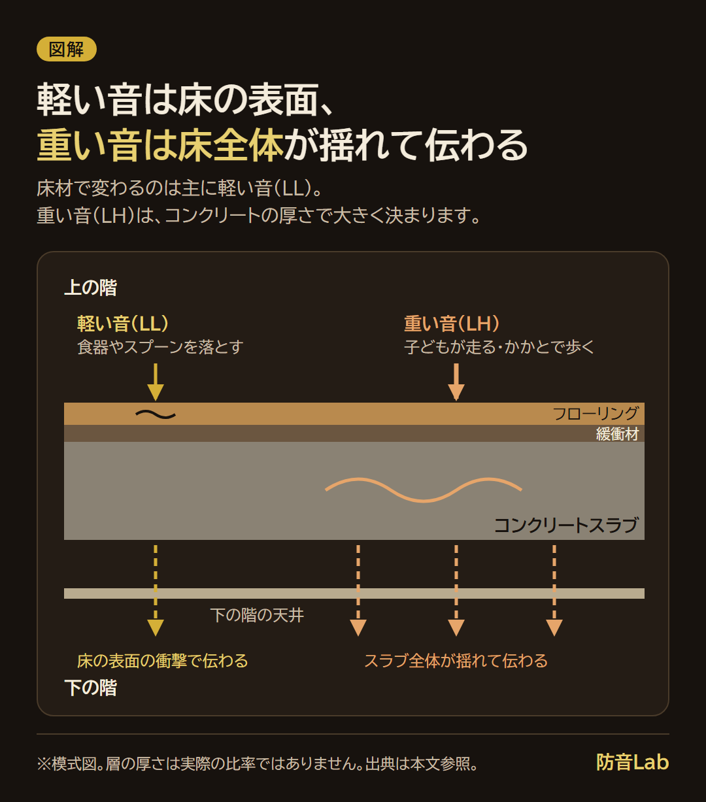
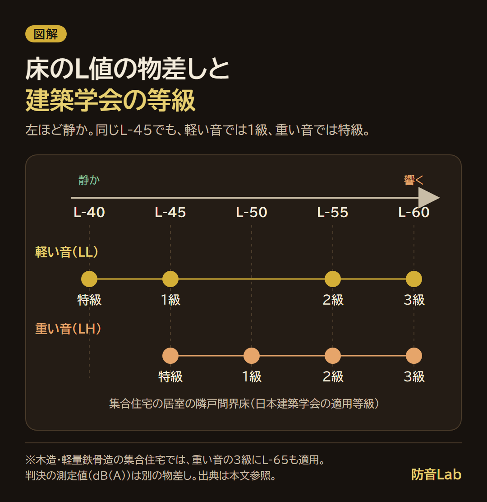
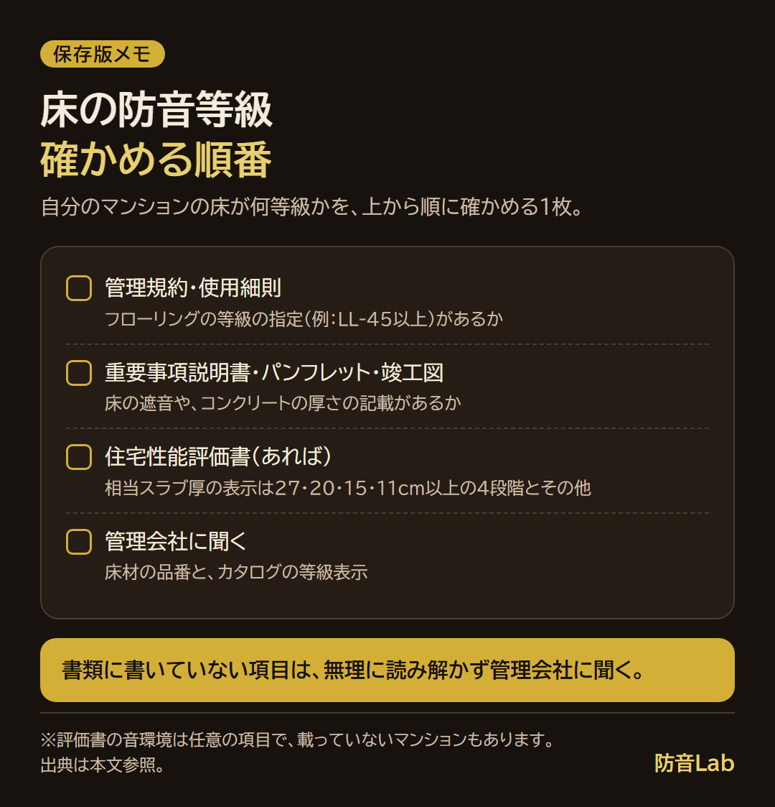

<RegionBanner />

床の防音等級は「L値」で表し、L-45よりL-40のように数字が小さいほど、下の階に音が響きにくい床です。

私が調べて分かったのは、等級が「軽い音（LL）」と「重い音（LH）」で別々に決まることです。

もう1つは、今のフローリングには「ΔLL(I)-4」のような別の表示が使われていて、古い「LL-45」とは読み替えが要ることです。

この記事では、L値ごとの聞こえ方の目安、判決で問題になった足音の大きさ、自分のマンションの等級を確かめる順番をまとめます。

## 床の防音等級は「L値」で、数字が小さいほど静か

L値は、上の階で決まった重さの物を落としたり跳ねたりしたとき、下の階でどのくらいの音になるかを測った数字です。

数字が小さいほど静かです。

測り方はJIS A 1419-2で決まっていて、周波数ごとの測定値を等級の曲線に当てはめて、L-45やL-50のように表します。

国土交通省の住宅性能表示の解説は、L-50を「標準衝撃源を用いた場合の発生音が周波数500ヘルツ帯域で50dB程度の重量床衝撃音として測定されること」と例示しています。

タイトルの「L-45で足りる？」には、先に条件つきで答えます。

- <strong>軽い音（LL）のL-45</strong> : 日本建築学会の1級で、学会が推奨する好ましい性能水準です
- <strong>重い音（LH）</strong> : 1級はL-50です
- <strong>足音や走る音</strong> : 重い音の側なので、LL-45の床材を選んでも、足音の大きさは決まりません

足りるかどうかは、出す音の種類と、下の階の静かさで決まります。

その見分け方を、このあとの表で順にたどります。

防音室の「Dr値・D値」とは、測る音も数字の向きも違います。

| 物差し | 測る音 | 数字の向き |
| :-- | :-- | :-- |
| L値（L-45など） | 床を伝わる衝撃音（足音・物の落下） | 小さいほど静か |
| D値・Dr値（Dr-45など） | 空気を伝わる音（話し声・テレビ・楽器） | 大きいほど遮音性能が高い |

出典: 国土交通省 住宅性能表示制度の解説「８．音環境に関すること」（2026年11月に確認）。

D値の見方は、[D値とdBの違い](/ja/knowledge/d-value-truth-and-myths/)で解説しています。

なお、集合住宅の床の遮音性能に法律の最低基準はありません。

リフォームでは、管理規約の中で床材の遮音性能を決めていることが多いと、日本建築総合試験所の2021年の報告に書かれています。

## LLとLHの違い：スリッパのパタパタと、かかとのドン

軽い音と重い音が下の階に伝わる道を、床の断面で見ます。

フローリングの遮音等級は、軽い音のLLと、重い音のLHに分けて表します。

| | 軽量床衝撃音（LL） | 重量床衝撃音（LH） |
| :-- | :-- | :-- |
| 音の例 | 椅子を引きずる・食器やスプーンを落とす | 子どもが走り回る・大人が歩く |
| 試験の標準衝撃源 | タッピングマシン | タイヤ衝撃源（バングマシン） |
| 床材を変えたとき | 変わる（フローリングはカーペットより低下） | カーペット・ビニル系・薄い直張りフローリングではほとんど変わらない |
| 主に決めるもの | 床仕上げ材の軟らかさなど | 床の構造（コンクリートの厚さなど） |

出典: 国土交通省 住宅性能表示制度の解説「８．音環境に関すること」、日本建築総合試験所「床材の床衝撃音低減性能の等級表記指針」（2008年3月）、東京地裁平成6年5月9日判決の事実認定（2026年11月に確認）。

床材で変わるのは、主にLLです。

LHは、コンクリートのスラブをどれだけ厚く、重くしているかで大きく決まります。

私は、底の硬いスリッパのパタパタ音がすごく響くことも、かかとからドンと落とす歩き方でバスドラムのような振動を感じたことも、体験しています。

前者はLLに近い軽い音で、後者はLHに近い重い音だと、整理すると分かりやすくなりました。

子どもが走り回る音は、まあ仕方ないかと思います。

ただ、それを許せるかどうかは、生活リズムにもよると感じています。

### 生活音で見るL値：足踏み・食器を落とす・脚がこすれる・子どもが走る

読者の暮らしの音を、LL側とLH側に分けます。

| 生活音 | どちら側か | 資料の言い方 |
| :-- | :-- | :-- |
| 皿やカップを落とす | 軽い音（LL） | 食器の落下音（国土交通省の別表） |
| 椅子を引きずる | 軽い音（LL） | 椅子の引きずり音（同） |
| 机やベッドの脚がこすれる | 軽い音（LL） | 椅子の引きずり音に近い音として扱います。資料に直接の分類はありません |
| その場で足踏みする・歩く | 重い音（LH） | 大人の足音（同） |
| 子どもが走り回る・跳ねる | 重い音（LH） | 子供の走回り音（同）。判決も重量衝撃音と認定 |

椅子が倒れる音は、軽い音と重い音のどちらに入れるかを示した資料を見つけられなかったので、表に入れていません。

L値ごとの聞こえ方は、国土交通省が、日本建築学会の書籍をもとにした表を載せています。

| L値 | 重い音（LH）の聞こえ方 | 軽い音（LL）の聞こえ方 |
| :-- | :-- | :-- |
| 45 | 表なし | 小さく聞こえる |
| 50 | 小さく聞こえる | 聞こえる |
| 55 | 聞こえる | よく聞こえる |
| 60 | よく聞こえる | 発生音がかなり気になる |
| 65 | 発生音がかなり気になる | うるさい |
| 70 | うるさい | 表なし |

出典: 国土交通省 住宅性能表示制度の解説「８．音環境に関すること」の別表（日本建築学会編『建築物の遮音性能基準と設計指針（第二版）』をもとに作成。2026年11月に確認）。

表は、部屋の暗騒音を30dB（A）程度と想定した目安です。

暗騒音が20〜25dB（A）と静かな部屋では、聞こえ方が1ランクずれると注記されています。

特にL-45では、2ランク程度ずれる場合もあるとのことです。

聞こえ方には個人差もあるため、表は「ひとつの目安」とされています。

L-40〜L-55の暮らしの例は、日本複合・防音床材工業会の表が、東京都の資料に載っています。

- <strong>L-40</strong> : 上階で物音がかすかにする程度。気配は感じるが気にはならない
- <strong>L-45</strong> : 上階の生活が多少意識される。スプーンを落とすとかすかに聞こえる。大きな動きはわかる
- <strong>L-50</strong> : 上階の生活状態が意識される。椅子を引きずる音は聞こえる。歩行などがわかる
- <strong>L-55</strong> : 上階の生活行為がある程度わかる。椅子を引きずる音はうるさく感じる。スリッパの歩行音が聞こえる

出典: 日本複合・防音床材工業会「L値ってなに？」（東京都「生活騒音・振動」指針No.229に掲載。2026年11月に確認）。

資料ごとに言い方が少し違うので、数字より「どんな音が聞こえる段階か」を見るのが安全です。

### 遮音等級L-45・L-40はどのくらい？建築学会の等級と並べる

日本建築学会は、床衝撃音の適用等級を、特級から3級までの4段階で示しています。

| 適用等級 | 水準 | 重い音（LH） | 軽い音（LL） |
| :-- | :-- | :-- | :-- |
| 特級 | とくにすぐれている。特別に高い性能が要求された場合の水準 | L-45 | L-40 |
| 1級 | すぐれている。建築学会が推奨する好ましい水準 | L-50 | L-45 |
| 2級 | 標準的。一般的な水準 | L-55 | L-55 |
| 3級 | やや劣る。やむを得ない場合に許容される水準 | L-60 | L-60 |

出典: 国土技術政策総合研究所の報告書（音環境分野）の表1.3.1・表1.3.3。対象は集合住宅の居室の隣戸間界床、重量衝撃源はタイヤ衝撃源（2026年11月に確認）。

木造・軽量鉄骨造などの集合住宅では、3級の重い音にL-65も適用されます。

同じL-45でも、軽い音では1級、重い音では特級です。

数字だけでなく、LLかLHかを見て等級を読みます。

等級の位置を、L値の物差しに並べるとこうなります。

### 裁判で問題になった足音の大きさと比べる

上の階の子どもの足音で、損害賠償と差止めが認められた判決があります。

東京地裁の2012年3月15日の判決（事件番号 平成20年（ワ）第37366号、判例時報2155号71頁）です。

分譲マンションで、階下の夫婦が、上階の所有者に騒音の差止めと損害賠償を求めました。

判決は一部認容で、その後に控訴されたと記録されています。

控訴審の結果は、確かめられませんでした。

| 項目 | 判決文に書かれていること |
| :-- | :-- |
| 床の仕様 | 厚さ200mm以上のコンクリートの上に、約4mmの防音緩衝材と、遮音性能LL-45の約9mmのフローリング |
| 測定 | 2008年7月3日〜30日、階下のリビング中央（高さ1.2m）で騒音計により測定 |
| 音の認定 | 子どもの飛び跳ねや走り回りによる重量衝撃音 |
| 差止め | 午後9時〜午前7時は40dB（A）超、午前7時〜午後9時は53dB（A）超を到達させない |
| 慰謝料 | 夫婦それぞれ30万円（別に、測定費用64万0500円と、妻の治療費2万4890円を損害と認定） |

出典: マンション管理業協会「おやくだち」掲載の判決文（Westlaw Japan出典）、事件番号 平成20年（ワ）第37366号（2026年11月に確認）。

判決は、足音や走り回りを元にした生活音の聞こえ方を、dB（A）で次のように認めています。

dB（A）は、騒音計で測る騒音レベルです。

L値の数字とは物差しが別なので、同じ数直線には並べられません。

| 判決が認めた騒音レベル | 判決の言い方 | 防音Labの基準表での大きさ |
| :-- | :-- | :-- |
| 40dB（A） | 小さく聞こえるもののあまりうるさくない | 図書館の館内、住宅地の夜 |
| 48dB（A）超 | やや大きく聞こえ、うるささが気になり始める | 書店の店内（50dB）に近い |
| 53dB（A）超 | かなり大きく聞こえ、相当にうるさい | 書店の店内（50dB）と銀行の窓口（60dB）のあいだ |

右の列は、環境省「騒音の目安」をもとにした[防音Labの基準表](/ja/knowledge/db-reduction-familiar-sound-scale/)の言い方です。

この床はLL-45でした。

判決は、LL-45の等級曲線が想定する衝撃なら、125Hz帯の床衝撃音レベルは58dB以下に抑えられると述べています。

実際の測定では、騒音計で48〜50dB（A）のときに、125Hz帯が64〜66dBに達しました。

そのため、想定を超える衝撃だったと判断しています。

判決は、売主が「防音緩衝材の性能規格は軽量床衝撃音の評価値で、歩行音などの生活音を遮断するものではない」と回答していたことも認定しています。

ここから分かるのは、LL-45の床でも、重い音は等級の想定を超えうることです。

反対に、等級が低くても違法と判断されなかった判決もあります。

東京地裁の1994年5月9日の判決（平成3年（ワ）第10131号、判例時報1527号116頁）は、軽量・重量ともL-60（建築学会の3級）の床で、請求を棄却しました。

通常の生活音に限られ、苦情後にカーペットやフェルトで配慮していたことが理由で、判決文に測定値は出てきません。

二つの判決を並べると、等級だけでなく、音の大きさ・頻度・時間帯と、配慮の有無が見られています。

法的な判断は、個別の事情で変わります。

苦情や請求の対応は、弁護士会や自治体の相談窓口に確認してください。

判例の読み方は、[騒音苦情の判例と受忍限度の境界線](/ja/knowledge/noise-complaint-legal-precedent-manual/)でも解説しています。

## フローリングの表示：LL-45とΔLL(I)-4の読み替え

今のフローリングのカタログには、「LL-45」ではなく「ΔLL(I)-4」と書かれていることがあります。

2008年ごろに、床材の表示が「推定L等級」から「ΔL等級」に変わったためです。

経緯は、日本建築総合試験所の報告書（2008年3月）と、同所の2021年の報告に書かれています。

- 1985年ごろから2008年まで、床材のカタログは「推定L等級」で表示していました
- 推定L等級は、実験室の低減量から、標準的な現場を仮定して、建物での性能を推定した等級です
- 実建物の条件が多様になり、推定が建物の性能とずれてきました。建物の性能の「保証値」という誤解も出ました
- 2007年のJIS A 1440の改正を機に、床材の関係団体が新しい表示を検討し、公的試験機関の報告書への推定L等級の添付も廃止されることになりました

ΔL等級は、建物の性能とは結びつけません。

実験室で測った、床材そのものの床衝撃音レベルの低減量から、直接等級を決める表示です。

数字が大きいほど、低減量が大きい（効く）床材です。

| 表示 | 何を表すか | 数字の向き |
| :-- | :-- | :-- |
| 推定L-45など（旧・推定L等級） | 建物の床の性能（推定） | 小さいほど静か |
| ΔLL(I)-4（新） | 床材の低減量（試験値） | 大きいほど効く |

軽量側のΔLL等級は、1から5までの5段階です。

各等級は、5つの周波数帯域で、低減量の下限値が決まっています。

すべての帯域で下限値を満たす、いちばん高い等級が表示になります。

| 等級 | 125Hz | 250Hz | 500Hz | 1kHz | 2kHz |
| :-- | :-- | :-- | :-- | :-- | :-- |
| ΔLL-5 | 15dB | 24dB | 30dB | 34dB | 36dB |
| <strong>ΔLL-4</strong> | 10dB | 19dB | 25dB | 29dB | 31dB |
| ΔLL-3 | 5dB | 14dB | 20dB | 24dB | 26dB |
| ΔLL-2 | 0dB | 9dB | 15dB | 19dB | 21dB |
| ΔLL-1 | −5dB | 4dB | 10dB | 14dB | 16dB |

出典: 日本建築総合試験所「床材の床衝撃音低減性能の等級表記指針」表1（2008年3月）。数値は低減量の下限値で、2026年11月に確認。

読み替えは、報告書が次のように示しています。

| 旧表示 | 新表示 | 条件 |
| :-- | :-- | :-- |
| 推定L-45等級以上（軽量衝撃） | ΔLL(I)-4等級以上 | 管理規約の置き換えとして、報告書が「適切」とする対応 |
| 推定L-50等級品の例 | ΔLL(I)-3 | 125Hzの低減量が9dBで、ΔLL(I)-4の下限10dBに届かないため |

出典: 同報告書の解説と、巻末の読み替え計算例（2026年11月に確認）。

ここでの対応は「目安」です。

報告書が示したのは上の2つで、L-40など、ほかの数字の対応表は見つけられませんでした。

カッコの(I)は、床材のカテゴリーです。

カテゴリーIは、カーペット・ビニル系のような、軟らかく薄い床材です。

カテゴリーIIは、乾式二重床のような、複層の床材です。

乾式二重床は試験方法が大きく変わったため、新旧の表記の対応を示すのは難しいと、報告書が書いています。

重い音のほうは、ΔLH等級が1から4の4段階です。

直張りフローリング（断面が一様で、厚さ16mm以下のもの）は、ΔLH(I)-3に相当すると判断されます。

重い音の低減量は0dBとして扱われます（ΔLH-3は63Hz帯の下限が0dBの等級です）。

## マンションの床の防音等級を自分の部屋で確かめる

自分のマンションの床が何等級かは、次の順に確かめます。

1. <strong>管理規約・使用細則</strong>に、フローリングの等級の指定があるかを見る
2. <strong>重要事項説明書・パンフレット・竣工図</strong>に、床の遮音やコンクリートの厚さの記載があるかを見る
3. <strong>住宅性能評価書</strong>があれば、重量・軽量の床衝撃音の項目を見る
4. <strong>管理会社</strong>に、床材の品番と、カタログの等級表示を聞く

私なら、書類に書いていない項目は、無理に読み解かず、管理会社に聞きます。

確かめる順番を、管理会社とのやりとりに持っていける1枚にまとめました。

### 管理規約を見る：標準管理規約には数字がない

国土交通省のマンション標準管理規約（令和7年改正、単棟型・コメント付き）には、L-45のような数字はありません。

標準管理規約が書いているのは、次の3点です。

- 床のフローリングは、理事長の承認が必要な修繕の具体例です（第17条関係②）
- フローリング工事は、構造・仕様・材料で影響が違うので、専門家への確認が必要です
- 別添2は、床材の張替えで「新築時と同等以上の遮音性能を確認する」としています

別添2は、例として、新築時カーペット敷きの高経年マンションで、承認条件を「遮音等級○L○○以上等」と示す書き方を挙げています。

「○L○○」は書式の例です。

実際の数字は、自分のマンションの規約や細則を見ないと分かりません。

2008年の報告書は、規約が「推定L45等級以上」（軽量衝撃）と定めている場合が多い、と書いています。

### コンクリートの厚さを見る：相当スラブ厚の表示

重い音は、コンクリートの厚さで大きく決まります。

住宅性能表示制度の評価書には、床構造を均質なコンクリート板の厚さに換算した「相当スラブ厚」が出ます。

| 重量床衝撃音対策等級 | JISのLi,r,H等級の目安（おおむね） |
| :-- | :-- |
| 等級5 | L-50相当以上 |
| 等級4 | L-55相当以上 |
| 等級3 | L-60相当以上 |
| 等級2 | L-65相当以上 |

相当スラブ厚の表示は、27cm以上・20cm以上・15cm以上・11cm以上の4段階と、それ以外（その他）です。

出典: 国土交通省 住宅性能表示制度の解説「８．音環境に関すること」8-1（2026年11月に確認）。

相当スラブ厚の4段階は、理論上5dBずつ性能が違うように決めた値です。

ただし、等級の表とスラブ厚の表は、端部の取り付け方などの条件が配慮されていない限り、行どうしが対応しません。

同じ厚さでも、条件で性能は変わります。

国土交通省の音のハンドブックは、RC造でスラブ厚15cm以上を、重量床衝撃音対策等級3相当の「一定の遮音対策」と呼んでいます。

また、相当スラブ厚が27cm以上なら、遮音性が非常に高い、と書いています。

なお、評価書の音環境は、申請者が選ぶ任意の項目です。

書類に書いていないマンションもあります。

### 規約の数字を、物差しに当てはめる

規約に数字が書いてあれば、生活音の表と、建築学会の等級の表に当てはめてみます。

たとえば「LL-45以上」なら、軽い音で1級の水準を、床材に求めています。

重い音は、その数字では決まりません。

自分が出している音（歩く・走る・物を落とす）が、LL側かLH側かを、生活音の表で見比べると、規約の数字が何を守っているかが分かります。

## 下の階から苦情が来たとき、等級を物差しにする

LL-45の床でも、音を完全に消すことはできません。

国土交通省のハンドブックも、生活音を完全になくすことはできないが、伝わりにくくすることはできる、と書いています。

等級は、標準の衝撃を想定して測った性能です。

住宅性能表示の解説も、表示する値は特定の条件下のもので、実際の住宅での性能とは必ずしも一致しない、と注意しています。

下の階から苦情が来たときは、次の順に考えます。

1. 自分の床の等級（LLかLHか）を、前の節の順で確かめる
2. 苦情の音が、軽い音（LL）か重い音（LH）かを分ける
3. 出している音が、ふつうの生活の範囲か、床の想定を超える音かを、表と判決の例で見比べる

判決の例（2012年）は、LL-45の床でも、子どもが走り回る重い音で、夜は40dB（A）超、昼は53dB（A）超が問題になりました。

判決の値は、専門会社が騒音計で測った値です。

スマホアプリの数字をそのまま比べられるかは、確かめていません。

アプリの限界は、[防音性能を測るスマホアプリ比較](/ja/knowledge/soundproof-app-review-2026/)で解説しています。

等級は、「どこまでが床の性能で、どこからが出している音か」を考える物差しです。

苦情を受けた直後の対策（ラグ・マット・歩き方）は、[階下から足音の苦情が来たときの対策](/ja/knowledge/vibration-reduction-science/)で解説しています。

夜に足音で眠れない側の対策は、[上の階の足音で眠れないときの騒音対策](/ja/soundproof-rental/bedroom-noise-type-solution-guide/)にあります。

## 等級で分からないこと：ラグ・マット・施工の差

ラグやジョイントマットを敷いても、床の「等級」が上がるわけではありません。

床材のΔL等級は、決まった条件の実験室で測った、床材単体の試験値です。

日本建築総合試験所の報告書は、実験室の試験は、条件をそろえて製品を横並びで比べるためのもので、現場ごとの性能を正確に予測するのは難しい、と書いています。

マットなど住宅用の商品は、軽量衝撃音の試験（LL試験）で確かめるのが一般的だと、国土交通省のハンドブックにあります。

マットの表示は軽い音の試験なので、マットで確かめられるのは軽い音の側です。

フロアタイルなどの下に何を敷くかは、[床の防音下地は何を敷く？](/ja/diy/floor-soundproof-underlay/)で素材ごとに比べています。

重い音は、スラブや床の構造で決まります。

施工でも、性能は変わります。

- <strong>重ね貼り</strong> : 防音フローリングの上に硬い床材を重ねると、遮音性能が下がると、日本建築総合試験所の2021年の報告が書いています
- <strong>乾式二重床</strong> : 壁際の納まり、床仕上げ高さ、幅木の種類で、性能が変わると、2008年の報告書が書いています

カタログの等級は、そのカタログの試験条件の値だと考えます。

足音や打鍵の振動が下に響く仕組みは、[叩く音・押す音が下の階に響くのはなぜ](/ja/knowledge/structure-borne-noise-tapping-striking/)で解説しています。

## よくある質問

### 賃貸でも床の防音等級は分かりますか？

等級が書類に載っているかは物件によるので、分かる場合と分からない場合があります。

国土交通省のハンドブックは、管理会社や大家さん向けに、図面や建築時の資料に遮音等級などの記載があれば、それを見せて説明するよう書いています。

入居前は、図面や資料に床の遮音の記載があるかを、管理会社に聞きます。

建物の構造も手がかりになります。

国土交通省の2025年の調査では、RC造とSRC造は、1996年以降に建てた物件のほとんどで、一定の遮音対策がありました。

鉄骨造と木造は、2011年以降に建てた物件の約6割でした。

「一定の遮音対策」は、RC造ではスラブ厚15cm以上、木造・鉄骨造では重い音がLH-55以上の床部材を使っている、という意味です。

### 管理規約に「LL-45以上」とあるとき、ΔL等級のどれを選べばいいですか？

薄くて軟らかい床材（カテゴリーI）なら、「ΔLL(I)-4以上」が、報告書の示す置き換えです。

乾式二重床は、新旧の対応を示すのが難しいため、管理組合か管理会社に、承認される表示を確かめます。

標準管理規約は、新築時と同等以上の遮音性能を確認するとしています。

カタログの試験条件と、施工方法を合わせる必要もあります。

「LL-45以上」は軽い音だけの条件で、重い音は含みません。

### LL-45とL-45は同じですか？

軽い音の等級を指すときは、同じ意味です。

2012年の判決も、「LL-45（L-45と同義）」と述べています。

重い音のときは、LH-50のように、LHをつけて区別します。

### 防音室を置く床にも等級は関係しますか？

関係します。

防音室のDr値は、空気を伝わる音を遮る性能です。

防音室の中で歩いたり、楽器や機材の振動が床に伝わったりした音は、床の衝撃音として、下の階に届きます。

カタログに床衝撃音の等級があるかは、製品ごとに確認が必要です。

重さの面では、[マンションに防音室を置けるかの床荷重](/ja/soundproof-rental/apartment-weight-limit-500kg/)も確かめます。

## まとめと次にやること

床の防音等級は、L値で表し、数字が小さいほど静かです。

軽い音はLL、重い音はLHで別の等級があり、LL-45は日本建築学会の1級、LH-50が重い音の1級です。

カタログの「ΔLL(I)-4」は、旧表示の「推定L-45等級」に近い表示で、数字の向きは逆です。

LL-45の床でも、重い音は等級の想定を超えることがあり、判決の例もあります。

次にやることは1つです。

<strong>管理規約のフローリングの条項を開き</strong>、等級の指定があるかを見てください。

指定がなければ、管理会社に「フローリングの遮音の条件」を聞きます。

私なら、条項の数字が、軽い音だけの条件か、重い音も含むかを、まず確かめます。

等級の数字や、判決の判断、管理規約の扱いは、個別のマンションや事情で変わります。

最終的な判断は、管理会社・管理組合、弁護士や自治体の相談窓口に確認してください。

## 出典（2026年11月に確認）

- [国土交通省 住宅性能表示制度の解説「８．音環境に関すること」](https://www.mlit.go.jp/jutakukentiku/house/torikumi/hinkaku/point/2_8.pdf)
- [国土交通省住宅局「音と向き合うための ハンドブック 共同住宅で快適に暮らすための音への気づきと工夫」](https://www.mlit.go.jp/jutakukentiku/house/content/001991123.pdf)
- [国土交通省「マンション標準管理規約（単棟型）コメント（令和7年改正）」](https://www.mlit.go.jp/jutakukentiku/house/content/001999022.pdf)
- [国土技術政策総合研究所の報告書（音環境分野）表1.3.1・表1.3.3](https://www.nilim.go.jp/lab/bcg/siryou/rpn/rpn0069pdf/kh0069_08.pdf)
- [日本建築総合試験所「床材の床衝撃音低減性能の表現方法に関する検討委員会 報告書」（2008年3月）](https://www.gbrc.or.jp/assets/test_research/acoustic/documents/report200803.pdf)
- [日本建築総合試験所「床材のリフォームにおける重ね貼り施工が床衝撃音遮断性能に及ぼす影響」（GBRC Vol.46 No.4、2021年10月）](https://www.gbrc.or.jp/assets/documents/gbrc/GBRC186_899.pdf)
- [東京都「生活騒音・振動」指針No.229（日本複合・防音床材工業会「L値ってなに？」の表を掲載）](https://www.hokeniryo.metro.tokyo.lg.jp/documents/d/hokeniryo/web_bunya9)
- [東京地裁平成24年3月15日判決（平成20年（ワ）第37366号、判時2155号71頁）](https://www.kanrikyo.or.jp/oyakudachi/pdf/vol10_04.pdf)
- [東京地裁平成6年5月9日判決（平成3年（ワ）第10131号、判時1527号116頁）](https://www.kanrikyo.or.jp/oyakudachi/pdf/vol10_02.pdf)
- [環境省「騒音の目安」（防音Labの基準表の出典）](https://www.env.go.jp/air/ippan/meyasu.pdf)
- [住宅性能評価・表示協会「評価書の見方」（2025年4月1日版。音環境が任意項目であること）](https://www.bcj.or.jp/upload/inspection/evaluation/mikata_20250401.pdf)
