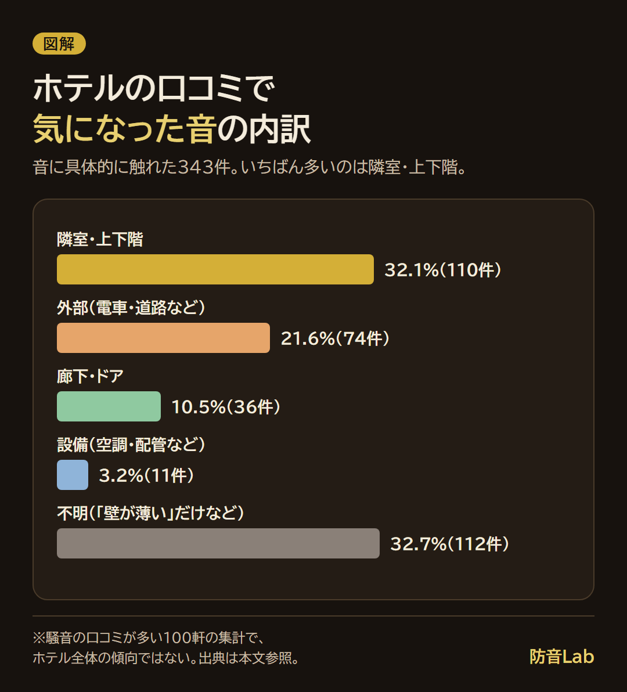
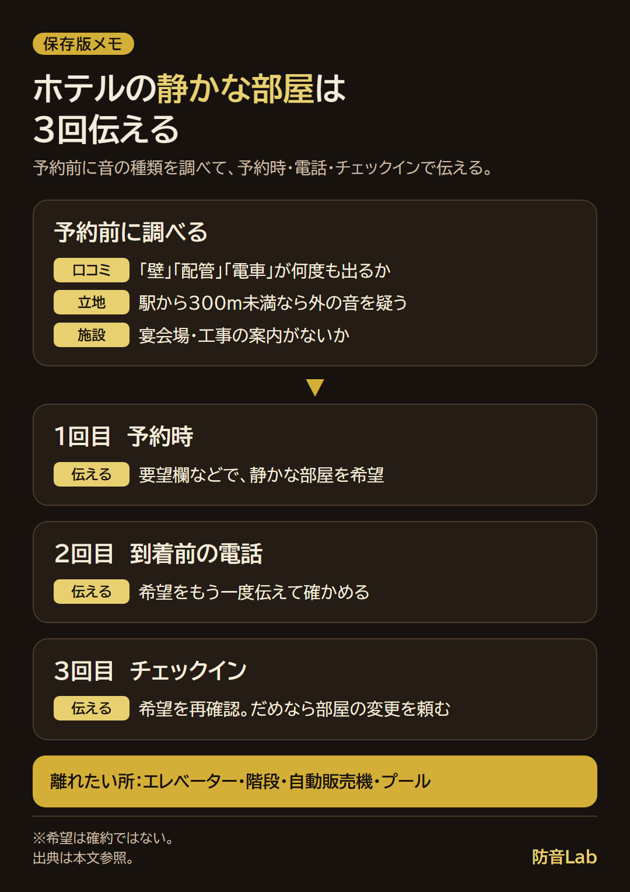

<RegionBanner />

ホテルで静かな部屋を選ぶには、予約前に口コミで「何の音か」を確かめ、希望を予約時・電話・チェックインの3回伝えます。

私が調べたのは、HotelBankが公開した、騒音の口コミが多い100軒の集計です。

この集計で音に具体的に触れた343件では、隣室・上下階が32.1%、外部が21.6%、廊下・ドアが10.5%でした（不明は32.7%）。

1990年以前にできた施設は隣室・上下階、2011年以降は外部の音が最も多く、外部の音の多くは駅から300m未満でした。

希望の伝え方と、部屋を変えられなかったときの耳栓も、順に整理します。

## ホテルで静かな部屋を選ぶ前に｜気になる音は隣室・外・廊下の順に多い

音の種類が分かるものでは、隣室・上下階がいちばん多く、次が外部、廊下・ドアの順でした。

対象は、口コミが20件以上で騒音への言及が10件以上ある施設のうち、言及が多い上位100軒です（直近24か月、2026年11月8日時点）。

100軒から抜き出した否定的な口コミの断片2,000件のうち、音に具体的に触れた343件を分けています。

ホテル全体の傾向ではありません。

| 音の種類 | 件数 | 割合（343件中） |
| :-- | :-- | :-- |
| 隣室・上下階 | 110件 | 32.1% |
| 外部 | 74件 | 21.6% |
| 廊下・ドア | 36件 | 10.5% |
| 設備 | 11件 | 3.2% |
| 不明 | 112件 | 32.7% |

「不明」は、「壁が薄い」とだけ書かれて、どこからの音か決められない口コミなどです。

1件が複数の種類に数えられている場合もあります。

出典は[HotelBankの記事](https://hotelbank.jp/investment/hotel-soundproofing-renovation-cost-per-room-noise-review-top100-adr-payback-2026/)です（2026年11月16日公開、同年11月25日確認）。



廊下・ドアの音は10.5%です。

私も、ホテルの廊下のスリッパの音や、かかとでドスドス歩く音が気になったことがあり、その場ではどうしようもありませんでした。

静けさの目安も、先に押さえておきます。

[環境省「騒音の目安」](https://www.env.go.jp/air/ippan/meyasu.pdf)では、ホテルの客室は30dBで、とても静かな分、小さな物音も目立ちます。

dBごとの体感は、[防音室の-dB軽減効果の体感早見表](/ja/knowledge/db-reduction-familiar-sound-scale/)にまとめています。

## 古いホテルと新しいホテルでは、うるさい音の種類が違う

同じ集計を施設の年代（運営を始めた年）で分けると、最も多い音が、1990年以前は隣室・上下階、2011年以降は外部に変わります。

| 施設の年代 | 隣室・上下階 | 外部 | 廊下・ドア |
| :-- | :-- | :-- | :-- |
| 1990年以前 | 42.4% | 4.5% | 18.2% |
| 2011年以降 | 17.8% | 39.5% | 4.6% |

残りは設備と不明です。

元の記事は、1990年以前はシティ・リゾートで建物の内側から、2011年以降は駅に近い宿泊特化型で外側から、音が入ると読んでいます。

年代と一緒に、施設の種類と立地も変わっている数字です。築年だけで音が決まるとは読めません。

外部の音74件のうち、64件が駅から300m未満、9件が300〜600m、1件が600m以上でした。

100軒のうち300m未満は59軒なので、外部の音（74件中64件、約86%）は、施設の数の割合より駅の近くに偏っています。

隣室・上下階の音は、駅からの距離に関係なく出ています。

同じ100軒の中で、騒音に否定的に触れた口コミの割合（言及率）の中央値も比べられています。

- <strong>業態</strong> : カプセル6.61%、ビジネス5.34%、シティ2.67%、デラックス2.37%、リゾート2.26%
- <strong>規模</strong> : 100室未満10.9%（7軒だけ）、100〜299室5.31%、300室以上2.67%

カプセル・ビジネスと、室数が少ない施設で高めです。

室数の多い施設は口コミの数も多く、割合が薄まりやすい点は差し引いて見ます。

口コミで改装への言及が5件以上ある47軒の言及率は5.03%、それ以外の53軒は4.80%で、差はほとんどありません。

改装済みという情報だけで、静かだと決めないほうがよさそうです。

## 予約前に口コミと立地で静かな部屋を見分ける

予約前は、口コミで繰り返されている音の種類と、駅や宴会場からの近さを確かめます。

[文春オンラインの記事](https://bunshun.jp/articles/-/13564?page=2)は、口コミの中で繰り返される指摘に注意するとしています。

[AARPの英語の旅行記事](https://www.aarp.org/travel/travel-tips/lodging/secure-a-quiet-hotel-room/)は、口コミで壁の薄さ・配管・電車の音を探すとしています。

海外の英語の記事なので、日本のホテルで同じように応じてもらえるとは限りません。

| 確かめること | 見方 | 根拠 |
| :-- | :-- | :-- |
| 繰り返される音 | 同じ音が口コミで何度も出ているか | 文春オンライン |
| 壁・配管・電車 | この3つの音の口コミを探す | AARP |
| 建物の構造 | 壁が薄いもののほか、鉄骨造では鉄骨を通じて他の階に音が伝わることがある | 文春オンライン |
| 駅からの距離 | 300m未満なら、外部の音の口コミを探す | HotelBankの集計 |
| 宴会 | 宴会のある施設なら、予約時に上の階を頼む | AARP |
| 工事 | 予約サイトや公式サイトに、改装工事の案内がないか | AARP |

角部屋や、宴会のない施設の高層階が静かかどうかは、ここで使った資料からは言えません。

## 静かな部屋の希望はいつ、どう伝える？

希望は、予約時・電話・チェックインの3回伝えます。

AARPの記事は、予約時に静かな部屋を希望し、電話とチェックイン時に再確認して、だめなら部屋の変更を頼むとしています。

| 順番 | 場面 | 伝えること |
| :-- | :-- | :-- |
| 1 | 予約時（要望欄など） | 静かな部屋を希望する。宴会のある施設は上の階も頼む |
| 2 | 到着前の電話 | 希望をもう一度伝え、確認する |
| 3 | チェックイン | 希望を再確認する。だめなら部屋の変更を頼む |

頼む位置は、エレベーター・階段・自動販売機・プールから離れた部屋です。

元フロントマンの[Forbes JAPANの別の記事](https://forbesjapan.com/articles/detail/71642)によると、部屋割りの希望は要望欄に書かれても、部屋番号はチェックインまで変わる可能性があります。

どのホテルも同じとは限らないと、本人も断っています。

希望は確約と考えず、チェックインでもう一度伝えます。

伝える文の例です。

```
静かな部屋を希望します。
エレベーター・階段・自動販売機から離れた部屋だと助かります。
難しい場合は、チェックインのときにもう一度相談させてください。
```

保存して持ち歩ける1枚にまとめました。



## うるさくて眠れないとき、部屋は変えられる？

我慢の限界を超える音なら、フロントに伝えてかまいません。

これは、元フロントマンが書いた[Forbes JAPANの記事](https://forbesjapan.com/articles/detail/73462)の説明です（2026年11月25日確認）。

ただし、線路や道路の音は、伝えてもどうにもならないことがあります。

その場合は、線路や道路の反対側の部屋があるかを、相談してみます。

AARPの記事は、割り当てられた部屋の位置がうるさそうなら、別の部屋に移れるか頼むとしています。

変更できるかどうかは、ホテルの対応によります。

伝えるときは、「隣の部屋の話し声」のように、音の種類と聞こえる方向を具体的に言います。

## 部屋を変えられなかったときの耳栓

部屋を変えられなかったときは、耳栓で音を減らす方法があります。AARPの記事も、耳栓を持っていくことを勧めています。

ただし耳栓は、音を減らすもので、聞こえなくなる保証ではありません。

選ぶときは、遮音の数値より先に、寝る向きと耳に合う形を見ます。

私は最初、耳に詰めるだけの安い耳栓を使っていましたが、横向きで寝ると邪魔になりました。

今は、寝転んでも邪魔にならない睡眠用を使っています。

筆者が使っているのは、DJcong QuietFit 睡眠用耳栓です。

<AffiliateCard slug="earplugs-djcong-quietfit" />

出張や旅行に持っていくなら、出発前に自宅で、横向きで痛くないかを確かめておきます。

耳をふさぐと、目覚ましや火災警報が聞こえにくくなる場合があるので、使う前に確かめます。

形の選び方、表示の読み方、痛みやアラームの対策は、[睡眠用耳栓の選び方と、アラーム・いびき・耳の痛みの対策](/ja/soundproof-rental/earplugs-for-sleep/)で整理しています。

## よくある質問（FAQ）

### ホテルで隣の音がうるさいのは、壁が薄いからですか？

集計では、隣室・上下階の音が音の種類の中で最も多く、343件中110件（32.1%）でした。

壁が薄いもののほか、鉄骨造では鉄骨を通じて他の階に音が伝わることがあるとされています。

### 新しいホテルなら静かですか？

静かとは限りません。

同じ100軒では、「静かだった」と書いた口コミの割合（中央値）は2011年以降が3.78%で、1990年以前の2.75%より高めです。

一方で、音の苦情の中身は、2011年以降の施設では外部の音が39.5%で最も多くなっています。

### ホテルでうるさい部屋は変更できますか？

我慢の限界を超える音なら、フロントに伝えてかまいません。

線路や道路の音は、伝えてもどうにもならないことがあり、変更できるかどうかはホテルの対応によります。

## まとめと次にやること

ホテルで静かな部屋を選ぶには、口コミで何の音かを確かめ、希望を予約時・電話・チェックインの3回伝えます。

集計は、騒音の口コミが多い100軒のものです。

ホテル全体の傾向ではないので、自分が泊まる施設の口コミで確かめます。

次は、<strong>予約したいホテルの口コミで、「壁」「配管」「電車」の語を探してください。</strong>

自宅の寝室の音が気になる場合は、[寝室の騒音対策を音の種類で選ぶ方法](/ja/soundproof-rental/bedroom-noise-type-solution-guide/)も確認できます。

眠れない状態が続くときは、医師などの専門家に相談してください。
