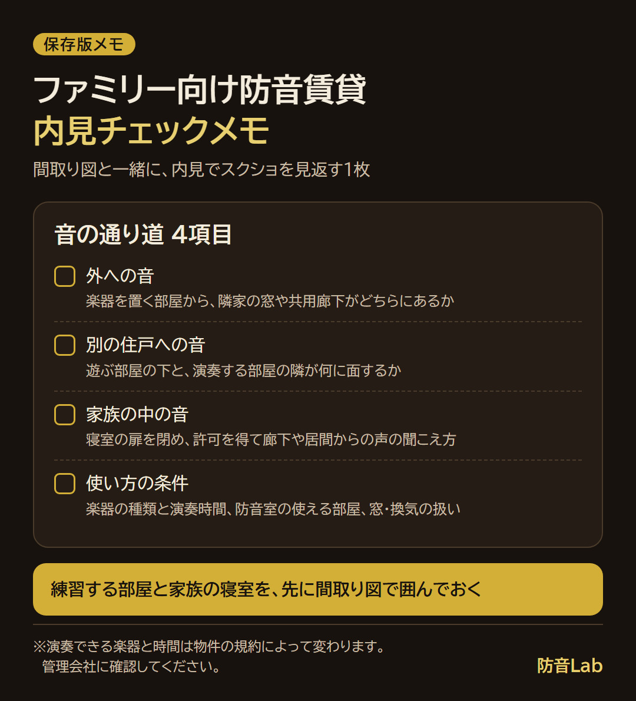

<RegionBanner />

メゾネットの防音賃貸は、[ミュージションテラス](https://www.musision.jp/terrace)のようなテラスハウス型に例があります（2026年11月に確認）。

1棟1戸の戸建ての防音賃貸は、今回確認した公式一覧と事例の範囲では見つかりませんでした。

戸建てのように家族で上下階を使いたいなら、テラスハウス型が近い候補です。

## 防音賃貸で戸建て・一戸建て、メゾネットを比べる

戸建てに近い暮らし方を求めるなら、家族で上下階を使えるテラスハウス型のメゾネットが候補です。

メゾネットは、住戸内の階段で複数の階を行き来する間取りです。

ミュージションテラスは、1棟に複数の住戸が横に並ぶテラスハウスです。

| 物件タイプ | 音の通り道として見る箇所 | 内見で確かめること |
| --- | --- | --- |
| 一戸建て | 家の中の上下階、窓や外壁から隣家まで | 練習する部屋の窓が隣家の窓に面するか |
| メゾネット（テラスハウス型の例） | 家族が使う上下階、横に並ぶ住戸との境の壁 | 防音室や遊ぶ部屋の隣と真上に何があるか |
| 集合住宅の平面住戸 | 隣戸との壁、上階・下階との床や天井 | 子ども部屋や寝室が別の住戸とどこで接するか |

メゾネットを探すときは、各階の間取り図で遊ぶ部屋の真下が自宅か別の住戸かも確かめます。

戸建ても、楽器を置く部屋の窓が隣家側を向いていれば、窓を閉めたときの聞こえ方と演奏の条件を確かめたいところです。

## 家族が出す音と、家族が聞く音

子どもの足音と楽器の音が気になるなら、間取り図に音の出る場所と静かにしたい場所の両方を記入します。

ミュージションテラスの3階建ての例なら、1階の防音室で練習し、2階のLDKや3階の寝室を家族の生活に使えます。

防音室の外で出る足音や子どもの声は、居室の床や隣戸との壁を通る音として別に考えます。

たとえば子どもが走る場所は床の真下を、楽器を置く場所は隣戸側の壁や外に面した窓を確かめます。

私なら、間取り図で練習する部屋と子どもが寝る部屋を囲みます。

廊下や別の部屋を挟む候補なら、内見でその間にあるドアも確認できます。

家族の生活時間がずれるなら、夜に使う部屋と早く寝る家族の部屋が隣り合っていないかも見ておきます。

足音や床の振動を住まいの構造から考えたいときは、[子育て世帯のマンションの防音リノベと騒音対策](/ja/soundproof-rental/child-rearing-soundproof-pillar/)が参考になります。

## ファミリー向けの防音賃貸の物件例｜ミュージションテラス

ミュージションテラスには、1戸で2〜3階を使う2LDK・3LDKの例があります。

[公式の紹介](https://www.musision.jp/terrace)では、1階に防音室と洗面、トイレを置き、その上に居住スペースを設けています（2026年11月に確認）。

設備の例には、2重防音ドア、3重窓、1階防音室の電動シャッターがあります。

設備の仕様は物件ごとに異なり、演奏できる楽器と時間帯は規約や楽器によって変わります。

| 物件（公式ページ） | 所在地 | 間取り・面積 | 階数・築年月 | 記載の遮音性能 |
| --- | --- | --- | --- | --- |
| [志木南](https://www.musision.jp/props/8234) | 埼玉県新座市 | 2LDK・73.69㎡ | 3階建て・2022年7月 | D-70 |
| [成増](https://www.musision.jp/props/15247) | 東京都板橋区 | 3LDK・82.79㎡ | 3階建て・2025年4月 | D-70 |
| [谷中](https://www.musision.jp/props/11644) | 東京都台東区 | 2LDK・55〜65㎡ | 2階建て・2023年8月 | D-80 |
| [調布柴崎](https://www.musision.jp/props/16297) | 東京都調布市 | 2LDK・64.77㎡／3LDK・75.57㎡ | 2階建て・2025年11月 | D-75 |
| [和光calms](https://www.musision.jp/props/6740) | 埼玉県和光市 | 2LDK・3LDK／71.58㎡ | 2階建て・2021年10月 | D-65 |
| [鳩ヶ谷](https://www.musision.jp/props/18127) | 埼玉県川口市 | 2LDK・68.31〜76.59㎡ | 2階建て・2026年8月 | D-70 |

表はすべて木造の例で、D値は各公式ページに記載の遮音性能です（2026年11月に確認）。

公式のD値を比べるときは、防音室どうしや上下階など、どの区間の値かを物件ごとに確かめます。

ほかに、バイオリンを弾く子どものいる家族が、防音室付きの3LDKに入居した例もあります。

出典は[ヤマハのエスポワール松風台の導入事例](https://rental.jp.yamaha.com/campaign/chintai/img/sample.pdf)です（資料に日付の記載なし、2026年11月に確認）。

[サウンドプルーフ中目黒の紹介記事](https://gentosha-go.com/articles/-/7870)には、1LDK・2LDKの例があります（2017年2月の記事、2026年11月に確認）。

## 防音賃貸の2LDK・3LDKの家賃と間取り｜東京と通勤圏で探す

ミュージションテラスの掲載例では、埼玉県の志木南と鳩ヶ谷の2LDKが入居受付中でした（2026年11月に確認）。

| 掲載物件 | 所在地 | 間取り | 家賃（月額・管理費別） | 管理費（月額） | 空室・募集状況 |
| --- | --- | --- | ---: | ---: | --- |
| 志木南 | 埼玉県新座市 | 2LDK | 18.6〜19.2万円 | 8,000円 | 入居受付中 |
| 鳩ヶ谷 | 埼玉県川口市 | 2LDK | 16.4〜18.5万円 | 10,000円 | 入居受付中 |
| 谷中 | 東京都台東区 | 2LDK | 22〜26万円 | 10,000円 | 空室なし |
| 調布柴崎 | 東京都調布市 | 2LDK・3LDK | 24.1万円 | 11,000円 | 空室なし |
| 成増 | 東京都板橋区 | 3LDK | 25.5万円 | 11,000円 | 空室なし |
| 和光calms | 埼玉県和光市 | 2LDK・3LDK | 13.9〜14.1万円 | 8,000円 | 空室なし |

出典は[ミュージション公式の物件一覧](https://www.musision.jp/props)です（2026年11月に確認）。

候補が決まったら、その住戸の家賃と管理費、練習に使える部屋と演奏時間を確かめます。

東京で2LDKを探して予算や間取りが合わない場合は、通える駅まで範囲を広げ、同じ条件で検索します。

地域を広げる前に、[防音賃貸の選び方と全国の家賃相場](/ja/soundproof-rental/bouon-rental-market-guide/)も参照できます。

## ファミリー向け防音賃貸の内見で確認する項目

内見では、家族が普段どの部屋を使うかを当てはめ、音の通り道を部屋ごとに確かめます。

- <strong>外への音</strong> : 楽器を置く部屋から隣家の窓や共用廊下がどちらにあるかを見る。
- <strong>別の住戸への音</strong> : 遊ぶ部屋の下と、演奏する部屋の隣が何に面するかを確認する。
- <strong>家族の中の音</strong> : 寝室の扉を閉め、案内担当に許可を得て廊下や居間から話し声の聞こえ方を確かめる。
- <strong>使い方の条件</strong> : 楽器の種類と演奏時間に加え、防音室があれば使える部屋と窓・換気の扱いを尋ねる。

私なら、練習場所と家族の寝室が両方決まる物件を優先します。

内見に持っていける1枚にまとめました。

## 引っ越さずに練習や生活の音を見直す方法

引っ越しを急がないなら、困っている音が足音か楽器かで、先に変える場所を決めます。

足音が気になるなら、遊ぶ場所を寝室の真上や隣戸側から移せるか、家族で間取り図を見て考えます。

楽器が主な悩みなら、生音で練習する日だけスタジオを利用する方法があります。

自宅で続けたいなら、今の賃貸に防音室を置けるかを管理会社に聞きます。

購入やレンタルを決める前に、設置する場所の床、換気、搬入経路、退去時の原状回復を確認します。

[賃貸に組み立て式防音室を置くときの設置許可の取り方](/ja/soundproof-rental/rental-unit-soundproof-room/)で、管理会社に伝える内容を整理できます。

[楽器可賃貸の探し方と通勤圏の決め方](/ja/soundproof-rental/instrument-allowed-rental-research-method/)は、今の家で条件が合わず探し直すときに参照できます。

## まとめ｜音を出す部屋と寝室を間取り図に書く

まず、気になる物件の間取り図に練習する部屋と寝室を書き込んでみてください。

どの部屋が隣戸や隣家に面するか分かると、内見で聞くことが絞れます。
