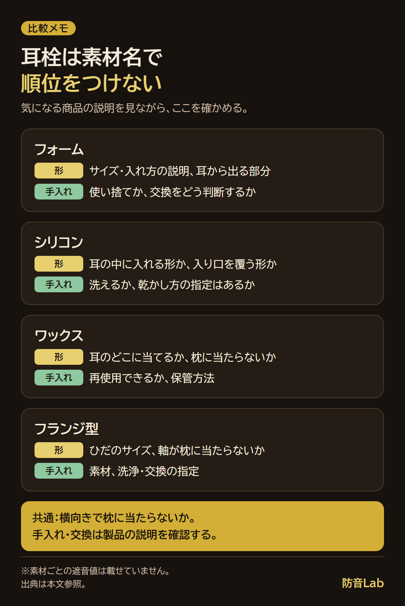
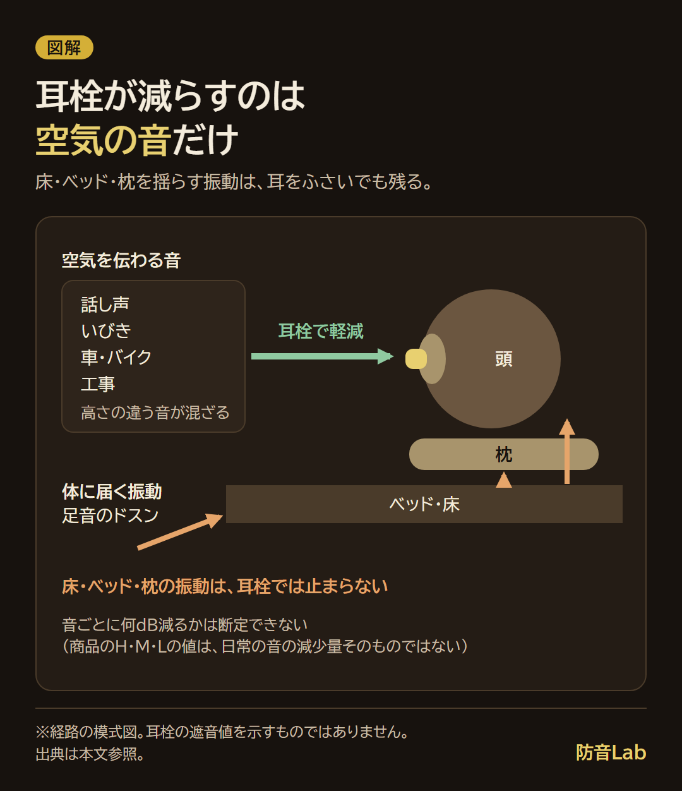

<RegionBanner />

耳栓で睡眠の妨げになる音を減らすには、遮音の数値より先に、寝る向きと自分の耳に合う形で選びます。

メーカーの説明と比較記事の検証では、表示のdBは試験条件での値で、実際の耳で同じ減り方になるとは限りません。

形を選ぶ確認表と音ごとの考え方、毎晩使うときの注意から、耳栓が合わない場合の次の手まで整理します。

## 睡眠用耳栓のおすすめは「寝る向き・形・遮音値」の順で選ぶ

遮音値だけで選ぶと、音は減っても、枕に当たって眠りづらいことがあります。

私は最初、耳に詰めるだけの安いものを使っていましたが、頭を横にすると邪魔になりました。

今は、寝転んでも邪魔にならない睡眠用のタイプを使っています。

買う前には、次の順に候補を絞ります。

| 順番 | 確認すること | 自分の場合の選び方 |
| :-- | :-- | :-- |
| 寝る向き | 仰向けか、横向きか | 横向きなら枕に当たる出っ張りを先に見る |
| 形・サイズ | 耳に合うか、痛みや圧迫感がないか | 合わない形を遮音値の高さで我慢しない |
| 遮音値 | 表示の種類と試験条件 | 同じ物差しかを見て、実際の減り方の保証と考えない |

部屋そのものの対策も考えるなら、[寝室の騒音対策を音の種類で選ぶ方法](/ja/soundproof-rental/bedroom-noise-type-solution-guide/)へ進んでください。

## 耳栓で睡眠の質は上がる？

音が眠りを邪魔しているなら、その音を減らす選択肢になります。

ただし、ここで挙げる資料は、耳栓による睡眠の改善を直接確かめたものではありません。

WHO欧州の環境騒音ガイドライン（2018年）は、道路交通騒音について、夜間45dB（Lnight）未満を推奨しています。

これは<strong>屋外の夜間の平均を表す値</strong>で、耳元の目標値や、耳栓の効果を示す数値ではありません。

根拠は[ガイドラインの要約資料](https://www.wbm.co.uk/wp-content/uploads/2018/11/WBM-WHO-2018-Summary-Nov-2018.pdf)です（2026年11月14日確認）。

「遮音値が高いほど睡眠の質も上がる」と結びつけず、痛みなく使えて、気になる音が減るかを見ます。

## 素材別の比較：フォーム・シリコン・ワックス・フランジ

候補はフォーム・シリコン・ワックス・フランジ型です。

素材名だけで遮音性や横向き寝の快適さを順位づけせず、具体的な商品の形と説明を比べます。

| 候補 | 形・付け心地で確かめること | 使用と手入れで確かめること |
| :-- | :-- | :-- |
| フォーム | 入れ方の説明、サイズ、耳から出る部分 | 使い捨てか、交換をどう判断するか |
| シリコン | 耳の中に入れる形か、入り口を覆う形か | 洗えるか、乾かし方の指定はあるか |
| ワックス | 耳のどこに当てる製品か、枕に当たらないか | 再使用の可否、保管方法 |
| フランジ型 | ひだのサイズ、軸が枕に当たらないか | 素材、洗浄・交換の指定 |

繰り返し使えるか、蒸れにくいか、横向きで痛くないかは、素材名だけでは決められません。

この表を使い、気になる商品の説明を見ながら候補を絞ってください。

## 「完全遮音」の耳栓はない：身近な音ごとの減り方

「最強」「完全遮音」で睡眠用耳栓を探していても、どの音も聞こえなくなる前提では選べません。

NRRはNoise Reduction Ratingの略で、米国環境保護庁（EPA）の規則による遮音の表示です。

[40 CFR Part 211 Subpart B](https://www.ecfr.gov/current/title-40/chapter-I/subchapter-G/part-211/subpart-B)で、実験室の試験から出す数値（dB）を包装に表示することが定められています。

SNRはSingle Number Ratingの略で、欧州の規格EN 352の表示です。

[OHROPAXの解説](https://www.ohropax.de/en/noise-insulation-values)では、高い音のH、中くらいの音のM、低い音のLという値も示されています。

[Honeywellの説明](https://explore.honeywell.com/rs/510-REI-219/images/HON-SoundSource-Ratings-Labels.pdf)では、表示値は個人が得られる減り方を予測するものではありません。

耳に合わなければ、試験と同じ値を期待できない、という読み方です。

[my-bestの比較検証](https://my-best.com/12844)でも、SNR・NRRの表示と実測の差が大きい商品が多かったとされています（以上、2026年11月14日確認）。

### 高い音・中くらいの音・低い音を分けて見る

数値の例は、フォーム耳栓のモルデックスMelLows（7600）です。

| 商品・試験条件 | SNR | H：高い音 | M：中くらいの音 | L：低い音 |
| :-- | :-- | :-- | :-- | :-- |
| MelLows（7600）、EN 352-2 | 21dB | 26dB | 18dB | 13dB |

出典は[メーカーの製品ページ](https://moldex-europe.com/en/details/mellows)です（2026年11月14日確認）。

この商品では低い音の値が小さく、総合のSNRだけでは分からない違いがあります。

身近な音では、目覚ましの高い電子音、話し声、車の走行音、工事の重機や足音の低い響きを分けて考えます。

ただし、車・バイク・工事・いびきは音が一種類ではなく、表のH・M・Lをそのまま各音の減少量にはできません。

<strong>「外の音から表示のdBを引けば、耳に届く音が分かる」という計算はしません。</strong>

たとえば、耳栓で隣の話し声は気になりにくくなったのに、上の階のドスンという音は枕を通して残る場面があります。

床・ベッド・枕を揺らす振動や、体を通って感じる音まで、耳の穴をふさぐだけでは止められません。

体に届く響きに敏感な人は、耳栓の数字だけで選ばないほうがよさそうです。

[上の階の足音が響く理由と対策](/ja/soundproof-rental/upstairs-footsteps-noise/)も合わせて確認してください。

## 横向きでも痛くない耳栓の選び方

横向きでは、耳の外に出る部分が枕に押されないかを先に確かめます。

出っ張りが小さい形を候補にしても、痛みが出たら無理に押し込まず、形やサイズを見直してください。

筆者が使っているのは、寝転んでも邪魔にならない睡眠用のタイプです。

<AffiliateCard slug="earplugs-djcong-quietfit" />

## 耳栓の危険とデメリット、その対策

私も、選ぶときには耳が痛くなることや、かゆくなることが気になります。

音を減らせても、不快感を我慢して使い続ける選び方にはしないようにします。

### 痛み・かゆみがあるとき

形やサイズを見直し、清潔に扱い、洗浄や交換は製品の説明に従います。

[耳鼻科医の解説](https://fdoc.jp/byouki-scope/features/ear-cleaning-everyday-trivia/)では、イヤホンの長時間使用に伴う外耳炎などのトラブルが指摘されています。

耳栓そのものの研究ではありませんが、耳をふさぐものを長くつける際の注意として参考になります（2026年11月14日確認）。

かゆみや痛みが数日たっても治まらない場合は、耳鼻いんこう科へ相談してください。

### アラーム・火災警報が聞こえにくいとき

使う耳栓をつけて、起きている間に目覚ましが分かるかを確認します。

音だけが不安なら、振動式アラームやスマートウォッチを候補にします。

目覚ましで起きられても、火災警報まで聞こえる保証にはなりません。

警報器の説明書やメーカー・管理会社に、耳をふさいで眠る場合の通知方法を確認してください。

## いびき対策で使うとき

いびきが聞こえて目が覚めるなら、耳に合う耳栓でどの部分が残るかを確かめます。

低い響きまで消そうとして、耳栓を深く押し込まないようにします。

「話し声で起きるか、いびきか、足音の低い響きか」を先に分けると、次の手を選びやすくなります。

| 目が覚める音 | 最初に試すこと | 足りない場合 |
| :-- | :-- | :-- |
| 話し声 | 耳に合う形と付け方の確認 | 寝る場所や、音が入る経路も見直す |
| いびき | 不快感なく使える耳栓 | 寝る場所を分ける方法も相談する |
| 足音・体に響く低い音 | 耳栓だけで足りるかを見極める | 部屋の変更や、建物の管理側への相談 |

耳栓は、いびきをかく人の健康状態を改善するものではありません。

いびき自体の健康上の心配は、医療機関に確認してください。

## 耳栓が合わないときの次の手：ノイキャン・寝ホン・ホワイトノイズ

ノイズキャンセリングは、一定に続く低い音を減らす候補です。

耳栓の上からノイキャンヘッドホンを使う組み合わせもありますが、床から体に伝わる振動まで消す方法ではありません。

ヘッドホンが枕に当たるなら、睡眠用として続けず、起きているときの休息・作業用として考えます。

寝ホンは睡眠時の形を考えたイヤホンですが、痛くないかは自分の耳で確認します。

私はBluetoothイヤホンで、ASMRや動画を聴きながら眠ることもあります。

これは使い方の体験で、睡眠が改善したという意味ではありません。

ホワイトノイズは、音を消すのではなく、別の音で気になる音を目立ちにくくする考え方です。

音量を上げて押し切らず、タイマーも使い、耳に不快感があるときは使用をやめて相談してください。

音の相手への相談も進めたいときは、[騒音の苦情の相談先と伝え方](/ja/soundproof-rental/noise-complaint-landlord-negotiation-guide/)を確認できます。

## よくある質問（FAQ）

### 耳栓を毎晩つけて寝ても大丈夫ですか？

全員に安全と言い切れる材料はありません。

製品の使用方法を守り、痛み・かゆみがあれば使い続けず、耳鼻いんこう科へ相談します。

### 耳栓をしても上の階の足音が聞こえるのはなぜですか？

低い音に加え、床や寝具を通る振動が残るためです。

耳栓の交換だけで解決しようとせず、寝る位置や相談先も考えます。

### フォームの耳栓はどれくらいで交換しますか？

一律の交換日数は、確認できていません。

再使用の可否や交換の条件は、使う製品の説明に従ってください。

### 100均やドラッグストアの耳栓でも眠れますか？

売っている場所だけでは、耳に合うかも遮音性も判断できません。

形・サイズ・遮音表示を確認し、表示のない商品に具体的な遮音量は見込みません。

## まとめと次にやること

睡眠用耳栓は、寝る向きと形を先に、遮音値をあとで見ます。

表示のdBは自分の耳での保証値ではなく、痛みやアラーム、残る振動も一緒に確認します。

次は、<strong>寝る向きと目が覚める音を一つ決め、それに合う形の耳栓を一つ選んでください。</strong>

耳の症状や睡眠の不調が続く場合は、医師などの専門家に確認してください。
