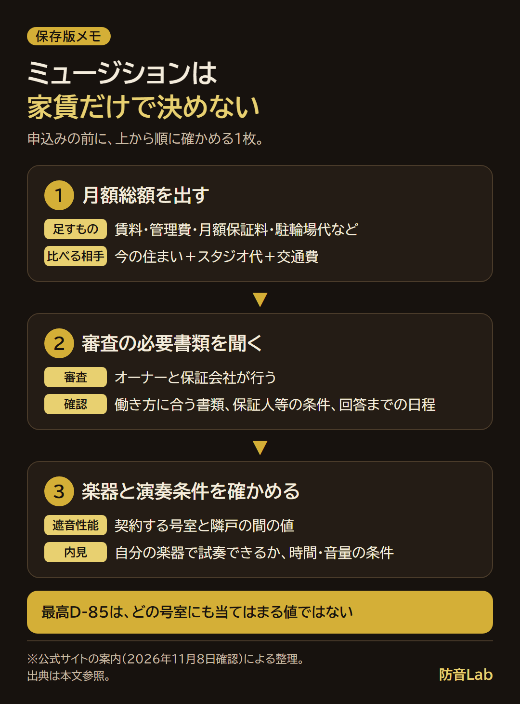

<RegionBanner />

ミュージションの家賃は、公式掲載例では川越が月6.9万〜14万円で、管理費などは別にかかります。

私は公式の物件情報と契約案内を読み比べ、掲載家賃だけでは毎月の負担が決まらないことを確認しました。

ここでは物件別の賃料と性能を表にし、入居審査の流れと、申込み前に確かめる費用・演奏条件を整理します。

ミュージション（MUSISION）は、[株式会社リブランが展開する防音賃貸ブランド](https://www.livlan.com/portfolio/)です。

ほかの候補も探す場合は、[防音賃貸のブランドと探し方](/ja/soundproof-rental/bouon-rental-market-guide/)も参考にしてください。

## ミュージションの家賃はいくら？公式の掲載例と管理費

<strong>家賃は物件・住戸ごとに異なります。</strong>公式の物件詳細に載る賃料例を並べると、次のとおりです。

| 物件 | 掲載賃料（月額） | 管理費（月額） | 掲載されている遮音性能 |
| :--- | :--- | :--- | :--- |
| ミュージション川越 | 6.9万〜14万円 | 5,000〜10,000円 | D-55〜D-65 |
| ミュージション早稲田 | 12.7万〜19.4万円 | 10,000円 | D-70〜D-85 |

出典：[ミュージション川越](https://www.musision.jp/props/123)、[ミュージション早稲田](https://www.musision.jp/props/4139)の公式物件詳細（確認日：2026-11-08）。各ページの情報更新日は、川越が2026-09-24、早稲田が2026-08-07です。

この表は<strong>物件全体の掲載範囲</strong>です。現在申し込める号室の価格や、ブランド全体の最安・最高額を示すものではありません。

同じ物件でも、広さや階数などで賃料が変わります。気になる号室の募集条件を開き、空室状況と併せて確かめます。

最新の探し先は、[公式の物件一覧](https://www.musision.jp/props)です。

### 一般の賃貸と比べると高い？

リブランは、周辺の同面積の家賃相場と比べ、3割以上高い賃料設定と説明しています。

これは同社の比較です。希望する物件と近隣の部屋の差が、一律に3割になるという意味ではありません。

出典：[リブラン「ミュージションの高い収益性」](https://www.livlan.com/asset-utilization/musision/profitability)（確認日：2026-11-08）。比較の周辺相場は、成約事例と仲介業者への調査による参考値とされています。

## 家賃以外の支払いと、スタジオ代の比べ方

家賃を払えるか考えるときは、月々の支払いと、入居時・更新時の支払いを分けます。

| 支払いの時期 | 見積書で確かめるもの | 比較のしかた |
| :--- | :--- | :--- |
| 毎月 | 賃料・管理費・月額保証料・必要な駐輪場代など | 利用する項目を足して月額総額にする |
| 入居時 | 敷金・礼金・仲介手数料・初回保証料・保険・鍵交換など | 対象住戸の見積書で有無と金額を確認する |
| 更新時・定期的な支払い | 更新料・保険の更新・サービス利用料など | 契約期間内に発生する支払いを確認する |

例えば早稲田の公式物件詳細では、管理費に加え、契約時と毎月の保証会社費用が案内されています。

費用項目や条件は物件で異なるため、表の全項目がどの住戸にも付くとは限りません。

スタジオ利用と比べるなら、次の表に<strong>自分が検討している住戸とスタジオの金額</strong>を入れます。

| 比較するもの | 計算する内容 |
| :--- | :--- |
| 今の住まいとスタジオを使う場合 | 今の住居の月額総額＋スタジオ単価×月の利用時間＋交通費 |
| ミュージションに住む場合 | 候補住戸の月額総額＋別途必要になるスタジオ代や交通費 |
| 月額とは別に考えること | 引っ越し・初期費用、通勤時間、楽器運搬の負担 |

家賃が上がっても毎日練習できるなら納得できる人もいれば、週末だけならスタジオのほうが合う人もいます。

月額差と、家で練習できる時間の両方で判断してください。

## ミュージションの審査は？公式で分かる申込みの流れ

<strong>入居審査は、オーナーと保証会社が行います。</strong>

公式の契約案内には審査があることは明記されていますが、必要年収や合否の基準、所要日数までは示されていません。

| 段階 | 公式案内の内容 | 先に確かめたいこと |
| :--- | :--- | :--- |
| 問い合わせ・内見 | 物件の特性、演奏可能楽器、時間、設備や初期費用などを案内 | 楽器名・使いたい時間・予算を伝える |
| 申込み | 希望物件・号室、連絡先、個人・法人の別、演奏予定の楽器などを連絡 | 専用申込フォームの案内と受付方法 |
| 審査 | オーナーと保証会社による入居審査 | 自分の働き方で必要な書類、保証人等の条件、回答までの日程 |
| 契約・支払い | 契約書類の手続きと初期費用の支払い | 見積書・契約条件・入居日 |

出典：[公式「ご契約の流れ」](https://www.musision.jp/moving-in/contract)（確認日：2026-11-08）。

フリーランス・学生など、収入の示し方が気になる場合は、提出できる書類を申込み前に窓口へ相談します。

職業だけで「通りやすい」「落ちる」と判断できる、公式の基準は確認できませんでした。

## 遮音性能は物件ごとに確認する

公式はブランドの遮音性能を<strong>最高D-85</strong>と案内しています。

一方で、最初の表の川越はD-55〜D-65です。最高値を、どの物件・号室にも当てはめないようにします。

公式の説明では、竣工時に全室を測定し、建物の表示には最も低い性能を用いるとされています。

物件ページに幅のある表記が載っている場合も、契約する号室と隣戸の間の性能を窓口に確かめてください。

出典：[公式「ミュージションの防音・遮音性能」](https://www.musision.jp/about/insulation)（確認日：2026-11-08）。

| 内見で伝えること | 確かめること |
| :--- | :--- |
| 楽器の種類・アンプの使用 | その住戸で演奏できるか、音量や時間の条件はあるか |
| 練習する部屋 | 防音仕様の範囲と、その部屋の測定結果 |
| 深夜の練習や配信 | 自分の使い方が契約条件に合うか、隣戸で聞こえ方を確認できるか |

公式FAQでは、自分の楽器を持参して内覧時に演奏できると案内しています。試奏の方法は予約時に相談してください。

出典：[公式「よくある質問」](https://www.musision.jp/moving-in/faqs)（確認日：2026-11-08）。

数値の読み方は、[遮音性能の基準「D値」と楽器別の目安](/ja/soundproof-room/bouon-dchiseinou-meyasu/)を参考にしてください。

## ミュージションの評判・「うるさい」が気になるとき

「家賃を上げたのに音で困りたくない」という不安は、内見で具体的な質問に変えると確かめやすくなります。

口コミは、物件・部屋・音源・時間帯が分からなければ、自分の場合と比較しにくいものです。

| 気になる内容 | 内見や窓口での確認 |
| :--- | :--- |
| 隣室の楽器が聞こえるか | 可能なら自分の楽器で試奏し、隣戸との聞こえ方を確認する |
| 足音や共用部の音 | 楽器の遮音性能とは分け、室内・廊下などで聞く |
| 音の相談が出たとき | 連絡先と、管理側が確認・対応する手順を聞く |

この表は、実際に苦情が出ているという集計ではありません。特定の口コミを根拠に、ブランド全体を「静か」「うるさい」と評価することは避けます。

配信用途の回線や電源も気になる場合は、[配信者向け賃貸の内見チェックリスト](/ja/creator/streamer-rental-selection-guide/)と一緒に確認すると整理できます。

## 満室なら公式のウェイティング登録を使う

希望物件が満室なら、公式LINEのウェイティング登録で募集通知を受け取れます。

気になる物件を「優先通知」に設定する方法も案内されています。

ただし、優先通知は設定した人全員に同時配信され、新築の新規募集は対象外です。通知は入居枠の確保や審査通過を保証するものではありません。

出典：[公式「ウェイティング登録について」](https://www.musision.jp/waiting)（確認日：2026-11-08）。

空室がある物件は、その募集案内から条件を確かめます。すべての申込みに空き待ちが必要というわけではありません。

## まとめ：家賃の差と、自宅で練習できる時間を比べる

私なら、候補住戸の月額総額を出してから、内見で楽器の条件を確かめます。

家賃を上げても、希望する練習ができなければ、別の場所を借りる費用が残るからです。

掲載賃料の例は川越が月6.9万〜14万円、早稲田が12.7万〜19.4万円です。管理費などを加え、審査の必要書類と演奏条件を確認して選んでください。
