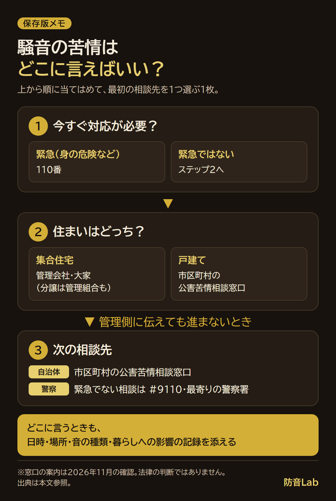

<RegionBanner />

騒音の苦情をどこに言えばいいか迷ったら、マンションは管理会社（分譲は管理組合も）、戸建てや管理会社が動かない場合は市区町村の公害苦情相談窓口が目安です。

[公害等調整委員会の案内](https://www.soumu.go.jp/kouchoi/trouble.html)と[警察庁の案内](https://www.npa.go.jp/goiken_index.html)を確認すると、身の危険や深夜の大騒ぎなどで緊急対応が必要なら110番、緊急でない警察への相談は<strong>#9110</strong>です。

相談先の比較表と記録例から、直接相手に言わずに相談を進める方法を確かめられます。

法的な対応の全体像は、[騒音苦情の判例と受忍限度の考え方](/ja/knowledge/noise-complaint-legal-precedent-manual/)にまとめています。

## 騒音の苦情はどこに言えばいい？相談先とできること

<strong>緊急性を先に確認し、そのうえで住まいに合う窓口を選びます。</strong>

普段の生活音についての苦情と、今すぐ安全を確保するための通報は分けて考えてください。

| 相談先 | 向いている場面 | できること・できないこと |
| :--- | :--- | :--- |
| 管理会社・大家／分譲の管理組合 | 賃貸マンション・アパートや分譲マンションの、継続する生活音 | 建物のルールの確認や、注意・聞き取りの依頼先。対応範囲は契約等で異なり、連絡すれば直ちに音が止まるとは限らない |
| 市区町村・都道府県の公害苦情相談窓口 | 戸建ての近隣騒音、管理側に伝えても進まない相談、店舗・設備などの音 | 内容に応じた実状の調査、改善の指導・助言。窓口への相談だけで損害賠償まで決まる仕組みではない |
| 警察の110番 | 身の危険がある、深夜の大騒ぎなどで今すぐ対応が必要 | 緊急通報の窓口。急がない相談や、継続する苦情の相談先探しには#9110等を使う |
| 警察相談専用電話 #9110・最寄りの警察署 | 緊急ではないが、生活の安全について警察に相談したい | 生活安全の悩みを相談する窓口。管理会社への連絡や民事上の請求とは役割が異なる |

自治体・警察の役割は、上記の公害等調整委員会と警察庁の案内に基づきます。

管理人・管理組合・管理会社等への相談経過は、[東京地裁の足音事件の判決](https://www.courts.go.jp/assets/hanrei/hanrei-pdf-35354.pdf)でも確認できます。

ただし、この事件の経過から、すべての管理会社に同じ対応を求められるとは限りません。

## マンションの騒音苦情を管理会社・管理組合へ伝える

賃貸なら、契約書や入居時の案内にある管理会社の連絡先を確認します。

管理会社がない場合は大家へ、分譲マンションでは管理組合にも相談します。

相手の部屋へ直接行くのが怖いなら、まず窓口を通して伝える形で構いません。

<strong>「誰が悪いか」より先に、「いつ、どこで、どんな音が続くか」を伝えます。</strong>

初回はメールや問い合わせフォームなど、送った内容を後から確認できる方法を選ぶと整理しやすくなります。

### 騒音記録は、相談前に長期間そろわなくてもよい

相談のために、受忍限度を超えたと自分で証明してから連絡する必要はありません。

今分かる事実を伝え、記録はその後も続ける形で進めます。

| 記録すること | 書き方の例（架空の記入例） |
| :--- | :--- |
| 日時と長さ | 11月○日、23時15分〜23時50分 |
| 聞こえた場所 | 寝室で、天井側から聞こえた |
| 音の種類 | 走るような足音、物を落としたような音 |
| 暮らしへの影響 | 音で目が覚め、寝直せなかった |
| 相談と対応 | ○日に管理会社へ連絡。建物全体への注意文の掲示を依頼 |

音源を確認できていない場合は、「上の部屋が原因」と決めつけず、聞こえた方向と状況を分けて書きます。

音量を測った場合も、測定機器・場所・時刻を一緒に残してください。

### 管理会社への連絡で頼むことを一つずつ決める

連絡では、記録に加えて、確認してほしいことと回答の希望時期を添えます。

> ○号室の者です。11月○日から、夜間に寝室の天井側で足音のような音が続いています。
>
> 記録を添付しますので、建物内の状況の確認と、生活音についての注意喚起をご検討いただけますか。
>
> 相談者の名前や部屋番号を相手へ伝える前に、扱いをご相談したいです。対応の見通しを○日ごろまでにお知らせいただけると助かります。

匿名を希望するときは、相手にどこまで伝わるかを、注意を依頼する前に確かめます。

手紙や掲示文が必要なら、[騒音苦情の手紙・張り紙の例文](/ja/soundproof-rental/noise-complaint-letter-template/)をもとに管理会社へ相談してください。

## 市役所への騒音苦情は、公害苦情相談窓口へ

戸建ての近隣騒音や、管理会社への連絡だけでは進まない場合は、自治体の窓口に相談します。

市役所・区役所などの公式サイトで「公害苦情相談」「騒音相談」を探してください。

担当部署が分からなければ、代表窓口で「近隣の騒音について公害苦情相談の担当につないでほしい」と伝えます。

公害等調整委員会は、まず身近な都道府県・市区町村の窓口へ相談するよう案内しています。

相談内容に応じて被害の実状を調べ、原因や実態を確かめたうえで、改善の指導・助言を行う窓口です。

<strong>相談すれば相手への命令や賠償が自動的に決まる、とは考えないようにします。</strong>

窓口には、音の種類・時間帯・続いている期間と、管理側へ相談した経過を伝えます。

何が対応の対象になるか、どのような記録や測定が必要かも、そこで確認してください。

## 騒音の苦情を警察に相談するときは、緊急性で選ぶ

<strong>身の危険や、今起きている深夜の大騒ぎなどで緊急対応が必要なら110番です。</strong>

急がない生活安全の相談は、警察相談専用電話<strong>#9110</strong>か最寄りの警察署へ連絡します。

警察庁の案内は、110番を緊急通報、#9110等を緊急でない相談の連絡先として分けています。

「夜だから必ず110番」「騒音だから警察には言えない」と一律に決めず、今すぐ対応が必要な状況かを伝えてください。

相談時は、音が続いている場所と時間、身の危険の有無を、分かる範囲で説明します。

## 受忍限度は何dB？判断で見られる点

受忍限度は、共同生活で一般に受け入れるべき音の範囲を指す考え方です。

<strong>何dBなら相談できる、何dBを超えたら違法、という一律の線引きではありません。</strong>

[京都地裁の判決](https://www.courts.go.jp/assets/hanrei/hanrei-pdf-80771.pdf)は、侵害の程度や被害の内容、地域性などを総合して考えるとしています。

上記の東京地裁の足音事件では、音が続く時間や期間に加え、相手の住まい方・対応も考慮されました。

| 受忍限度の判断で見られる点 | 相談・記録で整理すること |
| :--- | :--- |
| 音の大きさ・性質 | 話し声か足音か。測定したなら機器や場所も記録する |
| 時間帯 | 昼間か深夜か、睡眠や会話の時間と重なるか |
| 頻度と続いた期間 | 一度だけか、繰り返すか、いつから続いているか |
| 地域性・建物の状況 | 周囲の土地利用、建物の用途や構造など |
| 被害の内容 | 眠れないなど、暮らしにどんな支障が出ているか |
| 相手の対応・対策 | 注意後に対策があったか、その後どう変わったか |
| 記録・測定の条件 | 瞬間の最大値か、一定の時間全体を評価した値か |

### 公調委の2件は、屋内指針と等価騒音レベルを使っていた

公害等調整委員会の[令和6年（セ）第4号](https://www.soumu.go.jp/main_content/000961985.pdf)と[同第2号](https://www.soumu.go.jp/main_content/000965630.pdf)の決定は、中央環境審議会の答申にある屋内指針を物差しにしています。

一般地域では、昼間（6〜22時）は45dB以下、夜間（22〜翌6時）は35dB以下という指針です。

比較に使ったのは、一瞬の最大値ではなく、<strong>時間区分全体をエネルギーで平均した「等価騒音レベル」</strong>でした。

瞬間的に指針を超えた音があっても、時間区分全体の値は下回るとして、両件は受忍限度を超える音ではないと評価しました。

そのうえで、公害に該当せず申請の要件を満たさないとして、申請を却下しています。裁判所の判決とは異なる、公調委の決定です。

この45dB・35dBも、すべての近隣騒音の合法・違法を分ける線ではありません。

測定条件や各事件の事情を含む判断なので、手元のアプリの瞬間値だけで結論を出さないようにします。

判決・決定の経過と請求の考え方は、[騒音で引っ越し費用を請求できるかと既存事例](/ja/soundproof-rental/noise-moving-cost-claim/)で確認できます。

## 直接の注意や、音でのやり返しは避けて相談を進める

相手の部屋へ押しかけたり、待ち伏せして注意したりすると、口論や報復につながるおそれがあります。

壁を叩くなど音でやり返す方法も、別の騒音や対立を生むため避けます。

相談中の応急対応として、静かな場所へ移動する、寝る位置を変える、耳栓を検討するなど、無理なくできることを選んでください。

隣室の音に吸音パネルを置くだけで対応しようとせず、工事や材料の購入は、音の経路と賃貸の許可を確認してから進めます。

## 騒音苦情の相談でよくある質問

### 騒音の苦情は、何dB以上なら言っていいですか？

相談前に、自分で違法かどうかを判定する必要はありません。

音量だけでなく、時間帯・長さ・暮らしへの影響を伝え、対応できる内容を窓口に確認してください。

### 管理会社が動かないときは、次にどこへ言えばいいですか？

連絡日と返答、音の記録を整理して、大家や分譲の管理組合、市区町村の公害苦情相談窓口へ相談します。

身の安全について不安がある場合は、緊急性に応じて警察にも相談してください。

### 騒音の苦情は、匿名でも相談できますか？

氏名を相手に伝えたくない希望は、最初の相談時に伝えます。

匿名でどこまで確認・対応できるか、相手にどんな情報を伝えるかは、窓口ごとに確かめてください。

## 今日の音を記録して、相談先を一つ選ぶ

まず今日聞こえた音の日時・場所・種類と、生活への影響を書き留めます。

その記録を添え、集合住宅なら管理会社・管理組合、戸建てや管理側で進まない相談なら自治体へ連絡してください。

緊急の場合は、記録をそろえるより安全確保と110番への通報を優先します。

<strong>請求や訴えなど法的な判断が必要な場合は、弁護士や自治体の法律相談に確認してください。</strong>
