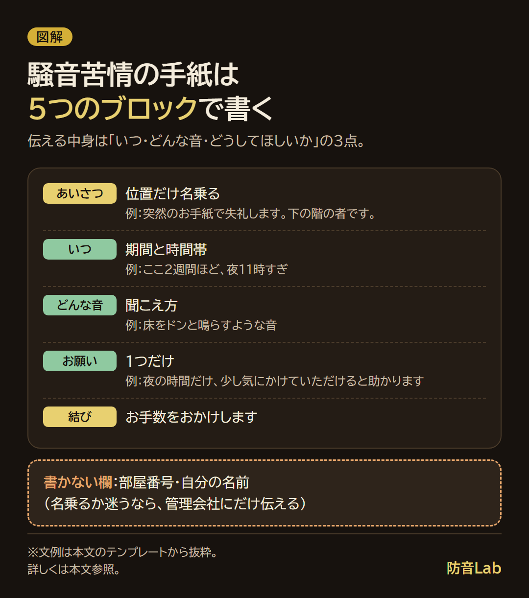
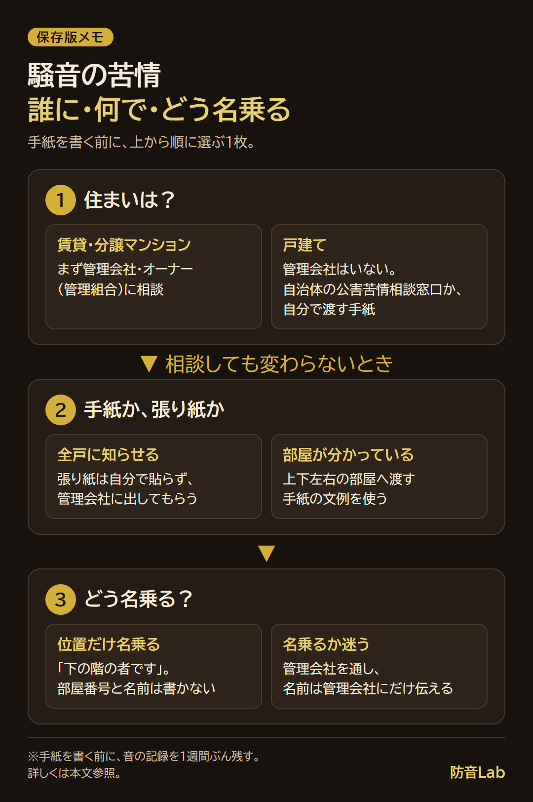

<RegionBanner />

騒音苦情の手紙の例文は、「いつ・どんな音が・どうしてほしいか」の3点を、相手を責めない言葉で書くと角が立ちにくくなります。

私が調べた範囲では、新宿区の「公害の苦情対策」が、まず直接相手に伝えることと、そのとき住所や名前を明らかにすることを勧めていました（2026年11月に確認）。

ただ、名前や部屋番号まで書くと、手紙の写真がSNSに載ったときや、逆恨みされたときに困ります。

この記事では、位置だけ名乗る書き方と、そのまま使える5つの文例、マンションの張り紙の文例、出す前に残す記録をまとめます。

「上の階の足音が毎晩続く。直接言いに行くのは怖いけれど、管理会社に言っても変わらなかった。手紙なら角が立たないか迷っている。」

そんな場面を想定して書いています。

私も、ペットの鳴き声で手紙を出したことがあります。

10分ほど鳴くくらいなら仕方ないと思っていました。

ところが半日ほどずっとキャンキャン鳴いていて、放置されているのではと気になりました。

念のために手紙を出したら、しばらく改善しました。

これは私の1回の経験で、どんな場合でも通じるとは言えません。

だから、手紙を出す前に確かめることと、書き方の加減を先にまとめました。

## 騒音苦情の手紙の例文は「いつ・どんな音・どうしてほしいか」の3点で書く

手紙は、5つのブロックを順に書くと形になります。

- <strong>あいさつ</strong> : 「突然のお手紙で失礼します」と、位置だけの名乗り（「下の階の者です」）
- <strong>いつ</strong> : 「ここ2週間ほど、夜11時すぎ」のように、期間と時間帯
- <strong>どんな音</strong> : 「床をドンと鳴らすような音」のように、聞こえ方
- <strong>お願い</strong> : 「夜の時間だけ、少し気にかけていただけると助かります」
- <strong>結び</strong> : 「お手数をおかけします」

「うるさいです」とだけ書くと、相手は何をどう直せばよいか分かりません。

「夜11時すぎに、床をドンと鳴らすような音が続いている」と書けば、相手は自分の生活と照らして思い当たれます。

部屋番号と名前を書く欄は、この型には置いていません。

理由は、後の「SNSに載せられても困らない書き方」で説明します。

手紙の型を1枚にすると、こうなります。

## 手紙を出す前に：管理会社・オーナーを通すか、自分で出すか

基本は、管理会社かオーナーを通します。

理由は、相手に「誰が言ったか」が分かりにくく、不審な手紙と受け取られにくいからです。

住まいごとの相談先は、次のとおりです。

| 住まい | 先に相談する相手 | 手紙・張り紙の出し方 |
| :-- | :-- | :-- |
| 賃貸マンション・アパート | 管理会社、オーナー | 管理会社に相談する文を出す。全戸向けの張り紙も頼める |
| 分譲マンション | 管理会社、管理組合 | 同じく管理会社に相談する文を出す |
| 戸建て | 管理会社はいない。自治体の公害苦情相談窓口 | 自分で渡す手紙になる。付き合いが続くため、書き方にいちばん気を遣う |

戸建ては、顔を合わせ続けるので、手紙でも気を遣います。

賃貸は管理会社が間に入れるぶん、出しやすいと考えています。

次の3つの質問で、自分の場合を選べます。

- 住まいは、賃貸・分譲マンション・戸建てのどれか
- 管理会社や管理組合には、もう相談したか
- 音の出どころの部屋は、分かっているか

管理会社に相談したのに変わらなかったときは、次の手段として手紙や張り紙を考えます。

誰に言うかの順番と、記録の付け方は、別の記事でくわしく書いています。

[騒音の苦情の相談先と記録の付け方](/ja/soundproof-rental/noise-complaint-landlord-negotiation-guide/)

誰に・何で・どう名乗るかを、保存して見返せる1枚にまとめました。

## 騒音の記録はなぜ要るか：管理会社・相手・第三者に見せる材料

手紙を書く前に、音の記録を1週間ぶん残します。

記録の使い道は、3つあります。

- <strong>管理会社・オーナーに動いてもらう</strong> : 「いつ・どんな音か」が分かると、注意のお知らせを出しやすくなります
- <strong>相手に具体的に伝える</strong> : 手紙の「いつ」「どんな音」に、そのまま入れられます
- <strong>調停や裁判など、第三者が判断するときの材料</strong> : 頻度と時間帯の記録が、判断の手がかりになります

残すのは、次の5つです。

| 残すこと | 書き方の例 |
| :-- | :-- |
| 日時 | 11/10 23:10〜23:40 |
| 音の種類 | 床をドンと鳴らすような音 |
| 続いた時間 | 約30分 |
| アプリの数値 | 騒音計アプリの表示（自分のスマホの値として書く） |
| 録音 | あれば、同じ日のファイル名を書いておく |

この表の日時と音は、書き方の例です。

眠れない日が続く、体調を崩した、というときは、通院して診断書を書いてもらうと、被害を伝える材料になることがあります。

診断書があれば請求できる、とは言い切れません。

請求できるかは状況によるので、弁護士か自治体の法律相談で確かめてください。

## SNSに載せられても困らない書き方：名乗り方と書かないこと

手紙を出すのをためらう理由は、私の場合、3つが重なります。

- 誰が出したか分かって、気まずくなる
- 逆恨みが怖い
- 書いても効果がなさそう

この3つが気になるので、「SNSに載せられても困らない書き方」を基準にします。

手紙の写真がSNSに載るかもしれない、という前提で、個人が特定される情報は書きません。

ただし、出どころがまったく書かれていない手紙は、不審で、伝わりにくくなります。

その中間として、位置だけ名乗ります。

| 書くこと | 書かないこと |
| :-- | :-- |
| 「下の階の者です」「隣の部屋の者です」 | 部屋番号 |
| いつ・どんな音か | 自分の名前、家族構成、在宅の時間帯 |
| お願い1つ | 相手の部屋番号、相手の名前 |

位置だけでも、真下の部屋は1つなので、相手には誰か分かることがあります。

直接渡すなら、「同じ建物の者です」のように、出どころをさらにぼかす手もあります。

筆跡で分かるのが心配なら、印刷にします。

新宿区の「公害の苦情対策」は、相手に不信感を与えないよう、自分のこと（住所や名前など）を明らかにして伝えることを勧めています。

それでも名乗るか迷うなら、管理会社かオーナーを通し、名前は管理会社にだけ伝えます。

管理会社に頼むときは、「私の名前と部屋番号は、相手に伝えないでください」と書き添えます。

## 騒音苦情の手紙のテンプレート5つ

文例は、この記事のオリジナルです。

【　】の部分を、自分の記録に置き換えて使います。

管理会社宛て以外は、部屋番号と名前の欄を置いていません。

### 管理会社・オーナーへ相談するときの文例

名前と部屋番号は、管理会社にだけ伝えます。

> 件名：騒音についてのご相談（【建物名】）
>
> お世話になっております。【建物名】【部屋番号】に住む【お名前】です。
>
> 【上／下／隣】の部屋から、【期間】ほど、【時間帯】に【音の種類】が続いています。
>
> 【日付】【時刻】〜【時刻】の記録を添えます。
>
> 眠れない日があり、困っています。
>
> 相手の方に、状況をやんわりお伝えいただけないでしょうか。
>
> 私の名前と部屋番号は、相手の方には伝えないようお願いします。
>
> 建物全体への、注意のお知らせでも構いません。
>
> お手数ですが、進め方を教えてください。

### 上下左右の部屋へ渡す手紙の文例（1回目）

位置だけ名乗ります。

> 突然のお手紙で失礼します。【下の階／隣の部屋／上の階】の者です。
>
> ここ【期間】ほど、【時間帯】に【音の種類】が続いていて、眠れない日がありました。
>
> お心当たりがあれば、【時間帯】だけ少し気にかけていただけると助かります。
>
> お互いに気持ちよく暮らせたらと思い、お手紙にしました。
>
> お手数をおかけします。

たとえば「ここ2週間ほど、夜11時すぎに床をドンと鳴らすような音が続いていて」と入れると、3点がそろいます。

### 改善しないときの2回目の文例

前回から日が空き、記録でも続いていると分かったときに使います。

> 先日、お手紙を差し上げた【下の階／隣の部屋／上の階】の者です。
>
> その後も、【日付の範囲】の【時間帯】に、【音の種類】が続いています。
>
> お気づきでない場合もあると思い、改めてお知らせしました。
>
> 【具体的なお願い。例：夜の時間だけ、椅子を引く前に持ち上げる】をしていただけると助かります。
>
> 難しい事情がありましたら、管理会社を通してお話しすることも考えています。

2回目でも、きつい言葉は足しません。

それでも続くときは、管理会社への相談文に切り替えます。

### ペットの鳴き声が長く続くときの文例

私がペットの鳴き声で手紙を出したのは、半日ほど鳴き続けていて、放置されているのではと気になったときでした。

そのときも、相手を責めない書き方にしました。

> 突然のお手紙で失礼します。【下の階／隣の部屋／上の階】の者です。
>
> ここ【期間】ほど、【時間帯】に【犬／猫】の鳴き声が、【続く長さ】ほど続く日があります。
>
> 鳴き声そのものより、長い時間ひとりで鳴いているように聞こえ、体調やご様子が心配になりました。
>
> お留守の間の様子を、一度見ていただけると安心です。
>
> 行き違いでしたら、ご放念ください。
>
> お手数をおかけします。

「虐待では」といった疑いの言葉は、手紙に書きません。

鳴き声の種類別の対策は、別の記事にまとめています。

[ペットの鳴き声の騒音対策｜種類別の対策と集合住宅での限界](/ja/soundproof-rental/pet-noise-soundproof-measures/)

### 戸建てのご近所へ渡す文例

戸建ては、向きや距離で相手が分かりやすく、付き合いも続きます。

位置は書かず、「近くに住む者です」にとどめます。

> 突然のお手紙で失礼します。近くに住む者です。
>
> ここ【期間】ほど、【時間帯】に【音の種類】が聞こえる日があり、【困っていること。例：窓を開けて寝られない】。
>
> 気づかれていないかもしれないと思い、お手紙にしました。
>
> お時間のあるときに、【具体的なお願い】を考えていただけると助かります。
>
> これからも気持ちよくお付き合いできたらと思っています。

戸建てには管理会社がいません。

手紙で変わらないときは、市区町村の公害苦情相談窓口に相談します。

## マンションの騒音の張り紙テンプレート：管理会社に出してもらう文

張り紙は、自分で貼らず、管理会社に出してもらいます。

共用部に貼ってよいかは、管理規約と管理会社の判断になります。

管理会社が出せば、誰が頼んだかが相手に分かりにくくなります。

管理会社には、次の3点を伝えて頼みます。

- いつ（期間と時間帯）、どんな音が続いているか
- 特定の部屋ではなく、全戸向けのお知らせにしてほしいこと
- 自分の名前と部屋番号は、掲示に出さないでほしいこと

掲示の文面は、次のように書けます。

> 【建物名】にお住まいの皆さまへ
>
> 最近、【時間帯】の【音の種類】について、ご相談が寄せられています。
>
> ご自身では気づきにくい音もあります。
>
> 【時間帯】は、【具体的なお願い。例：床に物を落とさない、ドアをゆっくり閉める】にご協力ください。
>
> お互いに気持ちよく暮らせるよう、ご理解をお願いします。
>
> 【管理会社名】

特定の部屋を名指ししない文面にすると、受け取った人が自分のことだと責められた気持ちになりにくくなります。

## 匿名で騒音苦情の手紙を出してもいい？

匿名の手紙は、出すこと自体はできます。

ただ、誰からか分からない手紙は、受け取った側には不審で不安に感じられます。

不安だけが残ると、内容が伝わる前に身構えられてしまいます。

匿名にしたいなら、手紙より管理会社経由にします。

管理会社には名前を伝え、相手には伝えないでもらいます。

「位置だけ名乗る」手紙は、完全な匿名ではなく、その中間の形です。

## 手紙で書かないほうがいいこと

次の書き方は、相手を身構えさせるので、避けます。

| 避ける書き方 | 言い換え |
| :-- | :-- |
| 「毎晩わざとやっていますよね」 | 「夜11時すぎに、床をドンと鳴らす音が続いています」 |
| 「非常識です」「迷惑です」 | 「眠れない日がありました」 |
| 「このまま続くなら訴えます」 | 書かない。必要なら管理会社や専門家に相談する |
| 相手の生活の決めつけ（「夜遊びしている」など） | 聞こえた音だけを書く |
| 自分の部屋番号・名前 | 「下の階の者です」 |

法的な措置をちらつかせる文は、相手との関係を決定的に悪くします。

法的な判断が要るときは、弁護士か、自治体の法律相談に確認してください。

受忍限度や判例の見方は、別の記事にまとめています。

[騒音苦情への正しい対応｜解決事例と判例から学ぶ受忍限度の境界線](/ja/knowledge/noise-complaint-legal-precedent-manual/)

## よくある質問

### 手紙はポストに入れていいですか？

ポストに入れる渡し方は、よく使われます。

封筒に入れて封をし、中身が他の人に見えないようにします。

集合住宅では、まず管理会社に相談する文を出し、それでも続くときに手紙を考えます。

### 騒音で警察に通報するとき、匿名にできますか？名前を伝えたら相手に知られますか？

110番と#9110は、使い分けがあります。

<strong>110番</strong>は、今まさに被害や事件・事故が起きている緊急のときの番号です。

<strong>#9110</strong>は、緊急ではない相談の番号で、警視庁は「相談内容に応じて相談窓口などを案内する窓口」と説明しています（2026年11月に確認）。

愛知県警では、#9110の受付は平日の午前9時から午後5時（年末年始・休日を除く）でした。受付時間は都道府県で違います。

通報者や相談者の名前を、騒音の相手に伝えるかどうか。匿名で相談できるかどうか。

この2点は、警視庁と愛知県警の案内ページでは確認できませんでした。

そのため、「匿名にできる」「相手に知られない」とは書きません。

名前を出すと匿名にならないのか、という点も確認できませんでした。

電話の最初に、「名前や連絡先を、相手に伝えますか」と聞いて確かめます。

### 騒音が原因の引っ越し費用は請求できますか？

引っ越し費用の請求は、騒音が受忍限度を超えていたと判断されるかと、騒音と引っ越しの結びつきにかかります。

裁判の結果は、音の大きさ・時間帯・続いた期間・相手の対応などの個別の事情で変わるため、請求できる、できないとは言い切れません。

判決と公害等調整委員会の決定の分かれ目、記録の型、請求までの順番は、[騒音で引っ越し費用は請求できる？](/ja/soundproof-rental/noise-moving-cost-claim/)にまとめています。

受忍限度の考え方は[騒音苦情の判例と受忍限度の記事](/ja/knowledge/noise-complaint-legal-precedent-manual/)にまとめています。

具体的な請求は、弁護士に相談してください。

### 何デシベルから苦情を言っていいですか？

環境省の「騒音に係る環境基準」は、住居中心の地域（A・B類型）で、昼間（6〜22時）が55dB以下、夜間（22〜6時）が45dB以下です（2026年11月に確認）。

45dBは、図書館の館内（40dB）と書店の店内（50dB）の間くらいの大きさです。

ただし、この数値は、建物の外壁の外側で評価する屋外の基準です。

隣の部屋の生活音で、苦情を言ってよい線を決めた数字ではありません。

受忍限度は、音の大きさだけでなく、時間帯・続いた期間・建物の事情などをあわせて判断されます。

くわしくは[判例と受忍限度の記事](/ja/knowledge/noise-complaint-legal-precedent-manual/)を参照してください。

### 手紙で解決しないときの相談先は？

順番は、管理会社かオーナー、次に市区町村の公害苦情相談窓口です。

総務省の公害等調整委員会は、まず市区町村か都道府県の公害苦情相談窓口に相談するよう案内しています。

調停など公害紛争処理制度の使い方は、「公調委・公害相談ダイヤル」で相談できます（03-3581-9959、平日10:00〜12:00・13:00〜17:00、2026年11月に確認）。

近隣の騒音も、影響がある程度広い範囲に及ぶ場合は、公害にあたると案内されています。

自分のケースが対象になるかは、窓口で確かめてください。

## まとめと次にやること

騒音苦情の手紙の例文は、「いつ・どんな音・どうしてほしいか」の3点を、相手を責めずに書くのが基本です。

基本の宛先は管理会社かオーナーで、名前と部屋番号は管理会社にだけ伝えます。

直接渡す手紙は、位置だけ名乗り、部屋番号と名前は書きません。

次にやることは1つです。

<strong>1週間、音の日時と種類を記録します。</strong>

記録は、管理会社への相談文にも、相手への手紙にも、あとで第三者に見せる材料にも使えます。

この記事は、法律の判断をするものではありません。

請求や訴えなど法的な判断が要るときは、弁護士か自治体の法律相談に確認してください。

### 出典

- 新宿区「公害の苦情対策」: https://www.city.shinjuku.lg.jp/seikatsu/file10_07_00005.html
- 総務省 公害等調整委員会「騒音や悪臭などでお困りの方へ」: https://www.soumu.go.jp/kouchoi/trouble.html
- 警視庁「総合相談センター（#9110）」: https://www.keishicho.metro.tokyo.lg.jp/sodan/madoguchi/sogo.html
- 愛知県警察「警察相談専用電話（#9110）」: https://www.pref.aichi.jp/police/anzen/110/shougai.html
- 環境省「騒音に係る環境基準について」: https://www.env.go.jp/kijun/oto1-1.html
- 環境省「騒音の目安」: https://www.env.go.jp/air/ippan/meyasu.pdf
