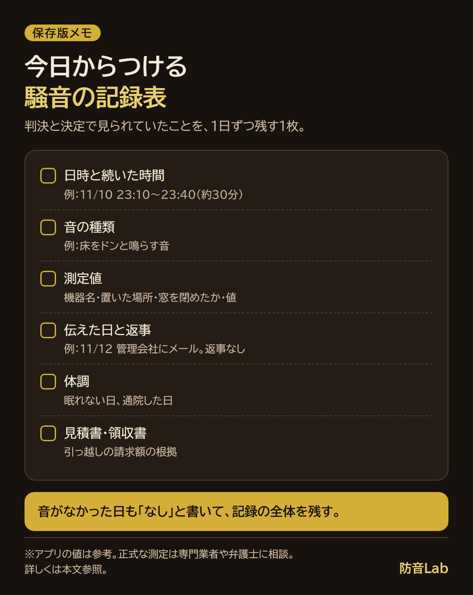
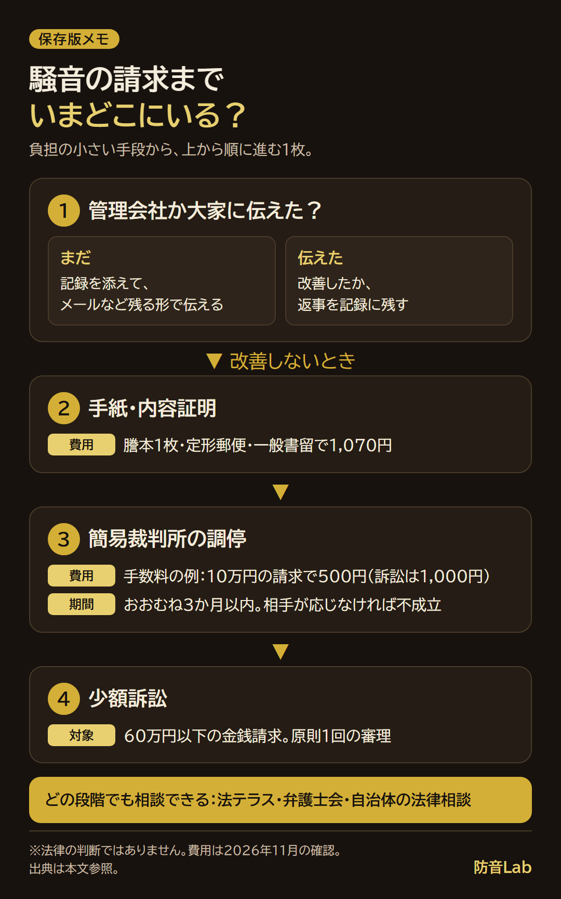

<RegionBanner />

騒音で引っ越し費用を請求するには、受忍限度を超える騒音だったことを、記録で示せることが出発点になります。

私が調べた範囲では、裁判所の判決全文と公害等調整委員会の決定を読んでも、引っ越し費用の賠償を認めたと確かめられた例は見つかりませんでした。

この記事では、判決と決定の分かれ目、請求の前にそろえる記録、管理会社から調停・訴訟までの順番をまとめます。

私も、騒音で引っ越しを考えたことはあります。

ただ、立地の便利さを考えると、引っ越す選択肢がありませんでした。

請求は簡単ではありません。まずは記録を残すことから始めましょう。

## 騒音で引っ越し費用は請求できる？答えは「請求はできるが、認められるかは記録と結びつきしだい」

法律上の根拠は、民法709条（不法行為）です。

条文は「故意又は過失によって他人の権利又は法律上保護される利益を侵害した者は、これによって生じた損害を賠償する責任を負う」と定めています。

精神的な苦痛への賠償（慰謝料）の根拠は、710条です。

引っ越し費用が「これによって生じた損害」に入るかは、騒音と引っ越しの結びつきを見る、事案ごとの判断になります。

### 受忍限度とは：自分の我慢強さではなく「一般に」の物差し

受忍限度は、近所に住む以上お互いに我慢すべき音の範囲のことです。

京都地裁の判決（平成22年9月15日、工場の騒音）は、「社会通念上一般に受忍すべき程度を超えたもの」であることが必要だと述べています。

つまり、「自分がどれだけ我慢できるか」という個人の感じ方だけでは決まりません。

同じ判決は、侵害の程度、被害の内容、地域性などを総合して考えるとしています。

隣人の足音の判決（東京地裁）では、これに加えて、相手の対応が考慮されていました。

## 判例で見る、隣人の騒音の認められた例・認められなかった例

引っ越し費用そのものを認めた判決は、確かめられた範囲では見つかりませんでした。

そこで、上階の足音の事件から、慰謝料が認められた例と、申請が却下された例を並べます。

| 事件 | 音・時間帯・測定値 | 結果 | 引っ越し費用 |
| :-- | :-- | :-- | :-- |
| 東京地裁 平成19年10月3日判決（平成17年(ワ)第24743号）。階上の子どもの足音 | ほぼ毎日、午後7時以降と時に深夜。50〜65dB程度が多い。約1年7か月 | 受忍限度を超える。慰謝料30万円と弁護士費用6万円で計36万円（請求は240万円） | 請求に含まれていない |
| 公害等調整委員会 令和6年（セ）第4号、2024年7月30日の決定。上階の足音 | 弁護士が規格の騒音計で3日半測定。昼45dB・夜35dBを超える音は5回程度 | 却下。受忍限度を超える騒音が届いておらず、公害にあたらない | 請求は314万円（慰謝料90万円＋転居費用224万円）。当否は判断されず |
| 公害等調整委員会 令和6年（セ）第2号、2024年8月19日の決定。上階の足音 | 5日間測定。瞬間値は概ね50dB程度。1回の音は数分で、10分を超えない | 却下。昼夜とも屋内指針を優に下回る | 請求は慰謝料400万円＋弁護士費用40万円 |

下の2件は、総務省の公害等調整委員会の決定で、判決ではありません。

測り方が違うため、表の数字を並べて大小は比べられません。

### 認められた例：夜まで続く音を、約1年7か月ぶん測っていた

東京地裁の事件では、階上の子どもが走り回る音が、ほぼ毎日、階下に届いていました。

原告は、管理人・管理組合・管理会社・警察への相談や手紙を重ねても解決せず、騒音計をリースして測定しました。

判決が重く見たのは、音の大きさに加えて、被告の対応でした。

床にマットを敷いたものの効果は明らかでなく、「これ以上静かにすることはできない」と突っぱね、調停にも応じなかった、と認定されています。

判決は、「特に被告の住まい方や対応の不誠実さを考慮すると」受忍限度を超える、としています。

認容額は請求した240万円の15%です。この事件の事情での判断で、相場ではありません。

### 認められなかった例：測っても、音が屋内指針の目安を下回っていた

公害等調整委員会の2件は、申請の前提になる「公害」（相当範囲にわたる被害）にあたるかで、却下されました。

決定は、足音は真下の部屋にいちばん伝わる音なので、その部屋で受忍限度を超えていなければ、周りにも及ばないと判断しました。

物差しは、中央環境審議会の答申にある屋内指針（一般地域で昼間45dB以下・夜間35dB以下）と、時間区分ごとの等価騒音レベルです。

昼間は午前6時〜午後10時、夜間は午後10時〜午前6時です。等価騒音レベルは、その時間帯全体を平均した大きさに直した値です。

瞬間のピークが指針を超えても、時間区分全体の値に直すと下回る、というのが決定の読み方でした。

相手が防音マットなどで対応を重ねていたことも、考慮されています。

分かれ目は、音の大きさ、時間帯と期間、相手の対応、記録の信頼性でした。

受忍限度の考え方は、[騒音苦情の判例と受忍限度](/ja/knowledge/noise-complaint-legal-precedent-manual/)にもまとめています。

## 相手は隣人か、大家・管理会社か：アパートの騒音と引っ越し費用

隣人に請求する根拠は、民法709条です。

大家に責任を問えるかは、別の話です。

賃貸借は、貸主が「使用及び収益を相手方にさせる」ことを約束する契約です（民法601条）。

隣の音が続いて部屋を使えない状態なのに貸主が動かなかった場合に、責任を問えるかは、判決で確かめられなかったため断定しません。

### 管理会社が対応してくれないとき

管理会社に伝えても動かないときは、いつ・誰に・何を伝えたかを、メールなど日付の残る形で残します。

東京地裁の事件でも、相談の経緯が判決に認定されていました。

進め方は、[騒音クレームを直接言う前に、管理会社を動かす3フェーズの進め方](/ja/soundproof-rental/noise-complaint-landlord-negotiation-guide/)にまとめています。

### 中途解約の違約金に注意

引っ越す前に、契約書の解約の条項（予告の期間・違約金）を読みます。

民法617条は、期間の定めがない建物の賃貸借は、解約の申入れから3か月で終了すると定めています。

実際の予告期間と違約金は、契約書の特約で決まります。

## 請求の前にそろえる記録：判決と決定で見られていたもの

判決と決定で見られていたのは、音の大きさ、時間帯、続いた期間、相談の経緯、測定条件、相手の対応でした。

| 残すこと | 書き方の例 |
| :-- | :-- |
| 日時と続いた時間 | 11/10 23:10〜23:40（約30分） |
| 音の種類 | 床をドンと鳴らす音 |
| 測定値 | 機器名・置いた場所・窓を閉めたか・値 |
| 伝えた日と返事 | 11/12 管理会社にメール。返事なし |
| 体調 | 眠れない日、通院した日 |
| 見積書・領収書 | 引っ越しの請求額の根拠 |

測定値について、公害等調整委員会の決定は、弁護士が規格を満たす騒音計で測った記録に「相応の信頼性」を認めていました。

スマホのアプリの値が、判決や決定でどう扱われるかは、確かめられませんでした。

アプリの値は参考として残し、正式な測定が必要なら、専門業者や弁護士に相談します。

アプリは、[防音性能を測るスマホアプリ比較2026](/ja/knowledge/soundproof-app-review-2026/)で比べています。

第4号の申請人らは、記録の表が「めぼしいものをピックアップしただけ」で、実際はもっと大きな騒音があったと主張しました。

決定は、ほかの証拠が出されていないとして、この主張を採用しませんでした。

私なら、音がしなかった日も「なし」と書いて、記録の全体を残します。

記録の書き方と手紙の文例は、[騒音苦情の手紙の例文](/ja/soundproof-rental/noise-complaint-letter-template/)にあります。

## 請求までの順番：管理会社・大家から、調停・少額訴訟まで

請求を考えたとき、私がためらう理由は、弁護士費用、相手との関係、時間がかかる、の順です。

費用と関係への負担が小さい手段から、順番に進めます。

<strong>管理会社か大家に、騒音のことを伝えましたか？</strong>

| 順 | 手段 | 中身 | 費用・期間（確かめた分） |
| :-- | :-- | :-- | :-- |
| 1 | 管理会社・大家に伝える | 記録を添えて、メールなど残る形で伝える | 確かめられた費用の記載なし |
| 2 | 手紙・内容証明 | 内容証明は、文書の謄本を郵便局と自分が1通ずつ保存する | 謄本1枚・定形郵便物・一般書留で1,070円 |
| 3 | 簡易裁判所の調停 | 調停委員が間に入る話し合い。成立した調書は確定判決と同じ効力 | 手数料は訴訟より低い。おおむね3か月以内 |
| 4 | 少額訴訟 | 60万円以下の金銭請求。原則1回の審理 | 手数料は裁判所の早見表で確認 |

内容証明の料金は、2026年11月に日本郵便の案内ページで確認しました（内容証明480円＋郵便物110円＋一般書留480円）。

調停の手数料は、裁判所の例で、10万円の貸金の返済を求める場合、訴訟が1,000円、調停が500円です（2026年11月に確認）。

調停は話し合いなので、相手が応じなければ不成立で終わります。

総務省の公害等調整委員会は、騒音で困ったときは、まず身近な都道府県・市区町村の「公害苦情相談」窓口に相談するよう案内しています（2026年11月に確認）。

### 弁護士費用が不安なとき：法テラス・弁護士会・自治体

<strong>法テラスの無料法律相談</strong>は、収入と資産が基準以下の人が対象です。

1人世帯の基準は、手取りの月収が182,000円以下（東京都特別区・大阪市などは200,200円以下）で、現金・預貯金が180万円以下です。

1回30分、同じ問題につき3回まで無料で、サポートダイヤルは0570-078374（平日9時〜21時、土曜9時〜17時）です（2026年11月に確認）。

<strong>弁護士会の法律相談センター</strong>は、全国約300か所にあります。

日本弁護士連合会は、相談時間をおおむね30分、相談料を地域や内容により異なる5,500円前後と案内しています（2026年11月に確認）。

<strong>自治体の無料法律相談</strong>は、自治体ごとに条件が違います。

たとえば新宿区は、在住・在勤・在学の個人が対象で、同一案件で2回までです（2026年11月に確認）。

## お金がないけど引っ越したいとき

引っ越しにお金がかかるときは、先に、出ていく費用を契約書で確かめます。

そのうえで、上の無料の相談窓口に、引っ越しと請求の両方を相談します。

引っ越し先の選び方は、[防音賃貸への引っ越し、失敗しない判断基準](/ja/money/quiet-space-relocation-decision-guide/)にまとめています。

## よくある質問

### 騒音で引っ越し費用を請求されたらどうすればいいですか？

認められるかは、受忍限度を超えていたかと、騒音と引っ越しの結びつきで決まります。

まず、自分の生活の時間帯と取った対策を記録し、法律相談で確かめます。

### 慰謝料も請求できますか？

民法710条が、慰謝料の根拠です。

東京地裁の事件では、慰謝料30万円と弁護士費用6万円が認められました（相場ではありません）。

### 証拠は録音だけで足りますか？

録音だけで足りる、とは言い切れません。

判決と決定で見られていたのは、測定値、時間帯、続いた期間、伝えた経緯、相手の対応でした。

録音は、音の種類を示す材料の一つとして、記録と合わせて残します。

## まとめと次にやること

騒音で引っ越し費用を請求するには、受忍限度を超える騒音を、記録で示すことが出発点です。

確かめられたのは、足音の事件で計36万円が認められた例と、公害等調整委員会が2件を却下した例で、引っ越し費用を認めた判決は見つかりませんでした。

次にやることは1つです。<strong>今日から、騒音の記録表をつけます。</strong>

この記事は、法律の判断をするものではありません。

請求や訴えなど法的な判断が要るときは、弁護士や、法テラス・自治体の法律相談に確認してください。

### 出典

- 民法（e-Gov）: https://laws.e-gov.go.jp/law/129AC0000000089
- 東京地裁 平成19年10月3日判決: https://www.courts.go.jp/assets/hanrei/hanrei-pdf-35354.pdf
- 京都地裁 平成22年9月15日判決: https://www.courts.go.jp/assets/hanrei/hanrei-pdf-80771.pdf
- 公害等調整委員会 令和6年（セ）第4号: https://www.soumu.go.jp/main_content/000961985.pdf
- 公害等調整委員会 令和6年（セ）第2号: https://www.soumu.go.jp/main_content/000965630.pdf
- 総務省 公害等調整委員会「騒音や悪臭などでお困りの方へ」: https://www.soumu.go.jp/kouchoi/trouble.html
- 裁判所「民事調停」: https://www.courts.go.jp/saiban/syurui/syurui_minzi/minzi_25_01/index.html
- 裁判所「少額訴訟」: https://www.courts.go.jp/saiban/syurui/syurui_minzi/minzi_25_02/index.html
- 日本郵便「内容証明の差出方法等」: https://www.post.japanpost.jp/question/78.html
- 法テラス「無料法律相談のご利用の流れ」: https://www.houterasu.or.jp/site/soudan-tatekae/goriyounonagare.html
- 日本弁護士連合会「法律相談」: https://www.nichibenren.or.jp/legal_advice/
- 新宿区「無料法律相談・交通事故相談」: https://www.city.shinjuku.lg.jp/kusei/kocho01_000109.html
