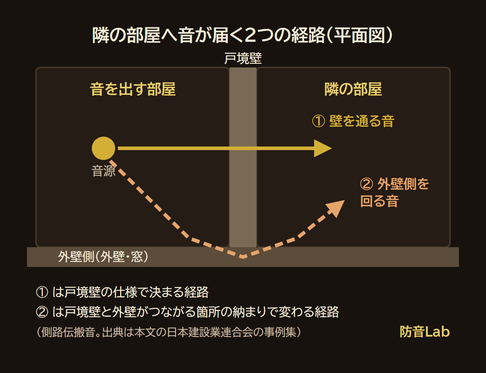

<RegionBanner />

鉄筋コンクリートの防音賃貸でも、戸境壁と外壁の納まりによって遮音性能が落ちた例があります。

木造でも、防音室を組み込んだテラスハウス型の防音賃貸には、公式の物件ページにD-65〜D-80と記載された例があります。

<strong>構造名に加え、壁や床の仕様と、遮音性能の数値がどの部屋の間を示すか</strong>を確かめると候補を比べられます。

## 鉄筋コンクリートの防音賃貸と構造別の確認点

鉄筋コンクリートの防音賃貸を含め、構造名から確認する箇所を絞り、壁や床の仕様と測定区間を確認します。

| 募集資料の構造 | 見る箇所 | 管理会社に聞くこと |
| --- | --- | --- |
| RC（鉄筋コンクリート造） | 住戸同士を隔てる戸境壁と、外壁・窓側でのつながり | 戸境壁の仕様と、隣戸間の測定資料はありますか |
| SRC（鉄骨鉄筋コンクリート造） | 躯体と戸境壁の仕様、床や天井を介する経路 | 演奏する部屋の横と上下で、どの区間を測っていますか |
| 鉄骨造・軽量鉄骨造 | 小屋裏がある場合は界壁の続き方、隣戸との取り合い | 壁は天井裏でどこまで続いていますか |
| 木造 | 小屋裏がある場合は界壁、足音が気になるときは床 | 隣戸の位置と、床・界壁の仕様は確認できますか |

国の調査研究では、コンクリート系共同住宅の界壁は躯体として連続すると説明されています。

[国土交通省の調査研究資料](https://www.mlit.go.jp/common/001183682.pdf)では、鉄骨系・木質系の小屋裏にある界壁の有無が隣戸間の遮音に影響するとしています（2026年11月に確認）。

私なら、募集資料の構造欄と間取り図を並べ、寝室の壁の向こうが隣戸の居間か共用廊下かを見ます。

## 鉄筋コンクリート（RC）・SRCの防音賃貸で見る壁と窓

RCやSRCの物件を選ぶときは、戸境壁を通る音と、その壁の端や外壁側を回り込む音を考えます。

たとえば、談話や演奏の音は戸境壁の正面に届きます。

同じ部屋の外壁側にも音が届くので、壁同士がつながる箇所も確認したいところです。

壁をまっすぐ通る経路のほかに、外壁などを介して隣の部屋へ回り込む経路があります。

このように伝わる音を側路伝搬音と呼びます。

日本建設業連合会は、壁を造ったあとの測定で仕様や納まりの影響が見られた事例を紹介しています。

| 事例 | 壁と周辺の仕様 | 測定の結果 |
| --- | --- | --- |
| 超高層集合住宅 A021_0300 | 乾式遮音壁を使い、外壁側にせっこうボードを直張りするGL工法を採用 | 室間の遮音等級は目標Dr-50、竣工時の測定でDr-45。250Hz付近で側路伝搬音が影響 |
| 戸境壁 A021_0200 | 220mmのRC戸境壁で、外壁側から断熱材を折り返す箇所に保温板裏打ちパネルを直張り | 2kHz帯で遮音が低下。独立した下地を組んで壁を足す方法では、大きな落ち込みは見られなかった |

表のDrは、建物内で部屋と部屋の間の遮音性能を示した等級です。

製品として売られる防音室のカタログにあるDrとは、測った対象が違います。

出典は日本建設業連合会の[建築音響の事例集](https://nikkenren.com/kenchiku/sound/pdf/data/data-all.pdf)です（2026年11月に確認）。

事例A021_0300は2019年11月14日付です。

候補に窓や換気口があるなら、気になる音が入ってきそうな向きも内見で見ます。

外からの音を比べたいときは、同じ場所で窓を開けた状態と閉めた状態を聞き比べます。

## 鉄骨造・軽量鉄骨造の賃貸で見る天井と界壁

鉄骨造や軽量鉄骨造の物件では、隣と接する壁が天井裏でどう続いているかを聞きます。

室内から見た壁が天井まで届いていても、天井裏で隣戸とつながるかどうかは室内から見えません。

最上階に小屋裏がある物件では、内見時に図面を見せてもらえるか、界壁の仕様が分かるかを尋ねます。

## 木造の賃貸で足音と話し声を確かめる

一般の木造賃貸では、足音が気になるなら床と真上の部屋の用途を、話し声が気になるなら隣戸との境の壁や窓の位置を見ます。

小屋裏がある物件なら、天井裏で界壁がどこまで続くかも図面で確認します。

入居後にできる工夫は、[木造アパートの防音と生活音対策](/ja/diy/wooden-apartment-soundproof-guide/)が参考になります。

楽器を弾くなら、防音室を組み込んだ木造の防音賃貸も候補です。

[ミュージションテラス](https://www.musision.jp/terrace)には、1戸が2〜3階のメゾネットで、防音室の上に住居の階がある例があります（2026年11月に確認）。

[公式の物件一覧](https://www.musision.jp/props)に載る建設中を含めた49件のうち、木造は16件、鉄筋コンクリートは33件でした（2026年11月に確認）。

| 木造の防音賃貸（公式ページ） | 間取り・階数 | 記載の遮音性能 |
| --- | --- | --- |
| [ミュージションテラス和光calms](https://www.musision.jp/props/6740) | 2LDK・3LDK／2階建て | D-65 |
| [ミュージションテラス志木南](https://www.musision.jp/props/8234) | 2LDK／3階建て | D-70 |
| [ミュージションテラス谷中](https://www.musision.jp/props/11644) | 2LDK／2階建て | D-80 |

表のD値は、防音室を組み込んだ物件について公式ページに記載された遮音性能です（2026年11月に確認）。

志木南のページには防音室どうしの遮音性能を確かめる動画があり、[中野中央のページ](https://www.musision.jp/props/10181)ではD-70を計画時の目標と説明する箇所があります（2026年11月に確認）。

候補のD値は、目標か測定結果かに加え、防音室どうし、居室間、上下階のどの区間を示すかを確認してください。

## 「完全防音」の賃貸で聞く数値と測定条件

「完全防音」と書かれた募集を見たら、測った数値と、その数値がどの区間のものかを聞きます。

[建築基準法第30条](https://laws.e-gov.go.jp/law/325AC0000000201)は、長屋・共同住宅の界壁に日常生活の音を低減する基準への適合を求めています（2026年11月に確認）。

[建築基準法施行令第22条の3](https://laws.e-gov.go.jp/law/325CO0000000338)の基準は、壁を通るときに音がどれだけ弱まるかを示す透過損失です（2026年11月に確認）。

| 音の周波数 | 界壁の構造に求められる透過損失 |
| --- | ---: |
| 125Hz | 25dB以上 |
| 500Hz | 40dB以上 |
| 2,000Hz | 50dB以上 |

この表の対象は日常生活の音を低減するための壁の構造です。

楽器演奏を前提に物件を選ぶときは、住戸間で測った遮音等級と演奏の条件を管理会社に確かめます。

壁の数値と住戸間で測った数値の違いは、[D値とRw値の違いと換算できない理由](/ja/knowledge/d-value-vs-rw-value-confusion/)も参考になります。

## 建物情報と管理会社で構造を確かめる

募集資料に構造が載っていたら、管理会社には候補の部屋に絞って、図面と測定資料があるかを聞きます。

- 部屋番号を添えて、建物の構造と戸境壁の仕様を聞く。
- 測定資料があるなら、音を出した部屋と測った部屋、窓や扉の開閉条件を聞く。
- 建物全体の代表値なら、候補の部屋に関する資料が別にあるかを聞く。

法令の適用や図面からの遮音性能の判断は、建築・施工の専門家と管理会社に確認してください。

## 防音賃貸マンションで構造以外に見る階と部屋の位置

防音賃貸マンションでは、何階か、角部屋かに加え、気になる音が出る場所と部屋の位置関係を見ます。

私なら、足音が気になるときは寝室の真上に何があるかを先に聞きます。

外から入る音が気になるときは、寝室の窓の向きから確認します。

| 避けたい場面 | 間取り図や内見で見ること |
| --- | --- |
| 上の部屋の足音が寝室に届く | 寝室の真上の用途と、上下階の床に関する資料 |
| 横の住戸へ楽器の音が届く | 楽器を置く部屋が接する壁、住戸間の測定結果、演奏条件 |
| 道路側から寝室に音が入る | 窓の向きと、窓を閉めたときの聞こえ方 |

遮音等級が資料に出てきたら、[D値とdBの違いとカタログ値の見方](/ja/knowledge/d-value-truth-and-myths/)で数字の意味を確かめられます。

構造から候補を絞ったあと、家賃や演奏条件を比べるなら、[防音賃貸の選び方と全国の家賃相場](/ja/soundproof-rental/bouon-rental-market-guide/)へ進めます。

## まとめ｜いちばん気になる音の通り道を一つ選ぶ

まず、候補の間取り図で、いちばん気になる音がどこからどの部屋に届きそうかを一つ書いてみてください。

その区間に絞ると、管理会社に聞く内容が決まります。
