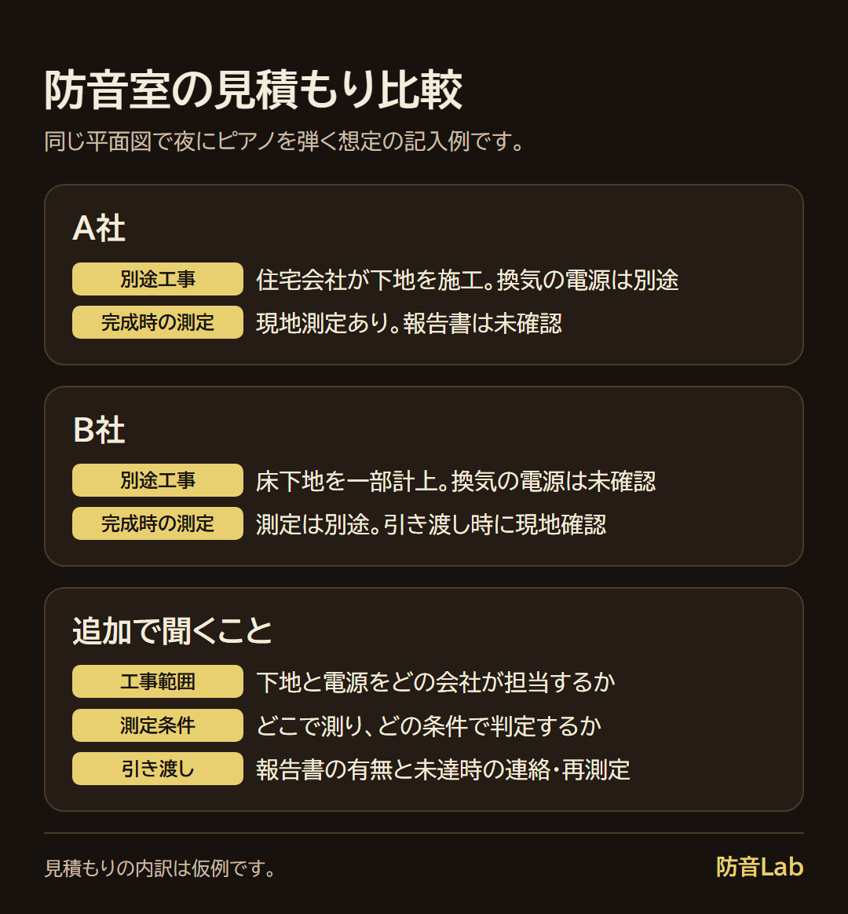

<RegionBanner />

注文住宅の防音室の見積もりは、工事範囲と遮音性能の条件をそろえ、完成時の測定と目標に届かなかった場合の対応まで比べます。

私が依頼先ガイドと施工会社の工程を見比べて整理したのは、見積書から引き渡しまで同じ条件で照合できる項目です。

手元の見積書を比較表に書き写すと、別途工事の担当や測定の扱いなど、見積もりを取り直す際の質問をまとめられます。

## 注文住宅の防音室の見積もりは工事範囲を揃えて比べる

注文住宅の防音室の見積もりは、同じ図面と用途を前提に、住宅会社と防音工事会社のそれぞれが何を見積もったかを確認します。

たとえば「換気工事込み」という記載があっても、機器代・ダクト・電源まで含むかを見積書で確かめます。

別途工事の欄には、どの会社が見積もるかと、費用が決まる時期を記入してください。

| 比較項目 | A社の見積もり（仮例） | B社の見積もり（仮例） | 同じ条件にするための質問 |
| --- | --- | --- | --- |
| 共通の依頼条件 | 夜のピアノ練習・同じ平面図 | 夜のピアノ練習・同じ平面図 | 同じ改訂日の図面と機種を使ったか |
| 躯体・下地 | 住宅会社の別途工事 | 防音側が床下地の一部を計上 | どの部位からどの会社が担当するか |
| 換気・電気 | 換気機器込み、電源は別途 | 換気機器とダクト込み、電源は未確認 | 機器・ダクト・電源を誰が手配するか |
| 内装 | 壁の仕上げ込み | 仕上げは住宅会社で見積もり | 同じ仕上げにしたときの金額はどうなるか |
| 測定・引き渡し | 現地測定あり、報告書は未確認 | 測定は別途、引き渡し時に現地確認 | 測定、報告書、再測定の費用はどこに入るか |

金額を比べる欄には、見積書の本体価格と、別途見積もりで金額が確定した工事をそれぞれ記入します。

私なら、金額が空欄の項目には担当会社と回答予定日を書き、同じ工事範囲にした見積もりを依頼します。

予算を立てる段階なら、[注文住宅の防音室の費用ガイド](/ja/money/custom-home-soundproof-price-guide/)も参考になります。

## 防音性能の数値は対象と測定条件を確認する

防音室の遮音性能を測定する提案では、数値がどの部材や部屋を対象にし、どの条件で確かめるものかを聞きます。

仕様書の「防音ドアの性能」は、まずドアの欄に記録します。

完成した部屋の確認は、音を出す場所と、受ける側で測る場所を組にして記録します。

| 確認項目 | 質問の例 |
| --- | --- |
| 数値の対象 | ドアなどの製品仕様ですか。完成後に部屋間で確かめる目標ですか |
| 音を出す場所と測る場所 | 防音室のどこから音を出し、廊下・寝室・屋外側のどこで測りますか |
| 測定条件 | どんな音を使い、窓・ドア・換気をどの状態にして測りますか |
| 報告書 | 結果と測定位置、当日の条件が記載された報告書を受け取れますか |

目標値が同じ提案でも、測定する場所と条件をそろえてから比較します。

完成後に遮音性能と音響性能の検査を行い、その後に立ち会いで引き渡す手順を案内する施工会社があります。 [シグマ音響の設計・施工の流れ](https://sigma-jp.com/%E8%A8%AD%E8%A8%88%E3%83%BB%E6%96%BD%E5%B7%A5%E3%81%AE%E6%B5%81%E3%82%8C/)（2026年11月確認）

## 見積もりから引き渡しまでに決める確認項目

防音室の引き渡しに向けて、測定の担当者と判定条件、目標に届かなかった場合の連絡や対応を契約前に書面に残します。

| 確認する内容 | 書面で決めておくこと |
| --- | --- |
| 測定と立ち会い | 誰が手配し、いつ測り、誰が立ち会うか |
| 判定と記録 | どの条件を満たせば合意した性能に届いたと扱うか。結果をいつ受け取るか |
| 目標に届かなかった場合 | 連絡先、調査や是正の担当、費用負担をどう取り決めるか |
| 是正後の確認 | 再測定の条件と費用、引き渡し日を見直す場合の窓口 |

「目標」と「保証」の表記があれば、どの書面に、どの条件と対応が記載されるかを担当者に確認してください。

工事を誰に頼むかも検討しているなら、[注文住宅の防音室の依頼先と契約前の確認項目](/ja/soundproof-room/custom-home-soundproof-builder-selection/)が参考になります。

工事範囲と引き渡しの取り決めを考える前に、[注文住宅で防音室を作る間取りのポイント](/ja/soundproof-room/custom-home-soundproof-room-layout/)で図面に載せる設備を確認できます。

## まとめ

見積書を横に並べ、共通の依頼条件・別途工事・完成時の測定・引き渡し時の対応を表に書き写します。

違いが残った項目に印を付け、対象の図面と一緒に担当者へ渡して見積もりの条件をそろえてください。

