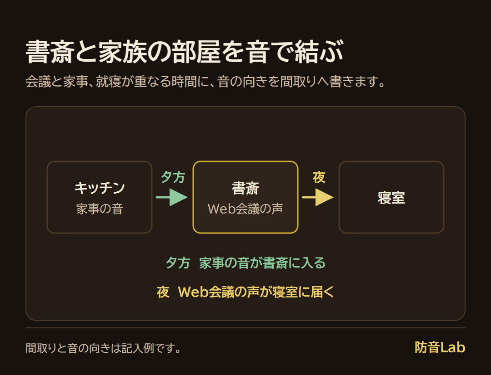

<RegionBanner />

注文住宅の書斎を防音するなら、Web会議の声が出る方向と家族の生活音が入る方向を図面に書き、位置・ドア・換気を一緒に決めます。

私が在宅ワークの防音と注文住宅の間取りの記事を照らし合わせて、先にそろえたいと思ったのは、会議と生活が重なる時間です。

音の向きと時間を書いた表があれば、どの場面を先に変えたいか家族や設計者に伝えられます。

## 注文住宅の書斎の防音は声の出入りを分けて考える

注文住宅の書斎の防音は、会議中に声が届くと困る場所と、会議に音が入ってくる場所をそれぞれ図面に書くところから始めます。

平日の会議予定を家族の就寝や家事の時間と重ね、音が気になる場面を先に記入してください。

| 時間と場面（記入例） | 音が出る場所 → 届く場所 | 困ること |
| --- | --- | --- |
| 平日の夕方に会議と夕食の準備が重なる | キッチンの家事 → 書斎 | 会議中に調理音が入る |
| 夜に会議が延び、家族が就寝する | 書斎の会話 → 寝室 | 会議の声が寝室に届く |
| 昼の会議中に家族がリビングを使う | LDKでの会話 → 書斎 | 会議中に家族の会話が入る |

同じ間取りでも、昼は書斎に入る音、夜は書斎から出る声が気になることがあります。

今の家で会議があるなら、家族に声が気になった場所と時間を聞いて、図面に載せる場面を選べます。

今の住まいで先に調整できることは、[在宅ワークで家族と音の悩みを減らす方法](/ja/soundproof-rental/remote-work-family-harmony-soundproof/)で確認できます。

## Web会議の声漏れを抑えたい書斎の位置とドア

Web会議の声漏れが気になる書斎では、寝室やLDKに向くドアの位置を確認し、隣り合う案と収納や廊下を挟む案を比べます。

収納を挟める案では、書斎と寝室の壁が接しない配置にできるかを見ます。

一方で、廊下に出た声がどの部屋のドアに向かうかも図面上でたどります。

| 確かめる場所 | 設計者に聞くこと |
| --- | --- |
| 隣り合う壁 | 書斎と寝室やLDKの間に収納を挟めるか |
| ドア | 廊下で寝室のドアと向かい合うか。枠や下端の隙間をどう扱うか |
| 換気 | ドアを閉めて会議するときは、どこから給気し、どこへ排気するか |
| 家族の動線 | 会議の時間と、廊下を行き来する時間が重なるか |

位置を変えたときに他の部屋へ出る影響は、[注文住宅で防音室を作る間取りのポイント](/ja/soundproof-room/custom-home-soundproof-room-layout/)と照らし合わせてみてください。

## 書斎にどこまで防音が必要か打ち合わせで決める

書斎に防音室が必要かは、残したい利用条件と、音をどこまで抑えたいかを伝え、間取りや部材の変更案と比べて決めます。

私なら、会議の声が寝室に届くことだけが気になる段階では、先に部屋の位置とドアの案を出してもらいます。

| 困る場面 | 打ち合わせの進め方 |
| --- | --- |
| 会議と就寝が重なり、寝室に声が届くのが心配 | 部屋の入れ替えや、寝室との間に収納を挟む案を出す |
| 位置を変更しにくく、廊下側の声漏れが心配 | ドアと枠の仕様を比べ、閉めた状態での換気も確かめる |
| 夜間の会議が多く、会話の内容が他室に聞こえることも避けたい | 何をどこで確認するかを決め、専用の防音室も候補にして相談する |

ドアの仕様から検討する場合は、[防音室の窓とドアからの音漏れと選び方](/ja/soundproof-room/door-window-weak-points/)も参考になります。

## まとめ

会議と生活が重なる時間を表に書き、書斎から出る声と書斎に入る生活音を矢印で描きます。

次は、矢印を書いた間取り図を設計者に渡し、いちばん気になる時間帯を伝えてください。

