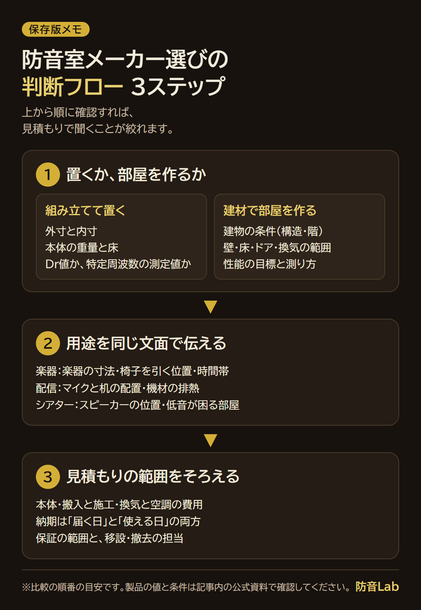

<RegionBanner />

防音室メーカーを比較するときは、ヤマハ・カワイなどの組み立て式と、ダイケン・パナソニックが案内する防音建材に分けて考えます。

メーカーの資料を見ると、製品の遮音等級であるDr値と、特定の周波数で測った値があり、測定条件が異なります。

家を建てる会社を探している人には、[防音室が作れるハウスメーカーの比較](/ja/soundproof-rental/housing-builder-soundproof-comparison/)があります。

## 防音室メーカー比較｜組み立て式と防音建材

既存の部屋に置くなら、本体の寸法・重量・遮音を見ます。部屋を作るなら、建物の条件と、壁・床・ドア・換気まで含めた設計を先に確認します。

### 組み立てて置く防音室・ブース

| メーカー・製品 | サイズ | 本体重量 | Dr値 | 1kHzの社内測定値 | 税込価格の例 |
| --- | --- | --- | --- | --- | --- |
| ヤマハ セフィーネNS | 0.8〜4.3畳の9タイプ | 0.8畳の例は約292kg | 0.8畳の例はDr-35 | — | 0.8畳の例は770,000円（本体） |
| カワイ ナサール ライトタイプ | 0.8〜4.3畳の9サイズ | 0.8畳・Dr-35は243kg | Dr-30・35・40 | — | — |
| VERY-Q Plus Gaming Booth | 0.8畳・1.2畳 | 約66kg・約83kg | — | −30dB | 495,000円・599,500円 |

製品仕様と価格は2026年11月に確認しました。[ヤマハ 0.8畳の仕様](https://jp.yamaha.com/musical-instruments/soundproofing/products/ready-made-rooms/size-08-15/amdb08h/specs.html)、[セフィーネNS](https://jp.yamaha.com/musical-instruments/soundproofing/explore/ready-made-rooms/cefine-ns/index.html)、[ヤマハ 1.5畳の仕様](https://jp.yamaha.com/musical-instruments/soundproofing/products/ready-made-rooms/size-08-15/amdc15h/specs.html)、[カワイ ライトタイプ](https://www.kawai-os.co.jp/product/unit01/)、[VERY-Q Gaming Booth](https://very-q.jp/product/gamingbooth/)

表の「—」は比較に使える値を載せていない欄です。

### 建材を使って部屋を作る場合

| メーカー | 公式に案内しているもの | 500Hzの遮音性能の目安 | 先に確認する条件 |
| --- | --- | --- | --- |
| 大建工業（ダイケン） | 防音ドア・換気・床材、スーパープレミアム防音の提案 | 60dB（スーパープレミアム防音） | 同提案は新築木造住宅の1階、ベタ基礎 |
| パナソニック | 用途別の防音・吸音プラン、防音建材、内装ドア | — | 対象の部屋に施工できる範囲と性能目標 |

2026年11月に確認した公式資料です。

[ダイケンの住宅向け防音建材](https://www.daiken.jp/buildingmaterials/sound/housing/)、[大建工業の2023年2月発表資料](https://www.daiken.jp/news/detail/pdf/20230127194252.pdf)、[パナソニックの内装製品](https://sumai.panasonic.jp/interior/lineup/)、[パナソニックの防音・吸音プラン](https://sumai.panasonic.jp/interior/bouon/)

私なら、まず「置ける寸法と重量」と「工事できる範囲」のどちらを確かめるか決めます。

見積もりの前に見返せる1枚にまとめました。

## 防音室メーカー別の特徴｜ヤマハ・カワイ・ダイケン・パナソニック・VERY-Q

組み立て式は候補を同じ広さと性能条件で並べ、建材で作る場合は提案が自宅の条件に当てはまるかを確かめます。

### ヤマハ アビテックス｜内寸まで見て機種を選ぶ

セフィーネNSの1.5畳・Dr-40（AMDC15H）は、本体468kg、税込1,364,000円です。

外寸は1,443×1,884mm、内寸は1,325×1,766mmです。[ヤマハの製品仕様](https://jp.yamaha.com/musical-instruments/soundproofing/products/ready-made-rooms/size-08-15/amdc15h/specs.html)（2026年11月に確認）

部屋に収まるかは外寸で、楽器・椅子を置いて姿勢を取れるかは内寸で見ます。

<CtaBox slug="yamaha-avitex" />

### カワイ ナサール｜同じ広さで等級ごとの重量を見る

ライトタイプの1.5畳は、Dr-30が297kg、Dr-35が337kg、Dr-40が460kgです。[カワイ ライトタイプの仕様](https://www.kawai-os.co.jp/product/unit01/)（2026年11月に確認）

スタンダードタイプは2.0〜4.9畳の8サイズです。

Dr-40のMKSXには床補強遮音マットが標準で付きます。[カワイ スタンダードタイプの仕様](https://www.kawai-os.co.jp/product/unit02/)（2026年11月に確認）

カスタムタイプは2.0〜10畳を110mm刻みで選べ、等級はDr-30・35・40です。[カワイ カスタムタイプの仕様](https://www.kawai-os.co.jp/product/unit03/)（2026年11月に確認）

ラインアップから絞るなら、[カワイの防音室ナサールの価格と選び方](/ja/soundproof-room/kawai-nasal-soundproof-room-guide/)も参照できます。

<CtaBox slug="kawai-nasal" />

### ダイケン・パナソニック｜防音建材で部屋を作る

ダイケンのスーパープレミアム防音は、施工業者が防音建材と一般の材料を組み合わせて作る提案です。

500Hzで60dBは設計の目安で、現場の性能を保証する値ではありません。500Hzより低い音の遮音は、建物の躯体によって変わります。[大建工業の発表資料](https://www.daiken.jp/news/detail/pdf/20230127194252.pdf)（2026年11月に確認）

パナソニックは用途別の防音・吸音プランと、内装ドアなどを案内しています。[パナソニックの防音・吸音プラン](https://sumai.panasonic.jp/interior/bouon/)（2026年11月に確認）

シアターを検討するなら、スピーカーを使う位置と、音を抑えたい隣室を図面に書いて相談できます。

両社で確認できたのは建材とプランの案内です。家庭向けの組み立て式防音室の製品ページは、今回確認した範囲では見つかりませんでした。

### VERY-Q｜配信用の設置条件と測定値を読む

Plus Gaming Boothは、面ファスナーと六角レンチを使って自分で組み立てる製品です。[VERY-Qの製品ページ](https://very-q.jp/product/gamingbooth/)（2026年11月に確認）

−30dBは1kHzでの社内測定値です。別の周波数や床の振動について判断するには、その条件での資料が必要です。

配信用の候補を広げたい人は、[組み立て式防音室の用途別比較](/ja/soundproof-room/assembly-type-comparison/)を参照できます。

## 楽器・配信・シアターで防音室メーカーを選ぶ

楽器なら演奏姿勢と遮音、配信なら声と排熱、シアターなら低音の伝わり方を先に確かめます。

| 用途 | 見積もりを取る前に伝えること |
| --- | --- |
| 楽器 | 楽器の寸法、椅子を引く位置、演奏する時間帯 |
| 配信・収録 | マイクと机の配置、声を張る場面、機材の排熱 |
| シアター | スピーカーを置く位置、低音が届くと困る部屋 |

たとえば楽器なら、候補の内寸を床にテープで示し、椅子を引いた状態で立てるか確認できます。

## 防音室メーカー選びで見落としやすい保証・納期・移設

同じ本体価格で比べられるように、見積書でどこまで含まれるかをそろえます。

- 納期は、製品が届く日と使える状態になる日をそれぞれ聞く
- 保証は、本体と設置工事の対象範囲、故障時の連絡先を聞く
- 移設・撤去は、誰が解体し、運び出し、再組み立てできるかを聞く

引っ越しを考えているなら、[防音室を移設する費用と専門業者への相談手順](/ja/money/soundproof-room-moving/)が参考になります。

## 見積もり前のチェックリスト

私なら候補ごとに質問を変えず、用途と設置条件を同じ文面で伝えます。

- 何を、何時に、どの部屋で使うか
- 設置場所の幅・奥行き・天井高と搬入経路
- 人と機材が収まる内寸と、扉を開ける側の余裕
- 比較する遮音値の測定条件と現場での確認方法
- 本体、搬入・施工、換気・空調にかかる費用

費用の項目は、[防音室の値段と価格相場](/ja/money/soundproof-room-price-market/)でも確認できます。

今日やることは、間取り図に置き場所を一つ描き、そこで使う楽器や機材を書き添えることです。
