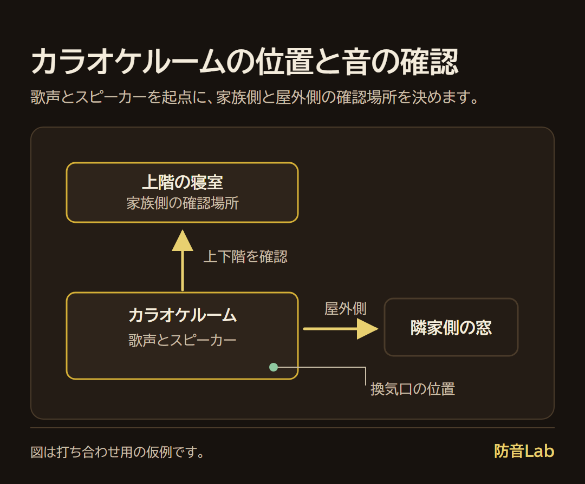

<RegionBanner />

一戸建てのカラオケルームを新築で作るなら、使う時間と機器を決め、家族の寝室や隣家への音を考えて部屋の位置を選びます。

注文住宅の防音室の間取りガイドでは、隣室だけでなく、上下階との位置関係も確認項目にしています。

歌声とスピーカーの使い方を打ち合わせ表に記入すると、窓や換気を含めて何を相談するか決まります。

## 一戸建てのカラオケルームは使い方と部屋の位置から決める

一戸建てのカラオケルームは、普段の使い方を具体的に伝え、家族の寝室や隣家側の開口との位置関係で候補を絞ります。

図面を広げ、カラオケルームから家族の寝室まで線を引いてください。

横の部屋に加え、真上や真下に寝室がないか、上下階の図面を重ねて確かめます。

敷地図には、隣家側を向く窓や出入口を丸で囲みます。

| 打ち合わせに持っていく項目 | 記入例（仮の条件） |
| --- | --- |
| 使う時間 | 夜、家族が寝室で休む時間と重なる |
| 音源 | マイクで歌う。伴奏はスピーカーから流す |
| 音が届くと困る場所 | 上階の寝室と、隣家に向く窓の外 |
| 候補位置 | 寝室の真下にある部屋と、収納を挟める部屋を比べる |
| 要確認事項 | ドアを閉め、換気を動かして歌える仕様と、完成時に確認する場所 |

私なら、夜の何時ごろに歌いたいかを伝え、家族の就寝時間と重なる範囲を図面に書き添えます。

私なら、寝室と部屋が重ならない案を候補に入れ、家族の動線や窓の向きも一緒に比べます。

ほかの部屋との位置関係まで考えるときは、[注文住宅で防音室を作る間取りのポイント](/ja/soundproof-room/custom-home-soundproof-room-layout/)も使えます。

## カラオケルームの防音はドア・窓・換気も一緒に相談する

カラオケルームの防音は、ドアや窓を閉めた状態で歌う場面を想定し、換気の運転条件も含めて設計者に相談します。

マイクの声と伴奏を室内のスピーカーから出す場合は、スピーカーの位置と普段使う音量を伝えます。

伴奏をヘッドホンで聞く場合は、室内で聞こえる歌声を主な確認対象にします。

| 部位 | 図面と仕様書で聞くこと |
| --- | --- |
| ドア | 廊下を通って寝室に向かう位置か。閉めたときの枠や下端の隙間をどう扱うか |
| 窓 | 採光に必要か。隣家側を向いているか。閉めて使う前提を図面に書けるか |
| 換気 | 給気口と排気口はどこか。ドアと窓を閉めたまま使うとき、どの設定で運転するか |
| スピーカー | どこに置くか。低音用のサブウーファーを足す予定があれば何を確認するか |

すでに住んでいる家で歌声を抑えたい場合は、[カラオケボックス並みの防音と自宅で試せる対策](/ja/diy/karaoke-box-soundproof-performance-guide/)に既存住宅向けの方法があります。

## 新築でカラオケルームを作るときの見積もりと完成確認

新築の見積もりでは誰がどこまで工事するかをそろえ、完成時は普段の利用条件で家族側と屋外側を確認する方法を決めます。

施工会社が分かれる場合は、部屋を仕上げる前に、工事の境目を一枚の図面に書いてもらうと確認しやすくなります。

| 時点 | 依頼する内容 | 誰に聞くか |
| --- | --- | --- |
| 見積もり | 下地、ドア、換気、電源や配線のうち、どこまでが各社の金額に入るか | 住宅会社と防音工事の担当者 |
| 工事前 | スピーカーやマイクを使う位置と、換気の運転条件を図面に載せる | 設計者と設備の担当者 |
| 完成時 | 普段の使い方を再現し、寝室側と敷地内の屋外側で確認する | 立ち会う担当者と家族 |
| 性能測定を頼む場合 | 音を出す場所と測る場所、判定に使う条件、結果の受け取り方を決める | 測定を担当する会社 |

新築の設計段階で建築側と打ち合わせをし、完成後の性能検査を工程に入れる施工会社もあります。 [シグマ音響の設計・施工の流れ](https://sigma-jp.com/%E8%A8%AD%E8%A8%88%E3%83%BB%E6%96%BD%E5%B7%A5%E3%81%AE%E6%B5%81%E3%82%8C/)（2026年11月確認）

普段の使い方で聞こえ方を確かめる機会と、合意した条件で遮音性能を測る機会を、担当者に確認しておきます。

見積もりを取る前に予算の項目を知りたいときは、[注文住宅の防音室の費用ガイド](/ja/money/custom-home-soundproof-price-guide/)で確認できます。

## まとめ

打ち合わせには、使用時間・音源・静かにしたい場所・候補位置・要確認事項を書いた表を持っていきます。

次の打ち合わせまでに、候補の部屋と寝室、隣家側の開口を図面に丸で囲み、担当者に見せてください。

