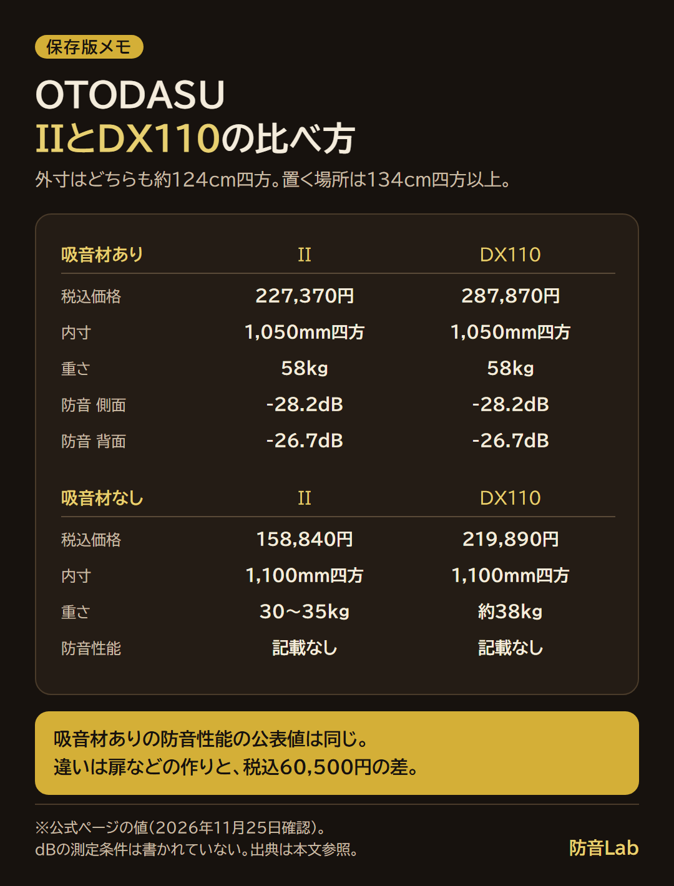

<RegionBanner />

OTODASU IIとDX110は、外寸が約124cm四方でほぼ同じで、吸音材ありの防音性能の公表値（側面-28.2dB・背面-26.7dB）も同じです。

違いは扉などの作りと価格で、同じ条件で比べると約5.5万円（税抜）の差があります。

私が公式の商品ページを読み比べて分かったのは、音を抑える目的だけなら、安いIIの吸音材ありから比べるのが筋だということです。

この記事では、4つの型の比較表、声の大きさ別の音の目安、置き場所、賃貸での確認点を順に確かめます。

## OTODASU IIとDX110の違いは価格と作り（外寸はほぼ同じ）

IIとDX110には、それぞれ吸音材なしと吸音材ありがあります。

この4つの型を、公式の商品ページの値で並べます。

| 型 | 税込価格 | 外寸 | 内寸（幅・奥行×高さ） | 重さ | 防音性能（公表値） |
| :--- | :--- | :--- | :--- | :--- | :--- |
| II 吸音材なし | 158,840円 | 約124cm四方 | 1,100mm四方×1,900mm | 30〜35kg | 記載なし |
| II 吸音材あり | 227,370円 | 約124cm四方 | 1,050mm四方×1,900mm | 58kg | <strong>側面-28.2dB・背面-26.7dB</strong> |
| DX110 吸音材なし | 219,890円 | 約124cm四方 | 1,100mm四方×1,890mm | 約38kg | 記載なし |
| DX110 MG2（吸音材あり） | 287,870円 | 約124cm四方 | 1,050mm四方（高さは1,890mmと1,865mmの表記が分かれる） | 58kg | <strong>側面-28.2dB・背面-26.7dB</strong> |

税込は、公式の税抜価格（144,400円・206,700円・199,900円・261,700円）に10%を掛けた値です。

出典は、公式の[OTODASU II](https://otodasu.jp/product/otodasu/)・[II 吸音材なし](https://otodasu.jp/otoadsu/)・[DX110](https://otodasu.jp/otodasu-dx110/)・[DX110 MG2](https://otodasu.jp/product/otodasu-dx110-mg2/)の各ページ（2026年11月25日確認）です。

IIの吸音材なしの重さは、公式の仕様表が30kg、紹介文が約35kgと分かれています。

外寸の細かい値は、IIが幅・奥行1,230mm×高さ1,912mm、DX110が幅・奥行1,240mm×高さ1,940mmです。

DX110の扉は、反り防止のアルミフレームと気密マグネットで開け閉めする作りで、壁は高強度プラスチック段ボールとアルミです。

IIの扉と壁の記載は、商品ページで見比べてください。

吸音材あり同士の価格差は、税抜で55,000円（税込で60,500円）です。

## OTODASUの防音性能は何dB？ボイスチャットと大声の目安

OTODASUの防音性能の公表値は、吸音材ありで側面-28.2dB、背面-26.7dBです。

私が見た商品ページでは、吸音材なしのIIとDX110にdBの記載はありませんでした。

公式は「平均-30dB」「90dB→60dB」とも書いていますが、全体の説明で、測定条件は書かれていません。

この記事の計算には使わず、面ごとの公表値だけを使います。

公表値を声の大きさから引いた計算値は、次のとおりです。

| 出す音 | 側面（-28.2dB） | 背面（-26.7dB） | 箱の外の大きさ |
| :--- | :--- | :--- | :--- |
| ふつうの声（60dB） | 約32dB | 約33dB | ホテルの客室（30dB）に近い |
| 大声（90dB） | 約62dB | 約63dB | 銀行の窓口（60dB）より少し大きい |

計算は、60−28.2＝31.8、60−26.7＝33.3、90−28.2＝61.8、90−26.7＝63.3です。

夜の住宅地は40dB前後（図書館の館内くらい）なので、ふつうの声はそれを下回り、大声は上回ります。

この値は箱の外の音の計算で、隣室に届く音ではありません。

低い音ほど下がりにくいので、低音は計算値より大きく届く可能性があります。

[公式FAQ](https://otodasu.jp/faq/)も、重低音や振動は完全に遮断できないとしています。

dBの大きさの例えは、[防音室の-dB軽減効果とは？楽器・交通音・空港・配信音で分かる体感早見表](/ja/knowledge/db-reduction-familiar-sound-scale/)に表でまとめています。

声を張らずに済ませる工夫も、あわせて使えます。

NVIDIA BroadcastなどのAIノイズ除去を使い、小さな声でも拾う設定にしておくと、出す声そのものを小さくできます。

## 1畳のOTODASUに入るもの・入らないもの

IIとDX110を置くには、外寸の約124cmに壁との隙間10cmを足した、幅・奥行とも134cm以上の場所が要ります。

[公式の1畳の記事](https://otodasu.jp/itizyou-bouonsitu/)（2026年11月25日確認）にある、入るものと入らないものは次のとおりです。

| 置く場所・物 | 可否 | 理由 |
| :--- | :--- | :--- |
| 奥行き90cmほどの押し入れ | <strong>入らない</strong> | 奥行きが外寸の約124cmに足りない |
| 88鍵の電子ピアノ | <strong>入らない</strong> | 幅が約135cmで、内寸（1,050〜1,100mm）に収まらない |
| 幅80〜100cmのデスク | 入る | モニター1台までが目安 |

1畳タイプは、公式オンラインショップの販売台数の37%（2025年11月19日〜2026年11月18日の確定注文）を占めます。

買う前に、床にマスキングテープなどで134cm四方の線を引き、壁や家具にぶつからないかを確かめます。

小型防音室のサイズ別の内寸は、[防音室0.8畳で足りる？0.5〜1.5畳の小型でギター・歌・配信はできるか](/ja/soundproof-room/compact-booth-under-1-5-tatami/)で比べています。

## OTODASUは賃貸に置ける？許可と床の重さ

OTODASUは工具不要で組み立てる製品ですが、賃貸で置いてよいかは、契約書と管理会社への確認が先です。

[公式のゲーム向けの案内](https://otodasu.jp/geming-bouonsitu/)も、壁の薄い木造賃貸の深夜は注意が必要としています。

椅子を引く音や足で踏む音は床を伝わるので、防振フェルトなどを敷くよう勧めています。

床の重さは、次の仮定で計算できます。

- <strong>本体</strong> : 58kg（吸音材あり、公式の値）
- <strong>人</strong> : 70kg（仮定）
- <strong>机と機材</strong> : 30kg（仮定）

合計158kgを、床に置く面積1.23m×1.23m＝約1.51㎡で割ると、約104kg/㎡です。

居室の床の積載荷重は1,800N/㎡（約184kg/㎡）で、建築基準法施行令第85条に定められています（[e-Gov法令検索](https://laws.e-gov.go.jp/law/325CO0000000338)）。

この数字は設計上の基準で、実際の建物の床の余裕は、築年数や構造で変わります。

私なら、この計算を管理会社に見せて、置く場所の床を相談します。

床の耐荷重の確かめ方は、[マンションに防音室を置ける？床の耐荷重の確かめ方と、500kg級・だんぼっちの荷重分散](/ja/soundproof-rental/apartment-weight-limit-500kg/)にまとめています。

火災警報器や居室の扱いなど、法令の確認点は、[防音室は建築基準法・消防法に違反する？居室扱いと無窓居室の確認点](/ja/knowledge/building-fire-law-soundproof-room/)で整理しています。

法令や契約に関わる判断は、管理会社や専門家・相談窓口に確認してください。

## だんぼっちと比べるとどちら？用途と予算で選ぶ

話し声が中心なら、価格と置き場所でだんぼっちとOTODASUを比べ、大声も出すなら、防音室だけに頼らず時間帯と声量を先に決めます。

条件別の比べ方は、次のとおりです。

| 条件 | 比べる型 |
| :--- | :--- |
| 声が中心（ボイスチャット・テレワーク） | OTODASU IIの吸音材あり、だんぼっち |
| 大声も出す | 公表値でも夜の住宅地（40dB）を上回るため、時間帯と声量を先に決める |
| 予算が15万円ほど | S-OTODASU II LIGHT（島村楽器専売） |
| 広さが要る | DX145（159cm四方）、DEKA/DX160（174cm四方） |
| 歌・管楽器 | Dr値のあるユニット型 |

予算が15万円ほどで、公式のIIの吸音材なし（税込158,840円）に少し届かないときは、島村楽器専売のS-OTODASU II LIGHTが候補です。

S-OTODASU II LIGHTは、IIとは別サイズで、遮音の値も別の計測（500Hzで20dB以上、販売元の計測）です。

DX145とDEKA/DX160の価格は、公式ページで確かめます。

管楽器は、公式FAQでも音圧が高く不十分な場合があるとされています。

歌や管楽器は、Dr値のあるユニット型を比べる範囲です。

私なら、まずIIの吸音材ありを基準にして、DX110に上げる理由が自分にあるかを見ます。

だんぼっちの標準モデルを見るときは、幅80cmの置き場所と価格を、OTODASUの134cm四方と並べます。

<AffiliateCard slug="danbocchi-standard" />

だんぼっちとOTODASUの排熱や中古の注意点は、[防音室の格安モデルは夏に暑い？だんぼっち・OTODASUの排熱と中古の注意点](/ja/soundproof-room/budget-soundproof-booth-comparison/)で比べています。

## 注文前に確かめること（納期・配送・返品・展示場）

OTODASUは受注生産で、お客様都合の返品とキャンセルはできません。

注文前に、展示場か販売店で中に入り、広さと音を確かめます。

| 項目 | 内容 |
| :--- | :--- |
| 納期 | 約3〜6週間（受注生産。IIの吸音材ありの商品ページ） |
| 返品・キャンセル | お客様都合は不可（公式FAQ） |
| 階上げ配送 | 16,500円（税込。[公式の配送オプション](https://otodasu.jp/shipping-option/)） |
| 展示場 | 渋谷と大阪、予約制。見られる機種は予約時に確かめる |

島村楽器の店舗で試せるかは、[島村楽器の防音室はどこで試せる？展示店舗・試奏とS-OTODASU](/ja/soundproof-room/shimamura-music-soundproof-room-guide/)にまとめています。

展示の有無は、店舗に確認します。

## よくある質問

### OTODASU DX110はIIより防音性能が高いですか？

公表値は、吸音材ありどうしで同じです（側面-28.2dB・背面-26.7dB）。

DX110の吸音材なしには、dBの記載がありません。

### OTODASUの組み立ては何人で、どのくらいかかりますか？

公式FAQでは、IIは2名で約30分〜1時間、工具は要らないとしています。

### OTODASUに換気ファンは付きますか？

標準かオプションかは、公式ページで書き方が分かれています。

購入する型に付くかを、商品ページで確かめます。
