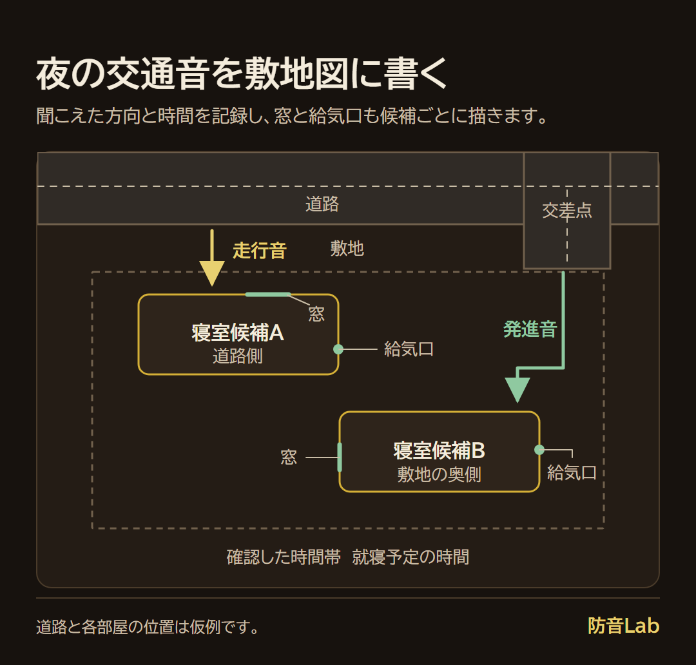

<RegionBanner />

道路沿いの注文住宅で寝室を防音するなら、就寝時間帯の音と方向を確かめ、部屋の候補位置と窓・給気口を一緒に検討します。

注文住宅の間取りガイドでは、寝室に入る外の音を考えるとき、窓や換気口の位置を確認項目にしています。

敷地図への記入例をもとに、設計者に見せるメモを用意できます。

## 道路沿いの注文住宅では寝室を決める前に夜の音を確認する

道路沿いの注文住宅では、就寝予定の時間帯に現地の音を聞き、道路側と敷地の奥側でどう違うかを寝室の防音計画に使います。

私なら、聞く時刻をそろえるため、同じ夜に立ち入れる場所から両方の候補を確認します。

車が途切れたときに静かになるのか、交差点から発進音が聞こえるのかもメモに残します。

| 聞いた場所 | 時間と音源 | 敷地図への記入例（仮例） |
| --- | --- | --- |
| 道路側の候補 | 就寝予定の時間帯に、道路の正面から車の走行音 | 道路側に音の矢印。寝室候補Aと記入 |
| 敷地の奥側の候補 | 同じ時間帯に、敷地の横から交差点の発進音 | 交差点の方向に矢印。寝室候補Bと記入 |
| 確認できなかった時間帯 | 休日の夜や明け方など、未確認の時間帯 | 日時を書き、再確認の候補にする |

地上で聞いた音は、完成後の寝室内での聞こえ方を検討する手がかりです。

上階を候補にする場合は、寝室の高さと道路との位置関係も設計者に見てもらいます。

外構やほかの部屋を含めて検討するときは、[注文住宅で防音室を作る間取りのポイント](/ja/soundproof-room/custom-home-soundproof-room-layout/)も参考になります。

## 寝室の窓と給気口は位置と使い方を合わせて考える

寝室の窓の防音を考えるときは、窓の向きと仕様に加え、就寝中に使う給気口の位置も図面で確かめます。

道路側に寝室を置く案なら、窓を別の面に向けられるか、朝の光をどこから取るかを聞きます。

敷地の奥側に置く案でも、横の道路や交差点の方向に窓が向く場合は、その位置を比較表に入れます。

私なら、寝室の位置ごとに、窓を閉めて寝る日と窓を開けて過ごしたい日の両方を伝えます。

給気口については、外気を取り入れる位置と風の通り道を設備図に示してもらいます。

## 間取りの打ち合わせで寝室の防音を確認する

間取りの打ち合わせでは、現地で聞こえた騒音を図面に書き、自分の希望と設計者の回答を並べます。

| こちらから伝える内容 | 設計者に書いてもらう回答 |
| --- | --- |
| 夜に気になった音とその方角 | 寝室候補ごとの道路との位置関係 |
| 朝の光を入れたい方向 | 窓の向き、開き方、候補のサッシやガラス |
| 就寝中に希望する換気の使い方 | 給気口の位置、換気の経路と運転条件 |
| 道路側と奥側で迷っている理由 | 各案で変わる収納や動線、追加費用があればその項目 |

交通騒音の公開データを持っている場合は、測定地点と時間帯を現地メモに添えます。

すでに入居している家で音の入り口を探すなら、[寝室の騒音を音の種類ごとに切り分ける方法](/ja/soundproof-rental/bedroom-noise-type-solution-guide/)が役立ちます。

窓の仕様を比べるときは、[戸建ての窓の防音対策と遮音窓の選び方](/ja/soundproof-room/shanon-vs-bouon-window/)も参考になります。

## まとめ

敷地図に道路と交差点、聞こえた音の方向、確認した時間帯を書き、寝室候補ごとに窓と給気口の位置を記入します。

次の打ち合わせでは、その敷地図を設計者に渡し、道路側と奥側の案を見せてもらってください。

